# Edge cases

<Callout type="warn">
This page is temporary review material for the pull request that introduces spec version 9, and is removed before merge. The written review is [Review: single orchestrator](/docs/changelog/single-orchestrator-review).
</Callout>

Each scenario has a timeline, the outcome, and the page that explains the mechanism. The facts come from the review page and were checked against the code at the references given; anything not checked says so.

| Scenario | Status |
|---|---|
| [Lease stall overlap](#lease-stall-overlap) | Handled by the fence |
| [Self-superseded 412](#self-superseded-412) | Fixed |
| [Crash between commit and dispatch](#crash-between-commit-and-dispatch) | Handled by the creator rules |
| [Coalesced timer losing its re-arm](#coalesced-timer-losing-its-re-arm) | Fixed |
| [Two concurrent sleeps](#two-concurrent-sleeps) | Fixed |
| [Run-ahead stop re-runs step bodies](#run-ahead-stop-re-runs-step-bodies) | Accepted, bounded |
| [Replay divergence recovered in place](#replay-divergence-recovered-in-place) | Handled |
| [Deadline handoff and the inline-start margin](#deadline-handoff-and-the-inline-start-margin) | Handled, one extra hop |
| [Stream-flush handoff](#stream-flush-handoff) | Handled |
| [Coalesced re-runs exhausted](#coalesced-re-runs-exhausted) | Fixed |
| [`run.wakeUp()` lost under coalescing](#runwakeup-lost-under-coalescing) | Accepted |
| [Spec 8 retry chains over 12 hours](#spec-8-retry-chains-over-12-hours) | Fixed |
| [Older SDK after a rollback](#older-sdk-after-a-rollback) | Known limitation |
| [world-postgres resets `attempt`](#world-postgres-resets-attempt) | Known gap |
| [Inline retry re-sent past the 24-hour dedupe](#inline-retry-re-sent-past-the-24-hour-dedupe) | Known gap, not verified |
| [Long step retries on Vercel](#long-step-retries-on-vercel) | Known cost |
| [QuickJS differences](#quickjs-differences) | Known differences |

## Lease stall overlap

An orchestrator's event loop blocks past its queue lease, for example in a CPU-heavy inline step. The queue redelivers the message and a second orchestrator starts.

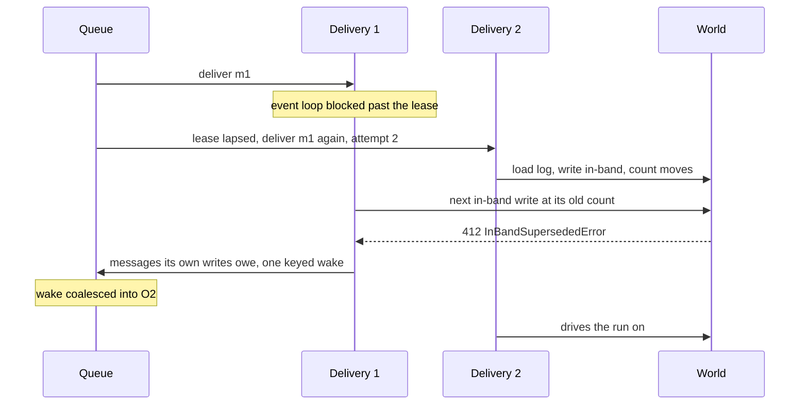

**Outcome.** Nothing is written twice, and O2 drives the run. What the queue answers to O1's acknowledgment of a lapsed lease is not verified here. Mechanism: [The in-band fence and its 412s](/docs/changelog/single-orchestrator-diagrams/in-band-fence) (`packages/core/src/runtime/spec9/delivery.ts:1010`).

## Self-superseded 412

The world-vercel backend also answers 412 when it sealed the writer's own position (its put outlived the staleness bound), or after a 409 that allocated a position and moved the count past the writer's. No other orchestrator exists.

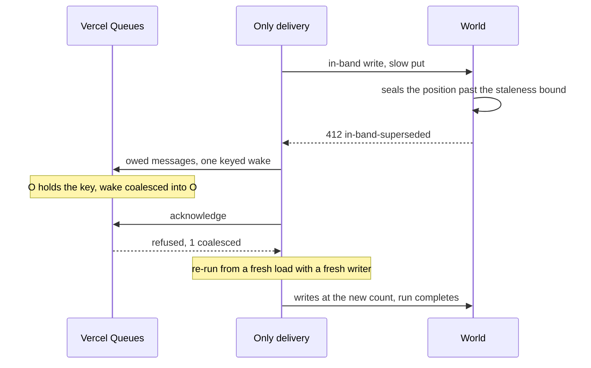

**Outcome.** Before the fix, a refused delivery acknowledged with no wake and the run stopped until something else woke it. Now it sends one keyed wake. On world-local and world-postgres the wake is delivered after the running delivery. A delivery refused on every pass ends after 32 re-runs with a handoff. Tests: `packages/core/src/runtime/spec9/fenced-overlap.runtime.test.ts`. Mechanism: [The in-band fence and its 412s](/docs/changelog/single-orchestrator-diagrams/in-band-fence) (`packages/core/src/runtime/spec9/delivery.ts:1033`).

## Crash between commit and dispatch

A delivery commits a background step's `step_created` and dies before it sends the step's message.

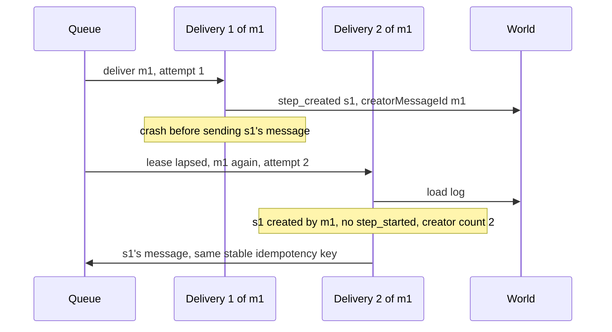

**Outcome.** The redelivery re-sends the message. A delivery after a handoff of a first delivery has creator count 1 and re-sends nothing, as a new message would not (`stepsToReenqueue`, `packages/core/src/runtime/spec9/creator-rules.ts:22`; creator count `packages/core/src/runtime/spec9/delivery.ts:344`). Mechanism: [Step ownership and data](/docs/changelog/single-orchestrator-diagrams/step-ownership).

## Coalesced timer losing its re-arm

Earlier rule: only a wait's own timer delivery armed the chain's next timer. A keyed timer that came due while a hook or step wake held the run was coalesced, and the holder completed the wait but armed nothing.

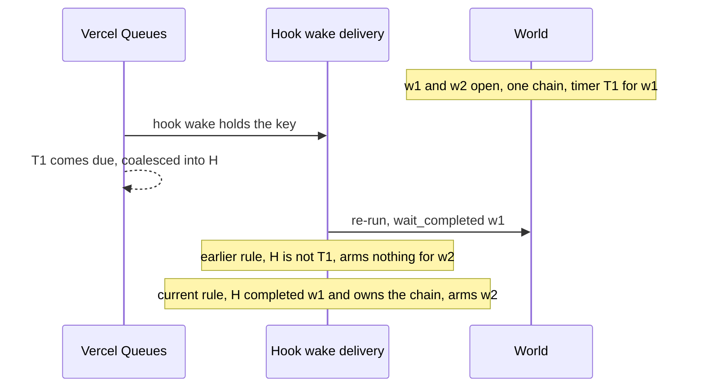

**Outcome.** Fixed: the delivery that completes a wait owns its chain, whatever message it is (`ownedWaitChains`, `packages/core/src/runtime/spec9/creator-rules.ts:116`). The same loss hit a coalesced intermediate hop of a long sleep, which is why intermediate hops are unkeyed. Tests: `packages/core/src/runtime/spec9/wait-chains.runtime.test.ts`. Mechanism: [Timers and waits](/docs/changelog/single-orchestrator-diagrams/timers-and-waits).

## Two concurrent sleeps

`await Promise.all([sleep("1h"), sleep("2h")])`. One timer covers the chain's earliest wait.

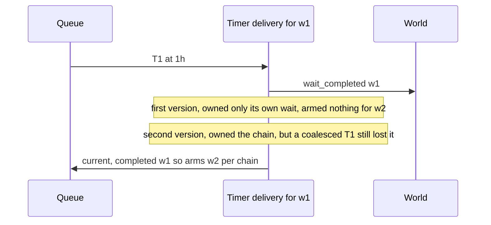

**Outcome.** Fixed twice: first by letting a timer own its chain, then by letting the completing delivery own it. A delivery owning waits of two chains also used to arm only the earliest of all; it now arms the earliest of each chain (`waitTimersToArm`, `packages/core/src/runtime/spec9/creator-rules.ts:176`). e2e did not catch the original bug, because its only parallel sleeps have equal durations. Residual: a delivery that commits `wait_completed` and dies before its next send leaves that chain without a timer, unless it was the timer's own delivery; no test covers it. Mechanism: [Timers and waits](/docs/changelog/single-orchestrator-diagrams/timers-and-waits).

## Run-ahead stop re-runs step bodies

A run-ahead stop (`RunAheadStopError`) lets the outcomes still allowed commit, sends what its writes owe, reloads, and replays from cold in the same delivery with run-ahead off. A step whose body started ahead of its creation, and whose creation the stop refused, has no committed start, so the restarted pass runs its body again.

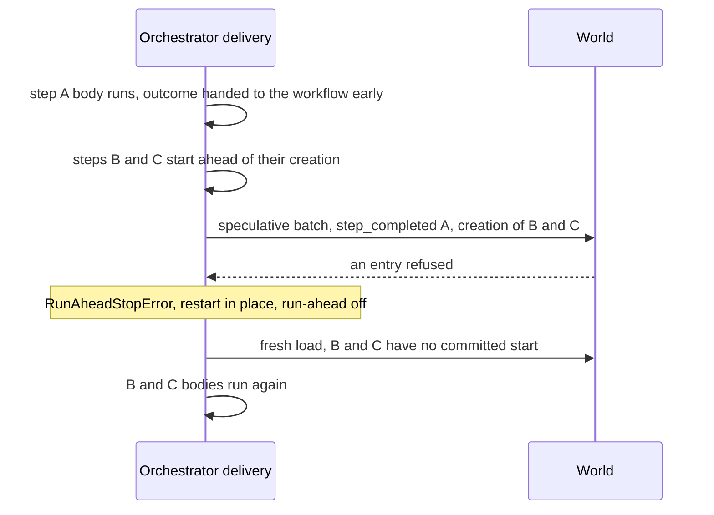

**Outcome.** Up to `WORKFLOW_RUN_AHEAD_DEPTH` bodies can run twice per stop. The default in code is 10 (`RUN_AHEAD_DEPTH`, `packages/core/src/runtime/constants.ts:410`). A step with `maxRetries: 0` never starts before its start commits (`mayRunBeforeItsStart`, `packages/core/src/runtime/spec9/step-executor.ts:79`). A second stop after the one restart hands off (`MAX_RUN_AHEAD_RESTARTS`, 1).

Stops in the code come from a refused speculative batch entry, a World that does not store `occurredAt` as `createdAt` (which also turns run-ahead off for that World), and the hazard check (`packages/core/src/runtime/spec9/delivery.ts:2153`, `:2227`, `:1956`). The review names a hook payload for an awaited hook as a trigger; in the code, an awaited hook makes the boundary not inert, so the orchestrator does not run ahead past it, and the hazard check is documented as ruled out by the classification and the fence (`packages/core/src/runtime/spec9/delivery.ts:1908`). Which events trigger a stop in practice is not verified. Mechanism: [Run-ahead and turbo](/docs/changelog/single-orchestrator-diagrams/run-ahead-and-turbo).

## Replay divergence recovered in place

A replay diverges from the log.

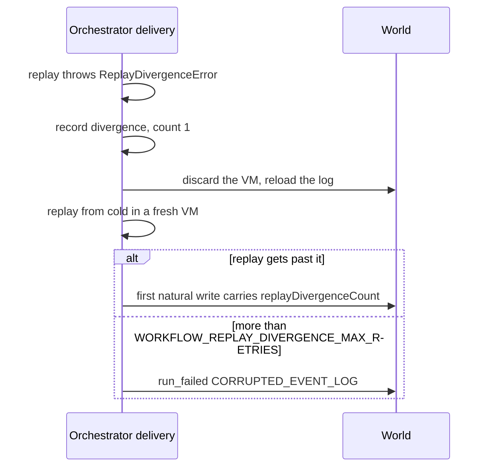

**Outcome.** Up to `WORKFLOW_REPLAY_DIVERGENCE_MAX_RETRIES` (3, `packages/core/src/runtime/constants.ts:378`) recoveries in the same delivery, counted in memory (`recordDivergence`, `packages/core/src/runtime/spec9/delivery.ts:3877`). The count starts again across crashes and redeliveries, where the delivery cap bounds it. Spec 9 no longer sends a `replayDivergence` message; spec 8 still does. QuickJS has no divergence recovery. Mechanism: [Run lifecycle](/docs/changelog/single-orchestrator-diagrams/run-lifecycle).

## Deadline handoff and the inline-start margin

The inline deadline is 2, 5 or 10 minutes from the invocation's start, by the function's maximum duration (`getMaxInlineDurationMs`, `packages/core/src/runtime/delivery.ts:319`). No inline step starts within `WORKFLOW_INLINE_STEP_DEADLINE_MARGIN_MS` (60 seconds) of it (`packages/core/src/runtime/spec9/deadline.ts:31`).

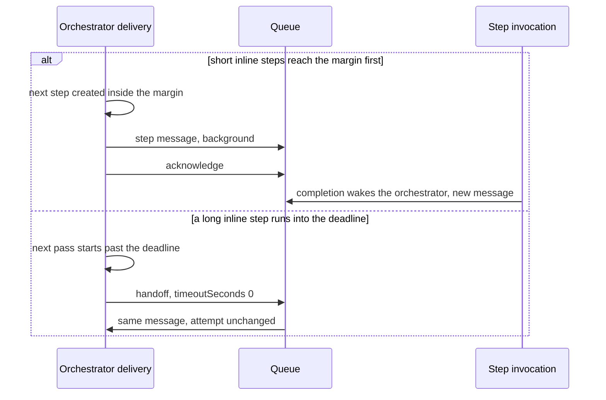

**Outcome.** Both continue the run. The margin path costs a step invocation and a queue hop where a handoff would cost a redelivery; handing off at the margin is not implemented. The handoff is not an attempt. Mechanism: [Queue topology](/docs/changelog/single-orchestrator-diagrams/queue-topology) (`packages/core/src/runtime/spec9/delivery.ts:2410`).

## Stream-flush handoff

An inline step returns while its stream writes are still flushing in `waitUntil`, for example `request.respondWith()` in a webhook step.

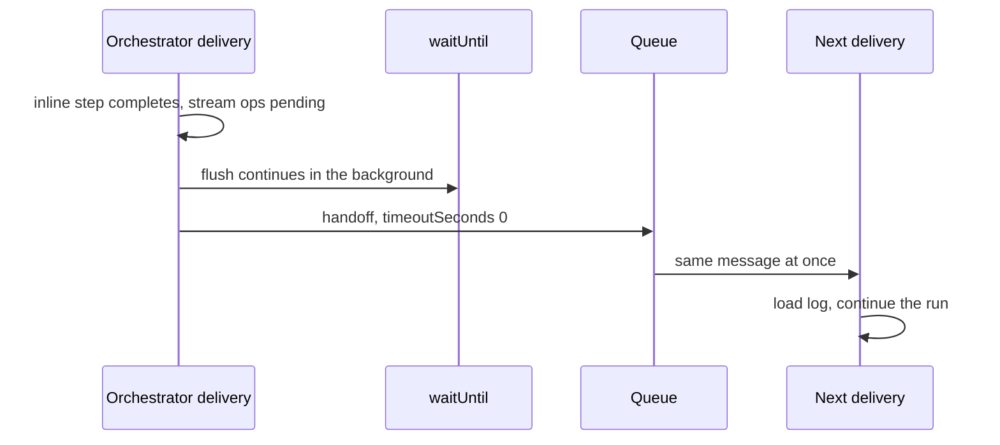

**Outcome.** The delivery ends so the flush can finish, and the run continues in the handoff (`pending-stream-ops`, `packages/core/src/runtime/spec9/delivery.ts:3629`). The e2e `webhookWorkflow` test exercises it. Mechanism: [Queue topology](/docs/changelog/single-orchestrator-diagrams/queue-topology).

## Coalesced re-runs exhausted

A busy run, such as a fan-out whose completions keep arriving, finds more coalesced messages on every acknowledgment.

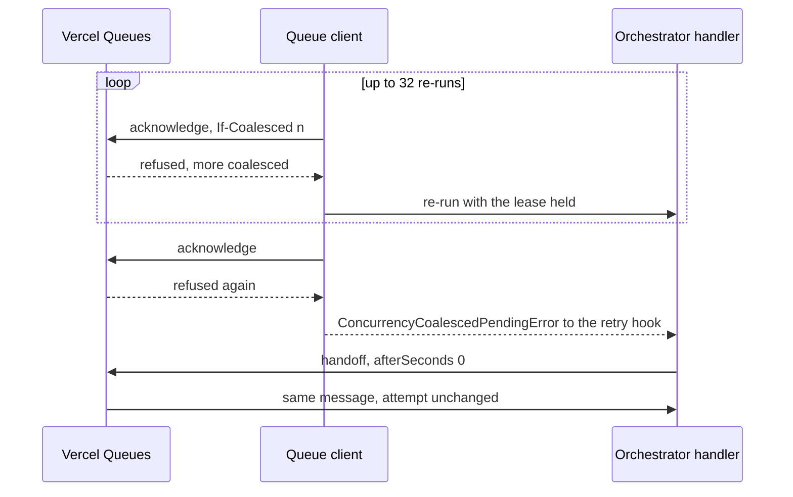

**Outcome.** Fixed: the retry hook used to back off and count an attempt, so a long busy fan-out could reach the delivery cap. Now it hands off (`packages/world-vercel/src/queue.ts:1039`). Each re-run measures the inline deadline from `invocationStartedAt`, so re-runs do not extend the invocation past its deadline. Mechanism: [Queue topology](/docs/changelog/single-orchestrator-diagrams/queue-topology), [Fan-out](/docs/changelog/single-orchestrator-diagrams/fan-out).

## `run.wakeUp()` lost under coalescing

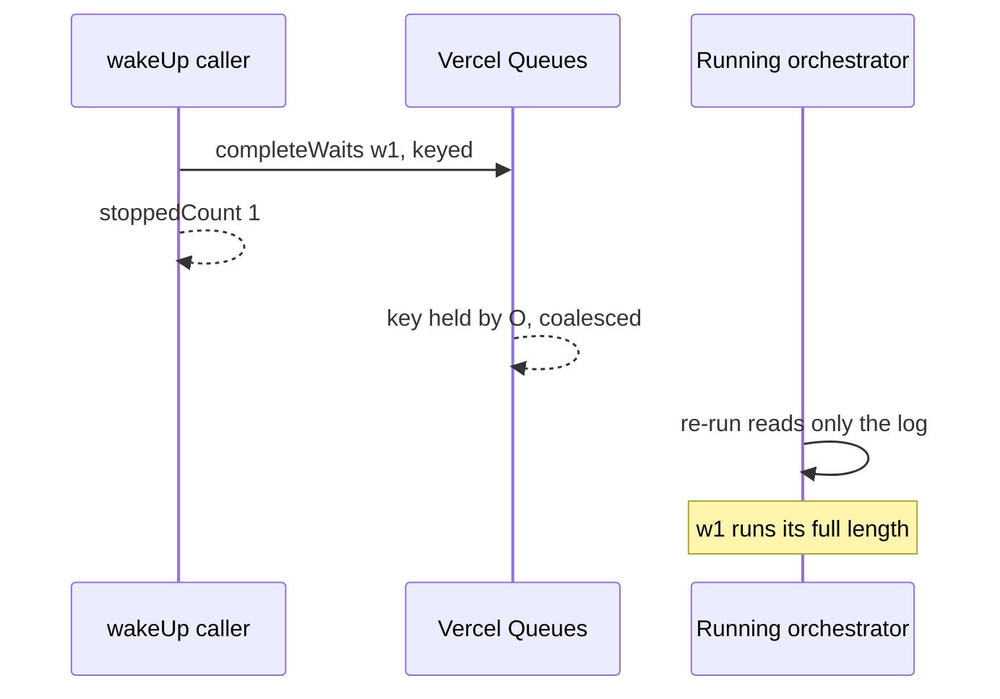

**Outcome.** Accepted: `wakeUp()` is best-effort on world-vercel while an orchestrator delivery holds the key, and reliable when the run is suspended and on world-local and world-postgres (`packages/core/src/runtime/runs.ts:468`). The unkeyed wake it replaced had two bugs when an orchestrator was running: a fence-losing wake dropped `completeWaits`, and a fence-winning one refused the running orchestrator's `step_completed`, so an open inline step's body ran twice. Mechanism: [Timers and waits](/docs/changelog/single-orchestrator-diagrams/timers-and-waits).

## Spec 8 retry chains over 12 hours

An earlier version of this PR redelivered the same message for every `{ timeoutSeconds }` result, spec 8 included.

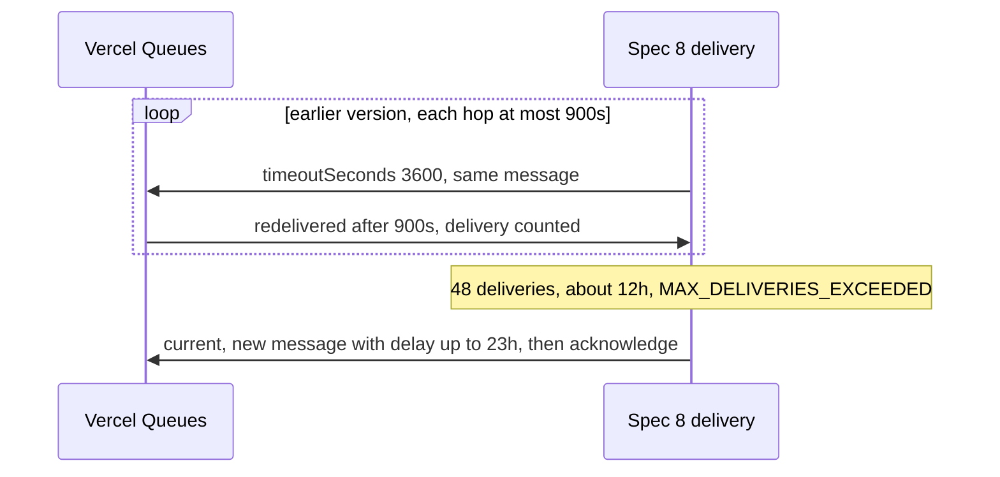

**Outcome.** Fixed: a spec 8 run's `{ timeoutSeconds }` sends a new message before acknowledging, as on `main` (`packages/world-vercel/src/queue.ts:984`). Unit-tested; per the review, not run against Vercel. Mechanism: [Queue topology](/docs/changelog/single-orchestrator-diagrams/queue-topology).

## Older SDK after a rollback

A deployment on an SDK without spec 9 writes to a spec 9 run, for example a rolled-back production deployment whose API route calls `resumeHook()` or `cancel()`.

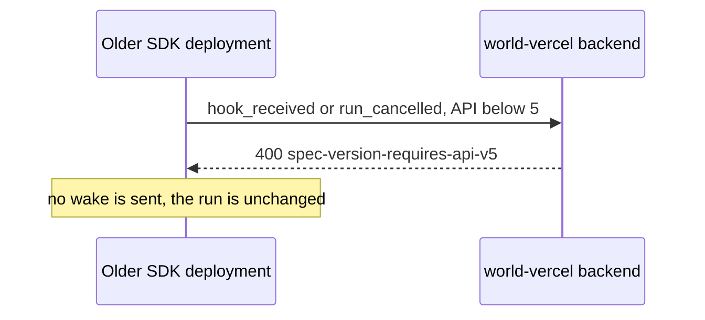

**Outcome.** The older SDK cannot resume hooks on, or cancel, spec 9 runs. Reads still work. The run's own deliveries stay on the deployment that created it, so the run keeps going; only callers on the older SDK fail. Mechanism: [Spec routing](/docs/changelog/single-orchestrator-diagrams/spec-routing).

## world-postgres resets `attempt`

Every `{ timeoutSeconds }` result on world-postgres, a handoff included, reschedules on a new Graphile job. `attempt` comes from that job's own counter plus an `attemptOffset` that the reschedule carries unchanged.

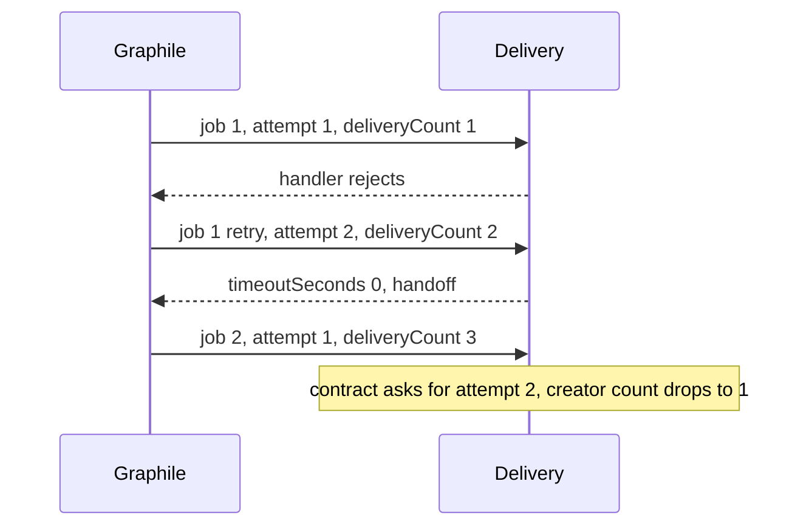

**Outcome.** Known gap, not fixed. A crash redelivery that then hands off loses its creator re-send on the next delivery, so a step message lost in the crash window is not re-sent and the run can strand. Whether a redelivery can hand off before it reaches its re-send point is not known. A reschedule also resets what the delivery cap counts. The review verified the sequence with a scratch test; I read the code (`packages/world-postgres/src/queue.ts:962`, `:1052`) and did not rerun it. Mechanism: [Queue topology](/docs/changelog/single-orchestrator-diagrams/queue-topology).

## Inline retry re-sent past the 24-hour dedupe

An inline step's retry moves to the background with a `retryAfter` beyond 24 hours. Its retry message can be re-sent after Vercel Queues' 24-hour idempotency window has passed, and then two messages own one step's body.

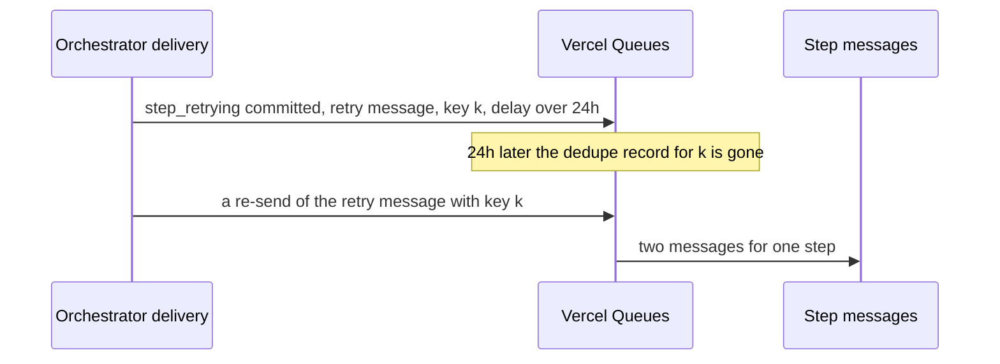

**Outcome.** Known gap, reported by a reviewer, predates this PR. Not verified: I did not trace which path re-sends the retry message after 24 hours. Step messages with retries are retained up to 7 days (`stepMessageRetentionSeconds`, `packages/core/src/runtime/spec9/step-retention.ts:25`), and `QueueOptions.idempotencyKey` documents the Vercel Queues dedupe window as `min(retention, 24h)` (`packages/world/src/queue.ts:717`). Mechanism: [Step ownership and data](/docs/changelog/single-orchestrator-diagrams/step-ownership).

## Long step retries on Vercel

A spec 9 step retries in place: its handler returns `{ timeoutSeconds: n }` with `n` from `retryAfter`, and the same message is redelivered. Vercel Queues clamps a redelivery to 900 seconds.

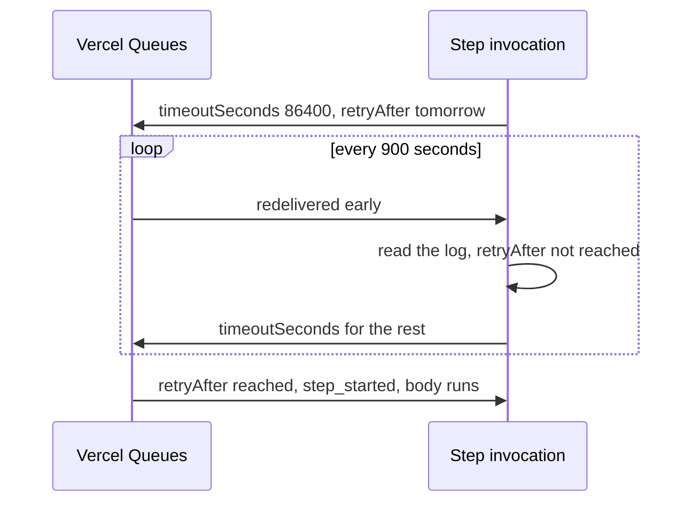

**Outcome.** About 96 invocations a day for a day-long backoff, where `main` sends a new message of up to 23 hours. Not measured (`decideStepDelivery`, `packages/core/src/runtime/spec9/step-delivery.ts:60`; `MAX_REDELIVERY_DELAY_SECONDS`, `packages/world-vercel/src/queue.ts:334`). Mechanism: [Step ownership and data](/docs/changelog/single-orchestrator-diagrams/step-ownership).

## QuickJS differences

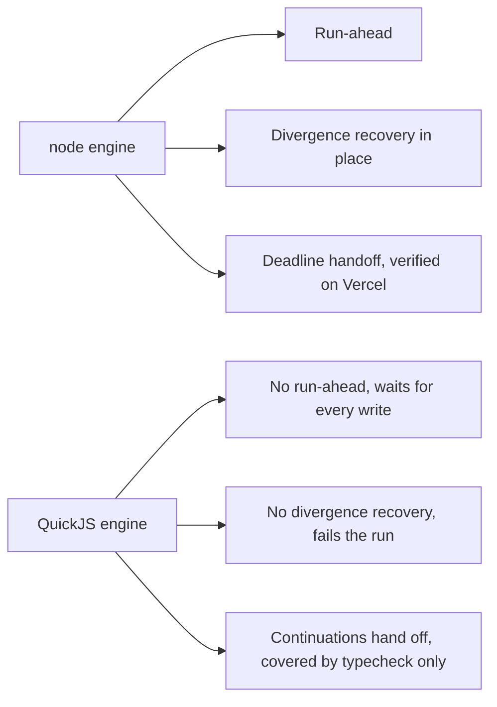

**Outcome.** On QuickJS, run-ahead stops, their restarts and the out-of-band `wait_completed` hazard never occur, and a VM failure fails the run as before this change (`packages/core/src/runtime/spec9/quickjs-entrypoint.ts` has no run-ahead or divergence-recovery code). Its exit continuations (replay budget, an elapsed wait, an unread write of its own) hand off through `continueInNextDelivery` (`packages/core/src/runtime/spec9/delivery.ts:1533`), and no test triggers them. Mechanism: [Run-ahead and turbo](/docs/changelog/single-orchestrator-diagrams/run-ahead-and-turbo).
