# Edge cases

<Callout type="warn">
This page is temporary review material for the pull request that introduces spec version 9, and is removed before merge. The written review is [Review: single orchestrator](/docs/changelog/single-orchestrator-review).
</Callout>

Each scenario has a timeline, the outcome, and the page that explains the mechanism. The facts come from the review page and were checked against the code at the references given; anything not checked says so.

| Scenario | Status |
|---|---|
| [Lease stall overlap](#lease-stall-overlap) | Handled by the fence |
| [Self-superseded 412](#self-superseded-412) | Fixed |
| [Two deliveries of one message, one dies owing a send](#two-deliveries-of-one-message-one-dies-owing-a-send) | Fixed (6b4c0cea3b) |
| [Crash between commit and dispatch](#crash-between-commit-and-dispatch) | Handled by the re-send rule |
| [Creator's redelivery coalesced away](#creators-redelivery-coalesced-away) | Fixed (1ddbe7497f; inline retries `008530f26c`) |
| [A new wait's creator coalesced away](#a-new-waits-creator-coalesced-away) | Fixed (`e3018c00c3`) |
| [A timer delivery's redelivery coalesced away](#a-timer-deliverys-redelivery-coalesced-away) | Fixed (`af8f076626`) |
| [world-local restart](#world-local-restart) | Fixed (1a808df572) |
| [Lost completion wake](#lost-completion-wake) | Fixed (`76643fe621`) |
| [Inline `maxRetries: 0` step after an orchestrator crash](#inline-maxretries-0-step-after-an-orchestrator-crash) | Fixed (`75ddd45207`) |
| [Background body before a refused start](#background-body-before-a-refused-start) | Behavior change, accepted |
| [Uncoalesced wakes on world-local and world-postgres](#uncoalesced-wakes-on-world-local-and-world-postgres) | Open follow-up |
| [Coalesced timer losing its re-arm](#coalesced-timer-losing-its-re-arm) | Fixed |
| [Rotated start message re-entering turbo](#rotated-start-message-re-entering-turbo) | Fixed (`1a02e52b42`) |
| [Near-due re-arms on every delivery](#near-due-re-arms-on-every-delivery) | Fixed (`dcddeb7378`) |
| [world-postgres re-send next to a locked job](#world-postgres-re-send-next-to-a-locked-job) | Fixed (`ab3713146b`) |
| [Two concurrent sleeps](#two-concurrent-sleeps) | Fixed |
| [Run-ahead stop re-runs step bodies](#run-ahead-stop-re-runs-step-bodies) | Accepted, bounded |
| [Replay divergence recovered in place](#replay-divergence-recovered-in-place) | Handled |
| [Deadline handoff and the inline-start margin](#deadline-handoff-and-the-inline-start-margin) | Handled, one extra hop |
| [Stream-flush handoff](#stream-flush-handoff) | Handled |
| [Coalesced re-runs exhausted](#coalesced-re-runs-exhausted) | Fixed |
| [`run.wakeUp()` lost under coalescing](#runwakeup-lost-under-coalescing) | Accepted |
| [Spec 8 retry chains over 12 hours](#spec-8-retry-chains-over-12-hours) | Fixed |
| [Older SDK after a rollback](#older-sdk-after-a-rollback) | Known limitation |
| [world-postgres resets `attempt`](#world-postgres-resets-attempt) | Handoff fixed; delayed reschedule still resets |
| [Inline retry re-sent past the 24-hour dedupe](#inline-retry-re-sent-past-the-24-hour-dedupe) | Fixed |
| [Long step retries on Vercel](#long-step-retries-on-vercel) | Known cost |
| [QuickJS differences](#quickjs-differences) | Known differences |

## Lease stall overlap

An orchestrator's event loop blocks past its queue lease, for example in a CPU-heavy inline step. The queue redelivers the message and a second orchestrator starts.

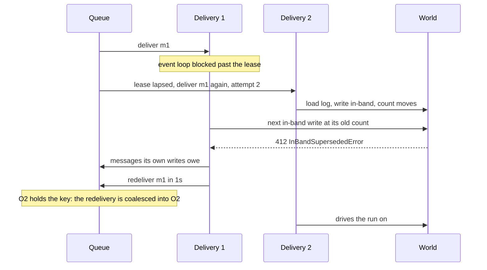

**Outcome.** Nothing is written twice, and O2 drives the run. O1 never acknowledges, so the question of what the queue does with an acknowledgment of a lapsed lease no longer arises. Mechanism: [The in-band fence and its 412s](/docs/changelog/single-orchestrator-diagrams/in-band-fence) (`packages/core/src/runtime/spec9/delivery.ts:1011`).

## Self-superseded 412

The world-vercel backend also answers 412 when it sealed the writer's own position (its put outlived the staleness bound), or after a 409 that allocated a position and moved the count past the writer's. No other orchestrator exists.

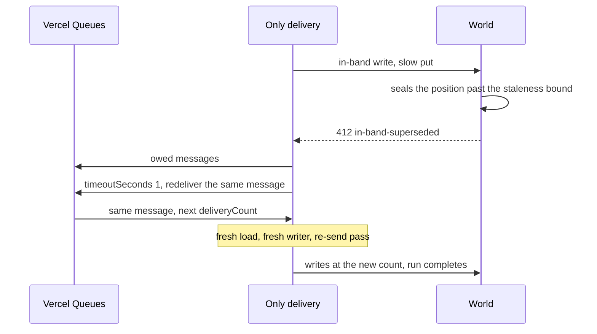

**Outcome.** Before the first fix, a refused delivery acknowledged with no wake and the run stopped until something else woke it. A second version sent one keyed wake and acknowledged, which still stranded the case below. Now the delivery asks for a counted redelivery of its own message. A delivery refused on every pass reaches the delivery cap and fails the run, where the World counts the redelivery as an attempt (not on world-postgres). Tests: `packages/core/src/runtime/spec9/fenced-overlap.runtime.test.ts`. Mechanism: [The in-band fence and its 412s](/docs/changelog/single-orchestrator-diagrams/in-band-fence).

## Two deliveries of one message, one dies owing a send

A delivery D1 of m1 outlives its lease and m1 is delivered again as D2. Both load the same log. D1 commits a background step's `step_created` and dies before the step's message goes out; D2's next write is refused.

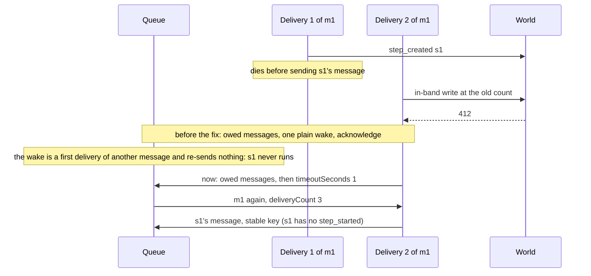

**Outcome.** Fixed ([4365355467](https://github.com/vercel/workflow/pull/4661#discussion_r4365355467), commit 6b4c0cea3b). The redelivery is not its message's first, so the re-send rule sends s1. Test: `two deliveries of one message after a lease lapse` in `packages/core/src/runtime/spec9/fenced-overlap.runtime.test.ts`, both engines; it strands without the fix. Mechanism: [Step ownership and data](/docs/changelog/single-orchestrator-diagrams/step-ownership).

## Crash between commit and dispatch

A delivery commits a background step's `step_created` and dies before it sends the step's message.

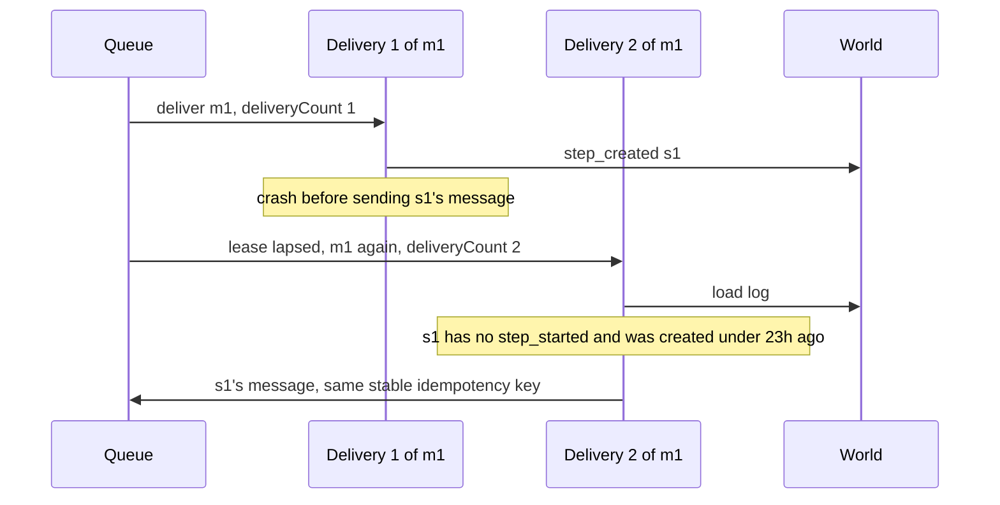

**Outcome.** The redelivery re-sends the message. So does a continuation after a handoff, or a coalesced re-run: any orchestrator delivery counted above 1, once per invocation (`stepsToReenqueue`, `invocationResends`, `packages/core/src/runtime/spec9/creator-rules.ts`). A step whose first message still lives dedupes the re-send. Mechanism: [Step ownership and data](/docs/changelog/single-orchestrator-diagrams/step-ownership).

## Creator's redelivery coalesced away

The delivery that created s1 fails before s1's message goes out (a crash, or a lapsed lease). A hook wake H takes the run's key first, and the creator's redelivery is coalesced into H, so it is never delivered.

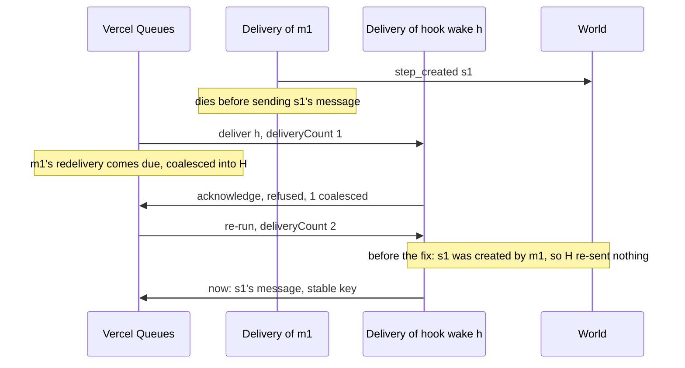

**Outcome.** Fixed ([4365355501](https://github.com/vercel/workflow/pull/4661#discussion_r4365355501), commit 1ddbe7497f): the re-send rule no longer asks which message created the step. A holder in retry backoff was never affected (the queue keeps its key, so a wake folds into it). Test: `spec9/step-resend.runtime.test.ts`, both engines, which also covers a handoff continuation, one re-send per invocation across coalesced re-runs, and the age bound. Mechanism: [Step ownership and data](/docs/changelog/single-orchestrator-diagrams/step-ownership).

The same shape stranded an inline step whose first attempt failed: the delivery commits its `step_retrying`, fails before the retry message goes out, and its redelivery is coalesced into a hook wake. Only a later delivery of the message that wrote the `step_retrying` re-sent it, and the orchestrator never runs a retried inline step inline again, so the step had no owner. Fixed (`008530f26c`): any delivery counted above 1 re-sends a creator-stamped `step_retrying` that is the step's last event, within the same 23-hour bound counted from that write. Test: `spec9/step-resend.runtime.test.ts`, both engines, with an inline first attempt.

## A new wait's creator coalesced away

The delivery that creates a sleep commits `wait_created` and fails before its timer goes out. A hook wake H takes the run's key, and the creator's redelivery is coalesced into H.

```mermaid
sequenceDiagram
    participant Q as Vercel Queues
    participant M as Delivery of m1
    participant H as Delivery of hook wake h
    participant W as World
    Note over M,W: before the fix
    M->>W: wait_created w1, 1h, creator m1
    Note over M: dies before sending w1's timer
    Q->>H: deliver h
    Note over Q: m1's redelivery comes due, coalesced into H
    Note over H: H owns no chain, w1 is an hour out, arms nothing
    Note over M,W: now
    M->>Q: w1's timer, key wait:w1:R:R
    M->>W: wait_created w1
    Note over M: dies; the timer is already out
```

**Outcome.** Fixed (`e3018c00c3`): a pass sends the timer of its chain's earliest new wait before the `wait_created` commits, on both engines. If the commit then fails, the stray timer finds no wait or re-arms the one the redelivery created. Tests: `spec9/wait-chains.runtime.test.ts`, both engines, for a failed timer send and a lost creation response. Mechanism: [Timers and waits](/docs/changelog/single-orchestrator-diagrams/timers-and-waits#who-arms-a-timer).

## A timer delivery's redelivery coalesced away

Three sleeps of one chain. The first one's timer T1 completes its sleep and fails right after the commit; T1's redelivery is coalesced into a wake that owns no chain.

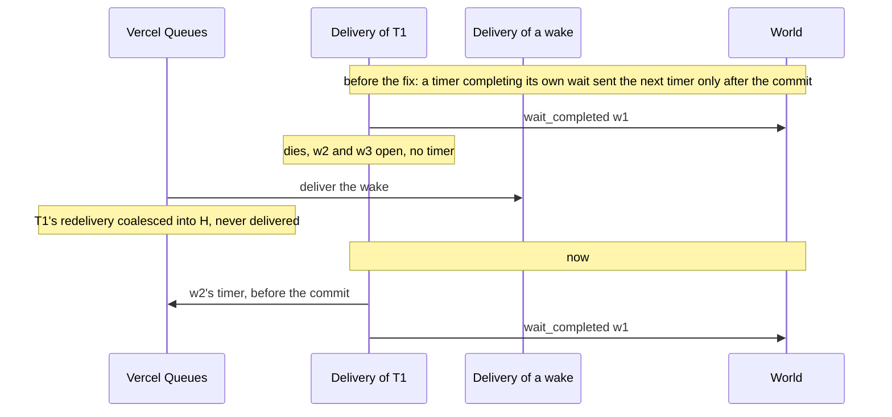

**Outcome.** Fixed (`af8f076626`): `chainTimersBeforeCompletion` no longer leaves out the wait a timer delivery is for. A redelivery of the timer still owns its chain, and the extra send it may make is deduplicated by the hop's key. Test: `spec9/wait-chains.runtime.test.ts`, both engines. Mechanism: [Timers and waits](/docs/changelog/single-orchestrator-diagrams/timers-and-waits#who-arms-a-timer).

## world-local restart

world-local's queue is in memory. A restart loses every step message and timer a run had queued, and its recovery wake is a new message on its first delivery.

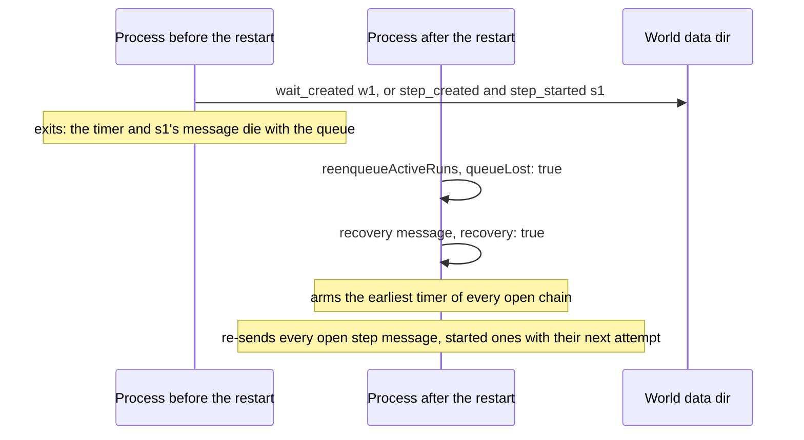

**Outcome.** Fixed ([4365355546](https://github.com/vercel/workflow/pull/4661#discussion_r4365355546), commit 1a808df572). Before it, a spec 9 run sleeping, or waiting on a background step mid-body, stayed `running` while spec 8 completed. world-postgres's queue persists, so it sets no marker. Tests: spec 9 rows in `packages/core/src/runtime/world-local-restart-recovery.test.ts`, both engines; each fails without the marker. Mechanism: [Timers and waits](/docs/changelog/single-orchestrator-diagrams/timers-and-waits).

## Lost completion wake

A background step commits its outcome, and sending its orchestrator wake fails. That wake is the only thing that moves the run on: the node orchestrator arms no backstop for background steps on spec 9.

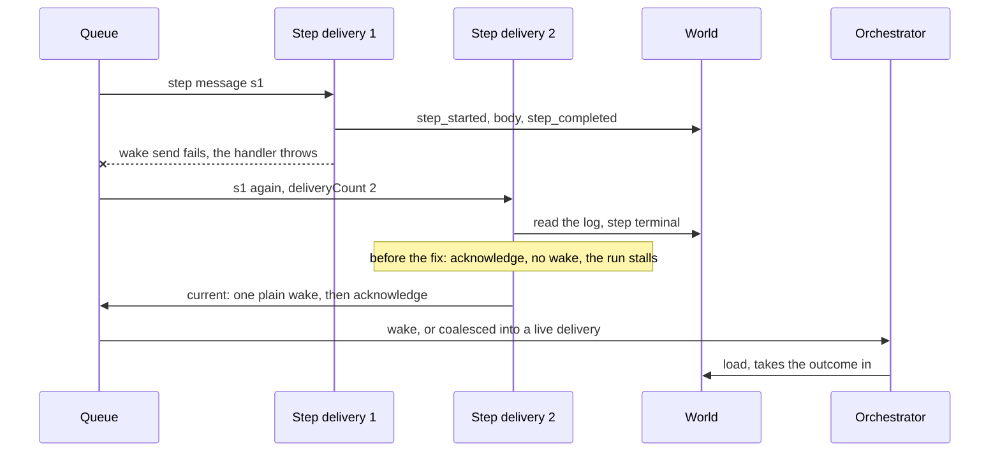

**Outcome.** Fixed in commit `76643fe621`: a redelivery whose decision is to acknowledge because the step is terminal (`step-terminal` in `packages/core/src/runtime/spec9/step-delivery.ts:87`) sends the plain wake again (`packages/core/src/runtime/spec9/step-handler.ts:167`). A live orchestrator absorbs it, and one with nothing new acknowledges it after a tail read. A run-terminal acknowledgment still sends nothing. Test: `re-sends the wake when a redelivered step message finds the step terminal` in `packages/core/src/runtime/spec9/orchestrator.runtime.test.ts`, both engines. Mechanism: [Step ownership and data](/docs/changelog/single-orchestrator-diagrams/step-ownership).

## Inline `maxRetries: 0` step after an orchestrator crash

An orchestrator commits an inline `maxRetries: 0` step's `step_started` and dies before the outcome.

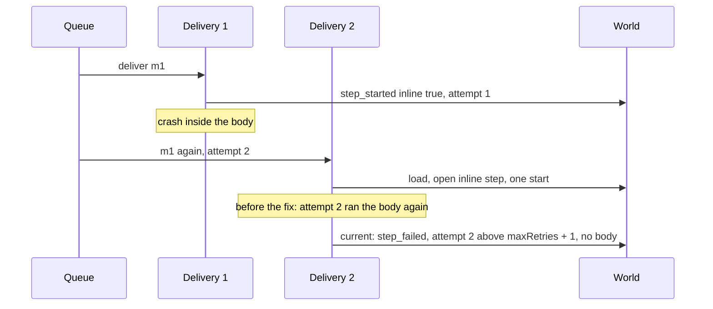

**Outcome.** Fixed in commit `75ddd45207`: `executeStep` fails an attempt past `maxRetries + 1` without running the body (`packages/core/src/runtime/spec9/step-executor.ts:403`), for inline and background steps alike. Only a background step's own message checked this before. It also covers a winner re-running a refused overlap's open inline step. Test: `runs an inline maxRetries: 0 step at most once across an orchestrator crash` in `packages/core/src/runtime/spec9/orchestrator.runtime.test.ts`, both engines. Mechanism: [Step ownership and data](/docs/changelog/single-orchestrator-diagrams/step-ownership).

## Background body before a refused start

Only under the opt-in `WORKFLOW_OPTIMISTIC_BACKGROUND_START=1`: on a plain first delivery, a background step that allows retries starts its body while its `step_started` is in flight. Commit `83ee22003e` made this the default; it is now off by default, and the body runs only once its start committed.

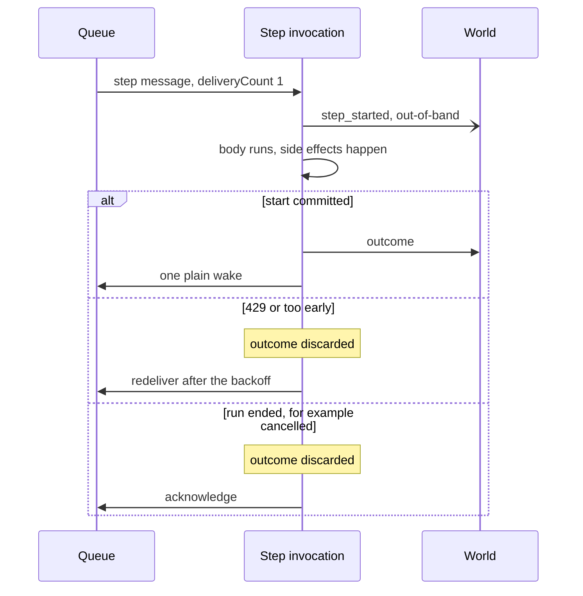

**Outcome.** By default the awaited start is refused first and the body never runs, as on spec 8. With the opt-in, on a cancelled run or under throttling the body runs before the refusal arrives, and a throttled start runs the body again on the redelivery. A `maxRetries: 0` step and every delivery that reads the log keep the awaited start even with the opt-in, and `WORKFLOW_OPTIMISTIC_INLINE_START=0` wins over it (`forceOptimisticStart`, `packages/core/src/runtime/spec9/step-handler.ts`; `isOptimisticBackgroundStartEnabled`, `packages/core/src/runtime/constants.ts`; `mayRunBeforeItsStart`, `packages/core/src/runtime/spec9/step-executor.ts:79`). Tests in `packages/core/src/runtime/spec9/orchestrator.runtime.test.ts` and `suspension.runtime.test.ts`. Mechanism: [Step ownership and data](/docs/changelog/single-orchestrator-diagrams/step-ownership).

## Uncoalesced wakes on world-local and world-postgres

Both mint spec 9 runs by default and serialize a run's orchestrator deliveries, but neither coalesces.

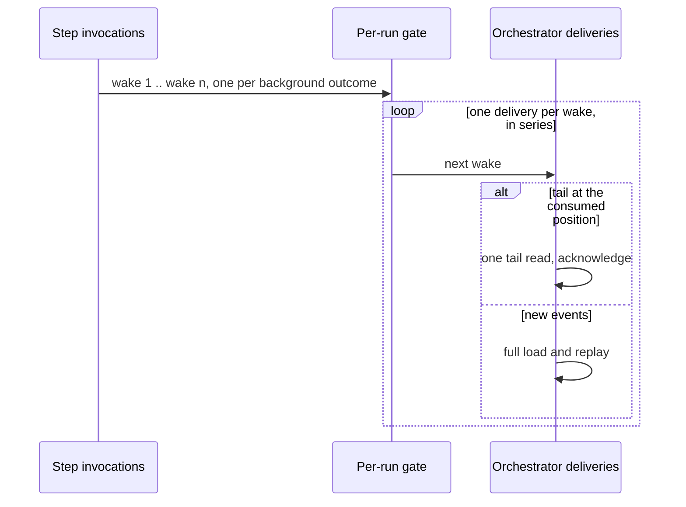

**Outcome.** Open follow-up: a fan-out of `n` background steps costs `n` orchestrator deliveries in series. world-vercel under `WORKFLOW_SEQUENTIAL_REPLAYS=1` has the same shape with one function invocation per wake. What the two Worlds would need (re-runs with the gate held, the coalesced count, `invocationStartedAt`, a handoff at the front of the run's queue) is on [Queue topology](/docs/changelog/single-orchestrator-diagrams/queue-topology#follow-up-coalescing-on-world-local-and-world-postgres).

## Coalesced timer losing its re-arm

Earlier rule: only a wait's own timer delivery armed the chain's next timer. A keyed timer that came due while a hook or step wake held the run was coalesced, and the holder completed the wait but armed nothing.

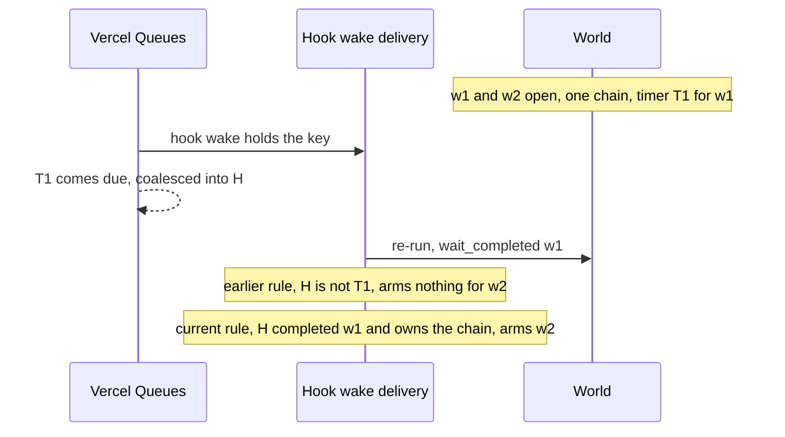

**Outcome.** Fixed: the delivery that completes a wait owns its chain, whatever message it is (`ownedWaitChains`, `packages/core/src/runtime/spec9/creator-rules.ts:116`). A final timer coalesced a little before its wait is due, into a delivery that does not own it, is covered by the near-due rule: the holder's re-run re-arms every wait due within a few seconds, under a key (`66b355d28c`, `dcddeb7378`). The same loss hit a coalesced intermediate hop of a long sleep, which is why intermediate hops carry no concurrency key. Tests: `packages/core/src/runtime/spec9/wait-chains.runtime.test.ts`. Mechanism: [Timers and waits](/docs/changelog/single-orchestrator-diagrams/timers-and-waits).

## Rotated start message re-entering turbo

A run's start message hands off for hours, and world-vercel continues it on a new message near its expiry.

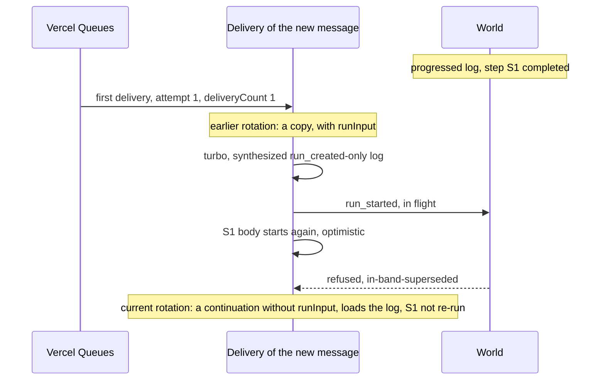

**Outcome.** Fixed (`1a02e52b42`): a rotation sends `singleOrchestratorContinuationPayload(payload)`, which drops `runInput` and the other first-delivery and per-request fields and stamps the spec version; a step message is not rotated. Tests: `packages/core/src/runtime/spec9/turbo.runtime.test.ts`, both engines. Mechanism: [Queue topology](/docs/changelog/single-orchestrator-diagrams/queue-topology#rotation-near-expiry).

## Near-due re-arms on every delivery

A fan-out of `step(i); sleep('3s')` whose outcomes each wake the run in their own delivery. Every sleep is near-due as soon as it is created.

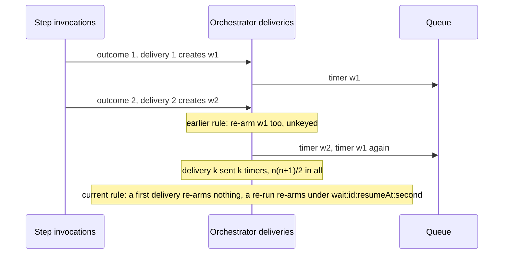

**Outcome.** Fixed (`dcddeb7378`): 210 timers became 20 at width 20, and 1600 became 1 on QuickJS at width 40 with every step done before the first wake. Tests: `packages/core/src/runtime/spec9/near-due-timers.runtime.test.ts`, both engines, on a clock that honours delays and keys. Mechanism: [Timers and waits](/docs/changelog/single-orchestrator-diagrams/timers-and-waits#near-due-re-arms).

## world-postgres re-send next to a locked job

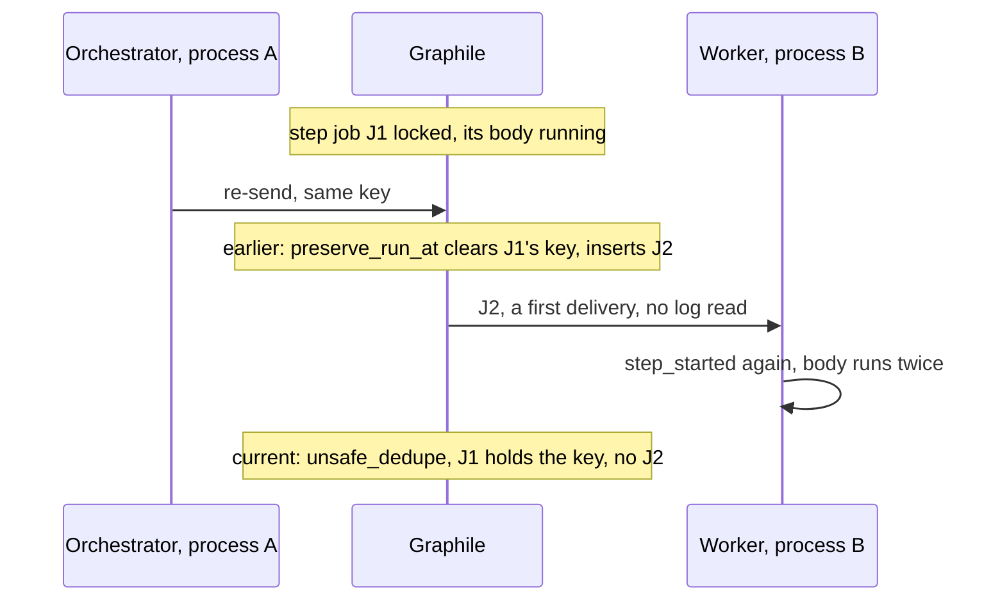

**Outcome.** Fixed (`ab3713146b`): a spec 9 run's keyed sends use `unsafe_dedupe`, so a re-send next to a locked job adds nothing, and one next to a job in retry backoff keeps its attempts and `run_at`. Spec 8 keyed sends keep `preserve_run_at` and the same exposure, unverified. Tests: `packages/world-postgres/test/queue-dedupe.test.ts`, against Docker Postgres. Mechanism: [Queue topology](/docs/changelog/single-orchestrator-diagrams/queue-topology#world-local-and-world-postgres).

## Two concurrent sleeps

`await Promise.all([sleep("1h"), sleep("2h")])`. One timer covers the chain's earliest wait.

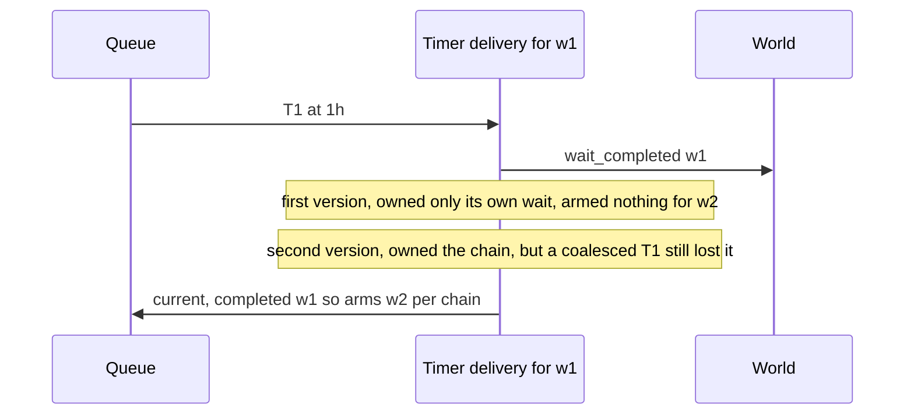

**Outcome.** Fixed twice: first by letting a timer own its chain, then by letting the completing delivery own it. A delivery owning waits of two chains also used to arm only the earliest of all; it now arms the earliest of each chain (`waitTimersToArm`, `packages/core/src/runtime/spec9/creator-rules.ts:176`). e2e did not catch the original bug, because its only parallel sleeps have equal durations. The residual this page listed, a delivery that commits `wait_completed` and dies before its next send, is fixed: the next timer goes out before the commit (`3ba56bbd43`, tests in `wait-chains.runtime.test.ts`). Mechanism: [Timers and waits](/docs/changelog/single-orchestrator-diagrams/timers-and-waits).

## Run-ahead stop re-runs step bodies

A run-ahead stop (`RunAheadStopError`) lets the outcomes still allowed commit, sends what its writes owe, reloads, and replays from cold in the same delivery with run-ahead off. A step whose body started ahead of its creation, and whose creation the stop refused, has no committed start, so the restarted pass runs its body again.

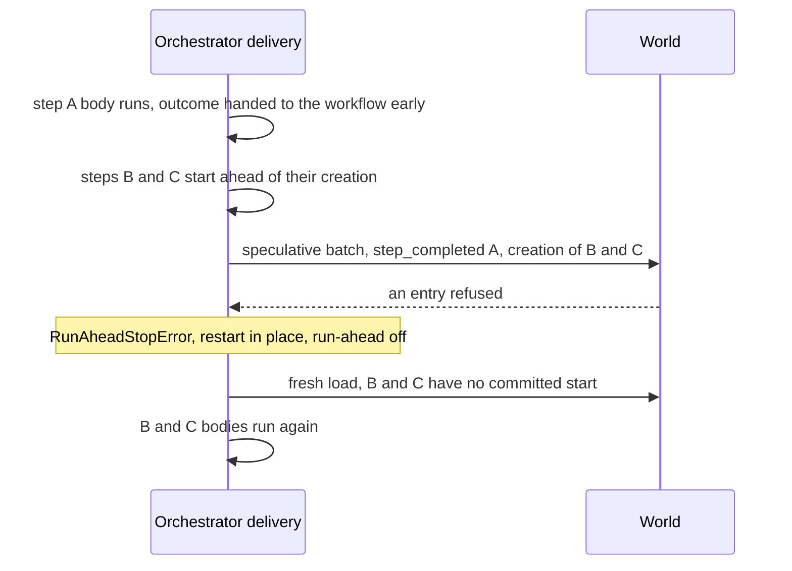

**Outcome.** Up to `WORKFLOW_RUN_AHEAD_DEPTH` bodies can run twice per stop. The default in code is 10 (`RUN_AHEAD_DEPTH`, `packages/core/src/runtime/constants.ts:411`). A step with `maxRetries: 0` never starts before its start commits (`mayRunBeforeItsStart`, `packages/core/src/runtime/spec9/step-executor.ts:79`). A second stop after the one restart hands off (`MAX_RUN_AHEAD_RESTARTS`, 1).

Stops in the code come from a refused speculative batch entry, a World that does not store `occurredAt` as `createdAt` (which also turns run-ahead off for that World), and the hazard check (`packages/core/src/runtime/spec9/delivery.ts:2160`, `:2234`, `:1963`). An awaited hook is not a trigger: it makes the boundary not inert, so the orchestrator does not run ahead past it, and the hazard check is documented as ruled out by the classification and the fence (`packages/core/src/runtime/spec9/delivery.ts:1915`). Which events trigger a stop in practice is not verified. Mechanism: [Run-ahead and turbo](/docs/changelog/single-orchestrator-diagrams/run-ahead-and-turbo).

## Replay divergence recovered in place

A replay diverges from the log.

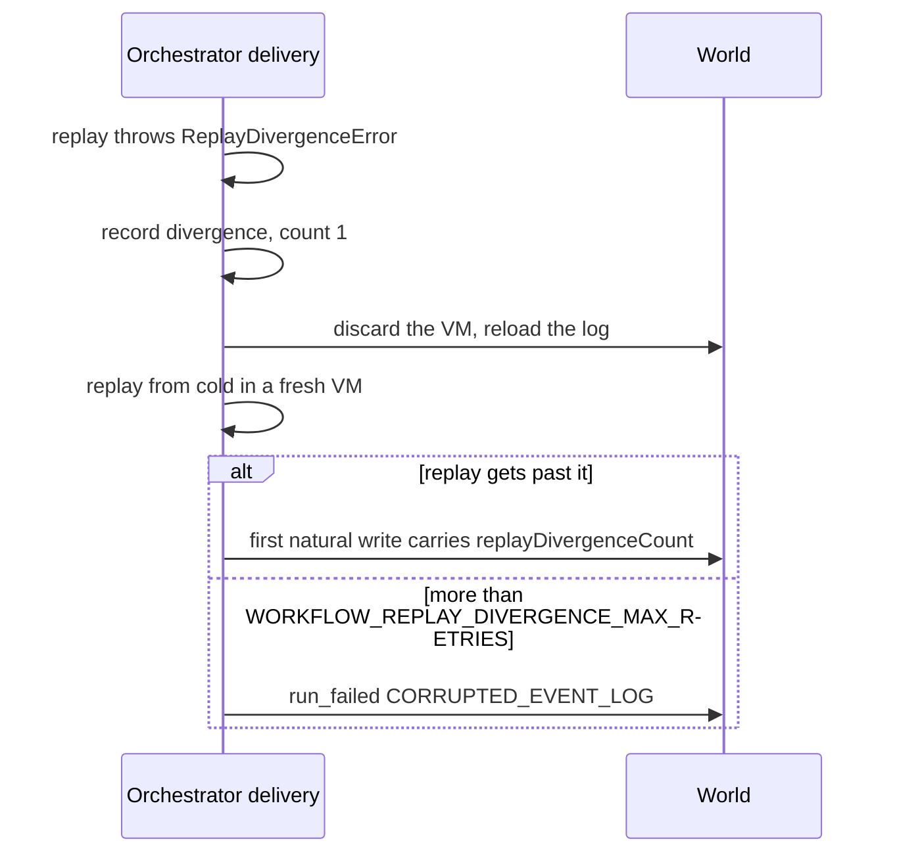

**Outcome.** Up to `WORKFLOW_REPLAY_DIVERGENCE_MAX_RETRIES` (3, `packages/core/src/runtime/constants.ts:379`) recoveries in the same delivery, counted in memory (`recordDivergence`, `packages/core/src/runtime/spec9/delivery.ts:3916`). The count starts again across crashes and redeliveries, where the delivery cap bounds it. Spec 9 no longer sends a `replayDivergence` message; spec 8 still does. QuickJS has no divergence recovery. Mechanism: [Run lifecycle](/docs/changelog/single-orchestrator-diagrams/run-lifecycle).

## Deadline handoff and the inline-start margin

The inline deadline is 2, 5 or 10 minutes from the invocation's start, by the function's maximum duration (`getMaxInlineDurationMs`, `packages/core/src/runtime/delivery.ts:319`). No inline step starts within `WORKFLOW_INLINE_STEP_DEADLINE_MARGIN_MS` (60 seconds) of it (`packages/core/src/runtime/spec9/deadline.ts:31`).

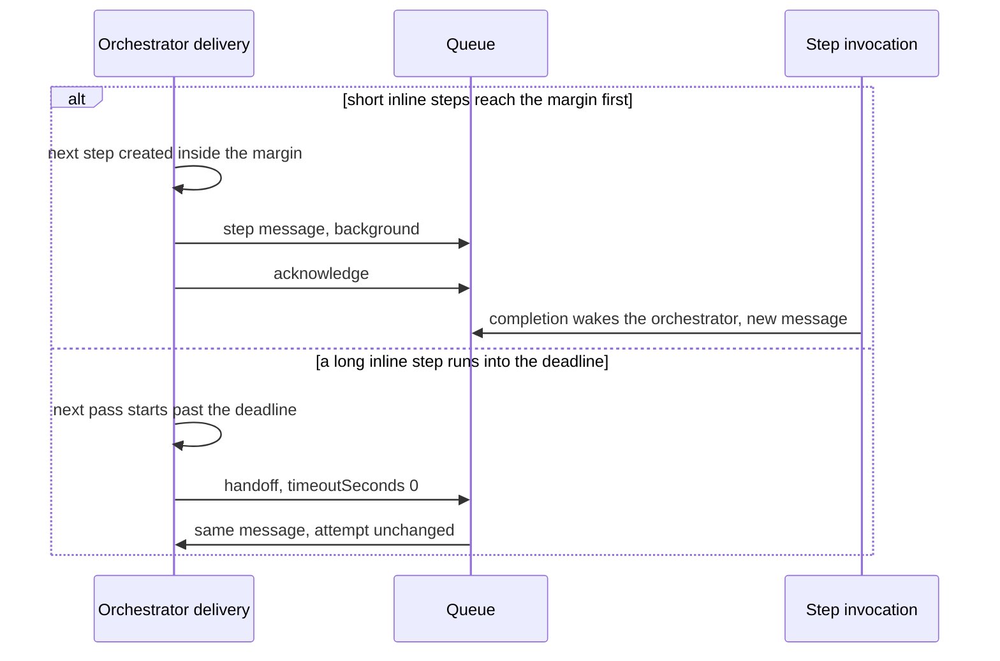

**Outcome.** Both continue the run. The margin path costs a step invocation and a queue hop where a handoff would cost a redelivery; handing off at the margin is not implemented. The handoff is not an attempt. Mechanism: [Queue topology](/docs/changelog/single-orchestrator-diagrams/queue-topology) (`packages/core/src/runtime/spec9/delivery.ts:2417`).

## Stream-flush handoff

An inline step returns while its stream writes are still flushing in `waitUntil`, for example `request.respondWith()` in a webhook step.

```mermaid
sequenceDiagram
    participant O as Orchestrator delivery
    participant WU as waitUntil
    participant Q as Queue
    participant O2 as Next delivery
    O->>O: inline step completes, stream ops pending
    O->>WU: flush continues in the background
    O->>Q: handoff, timeoutSeconds 0
    Q->>O2: same message at once
    O2->>O2: load log, continue the run
```

**Outcome.** The delivery ends so the flush can finish, and the run continues in the handoff (`pending-stream-ops`, `packages/core/src/runtime/spec9/delivery.ts:3649`). The e2e `webhookWorkflow` test exercises it. Mechanism: [Queue topology](/docs/changelog/single-orchestrator-diagrams/queue-topology).

## Coalesced re-runs exhausted

A busy run, such as a fan-out whose completions keep arriving, finds more coalesced messages on every acknowledgment.

```mermaid
sequenceDiagram
    participant Q as Vercel Queues
    participant C as Queue client
    participant O as Orchestrator handler
    loop up to 32 re-runs
        C->>Q: acknowledge, If-Coalesced n
        Q-->>C: refused, more coalesced
        C->>O: re-run with the lease held
    end
    C->>Q: acknowledge
    Q-->>C: refused again
    C-->>O: ConcurrencyCoalescedPendingError to the retry hook
    O->>Q: handoff, afterSeconds 0
    Q->>O: same message, attempt unchanged
```

**Outcome.** Fixed: the retry hook used to back off and count an attempt, so a long busy fan-out could reach the delivery cap. Now it hands off (`packages/world-vercel/src/queue.ts:1039`). Each re-run measures the inline deadline from `invocationStartedAt`, so re-runs do not extend the invocation past its deadline. Mechanism: [Queue topology](/docs/changelog/single-orchestrator-diagrams/queue-topology), [Fan-out](/docs/changelog/single-orchestrator-diagrams/fan-out).

## `run.wakeUp()` lost under coalescing

```mermaid
sequenceDiagram
    participant U as wakeUp caller
    participant Q as Vercel Queues
    participant O as Running orchestrator
    U->>Q: completeWaits w1, keyed
    U-->>U: stoppedCount 1
    Q-->>Q: key held by O, coalesced
    O->>O: re-run reads only the log
    Note over O: w1 runs its full length
```

**Outcome.** Accepted: `wakeUp()` is best-effort on world-vercel while an orchestrator delivery holds the key, and reliable when the run is suspended and on world-local and world-postgres (`packages/core/src/runtime/runs.ts:468`). The unkeyed wake it replaced had two bugs when an orchestrator was running: a fence-losing wake dropped `completeWaits`, and a fence-winning one refused the running orchestrator's `step_completed`, so an open inline step's body ran twice. Mechanism: [Timers and waits](/docs/changelog/single-orchestrator-diagrams/timers-and-waits).

## Spec 8 retry chains over 12 hours

An earlier version of this PR redelivered the same message for every `{ timeoutSeconds }` result, spec 8 included.

```mermaid
sequenceDiagram
    participant Q as Vercel Queues
    participant O as Spec 8 delivery
    loop earlier version, each hop at most 900s
        O->>Q: timeoutSeconds 3600, same message
        Q->>O: redelivered after 900s, delivery counted
    end
    Note over O: 48 deliveries, about 12h, MAX_DELIVERIES_EXCEEDED
    O->>Q: current, new message with delay up to 23h, then acknowledge
```

**Outcome.** Fixed: a spec 8 run's `{ timeoutSeconds }` sends a new message before acknowledging, as on `main` (`packages/world-vercel/src/queue.ts:984`). Unit-tested; per the review, not run against Vercel. Mechanism: [Queue topology](/docs/changelog/single-orchestrator-diagrams/queue-topology).

## Older SDK after a rollback

A deployment on an SDK without spec 9 writes to a spec 9 run, for example a rolled-back production deployment whose API route calls `resumeHook()` or `cancel()`.

```mermaid
sequenceDiagram
    participant Old as Older SDK deployment
    participant B as world-vercel backend
    Old->>B: hook_received or run_cancelled, API below 5
    B-->>Old: 400 spec-version-requires-api-v5
    Note over Old: no wake is sent, the run is unchanged
```

**Outcome.** The older SDK cannot resume hooks on, or cancel, spec 9 runs. Reads still work. The run's own deliveries stay on the deployment that created it, so the run keeps going; only callers on the older SDK fail. Mechanism: [Spec routing](/docs/changelog/single-orchestrator-diagrams/spec-routing).

## world-postgres resets `attempt`

Every `{ timeoutSeconds }` result on world-postgres reschedules on a new Graphile job. `attempt` comes from that job's own counter plus an `attemptOffset`. A spec 9 handoff now carries the attempts so far as `attemptOffset` (`1f7b912923`); a delayed reschedule does not.

```mermaid
sequenceDiagram
    participant G as Graphile
    participant O as Delivery
    G->>O: job 1, attempt 1, deliveryCount 1
    O-->>G: handler rejects
    G->>O: job 1 retry, attempt 2, deliveryCount 2
    O-->>G: timeoutSeconds 0, handoff
    G->>O: job 2, attempt 2, deliveryCount 3
    O-->>G: timeoutSeconds 1, a fence refusal
    G->>O: job 3, attempt 1, deliveryCount 4
```

**Outcome.** The handoff case is fixed. The crash-then-handoff strand is also gone because the re-send rule reads `deliveryCount`, not `attempt`. Still open: a delayed reschedule starts `attempt` over, so on world-postgres a fence refusal's redelivery does not count toward the delivery cap (review page, section 12). Mechanism: [Queue topology](/docs/changelog/single-orchestrator-diagrams/queue-topology).

## Inline retry re-sent past the 24-hour dedupe

An inline step's retry moves to the background with a `retryAfter` beyond 24 hours. A re-send of its retry message after Vercel Queues' 24-hour idempotency window had passed would give one step two messages.

```mermaid
sequenceDiagram
    participant O as Orchestrator delivery
    participant Q as Vercel Queues
    O->>Q: step_retrying committed, retry message, key k, delay over 24h
    Note over Q: 24h later the dedupe record for k is gone
    Note over O: a later delivery counted above 1
    O->>O: step_retrying older than 23h: not re-sent
```

**Outcome.** Fixed ([4365355478](https://github.com/vercel/workflow/pull/4661#discussion_r4365355478)): a `step_retrying` is re-sent only while it is younger than 23 hours (`STEP_RESEND_MAX_AGE_MS`), inside every World's minimum key dedupe window (`b075bd0437`, `030f77499c`). It was also limited to a later delivery of the message that wrote it (`8e6e547804`); that limit stranded the step when that redelivery was coalesced away, and is gone (`008530f26c`, above). A re-sent message is marked (`stepResent`), so a copy the queue takes after the step's outcome reads the log and does not run the body (`7fc895417f`). Test: `spec9/step-resend.runtime.test.ts`, both engines, a retry due two dedupe windows out. Mechanism: [Step ownership and data](/docs/changelog/single-orchestrator-diagrams/step-ownership).

## Long step retries on Vercel

A spec 9 step retries in place: its handler returns `{ timeoutSeconds: n }` with `n` from `retryAfter`, and the same message is redelivered. Vercel Queues clamps a redelivery to 900 seconds.

```mermaid
sequenceDiagram
    participant Q as Vercel Queues
    participant S as Step invocation
    S->>Q: timeoutSeconds 86400, retryAfter tomorrow
    loop every 900 seconds
        Q->>S: redelivered early
        S->>S: read the log, retryAfter not reached
        S->>Q: timeoutSeconds for the rest
    end
    Q->>S: retryAfter reached, step_started, body runs
```

**Outcome.** About 96 invocations a day for a day-long backoff, where `main` sends a new message of up to 23 hours. Not measured (`decideStepDelivery`, `packages/core/src/runtime/spec9/step-delivery.ts:60`; `MAX_REDELIVERY_DELAY_SECONDS`, `packages/world-vercel/src/queue.ts:334`). Mechanism: [Step ownership and data](/docs/changelog/single-orchestrator-diagrams/step-ownership).

## QuickJS differences

```mermaid
flowchart LR
    N["node engine"] --> RA["Run-ahead"]
    N --> DR["Divergence recovery in place"]
    N --> DL["Deadline handoff, verified on Vercel"]
    Q["QuickJS engine"] --> NRA["No run-ahead, waits for every write"]
    Q --> NDR["No divergence recovery, fails the run"]
    Q --> QC["Continuations hand off, covered by typecheck only"]
```

**Outcome.** On QuickJS, run-ahead stops, their restarts and the out-of-band `wait_completed` hazard never occur, and a VM failure fails the run as before this change (`packages/core/src/runtime/spec9/quickjs-entrypoint.ts` has no run-ahead or divergence-recovery code). Its exit continuations (replay budget, an elapsed wait, an unread write of its own) hand off through `continueInNextDelivery` (`packages/core/src/runtime/spec9/delivery.ts:1534`), and no test triggers them. Mechanism: [Run-ahead and turbo](/docs/changelog/single-orchestrator-diagrams/run-ahead-and-turbo).
