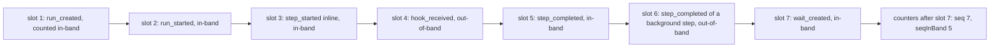
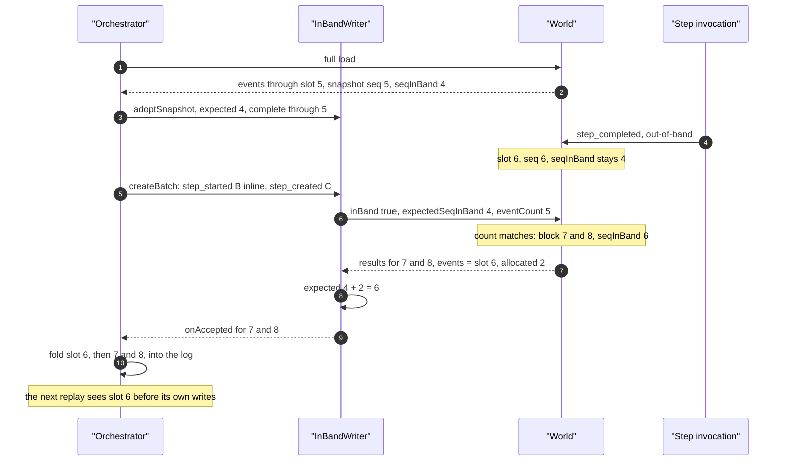
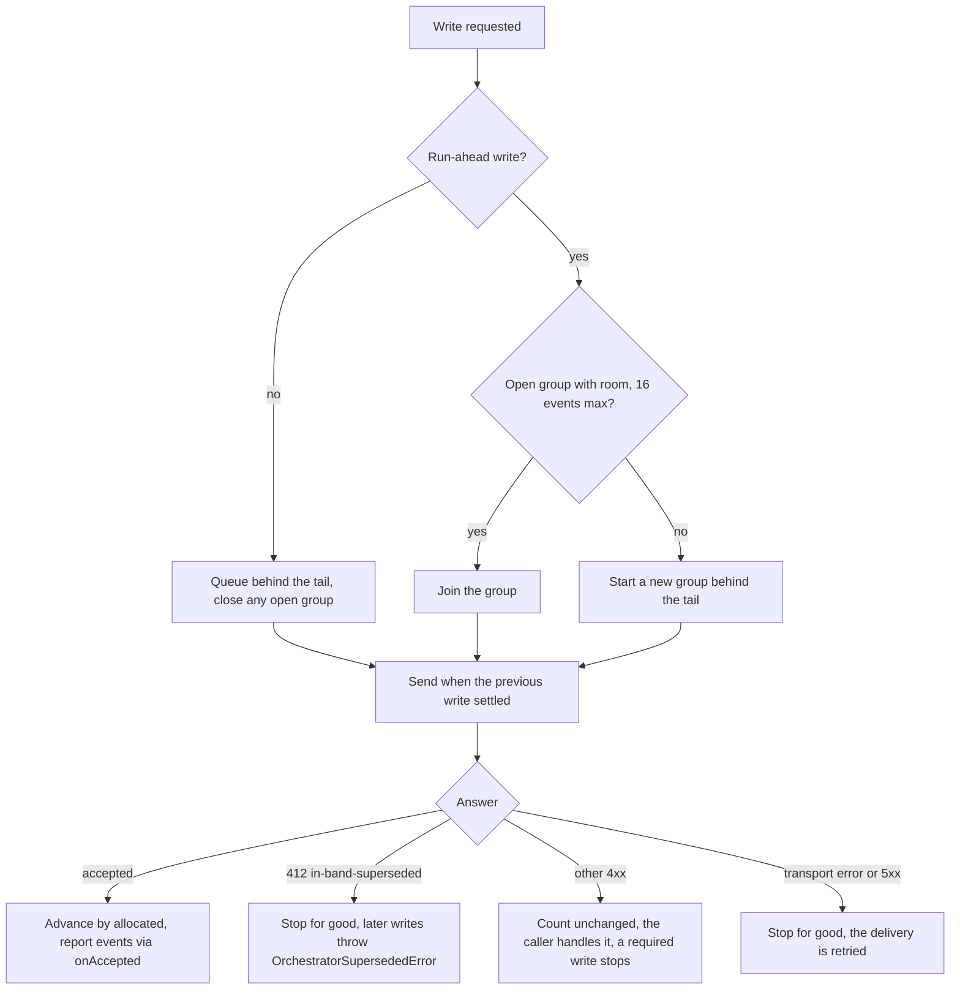
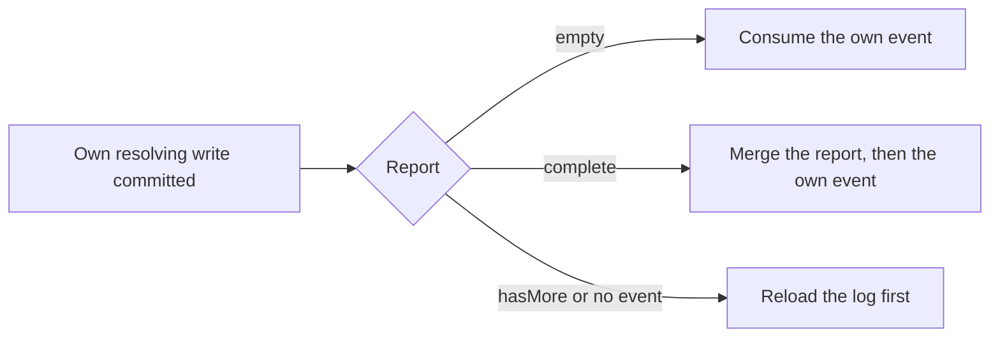
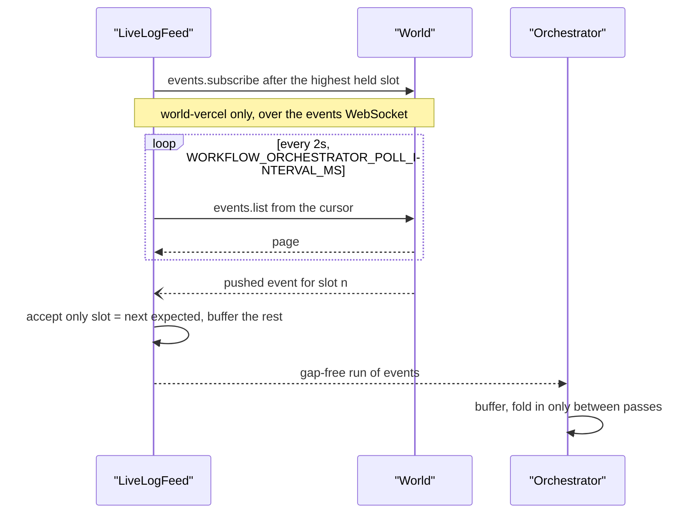

# Event posting

<Callout type="warn">
Temporary review material for the spec 9 pull request, removed before merge. See [Review: single orchestrator](/docs/changelog/single-orchestrator-review).
</Callout>

Every in-band write of one delivery goes through one `InBandWriter` (`packages/core/src/runtime/spec9/in-band-writer.ts:152`). It marks each write `inBand: true`, carries `expectedSeqInBand`, and sends one write at a time. Everything else that writes to the run is out-of-band and never carries a count.

## Slot numbering

Every event of a spec 9 run has a dense, 1-based slot, encoded in its id as `evnt_` plus a zero-padded decimal (`packages/world/src/slot-identity.ts:1`). The World keeps two counters: `seq`, the highest slot handed out to anyone, and `seqInBand`, the number of slots handed out to in-band writes, `run_created` included (`IN_BAND_SEQ_AT_RUN_CREATION = 1`, `packages/world/src/events.ts:1377`).

An out-of-band write moves `seq` only. It never invalidates the orchestrator's count, which is why a hook resume or a background step's outcome can land between two orchestrator writes without refusing either.

## What one write carries

| Field | Set by | Meaning |
|---|---|---|
| `inBand: true` | `fenceParams` (`in-band-writer.ts:796`) | The orchestrator made this write. |
| `expectedSeqInBand` | `fenceParams` | The writer's count: the load snapshot's `seqInBand`, advanced by every accepted write's `allocated`. |
| `eventCount` | `sendPosition` (`in-band-writer.ts:848`) | The slot the decision was made against, raised to the highest slot the writer knows it holds every event below. The World reports what lies between it and the write's own slot. |
| `occurredAt` | run-ahead writes (`packages/core/src/runtime/spec9/delivery.ts:2123`, `delivery.ts:2201`) | The time the workflow already used. On spec 9 the World stores it as the event's `createdAt` (`packages/world/src/interfaces.ts:420`). Writes that are not speculative do not send it, so the World's own time is stored. |

The response carries:

| Field | Meaning |
|---|---|
| `event` / `results` | The committed event, or per-item results of a batch. |
| `allocated` | Positions the write took: 1 for a new event, 0 for an idempotent replay, the admitted items for a batch (`packages/world/src/events.ts:1149`, `events.ts:1348`). |
| `events` | The skipped-slot report: every event in slots `eventCount + 1` up to the write's first slot. |
| `hasMore` | The report is incomplete; the orchestrator reloads before it consumes anything the write resolves. |

## One batched write with a foreign event in between

## Serialization and batches

- **One at a time.** Two concurrent in-band writes would carry the same count and the second would be refused, so the writer chains every write on one promise (`serialize`, `in-band-writer.ts:903`). A fan-out goes out as `createBatch` calls of at most `MAX_BATCH_EVENTS` (16) events (`packages/core/src/runtime/constants.ts:484`, `packages/core/src/runtime/spec9/step-wait-creation.ts:632`).
- **Per-entity order.** A batch on a spec 9 run is not atomic, but once the World refuses an item it refuses every later item with the same `correlationId` (`packages/world/src/interfaces.ts:429`). The world-vercel backend answers those with 409 `batch-earlier-item-failed`. This is what lets one run-ahead group carry a step's creation and its outcome.
- **Run-ahead groups.** Run-ahead writes queued behind a write in flight go out together as one batch when their turn comes (`enqueueAhead`, `in-band-writer.ts:475`); any other write closes the group, so writes are never reordered.

## Consume after commit

A write that resolves a promise in the workflow (`wait_completed`, an inline step's `step_completed` or `step_failed`) is consumed only after it committed and after the events its report names (`packages/core/src/runtime/spec9/consume-after-commit.ts:32`):

The reason: an out-of-band event below the write (a background step's outcome, a `hook_received`, a `run_cancelled`) is consumed first by every later replay, and resolution order is observable through correlation ids and the workflow clock.

## Out-of-band writers

| Writer | Event | Code | Wake it sends |
|---|---|---|---|
| Background step invocation | `step_started`, `step_retrying`, `step_completed`, `step_failed` | `packages/core/src/runtime/spec9/step-handler.ts:146` | Orchestrator message; shared per 1s window while other steps are open (`step-handler.ts:265`) |
| `resumeHook()` | `hook_received` | `packages/core/src/runtime/resume-hook.ts:938` | Orchestrator message, no idempotency key on spec 9 |
| `cancel()` | `run_cancelled` | `packages/core/src/runtime/runs.ts:230`, `packages/core/src/runtime/run.ts:323` | `wakeRunAfterOutOfBandWrite` (`runs.ts:173`) |
| `setAttributes()` in a step body | `attr_set` | `packages/core/src/set-attributes.ts:67` | none |
| `start()` | `run_created` | `packages/core/src/runtime/start.ts:1182` | the run's first message |

Each lands at the next slot when it commits. The orchestrator sees it in three ways: in the skipped-slot report of its next in-band write, in the live feed, or in its next load.

## The live feed

While inline bodies run or the delivery lingers, the orchestrator follows the log tail with a `LiveLogFeed` (`packages/core/src/runtime/spec9/live-feed.ts:62`):

A push that is late, duplicated or out of order is dropped and the poll fills it in, so correctness never depends on the push (`live-feed.ts:167`). world-local has no `subscribe`, so it is the poll alone there, and a delivery on world-local never lingers (`delivery.ts:2339`).

## Edge cases

- **Idempotent replay.** A write answered with an event at a slot the writer already knew allocated nothing, and the count does not move when the World reports no `allocated` (`packages/core/src/runtime/spec9/in-band-writer.ts:821`).
- **No `allocated` from the World.** The writer assumes 1 per create and the whole block per batch, less items answered at known slots (`in-band-writer.ts:383`, `in-band-writer.ts:762`).
- **Per-item batch failure.** A failed item leaves a hole the World seals as a `noop`; the next replay re-derives the event and the next suspension writes it again (`packages/core/src/runtime/spec9/step-wait-creation.ts:486`).
- **Throttle or terminal run in a batch.** A 429 or 410 on an inline step's creation-bearing start is that step's start refusal; any other 429 or a 5xx fails the delivery (`step-wait-creation.ts:499`).
- **Unknown outcome.** A transport error or 5xx may have allocated, so the writer stops for good and the delivery is retried from a fresh load (`in-band-writer.ts:876`).
- **Definite refusal that did allocate.** The writer keeps its count after a non-fence 4xx; when the world-vercel backend had allocated anyway, the next in-band write is refused with 412 and the delivery stands down with a wake (`in-band-writer.ts:877`).
- **Write before any snapshot.** Fails without reaching the World (`in-band-writer.ts:800`).
- **Non-empty log without a snapshot.** Fails the run with a World contract error instead of writing unfenced (`in-band-writer.ts:89`).
- **Payload missing from the response.** The writer fills the event's `eventData` from what it sent, so replay has the bytes (`in-band-writer.ts:955`).
- **Report incomplete or truncated.** `hasMore` marks the log behind and the next pass reloads before replaying (`packages/core/src/runtime/spec9/delivery.ts:675`).
- **Own write above an unreported gap.** If the own slot is more than one above everything held, the log is marked behind instead of merged with a hole (`delivery.ts:688`).
- **Writes queued behind others.** A queued write names the highest slot known complete, not the older slot it was decided from, so its report does not repeat the earlier writes' events (`in-band-writer.ts:848`).
- **Feed echo of own writes.** Feed events at own slots or of own inline steps do not start a pass (`delivery.ts:1599`).
- **World that rewrites `occurredAt`.** A speculative write stored at another time stops the delivery and turns run-ahead off for that World for the process (`delivery.ts:2147`, `packages/core/src/runtime/spec9/run-ahead.ts:145`).
- **Feed failure.** A failed subscribe or poll is logged at debug level and the feed continues on what remains (`live-feed.ts:102`, `live-feed.ts:147`).
