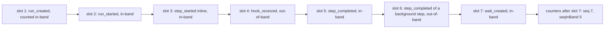
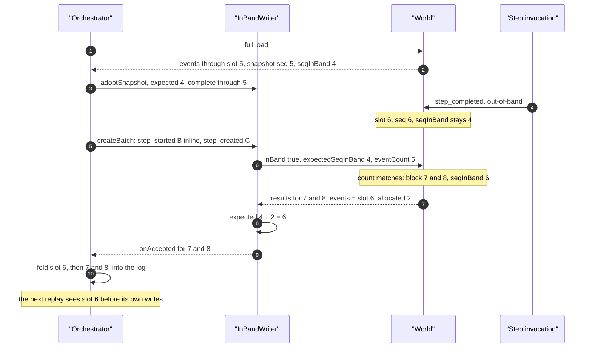
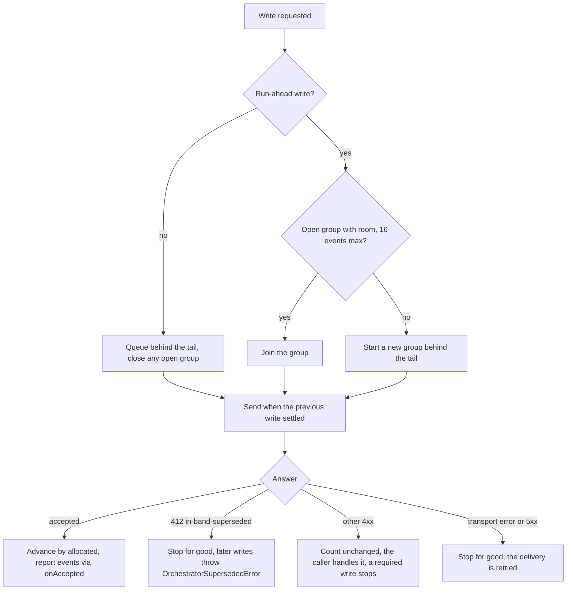
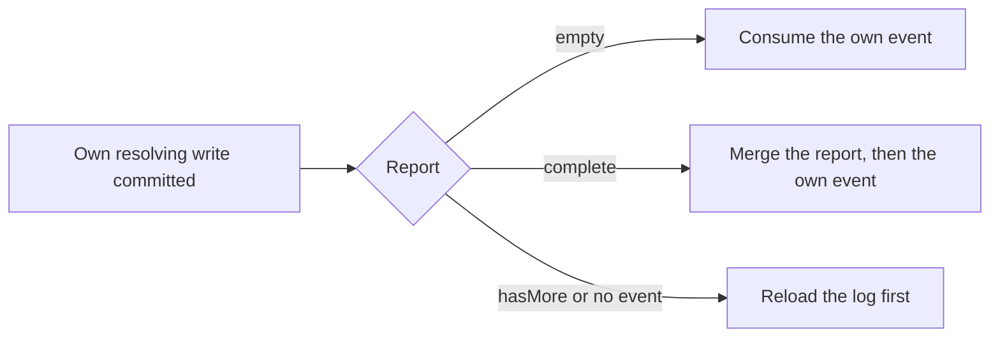
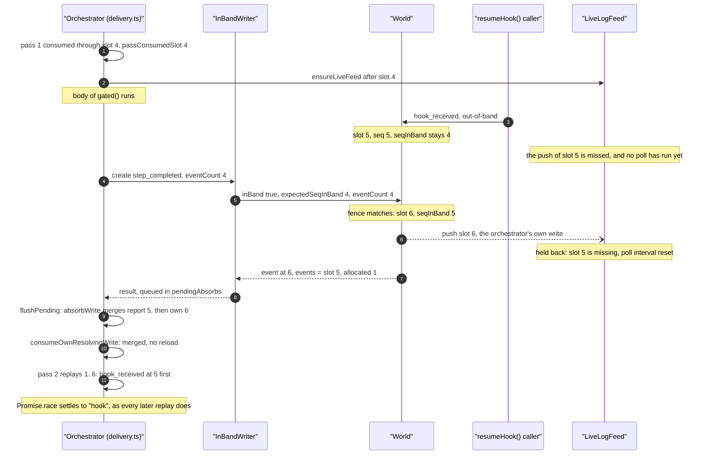
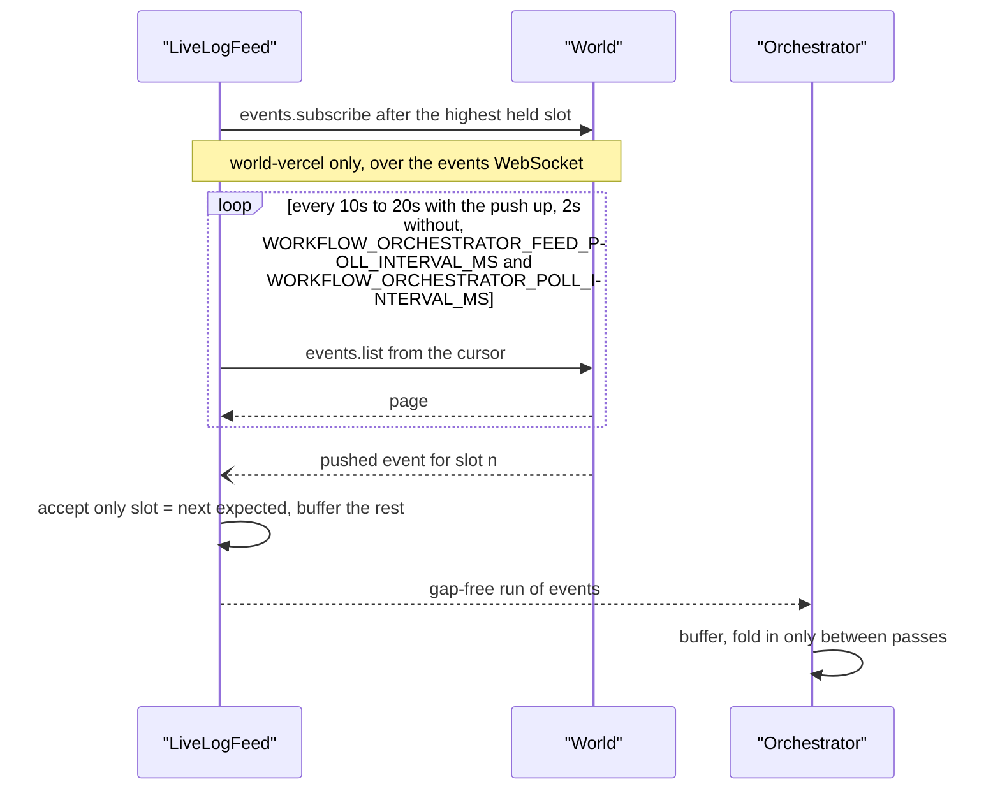

# Event posting

<Callout type="warn">
Temporary review material for the spec 9 pull request, removed before merge. See [Review: single orchestrator](/docs/changelog/single-orchestrator-review).
</Callout>

Every in-band write of one delivery goes through one `InBandWriter` (`packages/core/src/runtime/spec9/in-band-writer.ts:152`). It marks each write `inBand: true`, carries `expectedSeqInBand`, and sends one write at a time. Everything else that writes to the run is out-of-band and never carries a count.

## Slot numbering

Every event of a spec 9 run has a dense, 1-based slot, encoded in its id as `evnt_` plus a zero-padded decimal (`packages/world/src/slot-identity.ts:1`). The World keeps two counters: `seq`, the highest slot handed out to anyone, and `seqInBand`, the number of slots handed out to in-band writes, `run_created` included (`IN_BAND_SEQ_AT_RUN_CREATION = 1`, `packages/world/src/events.ts:1377`).



An out-of-band write moves `seq` only. It never invalidates the orchestrator's count, which is why a hook resume or a background step's outcome can land between two orchestrator writes without refusing either.

## What one write carries

| Field | Set by | Meaning |
|---|---|---|
| `inBand: true` | `fenceParams` (`in-band-writer.ts:798`) | The orchestrator made this write. |
| `expectedSeqInBand` | `fenceParams` | The writer's count: the load snapshot's `seqInBand`, advanced by every accepted write's `allocated`. |
| `eventCount` | `sendPosition` (`in-band-writer.ts:850`) | The slot the decision was made against, raised to the highest slot the writer knows it holds every event below. The World reports what lies between it and the write's own slot. |
| `occurredAt` | run-ahead writes (`packages/core/src/runtime/spec9/delivery.ts:2130`, `delivery.ts:2208`) | The time the workflow already used. On spec 9 the World stores it as the event's `createdAt` (`packages/world/src/interfaces.ts:420`). Writes that are not speculative do not send it, so the World's own time is stored. |

The response carries:

| Field | Meaning |
|---|---|
| `event` / `results` | The committed event, or per-item results of a batch. |
| `allocated` | Positions the write took: 1 for a new event, 0 for an idempotent replay, the admitted items for a batch (`packages/world/src/events.ts:1149`, `events.ts:1348`). |
| `events` | The skipped-slot report: every event in slots `eventCount + 1` up to the write's first slot. |
| `hasMore` | The report is incomplete; the orchestrator reloads before it consumes anything the write resolves. |

## One batched write with a foreign event in between



## Serialization and batches



- **One at a time.** Two concurrent in-band writes would carry the same count and the second would be refused, so the writer chains every write on one promise (`serialize`, `in-band-writer.ts:905`). A suspension's creations go out, on the awaited path, as `createBatch` calls of at most `MAX_IN_BAND_CREATION_BATCH_EVENTS` (64) events and `MAX_IN_BAND_CREATION_BATCH_BYTES` (512 KiB, each event's payload bytes plus a 1 KiB allowance), one after another; the inline steps' creation-bearing starts go first and share the first batch with background creations (`batchChunks`, `packages/core/src/runtime/spec9/step-wait-creation.ts:672`; `packages/core/src/runtime/constants.ts:506`, `constants.ts:515`). A single creation over the byte budget goes out alone. `MAX_BATCH_EVENTS` (16, `constants.ts:486`) still bounds run-ahead's coalesced write groups and the speculative creation batch run-ahead sends ahead of a boundary. On the node engine, an inline step's outcome is queued on the writer only after a fan-out's last creation batch was queued, so it never lands between two creation batches.
- **Per-entity order.** A batch on a spec 9 run is not atomic, but once the World refuses an item it refuses every later item with the same `correlationId` (`packages/world/src/interfaces.ts:429`). The world-vercel backend answers those with 409 `batch-earlier-item-failed`. This is what lets one run-ahead group carry a step's creation and its outcome.
- **Run-ahead groups.** Run-ahead writes queued behind a write in flight go out together as one batch when their turn comes (`enqueueAhead`, `in-band-writer.ts:475`); any other write closes the group, so writes are never reordered.
- **No resolved payloads on a batch.** A batch is sent without `resolveData`, which world-vercel sends as `lazy`, unless one of its writes explicitly asks for `'all'`. A write's `skip-step-inputs` (the replay default) no longer escalates the batch to `'all'`: it describes how a single write's event-log page is read, a batch returns no such page, and the writer overlays the payload it sent on every committed event anyway (`withWrittenEventData`). Single in-band writes already behaved this way (`in-band-writer.ts:538`, #5034).

## Consume after commit

Two operations happen to every event the orchestrator writes for itself:

- **Commit.** The World accepts the write at a log position: it checks the in-band fence (`expectedSeqInBand`), allocates the next slot, and answers with the event, `allocated`, and the skipped-slot report of every event between the write's `eventCount` and its own slot. Until that answer arrives, the event has no position, and the orchestrator does not know what lies below it.
- **Consume.** The orchestrator takes the event into the log it replays from, and the next pass of the VM acts on it: a promise resolves, the deterministic clock moves to the event's time, and the workflow's next decisions follow from it.

Replay consumes a log in slot order. Every later replay of the run, in this delivery or a cold one, reads the committed log and resolves promises in that order. So the live orchestrator must consume the same events in the same order, and it can only know that order once the write committed: the slot, and what the report says landed below it, come with the commit.

A write that resolves a promise in the workflow (`wait_completed`, an inline step's `step_completed` or `step_failed`) is therefore consumed only after it committed and after the events its report names (`consumeOwnResolvingWrite`, `packages/core/src/runtime/spec9/consume-after-commit.ts:32`):



The reason: an out-of-band event below the write (a background step's outcome, a `hook_received`, a `run_cancelled`) is consumed first by every later replay, and resolution order is observable through correlation ids and the workflow clock.

### Example: a hook payload lands while an inline step runs

The workflow races a hook against an inline step:

```js
const hook = createHook({ token: 'race' });
return await Promise.race([hook.then(() => 'hook'), gated()]);
```

The first pass writes `hook_created` and the inline step's `step_started` (slots 3 and 4, `seqInBand` 4) and starts the body. While the body runs, `resumeHook()` commits a `hook_received` out-of-band at slot 5. Then the body returns, and its `step_completed` is written in-band.



The report in step 7 names slot 5 whatever the feed did, so the order is right even with no push at all. The push in step 6 and the response in step 7 can arrive in either order, and the feed passes on slot 6 only after slot 5, by push or poll. Had the push of slot 5 arrived while the body ran, the delivery would have run a pass on it there and then (a committed foreign event ends the wait in `awaitInlineProgress`, `delivery.ts:3587`), and the race settles to `"hook"` just the same: consuming a committed event is always safe, only its position must be known. This is the case `inline-step-writes.runtime.test.ts` ("feeds an out-of-band event that landed below an inline outcome before the outcome") runs, with the poll off and no push, so the report alone carries the hook payload.

**What would go wrong otherwise.** Had the orchestrator handed `step_completed` to the VM when the body returned, pass 2 would settle the race to the step's value and the workflow would act on it (return, or create its next step). The committed log says the hook resolved first. The next cold replay, after a handoff, a redelivery or a retained session's discard, settles the race to `"hook"` and diverges from what the run already wrote. The same holds for a `run_cancelled` below a `wait_completed`: consumed in commit order, the run stops before the sleep's continuation runs (`hook-wait.runtime.test.ts`, "stops when a run_cancelled lands below its own wait_completed").

### Other orderings the rule covers

| Situation | What the code does | What would go wrong otherwise |
|---|---|---|
| The write's report is incomplete (`hasMore`) or the World answers without the event | `consumeOwnResolvingWrite` returns `reload`; the delivery drops the retained session and does a full load before the next pass (`delivery.ts:2509`, `delivery.ts:3690`). `absorbWrite` sets `logBehind` instead of merging (`delivery.ts:657`). | The VM would consume the own event above a hole. If the hole held an out-of-band resolution, the order would be wrong, as in the example. |
| The own slot is more than one above everything held and the report names nothing between | `absorbWrite` marks the log behind rather than merge across the hole (`delivery.ts:689`). | Same as above: an unseen event below the own one. |
| The fence refuses the write (412 `in-band-superseded`) | Nothing committed, so nothing is consumed. The writer stops for good and every later write throws `OrchestratorSupersededError` (`stop`, `in-band-writer.ts:878`). The delivery forgets its consumed position, sends the messages its committed writes owe and one plain wake, and acknowledges (`delivery.ts:1035`). Its retained session is discarded, and the wake's delivery replays from a fresh load. | A VM that consumed the refused event would hold a state the log never had: another orchestrator wrote at that count, and its decisions, not this one's, are the run's. Covered by `fenced-overlap.runtime.test.ts` ("discards the retained session when a later write is fenced out..."). |
| The live feed pushes the orchestrator's own write before the response | `isOwnEvent` does not start a pass for it (`delivery.ts:1620`); `mergeReportedEvents` keeps one copy per event id; `allocatedBy` counts only slots unknown when the write was sent, so the echo does not read as an idempotent replay (`in-band-writer.ts:823`). | A pass per echo, and a fence count that undercounts the write, so the next in-band write is refused. Covered by `orchestrator.runtime.test.ts` ("takes one workflow pass per inline step when the live feed echoes its own writes") and `inline-step-writes.runtime.test.ts` ("keeps the fence count when the feed shows a batch and later events before its response"). |
| An inline step finishes while a fan-out's later creation batches are still committing | Its outcome is queued on the writer only after every creation batch was queued (`creationBatchesQueuing`, `delivery.ts:3482`), and no pass decides while a creation is in flight (`creationsInFlight`, `delivery.ts:3617`). | A pass before the creations committed would not see them in the log, re-derive them as uncreated, and create the steps again. An outcome between two creation batches would also hold up the background creations behind it. |
| Another writer's event lands above what the pass consumed, after the VM decided | Before suspending, the delivery replays again if the log holds a foreign event above `passConsumedSlot` (`delivery.ts:3411`). It records its consumed position (`recordConsumedPosition`, `consumed-position.ts:40`) only after its writes committed and its messages and timers went out. | That event's own wake would find the tail at the recorded position and be acknowledged as a no-op (`isNoopDelivery`, `consumed-position.ts:66`), so the event would never be consumed. Covered by `small-rules.test.ts` ("skips a delivery whose tail is the consumed position..."). |

### The one exception: run-ahead

Run-ahead consumes an inline step's outcome before its write commits, and only where the order cannot matter. At a boundary that `observeOutOfBandWriters` (`packages/core/src/runtime/out-of-band-observation.ts:156`) classifies inert (no hook the workflow waits on, no abort-signal hook, no step running in another invocation, no wait due within the invocation), the outcome is placed at the slot the writer predicts (`predictNextSlot`, `in-band-writer.ts:324`) and handed to the VM while the write is in flight, at most `WORKFLOW_RUN_AHEAD_DEPTH` writes deep. Every event that then lands below a speculative slot is checked by `checkRunAheadHazard` (`delivery.ts:1967`, `runAheadHazard` in `packages/core/src/runtime/spec9/run-ahead.ts:43`). A path-changing one stops the writer's decisions (`stopDecisions`, `in-band-writer.ts:240`) so nothing decided from the speculative state is written, and the redelivery decides from the log. An inert one displaced by a foreign event is repaired in place. Before a boundary that is not inert, the delivery drains run-ahead and replays if anything foreign landed below (`hasUnconsumedForeignEvent`, `delivery.ts:2924`). Covered by `run-ahead.runtime.test.ts`.

### Where the code enforces it

- `consumeOwnResolvingWrite` (`consume-after-commit.ts`): the decision between merge and reload; unit tests in `consume-after-commit.test.ts` (unseen out-of-band event first, empty report, incomplete report, truncated report).
- `absorbWrite` (`delivery.ts:657`): folds every accepted in-band write into the log as report, then own event, in slot order; refuses to merge across a hole.
- `flushPending` (`delivery.ts:1704`): the only place buffered feed events and inline writes join the log, between passes and never under a replay.
- `InBandWriter` (`in-band-writer.ts`): one write at a time, the fence, `sendPosition` and `noteComplete` for the report's lower bound, and the stop on a refusal or an unknown outcome.
- `LiveLogFeed` (`live-feed.ts`): passes on only a gap-free run of slots, so the feed never hands over an event above one it has not delivered.
- `recordConsumedPosition` and `isNoopDelivery` (`consumed-position.ts`): a position counts as consumed only once the delivery that consumed it finished cleanly.

## Out-of-band writers

| Writer | Event | Code | Wake it sends |
|---|---|---|---|
| Background step invocation | `step_started`, `step_retrying`, `step_completed`, `step_failed` | `packages/core/src/runtime/spec9/step-handler.ts:148` | One plain orchestrator message per outcome, no idempotency key, no delay, no log read; sent again by a redelivery that finds the step terminal (`wakeOrchestrator`, `step-handler.ts:258`) |
| `resumeHook()` | `hook_received` | `packages/core/src/runtime/resume-hook.ts:938` | Orchestrator message, no idempotency key on spec 9 |
| `cancel()` | `run_cancelled` | `packages/core/src/runtime/runs.ts:230`, `packages/core/src/runtime/run.ts:323` | `wakeRunAfterOutOfBandWrite` (`runs.ts:173`) |
| `setAttributes()` in a step body | `attr_set` | `packages/core/src/set-attributes.ts:67` | none |
| `start()` | `run_created` | `packages/core/src/runtime/start.ts:1182` | the run's first message |

Each lands at the next slot when it commits. The orchestrator sees it in three ways: in the skipped-slot report of its next in-band write, in the live feed, or in its next load.

## The live feed

While inline bodies run or the delivery lingers, the orchestrator follows the log tail with a `LiveLogFeed` (`packages/core/src/runtime/spec9/live-feed.ts:121`):



A push that is late, duplicated or out of order is dropped and the poll fills it in, so correctness never depends on the push (`live-feed.ts:167`). world-local has no `subscribe`, so it is the poll alone there, and a delivery on world-local never lingers (`delivery.ts:2346`).

## Edge cases

- **Idempotent replay.** A write answered with an event at a slot the writer already knew allocated nothing, and the count does not move when the World reports no `allocated` (`packages/core/src/runtime/spec9/in-band-writer.ts:823`).
- **No `allocated` from the World.** The writer assumes 1 per create and the whole block per batch, less items answered at known slots (`in-band-writer.ts:383`, `in-band-writer.ts:764`).
- **Per-item batch failure.** A failed item leaves a hole the World seals as a `noop`; the next replay re-derives the event and the next suspension writes it again (`packages/core/src/runtime/spec9/step-wait-creation.ts:513`).
- **Throttle or terminal run in a batch.** A 429 or 410 on an inline step's creation-bearing start is that step's start refusal; any other 429 or a 5xx fails the delivery (`step-wait-creation.ts:526`).
- **Unknown outcome.** A transport error or 5xx may have allocated, so the writer stops for good and the delivery is retried from a fresh load (`in-band-writer.ts:878`).
- **Definite refusal that did allocate.** The writer keeps its count after a non-fence 4xx; when the world-vercel backend had allocated anyway, the next in-band write is refused with 412 and the delivery stands down with a wake (`in-band-writer.ts:879`).
- **Write before any snapshot.** Fails without reaching the World (`in-band-writer.ts:802`).
- **Non-empty log without a snapshot.** Fails the run with a World contract error instead of writing unfenced (`in-band-writer.ts:89`).
- **Payload missing from the response.** The writer fills the event's `eventData` from what it sent, so replay has the bytes (`in-band-writer.ts:957`).
- **Report incomplete or truncated.** `hasMore` marks the log behind and the next pass reloads before replaying (`packages/core/src/runtime/spec9/delivery.ts:676`).
- **Own write above an unreported gap.** If the own slot is more than one above everything held, the log is marked behind instead of merged with a hole (`delivery.ts:689`).
- **Writes queued behind others.** A queued write names the highest slot known complete, not the older slot it was decided from, so its report does not repeat the earlier writes' events (`in-band-writer.ts:850`).
- **Feed echo of own writes.** Feed events at own slots or of own inline steps do not start a pass (`delivery.ts:1600`).
- **World that rewrites `occurredAt`.** A speculative write stored at another time stops the delivery and turns run-ahead off for that World for the process (`delivery.ts:2154`, `packages/core/src/runtime/spec9/run-ahead.ts:145`).
- **Feed failure.** A failed subscribe or poll is logged at debug level and the feed continues on what remains (`live-feed.ts:102`, `live-feed.ts:147`).
