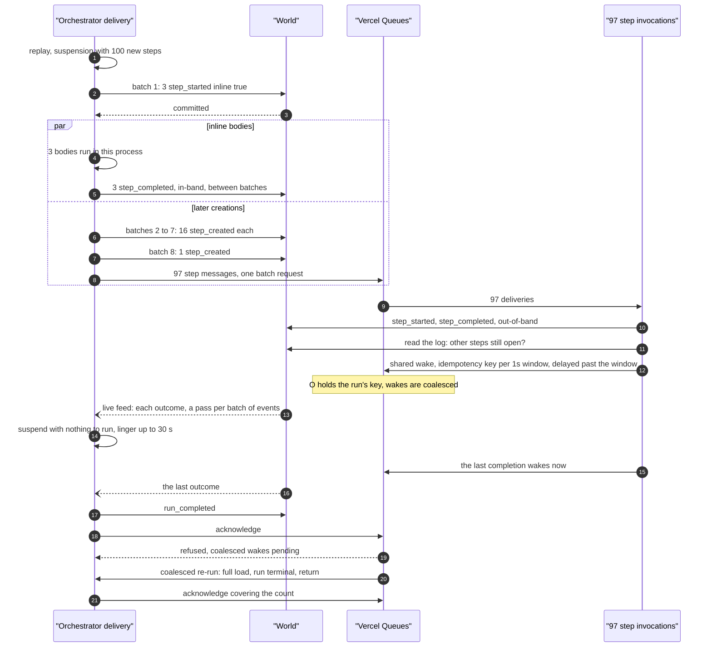

# Fan-out

<Callout type="warn">
Temporary review material for the spec 9 pull request, removed before merge. See [Review: single orchestrator](/docs/changelog/single-orchestrator-review).
</Callout>

{/* @skip-typecheck - illustrative workflow */}
```typescript
export async function resizeAll(urls: string[]) {
  "use workflow";
  return await Promise.all(urls.map((url) => resize(url))); // 100 urls
}
```

## The constants

| Constant | Value | Where |
|---|---|---|
| `WORKFLOW_MAX_INLINE_STEPS` | 3 by default, clamped to 0..16 | `packages/core/src/runtime/constants.ts:191`, `constants.ts:210` |
| `MAX_BATCH_EVENTS` | 16 events per `createBatch` | `constants.ts:484` |
| Step messages per Vercel Queues batch request | 100 | `packages/world-vercel/src/queue.ts:38` |
| Inline window | 2 min, or 5 min when the function may run 10 min or more, or 10 min at 25 min or more; `WORKFLOW_V2_TIMEOUT_MS` overrides | `packages/core/src/runtime/delivery.ts:319` |
| `WORKFLOW_INLINE_STEP_DEADLINE_MARGIN_MS` | 60 s: no inline step starts this close to the window's end | `packages/core/src/runtime/spec9/deadline.ts:2` |
| `WORKFLOW_ORCHESTRATOR_LINGER_MS` | 30 s, only on a World with a live feed | `packages/core/src/runtime/spec9/live-feed.ts:28` |
| Completion wake window | 1 s, plus 1 s margin | `packages/core/src/runtime/spec9/step-handler.ts:229` |
| Coalesced re-runs per delivery | 32 | `packages/world-vercel/src/queue.ts:328` |

## How the creations are split

The suspension's events are the inline steps' creation-bearing `step_started` events first, then the background steps' `step_created` (`packages/core/src/runtime/spec9/step-wait-creation.ts:231`). When they need more than one batch, the inline creations go in batches of their own, so the inline bodies start as soon as the first, small batch commits (`batchChunks`, `step-wait-creation.ts:632`).

| `WORKFLOW_MAX_INLINE_STEPS` | Events | Batches | First batch | Later batches | Step-message sends |
|---|---|---|---|---|---|
| 3 (default) | 3 starts + 97 `step_created` | 8 | 3 starts | 6 of 16, 1 of 1 | 1 request of 97, after the 7 later batches |
| 16 | 16 starts + 84 `step_created` | 7 | 16 starts | 5 of 16, 1 of 4 | 1 request of 84 |
| 0 | 100 `step_created` | 7 | 16 `step_created` | 5 of 16, 1 of 4 | 1 request of 16 after batch 1, 1 request of 84 after the rest |

All batches are in-band writes, so they go out one at a time (`packages/core/src/runtime/spec9/in-band-writer.ts:903`). The later batches run in the background of the delivery (`commitInChunks`, `delivery.ts:3102`); their background steps' messages go out in one `enqueueStepMessages` call once all of them committed (`delivery.ts:3106`). No pass decides while a creation batch is in flight (`delivery.ts:3536`).

A fan-out boundary with background steps is never run ahead: a step outside the delivery's inline slots runs elsewhere, so the boundary is not inert (`packages/core/src/runtime/out-of-band-observation.ts:172`).

## Sequence, default settings, world-vercel



## Timeline with the default numbers

Times below are positions in the delivery, not measurements. The only measurement on record is the review page's benchmark: a 100-step fan-out's last step finished at a p75 of 2213 ms on an earlier head, against `main`'s production baseline.

| Order | What happens | Count |
|---|---|---|
| 1 | Replay reaches `Promise.all`; 100 steps, 3 inline slots | 1 replay |
| 2 | Batch 1 commits; 3 inline bodies start | 1 `createBatch`, 3 events |
| 3 | Batches 2 to 8 commit, one at a time, while the bodies run | 7 `createBatch`, 97 events |
| 4 | 97 step messages go out | 1 queue request |
| 5 | Inline outcomes commit as each body returns | 3 `step_completed`, in-band |
| 6 | Background steps run; each writes start and outcome, reads the log, and sends a wake | 97 invocations, 194 out-of-band writes, 97 log reads |
| 7 | The orchestrator takes outcomes from the live feed, lingering while steps are open | up to 30 s per idle stretch, never past 60 s after the invocation started with a 2 min window |
| 8 | The last outcome lands; the workflow returns | 1 `run_completed` |
| 9 | Coalesced wakes re-run the handler in the same invocation | 1 or more re-runs, at most 32 |

Function invocations, if every background step finishes while the orchestrator lingers: 1 orchestrator invocation plus 97 step invocations. Each shared wake that arrives after the orchestrator acknowledged is one more short orchestrator delivery that finds the run finished. How many that is depends on how the completions spread over 1 s windows; not measured.

If the steps take longer than the linger allows, the delivery acknowledges and the shared wakes start new deliveries. Each one loads the log, takes in the outcomes since the last pass, and lingers again.

## On world-local

world-local has no `createBatch`, so the 100 creations are 100 single in-band writes, all committed before the inline bodies start (`delivery.ts:3135`). It has no `queueBatch` either, so the 97 messages are sent as parallel single sends (`packages/core/src/runtime/helpers.ts:1458`). It has no live-feed push, so the orchestrator polls every 2 s while bodies run, and it never lingers. Each completion's wake is delivered after the running delivery, one at a time.

## Edge cases

- **Inline slots already taken.** Open inline steps and running bodies count against `WORKFLOW_MAX_INLINE_STEPS`, so a second fan-out while the first runs gets fewer inline slots (`packages/core/src/runtime/spec9/delivery.ts:2961`).
- **Inside the margin.** A fan-out created within 60 s of the window's end gets no inline slots, and every step is a background step (`delivery.ts:2954`).
- **Window end with bodies running.** A pass that starts after the window's end hands off; running bodies settle first (`delivery.ts:2411`, `delivery.ts:2736`).
- **A later batch fails.** The delivery fails with that error once the bodies settled, and its redelivery writes the missing creations (`delivery.ts:3126`, `delivery.ts:1741`).
- **A batch item refused.** A refused item leaves a sealed hole; the next replay creates that step again (`packages/core/src/runtime/spec9/step-wait-creation.ts:486`).
- **Fence refusal mid fan-out.** The writer's accepted events record every background step created so far, including later batches, and a refused delivery sends exactly those messages (`delivery.ts:463`, `delivery.ts:3815`).
- **Completion wake that a delivery could miss.** A shared wake is delivered only after its window ended, so its delivery loads every outcome that joined it; a log the step cannot read makes it wake now (`packages/core/src/runtime/spec9/step-handler.ts:253`, `step-handler.ts:274`).
- **Two last completions.** Each may see the other open and send only the shared wake; the run then waits at most the window plus the margin (`step-handler.ts:261`).
- **Busy fan-out runs out of re-runs.** Past 32 coalesced re-runs world-vercel hands the message off instead of counting an attempt (`packages/world-vercel/src/queue.ts:1039`).
- **A step that fails.** A failed background step wakes the orchestrator now, not on the shared window (`step-handler.ts:221`).
- **Feed echo.** The live feed's copy of the delivery's own writes does not start a pass (`delivery.ts:1599`).
