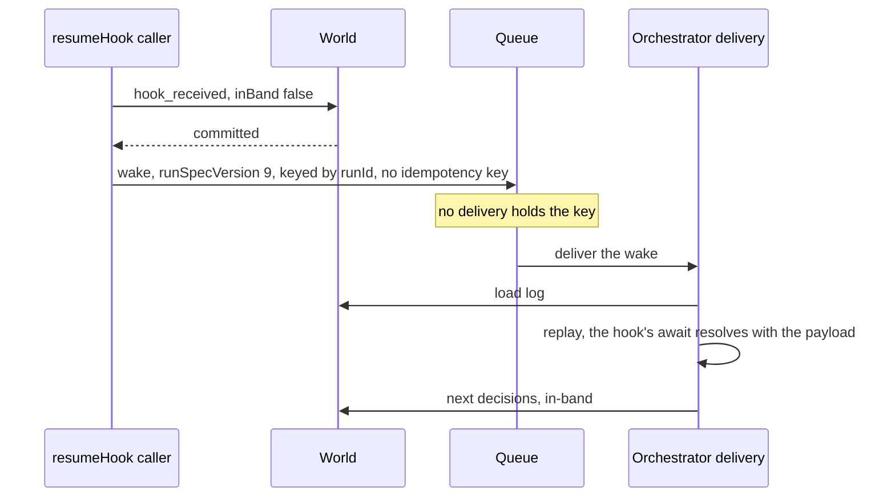
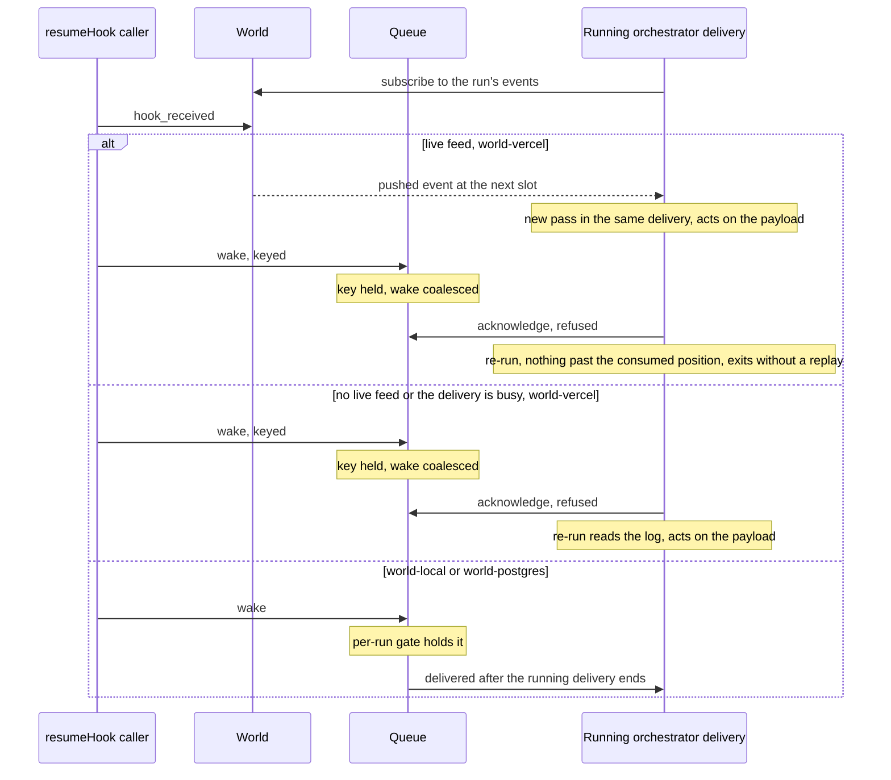
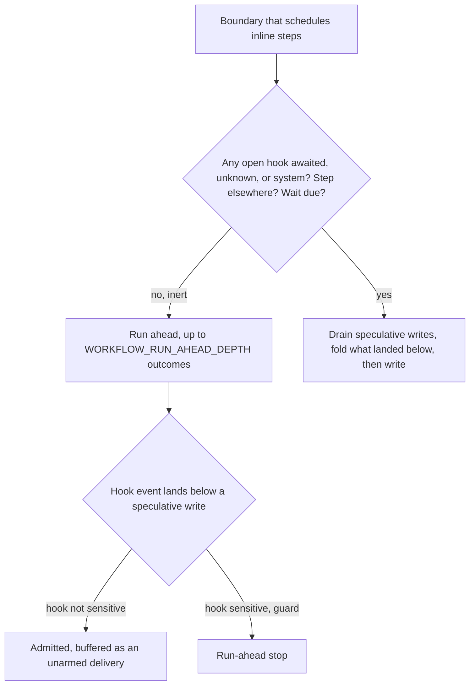
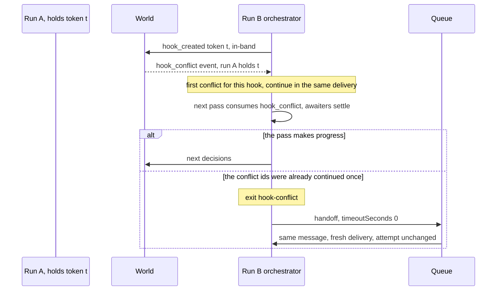
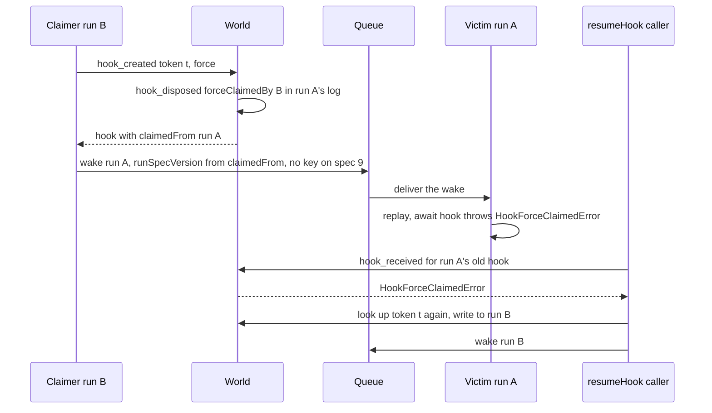
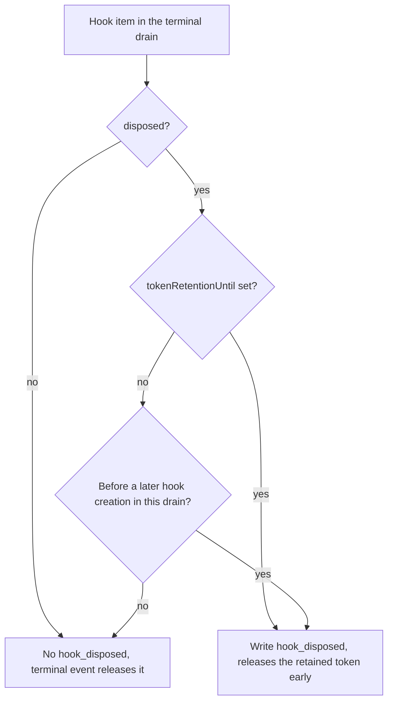

# Hooks

<Callout type="warn">
This page is temporary review material for the pull request that introduces spec version 9, and is removed before merge. The written review is [Review: single orchestrator](/docs/changelog/single-orchestrator-review).
</Callout>

A hook has two writers. The orchestrator writes `hook_created` and `hook_disposed` in-band, through its fenced writer, from the suspension (`startSuspensionHookWrites`, `packages/core/src/runtime/spec9/suspension-handler.ts:374`). `resumeHook()` writes `hook_received` out-of-band (`inBand: false`, `packages/core/src/runtime/resume-hook.ts:938`), then wakes the orchestrator. How out-of-band writes enter the in-band count is on [Event posting](/docs/changelog/single-orchestrator-diagrams/event-posting).

## `resumeHook()`

The dispatch is strictly serial: the `hook_received` write is acknowledged first, then the wake is published (`packages/core/src/runtime/resume-hook.ts:861`). The wake carries no payload, so a lost or coalesced wake loses nothing the log does not hold.

- The wake is `{ runId, runSpecVersion, traceCarrier, hookResumeTiming }`, with the run's spec version set explicitly (`packages/core/src/runtime/resume-hook.ts:967`).
- On a spec 9 run it has no idempotency key. A key could be absorbed by a delivery that is already exiting and lose the wakeup; a duplicate wake costs one cheap delivery. Spec 8 runs keep `hook-<resumeId>` (`packages/core/src/runtime/resume-hook.ts:989`).
- `publishHookWakeWithRetry` retries transport-shaped failures after 25 and 100 milliseconds. A wake that still fails throws, and the `hook_received` stays durable for the next wake of the run (`packages/core/src/runtime/hook-wake.ts:55`).

### Resume while the orchestrator is suspended



### Resume while the orchestrator is running

A spec 9 delivery that has nothing left to run, while the run waits on an open hook or a background step, lingers for up to `WORKFLOW_ORCHESTRATOR_LINGER_MS` (30 seconds by default), bounded by the inline deadline minus the inline-start margin (`lingerForExternalWork`, `packages/core/src/runtime/spec9/delivery.ts:2343`). It lingers only while the World's `events.subscribe` feed is live (world-vercel implements it in `packages/world-vercel/src/storage.ts:84`; world-local and world-postgres do not). world-vercel defines `subscribe` even when its push transport is unavailable and then reports the failure through `onError`, so the linger checks `LiveLogFeed.isLive` after starting the feed and after every wake, and the feed's `onFeedDown` callback wakes it to end at once (`packages/core/src/runtime/spec9/live-feed.ts`). A subscription that never acknowledges and never errors still counts as live ([Live event feed](/docs/changelog/single-orchestrator-diagrams/live-feed#linger-interaction)). While it lingers, or while it waits on inline bodies, a live feed pushes other writers' events and starts a new pass in the same delivery.



The feed accepts an event only at exactly the next slot, so a late, duplicate or out-of-order push is dropped and the log-tail poll fills in (every 2 seconds by default once the push has shown a gap, `WORKFLOW_ORCHESTRATOR_POLL_INTERVAL_MS`) (`packages/core/src/runtime/spec9/live-feed.ts:121`). The no-op exit applies to a re-run only once its invocation ran the re-send pass: the first re-run of an invocation (counted above 1) reads the log and re-sends unstarted background steps, later ones may exit after a tail read (`invocationResends`, `packages/core/src/runtime/spec9/creator-rules.ts`).

## Run-ahead and awaited hooks

The orchestrator runs ahead only at an inert boundary (`observation.inert`, `packages/core/src/runtime/spec9/delivery.ts:2854`). A boundary is not inert while any open hook is awaited by workflow code, has unknown observation, or is a system (abort) hook, or while a step runs elsewhere or a wait is due in the window (`observeOutOfBandWriters`, `packages/core/src/runtime/out-of-band-observation.ts:156`). At a boundary that is not inert, the delivery first drains its speculative writes and takes in what landed below them, in log order (`packages/core/src/runtime/spec9/delivery.ts:2870`).

An unawaited hook is inert: on the node engine its payload is buffered as an unarmed delivery and moves neither step results nor `Date.now()`, so a `hook_received` for it may land anywhere below speculative writes (`admitBelowSpeculation`, `packages/core/src/runtime/spec9/run-ahead.ts:81`). The first `then()` on the hook marks it observed (`observedHookIds`), and from that boundary on, run-ahead waits for its writes.

`sensitiveHookIds` (`runAheadContextFor`, `packages/core/src/runtime/spec9/run-ahead.ts:102`) keeps, per run-ahead context, the hooks a hazard check names. A hook event for one of them below an unconfirmed speculative write stops run-ahead (`runAheadHazard`, `packages/core/src/runtime/spec9/run-ahead.ts:43`). The code comment on that check says the classification and the fence rule this case out, so it is a guard (`packages/core/src/runtime/spec9/delivery.ts:1915`). What a stop does is on [Run-ahead and turbo](/docs/changelog/single-orchestrator-diagrams/run-ahead-and-turbo).

{/* @skip-typecheck - illustrative workflow */}
```typescript
export async function moderate(postId: string) {
  "use workflow";
  const hook = createHook<{ approved: boolean }>();
  const score = await classify(postId);  // hook not awaited yet: inert, may run ahead
  await notifyModerators(postId, score); // still inert
  return await hook;                     // observed: drain speculative writes first
}
```



## Hook conflicts

A `hook_created` for a token another run holds is answered with a `hook_conflict` event in the creator's log (`packages/core/src/runtime/hook-creation.ts:76`). The workflow observes it on its next pass: an awaited payload rejects, `hook.getConflict()` resolves with the conflicting run. While a suspension has a hook creation with a conflict awaiter, no inline step starts (`hookAwaitingConflict`, `packages/core/src/runtime/spec9/delivery.ts:2776`).



The continue-or-hand-off rule is in `packages/core/src/runtime/spec9/delivery.ts:2926`: each conflicting hook id gets one in-place continuation per delivery, then the delivery hands off.

## Force-claim

`createHook({ token, experimental_force: true })` takes a token from another run. The World writes `hook_disposed{forceClaimedBy}` into the victim's log and records the victim on the new hook (`claimedFrom`). The World has no queue, so the claimer's runtime wakes the victim (`publishForceClaimVictimWake`, `packages/core/src/runtime/hook-wake.ts:120`). The victim's `await hook` then throws `HookForceClaimedError`.



A claimer that dies between its `hook_created` and the victim wake repays it on every replay within 24 hours of the creation (`forcedCreationsOwingWake`, `packages/core/src/runtime/hook-wake.ts:185`). A `resumeHook()` in flight follows the token to its new owner up to `MAX_FORCE_CLAIM_REDIRECTS` (3) times (`packages/core/src/runtime/resume-hook.ts:424`).

## Terminal hook disposal

When the workflow completes or fails, the end-of-run drain writes the pending queue through the in-band writer with `terminalDrain: true` (`pendingQueueDrain`, `packages/core/src/runtime/spec9/suspension-handler.ts:659`). The run's terminal event releases non-retained hooks, so the drain skips their `hook_disposed`. It still writes a disposal for a hook with `tokenRetentionUntil`, which releases a retained token early, and for a hook created before a later creation in the same drain, so a later same-token registration does not conflict with this run's own hook (`packages/core/src/runtime/suspension-hooks.ts:275`, `:333`). A system hook that was never created and has no abort request is not created at all (`packages/core/src/runtime/spec9/suspension-handler.ts:357`). This is the spec 9 side of #4990.



## Edge cases

- A wake that fails after `hook_received` committed is reported as `WorkflowRuntimeError`, never `HookNotFoundError`, because the payload is durable (`packages/core/src/runtime/hook-wake.ts:83`).
- A 409 on the `hook_received` write is passed through as retryable instead of being mapped to `HookNotFoundError`, since it committed nothing (`packages/core/src/runtime/resume-hook.ts:910`).
- A resume to an ended run is refused by the World and surfaces as `HookNotFoundError` for the token (`packages/core/src/runtime/resume-hook.ts:921`).
- A spec 9 wake without an idempotency key can be duplicated by a retried publish; the extra delivery exits without a replay when nothing new is in the log (`packages/core/src/runtime/resume-hook.ts:979`).
- Linger is skipped when the remaining time to the inline deadline minus the margin is zero, so a late delivery does not hold the invocation (`packages/core/src/runtime/spec9/delivery.ts:2357`).
- A payload for an unawaited hook may land below speculative writes and is admitted; once the workflow awaits the hook, the boundary drains instead of running ahead (`packages/core/src/runtime/spec9/run-ahead.ts:81`, `packages/core/src/runtime/spec9/delivery.ts:2870`). See [Edge cases](/docs/changelog/single-orchestrator-diagrams/edge-cases).
- An older SDK's `resumeHook()` on a spec 9 run gets 400 `spec-version-requires-api-v5` from the world-vercel backend on the `hook_received` write, before it sends a wake. See [Spec routing](/docs/changelog/single-orchestrator-diagrams/spec-routing).
- A force-claim victim with no recorded `workflowName` (a legacy hook) gets no wake, and reads the disposal on its next invocation for any reason (`packages/core/src/runtime/hook-wake.ts:127`).
