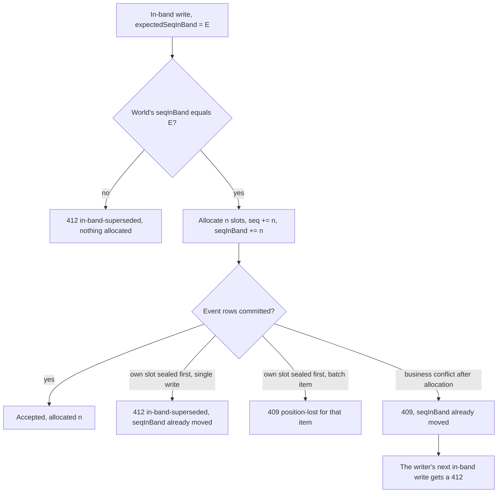
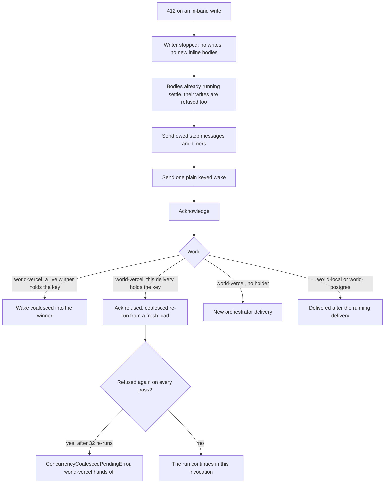
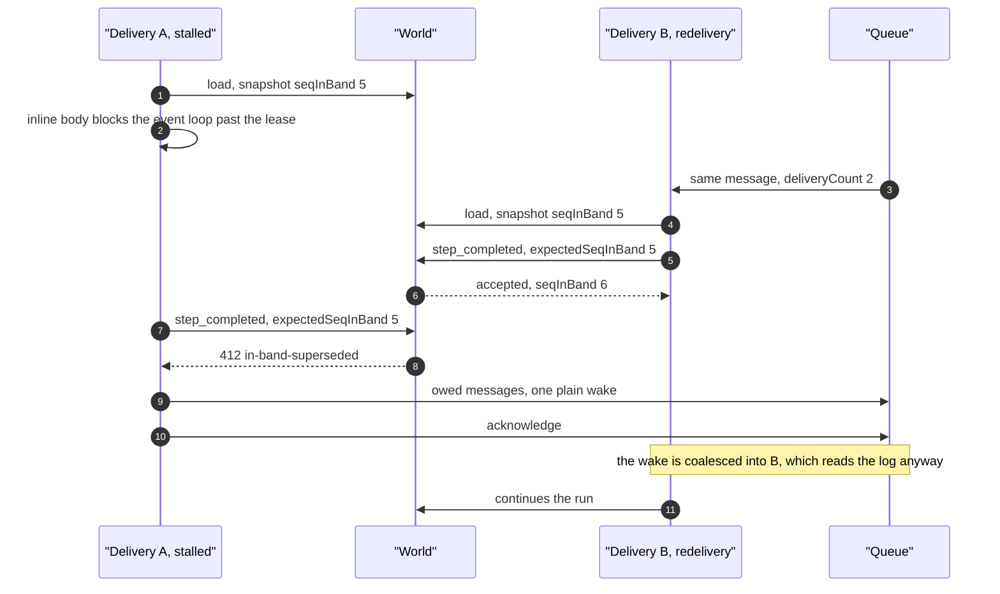
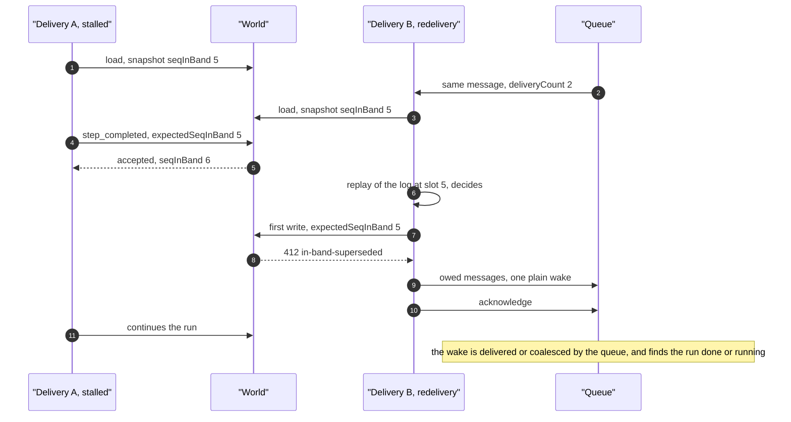
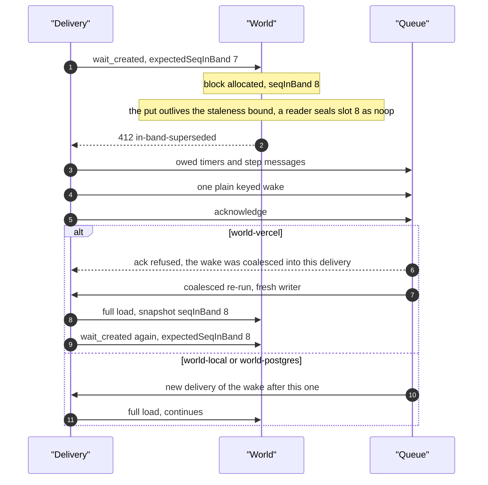
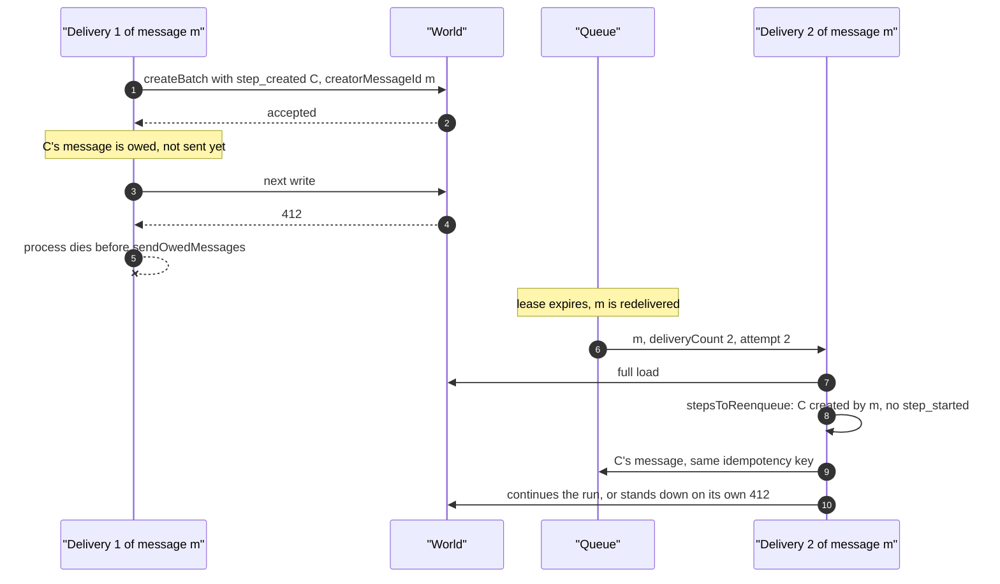

# The in-band fence and its 412s

<Callout type="warn">
Temporary review material for the spec 9 pull request, removed before merge. See [Review: single orchestrator](/docs/changelog/single-orchestrator-review).
</Callout>

The queue keeps a spec 9 run to one orchestrator delivery at a time (a concurrency key on world-vercel, a per-run gate on world-local and world-postgres). The fence is what makes an overlap the queue lets through safe: two orchestrators can never both write.

## Counters and the snapshot

| Counter | Moves on | Who reads it |
|---|---|---|
| `seq` | every allocation, in-band or not | the snapshot, as the highest slot handed out |
| `seqInBand` | in-band allocations only, starting at 1 for `run_created` | the snapshot, and the check on every in-band write |

- Every page of a spec 9 log load carries `snapshot: { seq, seqInBand }`. The writer adopts the first page's snapshot of a full load and never counts events itself (`packages/core/src/runtime/spec9/in-band-writer.ts:213`). A count derived from events cannot say which slots were in-band.
- The world-vercel backend allocates an in-band block with one conditional update: add `n` to `seq` and to `seqInBand`, on condition that `seqInBand` equals `expectedSeqInBand`. A failed condition allocates nothing, so a refused write leaves no hole. An out-of-band allocation is unconditional and moves `seq` only.
- After an accepted write the writer adds the reported `allocated` to its count (`in-band-writer.ts:810`).

## What returns 412 `InBandSupersededError`

The world-vercel backend answers 412 `in-band-superseded` in these cases:

1. **Another orchestrator wrote in-band.** Its writes moved `seqInBand` past this writer's count. This is the overlap the fence exists for.
2. **The writer's own slot was sealed.** The allocation succeeded, but the event row's put took longer than the backend's staleness bound, and a reader sealed the slot as a `noop` first. The single-write path answers 412, because the allocation already moved `seqInBand` and the writer's count is stale either way. A terminal run event that loses its slot the same way gets the same answer. In a batch, the item gets 409 `position-lost` instead and the batch's `allocated` still counts it.
3. **A 409 after allocation.** Some refusals come after the block was allocated: a hook or attribute write whose row logic conflicts, or a terminal event that lost to another terminal event that committed first. `seqInBand` moved, the writer keeps its count after a non-fence 4xx (`in-band-writer.ts:879`), and its next in-band write gets 412.

Only case 1 involves a second orchestrator. In cases 2 and 3 nothing else is queued for the run, which is why a refused delivery sends a wake (below).

## What a refused delivery does

The first 412 stops the writer for good: that write and every later one throw `OrchestratorSupersededError` without reaching the World, and `assertActive` refuses to start further inline bodies (`in-band-writer.ts:275`, `in-band-writer.ts:878`). The delivery's catch then (`packages/core/src/runtime/spec9/delivery.ts:1015`):

1. forgets the consumed position recorded for the run;
2. sends what its own committed writes owe the queue, from the writer's accepted events (`sendOwedMessages`, `delivery.ts:3854`): the message of each background step whose `step_created` it committed, the message of each inline step whose retry it moved to the background, and the timers of the wait chains it owns. On a redelivery of its message it also sends what the creator rules re-send for an earlier delivery of it;
3. sends one plain orchestrator wake: run id, trace carrier and spec stamp, no delay (`delivery.ts:1051`);
4. acknowledges.

## Two overlapping orchestrators

A delivery stalls past its lease (a CPU-bound inline step), and the queue redelivers the run's message.

### The second delivery writes first

### The stalled delivery writes first

In the first order, if A was inside an inline body, B finds that step started with no outcome and runs it again (`packages/core/src/runtime/spec9/delivery.ts:3250`): B's `step_started` commits, so the body runs in both deliveries. The fence keeps the log to one writer; it does not stop a body from running twice. The exception is a `maxRetries: 0` step: B's attempt 2 is past `maxRetries + 1`, so `executeStep` fails the step without running the body (commit `75ddd45207`, `packages/core/src/runtime/spec9/step-executor.ts:403`). In the second order, B's first write is refused, and a body B would start behind an awaited start never starts.

## A self-superseded write with no winner

Before the wake existed, this case stranded the run: nothing else was queued for it.

## A crash before the owed sends

## Edge cases

- **Refusal while bodies run.** Bodies already running settle, their outcome writes are refused, and supersession wins over any other failure (`packages/core/src/runtime/spec9/delivery.ts:3573`).
- **Refused turbo `run_started`.** A fence refusal of the backgrounded `run_started` stops every later write and the delivery acknowledges (`delivery.ts:1011`; tested in `packages/core/src/runtime/spec9/turbo.runtime.test.ts:243`).
- **Refused on every pass.** Each refused pass sends one wake, which world-vercel coalesces into the same delivery; past 32 re-runs it hands the message off instead of counting an attempt (`packages/world-vercel/src/queue.ts:328`, `queue.ts:1039`; tested in `packages/core/src/runtime/spec9/fenced-overlap.runtime.test.ts:322`).
- **Retained VM after a refusal.** The retained session is discarded and the wake's delivery replays to the same result (`fenced-overlap.runtime.test.ts:211`).
- **Overlap through a hook or timer wake.** A parked delivery is fenced out when a hook or wait wake overlaps it, and the final log replays from cold to the same result (`fenced-overlap.runtime.test.ts:111`).
- **Timer delivery refused on its `wait_completed`.** It re-sends its own timer before acknowledging, because its redelivery would otherwise be the only one that owns the chain (`packages/core/src/runtime/spec9/orchestrator.runtime.test.ts:1346`).
- **A non-fence 4xx.** The count stays and the caller may handle it; a required write (turbo `run_started`, run-ahead) stops the writer either way (`packages/core/src/runtime/spec9/in-band-writer.ts:886`).
- **5xx or transport error.** Not a fence refusal: the writer stops with that error and the delivery is retried as the error is, never reported as superseded (`in-band-writer.ts:280`).
- **Stale-holder acknowledgment.** What Vercel Queues does with the acknowledgment of a delivery whose lease already expired is not verified here.
- **Sequencer item expiry.** The world-vercel backend's sequencer item expires after a period without allocations, and a revived item restarts `seqInBand` at 1; a writer that starts from the snapshot follows it. Not exercised by a test in this repository.
