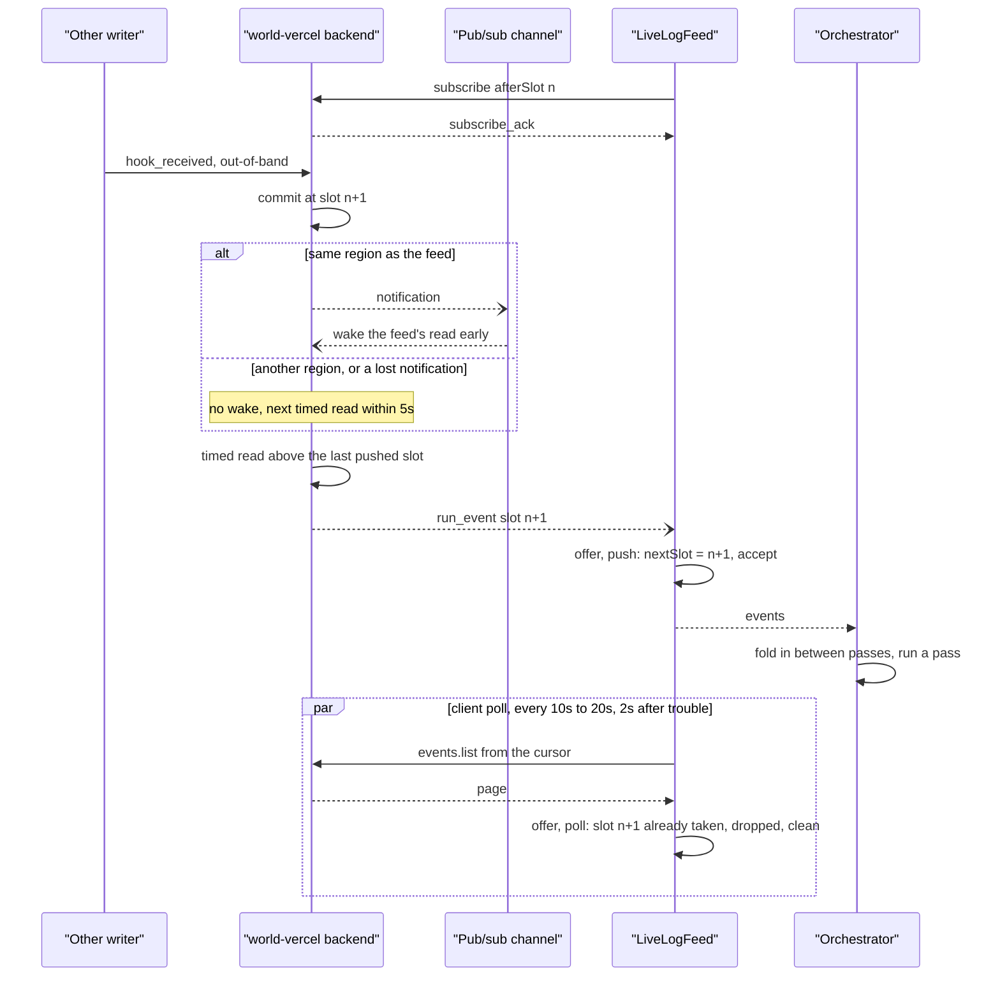

# Live event feed

<Callout type="warn">
This page is temporary review material for the pull request that introduces spec version 9, and is removed before merge. The written review is [Review: single orchestrator](/docs/changelog/single-orchestrator-review).
</Callout>

## Why the feed exists

A spec 9 run has one orchestrator delivery at a time, but more than one writer. Background step bodies write their own outcomes, `resumeHook()` writes `hook_received`, and `run.cancel()` writes `run_cancelled`, all out-of-band ([Event posting](/docs/changelog/single-orchestrator-diagrams/event-posting#out-of-band-writers)). Each of them also sends a keyed wake, but a wake for a run whose delivery is still running is folded into that delivery or queued behind it ([Queue topology](/docs/changelog/single-orchestrator-diagrams/queue-topology)).

The live feed lets a delivery that is still running react to those events at once, without waiting for its own exit and the next queue hop. It runs while inline bodies run, and while the delivery lingers on an open hook or a background step ([Hooks](/docs/changelog/single-orchestrator-diagrams/hooks#resume-while-the-orchestrator-is-running)). Every event it hands over joins the log between passes, never under a replay (`flushPending`, `packages/core/src/runtime/spec9/delivery.ts:1921`).

The feed is one class, `LiveLogFeed` (`packages/core/src/runtime/spec9/live-feed.ts:131`), with two sources:

- the World's optional `events.subscribe` push, which only world-vercel implements;
- a tail poll of `events.list` from the delivery's cursor, on every World.

Both go through the same `offer()`, so correctness never depends on the push. What the push buys is latency, and what the poll buys is a bound on how long a silent push failure can hide an event.

## The subscription

`ensureLiveFeed` starts the feed once per delivery, from the loaded log: `afterSlot` is the highest slot the delivery holds, and the poll's cursor is the log's cursor (`delivery.ts:1980`).

On world-vercel, `subscribe` (`subscribeRunEvents`, `packages/world-vercel/src/events-live-feed.ts:111`) sends a request frame on the run's events WebSocket:

```
{ reqId, type: 'subscribe', afterSlot }
```

- **One socket per run per process.** The socket is the same one the run's event writes use (`openWsChannel`, `packages/world-vercel/src/ws-transport.ts:962`), so invocations of one run in one process share it. A second `subscribe` on the socket replaces the first on world-vercel's side.
- **The reply.** world-vercel answers `subscribe_ack` (200) once it has made a first read that checks the run, or an error reply: 400 for a run that is not spec 9, or 429 `run-feed-limit` when a cap is reached. Any non-2xx reply fails the feed.
- **Pushes.** From then on world-vercel pushes `{ reqId, type: 'run_event', slot }` frames, each carrying one complete event, byte-identical to a list frame. It pushes only the dense prefix above the last slot it pushed: an event above a slot that has not committed yet waits until the slot below it commits or is sealed as a `noop`.
- **Routing.** The client routes every `run_event` to every push subscriber on the socket, whatever its `reqId` (`ws-transport.ts:700`). Each subscriber drops slots at or below its own `lastSlot` (`events-live-feed.ts:170`).
- **End.** The feed ends, and `onError` is called once, on an `end: true` notice from world-vercel, a malformed push, or the socket closing. It is never re-subscribed for the rest of the delivery.

### What each side tracks

| Side | State | Meaning |
|---|---|---|
| Client, world-vercel adapter | `lastSlot` | Highest slot this subscriber passed on; lower or equal pushes are dropped |
| Client, `LiveLogFeed` | `nextSlot` | The only slot `offer()` accepts next |
| Client, `LiveLogFeed` | `pending` | Events above `nextSlot`, held until the gap below them fills |
| Client, `LiveLogFeed` | `feedLive` | The subscription was opened and has reported no error |
| world-vercel, per subscription | last pushed slot | Where the next timed read starts; pushes must continue it by exactly one |

### Caps

world-vercel runs at most 2 feeds per run and 64 per tenant on each backend instance. A replacing `subscribe` reuses the slot of the feed it replaces. Over a cap, the `subscribe` is answered with 429 `run-feed-limit`, and the client fails the feed: the delivery polls only, at the no-feed interval, and does not linger.

## world-vercel's side

The feed is a timed tail read of the run's event log on the backend. Each read goes through the same authenticated path and tenant rate limits as an `events.list` call, and pushes what it finds above the last pushed slot.

- **Cadence.** The next read is due shortly after a read that pushed something (200 ms), then the delay doubles on each read that found nothing, up to an idle cap: 5 s for a feed that listens for notifications, 1 s for one that does not.
- **Early wake-ups.** After a write commits, the backend publishes a notification on the run's pub/sub channel. A feed that listens wakes at once and reads, instead of waiting out its delay. A notification that arrives during a read is latched, so the next read starts as soon as that one ends.
- **Cross-region writes.** A write served in another region than the one serving the feed is not announced to the feed. The feed's next timed read picks it up, at most one idle cap later. A feed served outside the run's home region does not listen for notifications at all, and reads on the 1 s idle cap.
- **Lost notifications.** A notification is a hint to read now. A lost one only delays the event to the next timed read; it never loses it, because the event is in the log and the read finds it.
- **Throttled or failed reads.** A read that is throttled (429) or fails with a 5xx backs off, doubling up to 30 s per step. After 60 s of continuous unavailability the feed sends an `end` notice with `run-feed-unavailable` and stops. A read refused for any other reason sends `end` at once, and so does a push that is too large or fails.
- **Backpressure.** While the socket's send buffer is full, the feed waits and does not read.

## The client side

`LiveLogFeed` polls the log tail with `events.list` from its cursor, each page under the orchestrator's read deadline (`WORKFLOW_ORCHESTRATOR_READ_TIMEOUT_MS`, 5 s) with a single attempt, so one held read cannot stop later polls (`pollNow`, `live-feed.ts:263`).

| Feed state | Interval | Variable |
|---|---|---|
| Subscription live, after a clean poll | starts at 10 s, doubles per clean poll, capped at 20 s (`ORCHESTRATOR_POLL_MAX_BACKOFF_FACTOR` = 2) | `WORKFLOW_ORCHESTRATOR_FEED_POLL_INTERVAL_MS` |
| No `events.subscribe`, a failed or ended subscription, or feed trouble | 2 s | `WORKFLOW_ORCHESTRATOR_POLL_INTERVAL_MS` |

`WORKFLOW_ORCHESTRATOR_POLL_INTERVAL_MS=0` turns the poll off. The live interval is never below the no-feed one.

### One dedupe for both sources

`offer()` (`live-feed.ts:343`) takes a push or a poll page the same way:

1. Drop events below `nextSlot`; put the rest in `pending` by slot.
2. Hand over the gap-free run starting at `nextSlot`, advancing `nextSlot` past it.
3. If the source was a push and `pending` is still not empty, the push skipped a slot: that is feed trouble.

A late, duplicate or out-of-order push is therefore dropped or held, and the poll fills the gap.

### Clean polls and resets

A poll is clean only when all of these hold:

- the subscription is live when the poll starts and when it ends;
- the poll did not fail;
- it handed over nothing the push had not already delivered;
- `pending` is empty afterwards.

A clean poll doubles the interval, up to 20 s. Any other poll sets it back to 2 s. Feed trouble (`feedTrouble`, `live-feed.ts:329`) also sets it back to 2 s, and moves a poll that was due later than 2 s from now up to 2 s from now. Feed trouble is a pushed event that leaves a gap, or `onError`.

### Worlds without a push

world-local and world-postgres have no `events.subscribe`. Their feed is the 2 s poll alone, `feedLive` is never true, and a delivery on them never lingers.

## How the two polls relate

The backend's timed read and the client's poll cover different failures.

- **The backend's timed read makes the push dependable.** It does not rely on the notification: the notification only cuts its wait short. A lost notification or a cross-region write is pushed within one idle cap (5 s, or 1 s for an unlistening feed). The client poll at 10 to 20 s is slower, so it is never the first to deliver such an event, except when it happens to land inside that window.
- **The client poll is the backstop for a feed that dies silently.** These are the cases where world-vercel stops pushing while the client still sees the subscription as live:
  1. **Stuck before its first timed read.** The backend feed waits for its pub/sub subscription to open before its first timed read, with no bound on that wait. A stalled subscription leaves a feed that was acknowledged and never reads.
  2. **A feed loop that throws.** The loop's catch-all logs and stops the feed, but sends no `end` notice, and the socket stays open.
  3. **The drain window.** When the backend drains a long-lived socket, it stops the feed at the drain notice, while the socket can stay open for up to 10 s more. A `subscribe_ack` sent just as the drain starts is for a feed that is stopped at once. The close that follows is signalled.
  4. **A half-open socket during a linger.** Neither side times a connection out on missing pings. The client detects a broken socket only when a request on it times out, and a lingering delivery makes no requests.
  5. **A replacement subscription that skips slots.** Another delivery of the run in the same process subscribes from a higher `afterSlot`. The old subscriber sees the gap at the next push and drops to 2 s; with nothing pushed after the replacement, it never sees it.

  In each case the poll delivers within 10 to 20 s. Without it, the event would wait for the end of the delivery and a queue wake: up to the linger, or the whole pass.
- **Side effect.** A client poll that lands inside the backend's timed-read window, before the push of a lost-notification or cross-region event, finds that event first. It counts as unclean and drops the client back to 2 s. A run whose hook resumes come from another region can therefore keep polling at 2 s.

Signalled failures (a refused `subscribe`, an `end` notice, a closed socket) are not backstop cases: `onError` switches the feed to the 2 s poll at once.

## Linger interaction

A delivery with nothing left to run, while the run waits on an open hook or a background step, lingers for up to `WORKFLOW_ORCHESTRATOR_LINGER_MS` (30 s), capped by the inline deadline minus the inline-start margin (`lingerForExternalWork`, `delivery.ts:2624`).

- **Only while the feed is live.** The linger starts the feed and checks `LiveLogFeed.isLive` (`feedLive && !stopped`) first, and again after every wake. A World without `events.subscribe` never lingers. Lingering on the poll alone would hold a function open for a poll's latency.
- **A down feed ends it.** `onFeedDown` is `notifyProgress`, so `onError` wakes the linger, which sees `isLive` false and ends at once.
- **What `isLive` cannot see.** A subscription that never acknowledges and never errors still counts as live, and so does every silent case above. The linger then runs to its end on the poll alone, and the poll's 20 s cap bounds what it can miss.
- **Long-lived hooks.** Any open hook is enough to linger, so a run with a long-lived approval or cancel hook holds each of its deliveries for the linger window after its last pass, and keeps a feed and a socket open for that time (review page, section 12, "Hook-linger policy").

## Sequence



If the push in the middle never comes (one of the silent cases), the poll's `offer()` hands slot n+1 over instead, the poll counts as unclean, and the interval drops to 2 s.

## Considerations and follow-ups

- **Feed heartbeat and client watchdog.** The planned fix for the silent cases: while idle, the backend feed sends a small heartbeat frame every few seconds carrying the highest slot it has read through. The client treats a missing heartbeat as `onError` (2 s poll, linger ends), polls at once when the heartbeat's slot is above what it holds, and treats a heartbeat for another subscription as feed trouble. It needs a new frame type, since a `run_event` with no event fails today's client feed. With it, the client poll can be lengthened to 60 s or more while heartbeats are fresh, or dropped and kept only as the 2 s fallback after trouble, and a poll that finds an event the push had not delivered yet no longer reads as trouble (review page, section 12).
- **Backend fixes independent of the heartbeat.** Bound the feed's wait for its pub/sub subscription, and start reading at once with the subscription as an optional extra. Send an `end` notice from the feed loop's catch-all, and on drain. These cover the two cases where the client poll is the only delivery path for the whole socket.
- **Measurement.** Count how often a backend read after a notification finds new events, against reads on the timed cadence, to see how often notifications are missed. Count `run-feed-limit` refusals. On the client, count polls that delivered events while the feed was live, which is the only way to see the reset effect above and to justify a longer poll.
- **Cross-region forwarding (optional).** Forwarding a write's notification, or relaying the whole write, to the run's home region would cut a cross-region event's delay from up to 5 s to about one round trip, and stop such events from resetting the client poll. It fixes none of the silent cases, so it is not a reason to drop the poll.
- **world-postgres.** An `events.subscribe` over LISTEN/NOTIFY would give world-postgres a push and the linger (review page, section 12).
