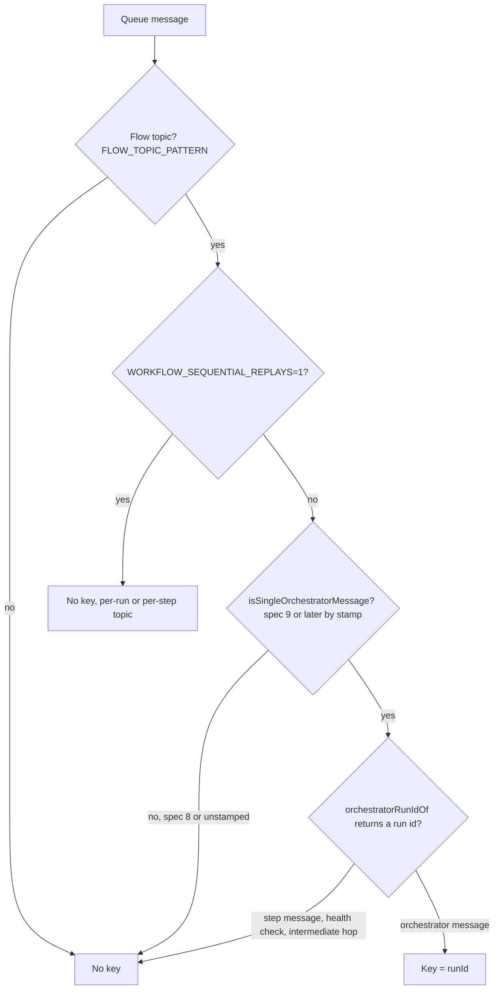
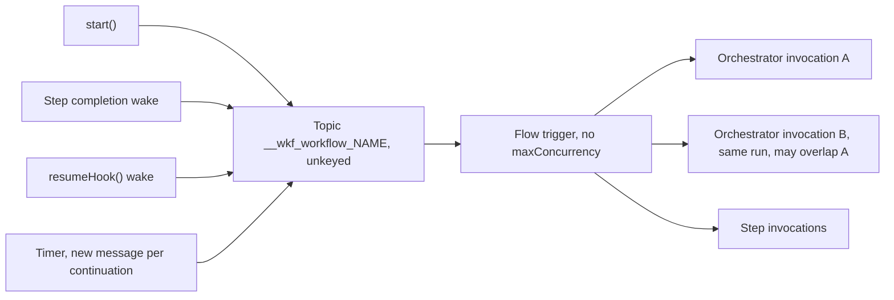
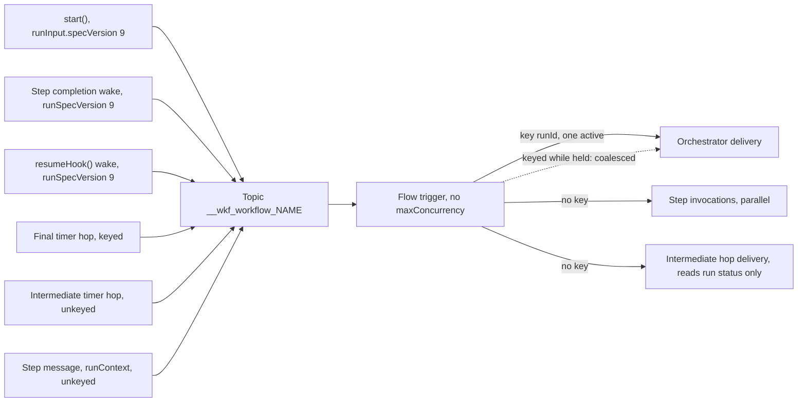
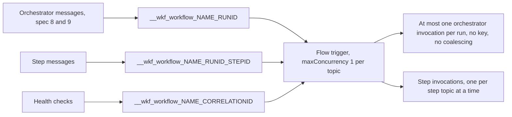
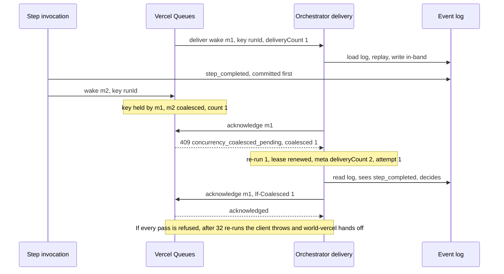
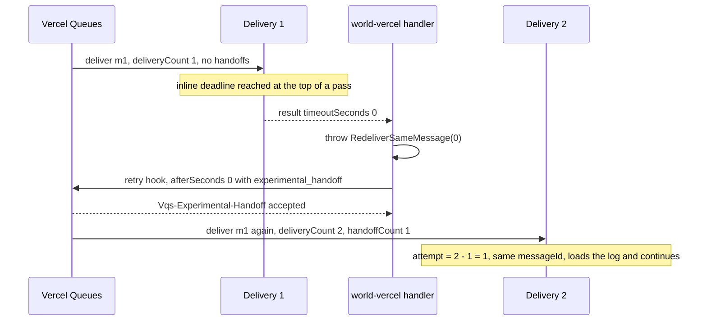
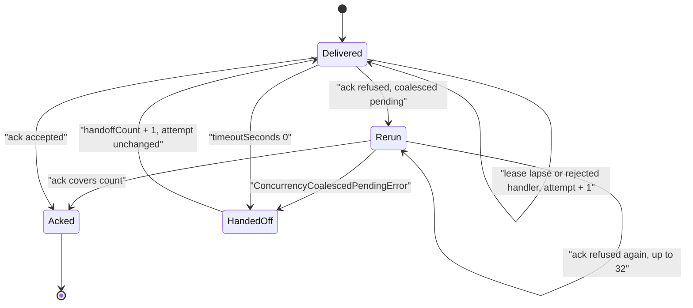
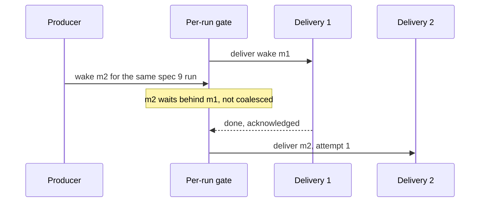

# Queue topology

<Callout type="warn">
This page is temporary review material for the pull request that introduces spec version 9, and is removed before merge. The written review is [Review: single orchestrator](/docs/changelog/single-orchestrator-review).
</Callout>

On Vercel, a spec 9 run is kept to one orchestrator invocation by a Vercel Queues concurrency key, the run id, on the same `__wkf_workflow_<name>` topic spec 8 runs use. Spec 8 runs keep `main`'s topology: no key, and a `{ timeoutSeconds }` result continues on a new message. The in-band fence that makes an overlap safe when the key does not hold is on [The in-band fence and its 412s](/docs/changelog/single-orchestrator-diagrams/in-band-fence).

## What decides the topic and the key

world-vercel decides from the payload alone, at send and at delivery. Three helpers from `@workflow/world` do it:

- `messageRunSpecVersion` reads `runInput.specVersion`, then `runContext.specVersion`, then the `runSpecVersion` hint. `isSingleOrchestratorMessage` is true when that is 9 or more. An unstamped message counts as spec 8 (`packages/world/src/queue.ts:657`, `:683`).
- `orchestratorRunIdOf` returns the run id for an orchestrator message, and `undefined` for a step message (`stepId`), a health check, and an intermediate hop of a long wait's timer (`isIntermediateWaitHop`, `waitContinuation.resumeAtMs` set) (`packages/world/src/queue.ts:615`, `:638`).
- `concurrencyKeyOf` in world-vercel combines them: a flow topic (`FLOW_TOPIC_PATTERN`), the opt-in off, a spec 9 message, then `orchestratorRunIdOf` (`packages/world-vercel/src/queue.ts:660`).

## Spec 8 on Vercel

Every flow message of a workflow, orchestrator and step, goes to one topic. The trigger has no `maxConcurrency`, so two orchestrator invocations of one spec 8 run can run at once. A `{ timeoutSeconds }` result sends a new message (delay up to 23 hours) before acknowledging (`packages/world-vercel/src/queue.ts:984`).

## Spec 9 on Vercel

Same topic and same trigger. Orchestrator messages carry the run id as the key. Vercel Queues keeps at most one push delivery per key active, and a keyed message claimed while another delivery holds the key is coalesced into that delivery. Step messages, health checks and intermediate wait hops carry no key and keep full parallelism. A run's step dispatches share one topic, so a fan-out's step messages go out in parallel queue batch requests of up to `STEP_DISPATCH_QUEUE_BATCH_SIZE` (16) each on the node engine (`enqueueStepMessages`, `packages/core/src/runtime/spec9/delivery.ts:3697`); world-vercel caps one request at 100 (`packages/world-vercel/src/queue.ts:38`, `:860`).

## The `WORKFLOW_SEQUENTIAL_REPLAYS=1` opt-in

The opt-in keeps `main`'s topology for every run: a per-run topic for orchestrator messages, a per-step topic for step messages, a per-probe topic for health checks (`getPhysicalQueueName`, `packages/world-vercel/src/queue.ts:613`), and `maxConcurrency: 1` on the flow trigger (`packages/builders/src/constants.ts:129`). Spec 9 messages are then sent unkeyed, because Vercel Queues refuses (400) a keyed send to a topic a `maxConcurrency` consumer reads. The per-run topic serializes the orchestrator, nothing is coalesced, and handoffs still work.

## The Vercel Queues client (`@vercel/queue` 0.9.0)

What the client does with a keyed message (`experimental_concurrencyKey`), in `src/consumer-group.ts` and `src/api-client.ts` of `@vercel/queue`:

- **Send.** The key travels as the `Vqs-Experimental-Concurrency-Key` header. A coalesced message is never delivered, so its sender must commit what the message is for before sending it.
- **Conditional acknowledgment.** The holder's acknowledgment is refused with 409 `concurrency_coalesced_pending` and a coalesced count while coalesced messages it has not covered are pending (`ConcurrencyCoalescedPendingError`). The next acknowledgment sends `Vqs-Experimental-If-Coalesced: <count>`: acknowledge only if at most that many were coalesced.
- **Re-runs with the lease held.** Between refusals the client renews the lease at once and runs the handler again, with `experimental_coalesced: { rerun, coalescedCount }` in the metadata, up to `experimental_maxCoalescedReruns` times (world-vercel passes `MAX_COALESCED_RERUNS`, 32). Past that, the refusal is thrown to the retry hook.
- **Handoff.** A retry directive `{ afterSeconds: 0, experimental_handoff: true }` changes visibility to 0 with `Vqs-Experimental-Handoff: 1`. The queue answers `accepted`, or `not_immediate` / `limit_reached` when it applied an ordinary reschedule instead (it bounds handoffs per message). The next delivery reports `experimental_handoffCount`, from the `ce-vqsexperimentalhandoffcount` header.

## `{ timeoutSeconds }` by run spec

`createQueueHandler` in world-vercel reads the run's spec off the payload (`packages/world-vercel/src/queue.ts:977`).

| Handler result | Spec 9 run | Spec 8 run or unstamped |
|---|---|---|
| `{ timeoutSeconds: n }`, `n > 0` | Same message redelivered after `n` seconds (`RedeliverSameMessage`; Vercel Queues clamps to 5 to 900 seconds) | New message with `delaySeconds: min(n, 82800)`, sent before the acknowledgment |
| `{ timeoutSeconds: 0 }` | Handoff: same message, at once, not an attempt | New message with no delay |
| Non-finite `timeoutSeconds` | Redelivery after 900 seconds, counted | `Infinity` is clamped to a new message 82800 seconds out |
| Anything else | Acknowledge | Acknowledge |

A spec 9 delivery ends with `{ timeoutSeconds: 0 }` when `wakeSelf()` is called with nothing to carry and no delay (`packages/core/src/runtime/spec9/delivery.ts:809`, `:296`): the inline deadline, a stream flush, a hook conflict, a run-ahead stop past its restart, and the QuickJS continuations.

## Handoff

A message the orchestrator sent itself would be coalesced into its own delivery and re-run in the same invocation, which is why a spec 9 delivery hands off instead (`packages/core/src/runtime/spec9/delivery.ts:268`).

## Attempt accounting

world-vercel computes `attempt` as `max(1, deliveryCount - handoffCount)` and reports `deliveryCount + rerun` as the delivery count (`packages/world-vercel/src/queue.ts:956`). A re-run is not a queue delivery, so it never raises `attempt`. The spec 9 re-send rule reads `meta.deliveryCount`: every delivery counted above 1 re-sends unstarted background steps, once per invocation. A timer's redelivery owning its chain still reads `min(deliveryCount, attempt)`.

One message, in order:

| Delivery | Queue `deliveryCount` | `handoffCount` | `rerun` | `meta.deliveryCount` | `meta.attempt` | Re-send pass |
|---|---:|---:|---:|---:|---:|---|
| First delivery | 1 | 0 | 0 | 1 | 1 | no |
| Coalesced re-run 1 | 1 | 0 | 1 | 2 | 1 | yes |
| Coalesced re-run 2 | 1 | 0 | 2 | 3 | 1 | no, same invocation |
| After a handoff | 2 | 1 | 0 | 2 | 1 | yes |
| After a lease lapse (crash) | 3 | 1 | 0 | 3 | 2 | yes |
| After a fence refusal (`{ timeoutSeconds: 1 }`) | 4 | 1 | 0 | 4 | 3 | yes |

`meta.deliveryCount` drops from 3 to 2 across the handoff, because the queue never counted the re-runs. Turbo needs `attempt === 1` and `deliveryCount === 1`, and the delivery after a handoff reports 2, so the drop does not turn turbo on (`packages/core/src/runtime/spec9/delivery.ts:535`). Every delivery but the first, and but later re-runs of an invocation that already ran the pass, re-sends unstarted background steps created less than 23 hours ago (see [Step ownership and data](/docs/changelog/single-orchestrator-diagrams/step-ownership)). A handoff counts, so a busy fan-out that keeps handing off re-sends deduped messages on each continuation; the count is on the span as `workflow.reenqueue.count`.

## world-local and world-postgres

Both declare the fence, mint spec 9 runs by default (`mintedSpecVersion()`, `packages/world-local/src/index.ts:147`, `packages/world-postgres/src/index.ts:79`), and serialize a spec 9 run's orchestrator deliveries with `singleOrchestratorRunIdOf` (spec 9 by stamp, then `orchestratorRunIdOf`). Spec 8 runs, step messages, health checks and intermediate hops are not gated. Neither coalesces: a second orchestrator message waits and is delivered after the running one, so every background completion's wake is its own orchestrator delivery.

| | world-local | world-postgres |
|---|---|---|
| Per-run gate | In-process run gate (`createRunGate`, `packages/world-local/src/queue.ts:216`) | Graphile named queue per run (`serialRunId`, `packages/world-postgres/src/queue.ts:912`) |
| Handoff | Same message, `handoffs++`, `attempt = delivery + 1 - handoffs` (`packages/world-local/src/queue.ts:358`, `:448`), up to 10,000 handoffs. The delivery releases the run gate and takes it again in FIFO order, so orchestrator messages already waiting run first | Reschedule on a new Graphile job with the same `messageId`, no delay, on the run's named queue behind jobs already there (`packages/world-postgres/src/queue.ts:1040`) |
| `attempt` after a handoff | Unchanged | Reset to the new job's count (known gap, below) |
| Coalescing | None | None |
| Re-runs with the gate held, coalesced count | None | None |
| `invocationStartedAt` | Not passed | Not passed |

### Follow-up: coalescing on world-local and world-postgres

A fan-out of `n` background steps sends `n` wakes, and here each is one orchestrator delivery, in series. A delivery that finds the log tail at the position this process last consumed acknowledges after one tail read (`packages/core/src/runtime/spec9/consumed-position.ts`); every other one loads the full log and replays. world-vercel under `WORKFLOW_SEQUENTIAL_REPLAYS=1` has the same shape, with each wake one function invocation, because its spec 9 messages are unkeyed on per-run topics.

What these Worlds would need to match world-vercel:

1. Drop an orchestrator message for a spec 9 run that arrives while the run's delivery holds the gate, and count it on the holder.
2. When the holder's handler returns, run it again in the same process while counted messages are uncovered, reporting `deliveryCount + rerun` and the same `attempt`, and the first run's `invocationStartedAt`.
3. Cap the re-runs (world-vercel: 32) and hand off past the cap.
4. Give a handoff the front of the run's queue, instead of a place behind the waiting wakes.

Intermediate wait hops are already ungated and must stay that way, since a hop's delivery depends on its own message. Every other spec 9 orchestrator message is safe to coalesce (review page, section 5, "No orchestrator message carries state the log needs"). Not implemented.

## Edge cases

- An unstamped spec 9 orchestrator message is sent unkeyed and continues on new messages, so it runs next to the keyed holder and only the fence keeps it safe (`packages/world-vercel/src/queue.ts:666`).
- A keyed send to a `maxConcurrency` topic is refused with 400, which is why the opt-in sends spec 9 messages unkeyed (`packages/world-vercel/src/queue.ts:665`).
- A delivery whose acknowledgment is refused 32 times in a row gets `ConcurrencyCoalescedPendingError`, and the retry hook hands the message off instead of backing off (`packages/world-vercel/src/queue.ts:1039`).
- Every coalesced re-run measures its inline deadline from the invocation's start (`invocationStartedAt`), so a late re-run does not get a fresh budget (`packages/world-vercel/src/queue.ts:968`, `packages/core/src/runtime/spec9/delivery.ts:353`).
- A non-finite `timeoutSeconds` on a spec 9 message is a 900-second redelivery, never a handoff, so a handler that kept returning it is still bounded by the delivery cap (`packages/world-vercel/src/queue.ts:1012`).
- Vercel Queues bounds handoffs per message and past the bound applies an ordinary reschedule (`limit_reached`), which counts as an attempt; world-local mirrors this with `MAX_LOCAL_HANDOFFS` (`packages/world-local/src/queue.ts:333`).
- The queue's answer to a handoff is not logged by the client, so `accepted` versus `not_immediate` is not observed directly (`packages/world-vercel/src/queue.ts:1035`).
- A spec 8 continuation sends its new message before acknowledging, so a crash in between duplicates the wake instead of losing it (`packages/world-vercel/src/queue.ts:997`).
- world-postgres resets `attempt` on every reschedule, handoffs included, because the new Graphile job starts its own count and `attemptOffset` is carried unchanged (`packages/world-postgres/src/queue.ts:962`, `:1052`). See [Edge cases](/docs/changelog/single-orchestrator-diagrams/edge-cases).
- An intermediate wait hop has no key, so it is delivered beside a running orchestrator; its delivery writes nothing (`packages/world/src/queue.ts:620`). See [Timers and waits](/docs/changelog/single-orchestrator-diagrams/timers-and-waits).
