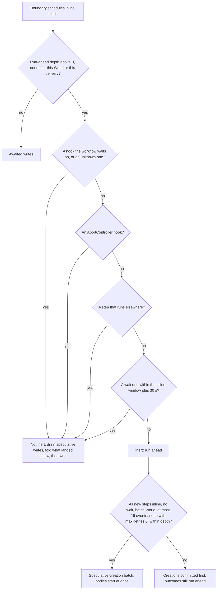
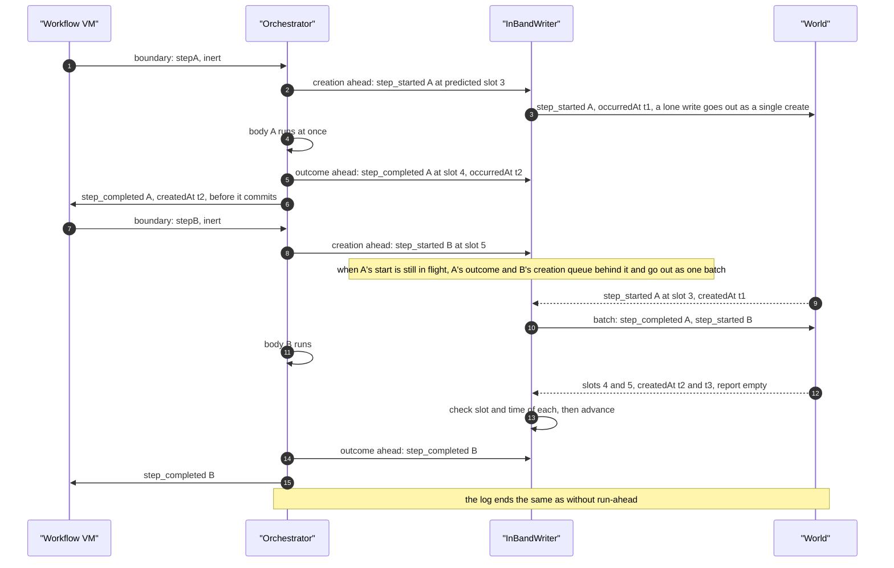
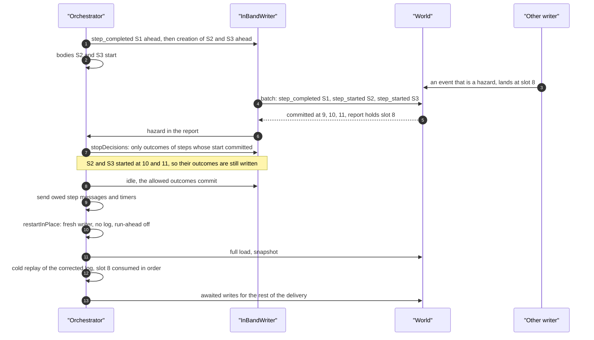
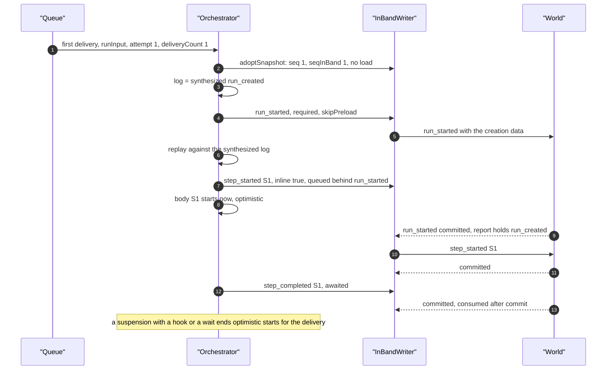

# Run-ahead and turbo

<Callout type="warn">
Temporary review material for the spec 9 pull request, removed before merge. See [Review: single orchestrator](/docs/changelog/single-orchestrator-review).
</Callout>

Both start work before the writes it depends on commit. Run-ahead hands an inline step's outcome to the workflow before its `step_completed` commits. Turbo, on a run's first delivery, writes `run_started` without waiting for it and starts the first inline bodies before their start commits. Every write still goes through the one in-band writer, in decision order.

## Run-ahead

`WORKFLOW_RUN_AHEAD_DEPTH` is 10 by default, clamped to 0..16, and 0 turns it off (`packages/core/src/runtime/constants.ts:410`, `constants.ts:422`). It caps how many step outcomes are unconfirmed at once. Run-ahead exists on the node:vm engine only: the QuickJS entry point has no run-ahead code.

### When a boundary may run ahead

At each suspension that schedules inline steps, the delivery classifies who else could append an event that changes what the workflow does next (`observeOutOfBandWriters`, `packages/core/src/runtime/out-of-band-observation.ts:156`; called at `packages/core/src/runtime/spec9/delivery.ts:2821`).



A hook the workflow has created but not awaited is inert on node:vm: its payload is buffered as an unarmed delivery and moves neither step results nor the clock (`out-of-band-observation.ts:27`).

### A clean run-ahead

{/* @skip-typecheck - illustrative workflow */}
```typescript
export async function pipeline(input: string) {
  "use workflow";
  const a = await stepA(input);
  const b = await stepB(a);
  return await stepC(b);
}
```



Each speculative write is checked when it commits (`writeOutcomeAhead`, `delivery.ts:2125`; `writeCreationAhead`, `delivery.ts:2203`):

- every event in its skipped-slot report is tested for a hazard;
- its stored `createdAt` must equal the `occurredAt` the workflow used, or the delivery stops and run-ahead is off for that World for the rest of the process (`delivery.ts:2154`);
- a slot other than the predicted one is a repair, not a stop: another writer appended first, and the delivery rebuilds its log from the responses and replays, keeping the retained session when it can (`delivery.ts:2164`).

### Hazards

`runAheadHazard` (`packages/core/src/runtime/spec9/run-ahead.ts:43`) names an event below a speculative write that would have made the boundary path-changing:

| Event below a speculative write | Hazard when |
|---|---|
| `hook_received`, `hook_disposed`, `hook_conflict` | the hook was sensitive at a boundary still in flight: awaited, unknown, or a system abort hook |
| `step_started`, `step_completed`, `step_failed`, `step_retrying` | the step is not one this delivery runs inline |
| `wait_completed` | always: on spec 9 only the orchestrator completes waits |
| anything else (`run_cancelled`, `attr_set`, `noop`) | never |

The classification rules these out, so a hazard means a writer the classification missed. The world-vercel backend refuses an out-of-band `wait_completed` on spec 9 runs (409 `wait-completion-in-band-only`). The run-ahead tests produce a hazard by appending one directly (`packages/core/src/runtime/spec9/run-ahead.runtime.test.ts:576`).

### A hazard stop and the restart in place



If the stop had refused the batch that creates S2 and S3 (a refused speculative write stops the writer before anything else is sent), their bodies ran with no committed start, and the restarted pass runs them again. That is how a stop can run a body twice: at most the steps of refused speculative creations, which the test bounds at the run-ahead depth (`run-ahead.runtime.test.ts:632`). A `maxRetries: 0` step is never one of them, because it never starts ahead of its start (`packages/core/src/runtime/spec9/step-executor.ts:79`, `delivery.ts:3016`).

`MAX_RUN_AHEAD_RESTARTS` is 1 (`constants.ts:178`). With run-ahead off after the first restart, a second stop cannot come from run-ahead; a stop past the cap hands the message off instead (`delivery.ts:1075`).

## Turbo

Turbo is on by default (`WORKFLOW_TURBO`, `constants.ts:347`) and applies to a delivery when all of these hold (`delivery.ts:535`):

- the message carries `runInput`, so it is the message `start()` enqueued;
- `attempt` is 1 and `deliveryCount` is 1, so it is neither a redelivery, a handoff's next delivery nor a coalesced re-run;
- it is not a step message, a legacy hook resume or a timer.

A restart in place is never turbo (`delivery.ts:1128`).



The optimistic start applies only while every step of the boundary is inline and the boundary has no wait and no step that failed to serialize (`delivery.ts:3019`). A boundary with a background step commits its creations first.

## Edge cases

- **World stores its own time.** A speculative write whose `createdAt` differs from its `occurredAt` stops the delivery and turns run-ahead off for that World in the process (`packages/core/src/runtime/spec9/delivery.ts:2154`, `packages/core/src/runtime/spec9/run-ahead.ts:145`).
- **World without `createBatch`.** Speculative creation needs a batch World; outcomes still run ahead as single required writes (`delivery.ts:3041`, `packages/core/src/runtime/spec9/in-band-writer.ts:436`).
- **Depth cap.** An outcome at the cap waits for an earlier speculative write to settle and then runs ahead too, so the next creation shares a round trip (`delivery.ts:3430`).
- **Displaced speculative write.** Another writer took the predicted slot; the delivery repairs from the write responses without a log read and keeps the session (`delivery.ts:2164`; tested in `packages/core/src/runtime/spec9/run-ahead.runtime.test.ts:476`).
- **Cancellation below a speculative write.** Not a hazard; no outcome is left without its creation (`run-ahead.runtime.test.ts:534`).
- **Refused speculative creation.** The writer stops before any later write, so no outcome is written without its creation (`run-ahead.runtime.test.ts:413`).
- **Fence refusal while running ahead.** Handled as any refusal, with no orphan writes, and the redelivery completes (`run-ahead.runtime.test.ts:726`).
- **Slot gap from a queued sibling start.** A sibling's start queued ahead of a speculative outcome is not read as a hole; the delivery drains before judging the log (`delivery.ts:2488`).
- **Failed turbo `run_started`.** Its error decides the delivery whatever later write surfaced it: a fence refusal asks for a redelivery of the message, a conflict or expired run acknowledges, anything else is recorded as a setup failure or redelivered (`delivery.ts:1011`, `delivery.ts:1093`).
- **Resilient start under turbo.** A `run_started` carrying the creation data creates a run whose `run_created` never landed (`packages/core/src/runtime/spec9/turbo.runtime.test.ts:307`).
- **A step body's own out-of-band writes under turbo.** Stream and attribute writes from an optimistic body wait for the backgrounded `run_started` (`turbo.runtime.test.ts:394`, `delivery.ts:574`).
- **`WORKFLOW_OPTIMISTIC_INLINE_START=0`.** Each start is awaited, and the log load is still skipped (`turbo.runtime.test.ts:358`).
- **Coalesced re-run of the first delivery.** Reported with `deliveryCount` 2, so it loads the log (`turbo.runtime.test.ts:227`).
