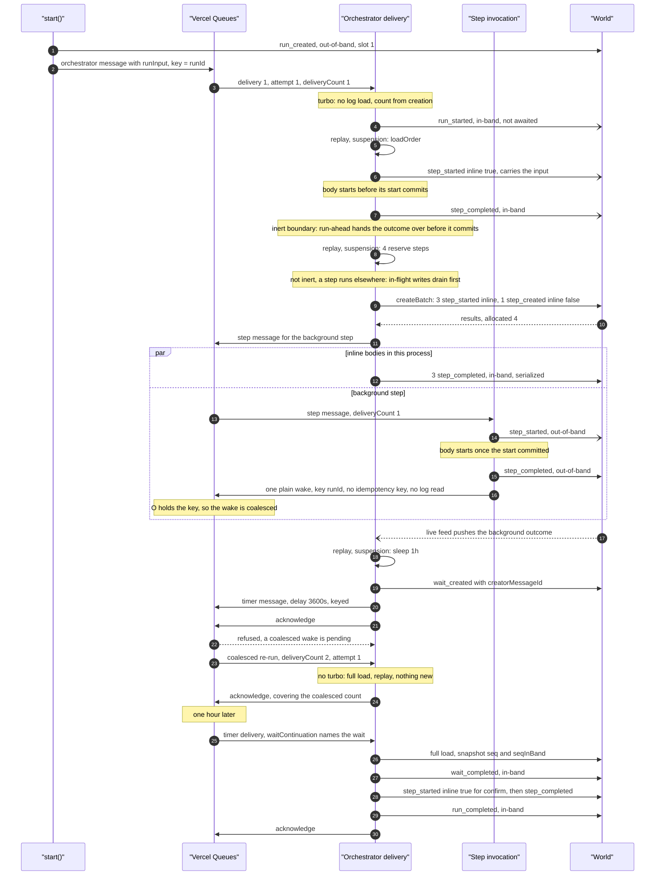
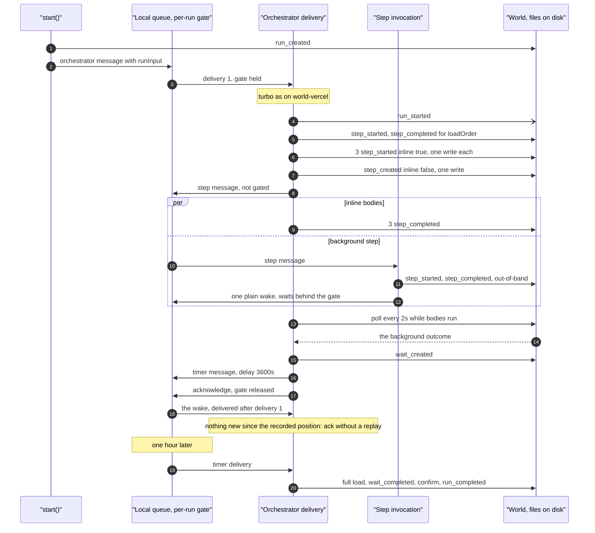
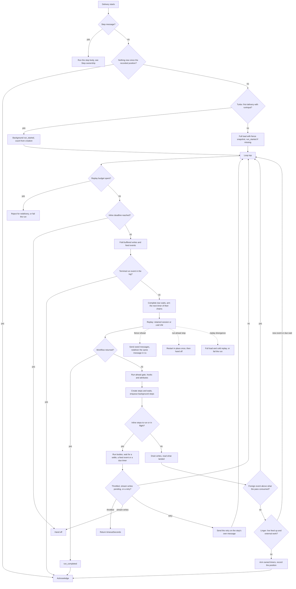

# Run lifecycle

<Callout type="warn">
Temporary review material for the spec 9 pull request, removed before merge. See [Review: single orchestrator](/docs/changelog/single-orchestrator-review).
</Callout>

This page follows one run of the workflow below from `start()` to `run_completed`. With the default `WORKFLOW_MAX_INLINE_STEPS` of 3 (`packages/core/src/runtime/constants.ts:191`), the four-way `Promise.all` gets three inline steps and one background step.

{/* @skip-typecheck - illustrative workflow */}
```typescript
export async function order(id: string) {
  "use workflow";
  const order = await loadOrder(id);   // inline, first delivery (turbo)
  await Promise.all([1, 2, 3, 4].map((n) => reserve(order, n))); // 3 inline, 1 background
  await sleep("1h");                   // suspends; a timer message wakes the run
  return await confirm(order);         // inline, timer delivery
}
```

Terms used below:

- **Delivery**: one call of the orchestrator handler for one queue message (`runSpec9Delivery`, `packages/core/src/runtime/spec9/delivery.ts:272`).
- **In-band**: a write the orchestrator makes, fenced with `expectedSeqInBand`. **Out-of-band**: any other writer (a background step's invocation, `resumeHook()`, `cancel()`).
- **Handoff**: the delivery returns `{ timeoutSeconds: 0 }` and the World delivers the same message again at once without counting an attempt (`delivery.ts:296`).

## On world-vercel



## On world-local

world-local has no `createBatch`, no live-feed push (`events.subscribe`) and no coalescing. It serializes a spec 9 run's orchestrator deliveries with an in-process per-run gate (`packages/world-local/src/queue.ts:210`); step messages are not gated.



## One delivery's main loop



The dotted exits are exceptions caught around the whole pass (`delivery.ts:1007`, `delivery.ts:2715`). The fence and run-ahead exits have their own pages: [The in-band fence](/docs/changelog/single-orchestrator-diagrams/in-band-fence) and [Run-ahead and turbo](/docs/changelog/single-orchestrator-diagrams/run-ahead-and-turbo).

## Edge cases

- **Resilient start.** When `run_created` never landed, the first delivery creates the run from `run_started` carrying `runInput`, and the writer starts at the count a run has at creation (`packages/core/src/runtime/spec9/delivery.ts:1292`).
- **Run already finished at setup.** A `run_started` refused as a conflict or an expired run acknowledges without writing (`delivery.ts:1359`).
- **Wake with nothing new.** A delivery that is its message's first (or whose invocation already ran the re-send pass), carries no `runInput`, hook or timer, and finds the log tail at the position this process recorded, acknowledges without a replay (`packages/core/src/runtime/spec9/consumed-position.ts:66`).
- **Coalesced re-run.** world-vercel reports a re-run with the next `deliveryCount` and the same `attempt`, so turbo is off and the log is read, and the first re-run of an invocation re-sends unstarted background steps (`packages/world-vercel/src/queue.ts:955`, `stepsToReenqueue`).
- **Non-first delivery.** A redelivery, a handoff continuation or a coalesced re-run re-sends, once per invocation and under each step's stable key, every background step with a `step_created`, no `step_started`, and a creation less than 23 hours old.
- **Recovery delivery.** On world-local after a restart, the recovery message carries `recovery: true`; its delivery also re-sends started steps with no outcome and arms every open wait chain.
- **Coalesced re-run of the wait's creator re-arms its timer.** A re-run is a new handler call with no memory of the timer the first pass sent, and spec 9 timers carry no idempotency key, so the run can hold two timers for one wait; the later one finds the wait completed and arms nothing (`packages/core/src/runtime/spec9/wait-timer.ts:19`, `packages/core/src/runtime/spec9/creator-rules.ts:112`). From reading the code; not run.
- **Inline deadline.** At the top of each pass the delivery hands off once `invocationStartedAt` plus the inline window has passed (`delivery.ts:2418`); the window is 2, 5 or 10 minutes depending on the function's deadline (`packages/core/src/runtime/delivery.ts:319`).
- **Inline-start margin.** Within `WORKFLOW_INLINE_STEP_DEADLINE_MARGIN_MS` (60s) of the window's end, new steps are created as background steps instead of inline (`packages/core/src/runtime/spec9/deadline.ts:26`, `delivery.ts:2956`).
- **Stream writes still flushing.** An inline step that returned with stream writes pending makes the delivery hand off once no body runs (`delivery.ts:3629`).
- **Hook conflict.** A hook conflict the workflow has to consume in a fresh pass hands off (`delivery.ts:2927`).
- **An event that landed after the VM decided.** Before suspending, a foreign event above the pass's consumed slot starts another pass instead of acknowledging, because its own wake would find the position already recorded (`delivery.ts:3339`).
- **Linger.** While the World's live feed is up (`LiveLogFeed.isLive`), a delivery with an open hook or a background step stays live up to `WORKFLOW_ORCHESTRATOR_LINGER_MS` (30s), capped by the inline-start margin, and runs a pass for each foreign event (`delivery.ts:2336`, `packages/core/src/runtime/spec9/live-feed.ts:41`).
- **Throttled inline start.** A throttled inline start defers the run by the longest backoff once every sibling settled (`delivery.ts:3572`).
- **Out-of-band terminal event first.** A `run_completed` that loses to an earlier `run_cancelled` or `run_failed` by position does not dispatch completion hooks (`delivery.ts:2615`).
- **Background step after its body.** The step's invocation writes its outcome once its `step_started` committed (the body starts after that commit; only under `WORKFLOW_OPTIMISTIC_BACKGROUND_START=1` does a plain first delivery start it while the start is in flight), then sends one plain orchestrator wake without reading the log (`packages/core/src/runtime/spec9/step-handler.ts`, `wakeOrchestrator`). That wake is the only thing that moves the run on. A redelivery of the step message that finds the step terminal sends the wake again, so a wake whose send failed is not lost; one that finds the run terminal sends nothing (commit `76643fe621`).
- **Uncoalesced wakes.** On world-local, world-postgres, and world-vercel under `WORKFLOW_SEQUENTIAL_REPLAYS=1`, each background outcome's wake is its own orchestrator delivery, delivered after the running one. A fan-out's wakes are then a series of deliveries; one that finds nothing new since the last consumed position acknowledges after one tail read, the others load the log and replay (review page, section 7).
- **QuickJS engine.** The same delivery hands the run to the QuickJS entry point after setup, with the same writer; it has no run-ahead and no divergence recovery (`delivery.ts:1508`).
