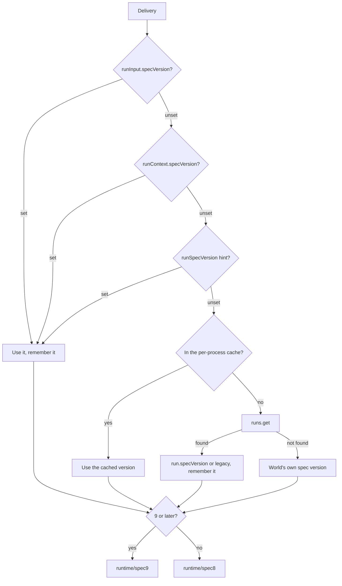
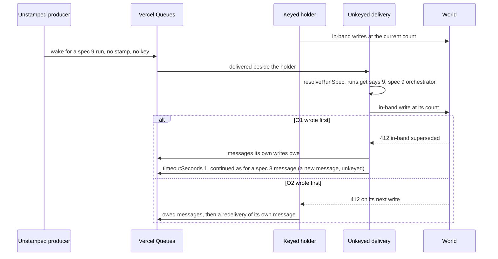
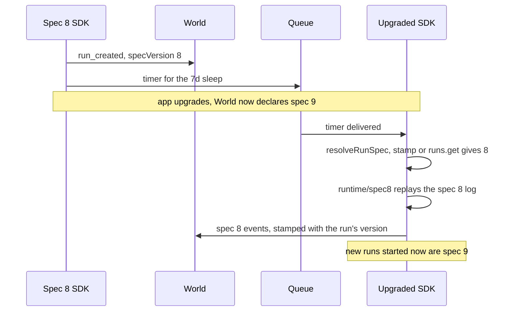
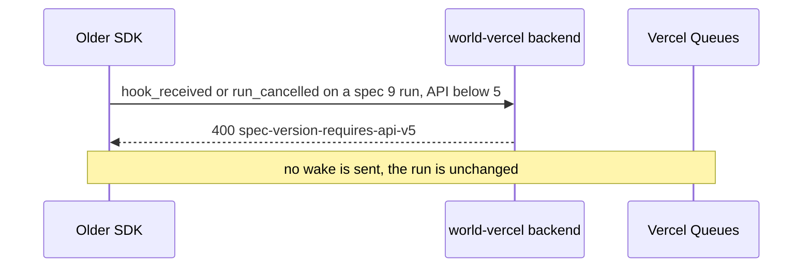

# Spec routing

<Callout type="warn">
This page is temporary review material for the pull request that introduces spec version 9, and is removed before merge. The written review is [Review: single orchestrator](/docs/changelog/single-orchestrator-review).
</Callout>

The runtime keeps two orchestrators side by side: `runtime/spec8/` (the previous one) and `runtime/spec9/`. A run keeps the spec version it was created with, and every delivery is routed by that stored version. Runs at 9 or later go to the spec 9 orchestrator, anything earlier to spec 8 (`packages/core/src/runtime.ts:60`).

## Resolving a delivery's spec

`resolveRunSpec` (`packages/core/src/runtime/run-spec-routing.ts:52`) tries, in order:

1. `runInput.specVersion`, on a run's first delivery from `start()`.
2. `runContext.specVersion`, on a step message.
3. `runSpecVersion`, the hint on every other message of a run.
4. A per-process cache of 10,000 run spec versions (`RUN_SPEC_VERSION_CACHE_SIZE`), on `globalThis` so every bundled copy shares it. A carried version is remembered here.
5. `runs.get(runId, { resolveData: 'none' })`. A run without a stored version is `SPEC_VERSION_LEGACY`. A run that is not found takes the World's own spec version, and the orchestrator handles the missing run. The run read here is handed on, so the orchestrator does not read it again.



The World decides the queue side from the payload alone, with `messageRunSpecVersion` (steps 1 to 3 only). It never reads the run. An unstamped message is spec 8 there, whatever the run is. See [Queue topology](/docs/changelog/single-orchestrator-diagrams/queue-topology).

## Spec 8 and spec 9 side by side

| | Spec 8 run | Spec 9 run |
|---|---|---|
| Orchestrator | `runtime/spec8` | `runtime/spec9` |
| Writers | Several orchestrator invocations may write; the World's step and wait rows refuse duplicates | One fenced in-band writer; out-of-band writers for hook payloads, step outcomes, cancellation, attributes |
| world-vercel topic | `__wkf_workflow_<name>`, unkeyed | Same topic, orchestrator messages keyed by run id |
| world-vercel `{ timeoutSeconds: n }` | New message, up to 23 hours | Same message redelivered; `0` is a handoff |
| world-local, world-postgres | Not serialized per run | Serialized per run (run gate, Graphile named queue) |
| Wake idempotency keys | `hook-<resumeId>`, `hook-force-claim-<hookId>` | None on wakes |
| `run.wakeUp()` | Writes `wait_completed` out-of-band | Sends `completeWaits` to the orchestrator |

world-local and world-postgres serialize only spec 9 runs (`singleOrchestratorRunIdOf`, `packages/world/src/queue.ts:705`). A spec 8 delivery can hold an inline step until another wake of the same run aborts it, and a per-run gate would hold that wake back.

## Minting new runs

`mintedSpecVersion()` returns 9, or the version `WORKFLOW_SPEC_VERSION` names (6 to 9), or 6 when `WORKFLOW_SEALED_LOG=0` is set and `WORKFLOW_SPEC_VERSION` is not (`packages/world/src/spec-version.ts`). First-party Worlds call it when they are created, so `WORKFLOW_SPEC_VERSION=8` works as a kill switch: new runs are spec 8, runs in flight keep their version. An unrecognised value is ignored with a one-time warning.

## Stamps at every send site

Every send of a spec 9 run's message in this runtime names the run's version. `queueMessage` and `queueMessages` add `runSpecVersion` from `opts.specVersion`, falling back to the process cache only when the caller passed none (`withRunSpecVersion`, `packages/core/src/runtime/run-spec-routing.ts:89`; `packages/core/src/runtime/helpers.ts:1388`). `spec9/spec-stamp.runtime.test.ts` clears the cache before every write and step body, on both engines, and checks every message is stamped.

| Producer | Field | Where |
|---|---|---|
| `start()`, first delivery | `runInput.specVersion` | `packages/core/src/runtime/start.ts:1219` |
| Background step message, node engine | `runContext` | `packages/core/src/runtime/spec9/delivery.ts:3722` |
| Background step message, QuickJS | `runContext` | `packages/core/src/runtime/spec9/quickjs-entrypoint.ts:218` |
| Orchestrator wake, timer, intermediate hop | `runSpecVersion` from the routed spec | `packages/core/src/runtime/spec9/delivery.ts:809` |
| Deployment-mismatch re-enqueue | `runSpecVersion`, the run's or the routed spec | `packages/core/src/runtime/spec9/delivery.ts:859` |
| Step handler's wake | `runSpecVersion` | `packages/core/src/runtime/spec9/step-handler.ts:258` |
| QuickJS wakes and timers | `runSpecVersion` | `packages/core/src/runtime/spec9/quickjs-entrypoint.ts:445`, `:2394`, `:2423` |
| `resumeHook()` wake | `runSpecVersion`, explicit | `packages/core/src/runtime/resume-hook.ts:971` |
| Force-claim victim wake | `runSpecVersion` from `claimedFrom` | `packages/core/src/runtime/hook-wake.ts:141` |
| `cancel()` wake | `runSpecVersion`, explicit | `packages/core/src/runtime/runs.ts:186` |
| `run.wakeUp()` | `runSpecVersion`, explicit | `packages/core/src/runtime/runs.ts:486` |
| `reenqueueRun()` | `runSpecVersion`, explicit | `packages/core/src/runtime/runs.ts:361` |
| `resumeHook()` and `cancel()` from an older SDK | none | outside this runtime |
| Vercel dashboard's pinned `@workflow/core` | none | outside this runtime, not verified here |
| Admin re-enqueue path | none, per the review | outside this repository, not verified here |

## An unstamped message

A message to a spec 9 run without a stamp still reaches the right orchestrator, because `resolveRunSpec` falls through to the cache or `runs.get`. The World treats it as spec 8: on world-vercel it is sent unkeyed and a `{ timeoutSeconds }` result continues on a new message; on world-local and world-postgres it skips the per-run gate. It then runs next to the keyed holder, and the in-band fence keeps that safe: the loser's write gets a 412, and it asks for a redelivery of its own message (see [The in-band fence and its 412s](/docs/changelog/single-orchestrator-diagrams/in-band-fence)). The log stays linear, but the overlap can cost more than one invocation: a spec 9 inline step's start carries no owner, so the unserialized delivery can start and run the body of an inline step the holder is still running, and the fence refuses only the later outcome write. Every producer in this runtime stamps its messages for that reason, including the restart recovery of world-local and world-postgres (`reenqueueActiveRuns`).



A spec 9 step message without a stamp would lose its same-message retry on world-vercel and arrive as a plain first delivery, which skips the log read the at-most-once rule of `maxRetries: 0` depends on. Every step message this runtime sends carries `runContext`, so this applies only to a producer outside it.

## A spec 8 run after an upgrade

A run started on a World that declares spec 8 keeps spec 8 after the app moves to a World that declares spec 9. `packages/world-testing/test/spec8-upgrade.test.ts` does this with world-local.

{/* @skip-typecheck - illustrative workflow */}
```typescript
export async function approval(requestId: string) {
  "use workflow";
  await notifyApprover(requestId);
  await sleep("7d");
  return await escalate(requestId);
}
```



Writes made outside a delivery (cancel, resume, wake-up, attributes) stamp the run's own version through `specVersionForRunWrite(run.specVersion)`, so a spec 8 run never receives a spec 9 event (`packages/core/src/runtime/resume-hook.ts:929`).

## An older SDK and a spec 9 run

The world-vercel backend accepts writes to a spec 9 run only over its API version 5. Every older API version gets 400 `spec-version-requires-api-v5` on a write, while reads stay available. An older SDK (a deployment rolled back, or another deployment's `resumeHook()`) therefore fails on the write, before it sends any wake. It cannot resume a hook or cancel a spec 9 run.



## Edge cases

- A run that is not found during routing takes the World's own spec version, and that orchestrator then handles the missing run (`packages/core/src/runtime/run-spec-routing.ts:70`).
- The cache holds 10,000 runs and evicts the oldest; a send site that relied on it used to go out unstamped after 10,000 other runs in one process, which the explicit stamps fixed (`packages/core/src/runtime/run-spec-routing.ts:24`).
- `withRunSpecVersion` never overwrites a `runSpecVersion` the payload already carries (`packages/core/src/runtime/run-spec-routing.ts:92`).
- A health check has no run spec and is never keyed or gated (`packages/world/src/queue.ts:660`).
- The in-band fence is checked where a spec 9 run is created (`start()`) and where its orchestrator delivery begins writing (the `InBandWriter`); a World that declares spec 8 creates spec 8 runs and is not checked (`assertWorldSupportsInBandFence`, `packages/core/src/runtime/world-compatibility.ts:78`).
- `WORKFLOW_SPEC_VERSION` with any value but `8` mints spec 9 (`packages/world/src/spec-version.ts:173`).
- An older SDK's 400 is answered on the write, so no stale wake is left queued for a spec 9 run.
