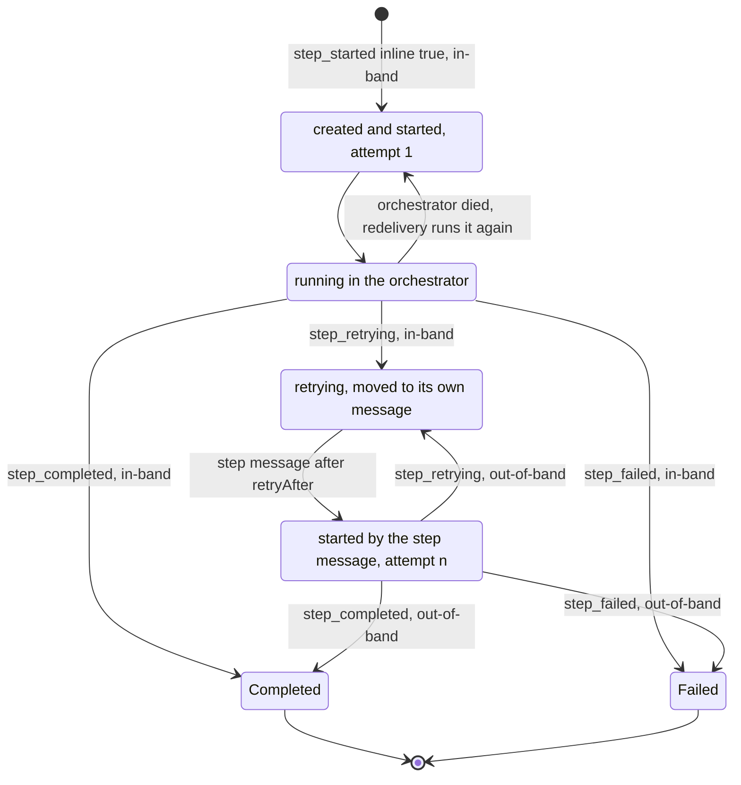
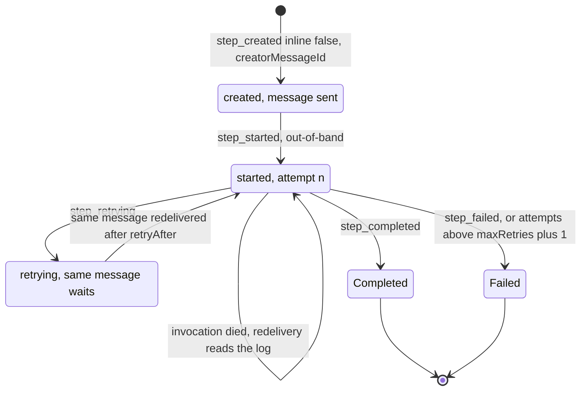
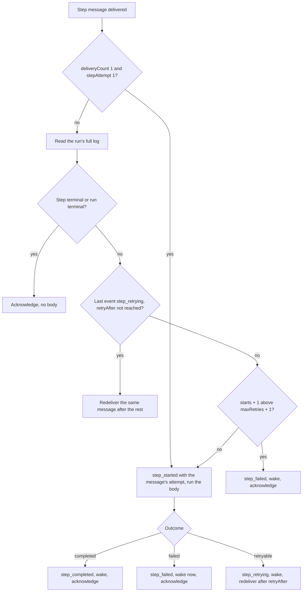
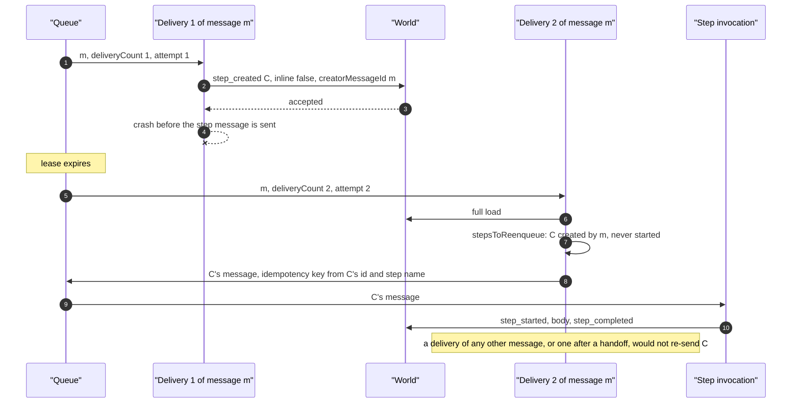
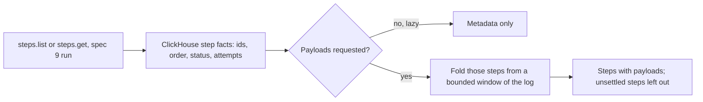

# Step ownership and data

<Callout type="warn">
Temporary review material for the spec 9 pull request, removed before merge. See [Review: single orchestrator](/docs/changelog/single-orchestrator-review).
</Callout>

A spec 9 step has one owner at a time, and its execution mode is fixed when it is created. The first `inlineSlots` new steps of a suspension are inline, the rest are background (`packages/core/src/runtime/spec9/step-wait-creation.ts:234`). `inlineSlots` is `WORKFLOW_MAX_INLINE_STEPS` (3 by default) less the inline steps already open or running, and 0 inside the inline-start margin or while a new hook waits on its conflict (`packages/core/src/runtime/spec9/delivery.ts:2954`).

- **Inline step.** Owned by the orchestrator delivery that created it, which runs the body in its own process and writes all of its events in-band. If its body fails with a retryable error, the retry moves to the step's own queue message, which owns the step from then on.
- **Background step.** Owned by its queue message, one message for the step's whole life. The step's invocation writes only `step_started` and the outcome, out-of-band, then wakes the orchestrator.

## What each event carries

| Event | Writer | `inline` | `input` | `creatorMessageId` | `attempt` | Notes |
|---|---|---|---|---|---|---|
| `step_started`, first of an inline step | orchestrator, in-band | `true` | yes | no | 1 | Also the step's creation. Told apart by `inline: true`, which no other start carries (`packages/core/src/runtime/spec9/log-state.ts:72`). |
| `step_created` | orchestrator, in-band | `false` | yes | yes | no | A background step's creation (`step-wait-creation.ts:259`). |
| `step_created`, unserializable input | orchestrator, in-band | `true` | placeholder | yes | no | Followed at once by `step_failed` (`step-wait-creation.ts:595`). |
| `step_started`, later | step invocation, out-of-band; or the orchestrator for an inline re-run | no | no | no | starts + 1 | The backend requires `attempt` and refuses an input on any start but the first. |
| `step_retrying` | the step's current owner | no | no | no | yes | Carries `retryAfter`. |
| `step_completed` / `step_failed` | the step's current owner | no | no | no | `step_failed` only | Terminal: every later event with the step's id is inert. |
| `wait_created` | orchestrator, in-band | n/a | n/a | yes | n/a | The wait chain's creator, read by the timer rules. |

`step_started.creatorMessageId` is gone: the creator rules never read an inline step's creator.

## Inline step

## Background step

## One delivery of a step message

The step's invocation never replays the workflow (`packages/core/src/runtime/spec9/step-handler.ts:93`). It decides from the message alone only on a plain first delivery; any other delivery reads the run's log first (`packages/core/src/runtime/spec9/step-delivery.ts:35`).

## Creator rules

A background step's message is sent once, right after its `step_created` commits. Only a redelivery of the message whose delivery wrote that `step_created` may send it again, and only while the step has no `step_started` (`stepsToReenqueue`, `packages/core/src/runtime/spec9/creator-rules.ts:22`). The same rule re-sends an inline step whose last event is `step_retrying` (the crash window between that write and its retry message).

"Redelivery" counts attempts, not deliveries: the delivery uses `min(deliveryCount, attempt)` (`delivery.ts:344`), and `attempt` leaves out handoffs and coalesced re-runs (`packages/world-vercel/src/queue.ts:955`). A delivery after a handoff behaves like the new message it replaces and re-sends nothing; a delivery after a crash counts 2 and re-sends.

A broader rule, "re-send every open background step on replay", would eventually send a second message for a step whose first message is still retrying past the queue's dedupe window: a second owner of its body (`creator-rules.ts:13`).

## `maxRetries: 0`

- **No early start.** A step declared with `maxRetries: 0` never starts its body before its `step_started` commits, under turbo or run-ahead (`mayRunBeforeItsStart`, `packages/core/src/runtime/spec9/step-executor.ts:79`). A boundary that creates one commits its creations first (`delivery.ts:3009`).
- **Background redelivery.** A redelivered message reads the log, finds one start with no outcome, computes attempt 2, and writes `step_failed` without running the body (`step-delivery.ts:117`; tested in `packages/core/src/runtime/spec9/orchestrator.runtime.test.ts:427`).
- **Message retention.** A step that never retries keeps its message for one day, one that may retry for seven (`packages/core/src/runtime/spec9/step-retention.ts:25`).
- **Inline re-run after an orchestrator crash.** A redelivered orchestrator re-runs an open inline step with attempt `starts + 1` (`packages/core/src/runtime/spec9/delivery.ts`, the `runnableInline` loop). `executeStep` fails an attempt past `maxRetries + 1` without running the body (`failStepForExhaustedRetries`, `spec9/step-executor.ts`), so an inline `maxRetries: 0` step whose start committed is failed rather than run again. Covered by `runs an inline maxRetries: 0 step at most once across an orchestrator crash` in `spec9/orchestrator.runtime.test.ts`, on both engines.

## How the world-vercel backend serves steps

The world-vercel backend keeps no step or wait rows for spec 9 runs: step and wait events are plain appends, with no step state checked on write. Step state is folded from the log when it is read.

- **Step lists and gets, metadata.** Which steps a page holds, and in what order, comes from the run's step event facts aggregated in ClickHouse by the same terminal-inert rules replay applies. Facts lag their events, so a step written moments ago can be missing or behind.
- **Payloads.** A request for payloads folds each step of the page from the log with payloads resolved, reading a bounded window of events from the page's earliest first event. A step the window does not settle is left out of a list (or a 404 for a get) and logged.
- **A get the facts do not know.** Folded from a bounded window from the start of the log, since facts are best-effort.

## Edge cases

- **Terminal-inert rule.** Once a step's outcome is consumed, every later event with its id is inert, so a stalled step invocation's late `step_started` or `step_retrying` cannot change what the workflow observed (`packages/core/src/events-consumer.ts:658`).
- **Re-run of an open inline step.** A redelivered orchestrator, or a second overlapping one, runs an inline step that has a start and no outcome again in its own process (`packages/core/src/runtime/spec9/delivery.ts:3239`).
- **Inline retry moves to the background.** A retryable failure writes `step_retrying` in-band and sends the step's first message with the next attempt, delayed to `retryAfter` (`delivery.ts:3579`).
- **Owed retry message on a refusal.** A committed `step_retrying` of an inline step is tracked as an owed message and sent by a refused or restarted delivery (`delivery.ts:469`).
- **Retry past the message's retention.** A retry that would land after the step's message expires fails the step instead (`packages/core/src/runtime/spec9/step-executor.ts:953`, `packages/core/src/runtime/spec9/step-retention.ts:36`).
- **Retry longer than one redelivery.** A `retryAfter` beyond the queue's redelivery cap is waited out across several redeliveries of the same message (`packages/core/src/runtime/spec9/step-delivery.ts:102`; tested in `orchestrator.runtime.test.ts:378`).
- **Outcome already in the log.** A redelivered step message whose step is terminal acknowledges without a body (`step-delivery.ts:85`).
- **Run terminal.** A step message for a run that ended acknowledges without a body (`step-delivery.ts:80`, `packages/core/src/runtime/spec9/step-handler.ts:381`).
- **Large inputs.** An input over 128 KiB is not carried on the message, and the step's invocation reads it from the step's creation event (`packages/core/src/runtime/spec9/log-state.ts:8`, `step-handler.ts:400`).
- **Unserializable arguments.** The step is finalized as `step_created` with a placeholder input plus `step_failed`, so the workflow observes the error (`packages/core/src/runtime/spec9/step-wait-creation.ts:563`).
- **world-postgres resets `attempt` on every reschedule.** A crash redelivery that then hands off loses its creator re-send on the next delivery (review page, section 7). Not fixed in this PR.
