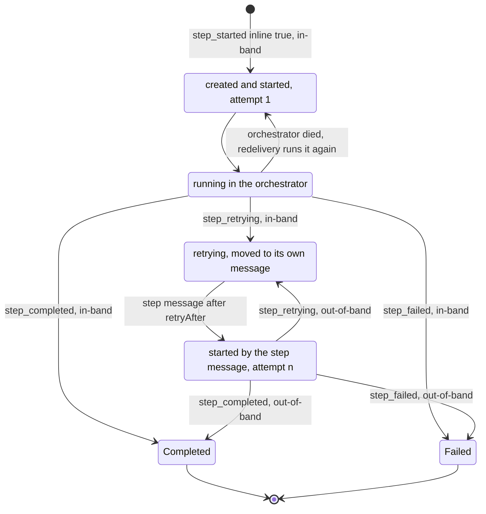
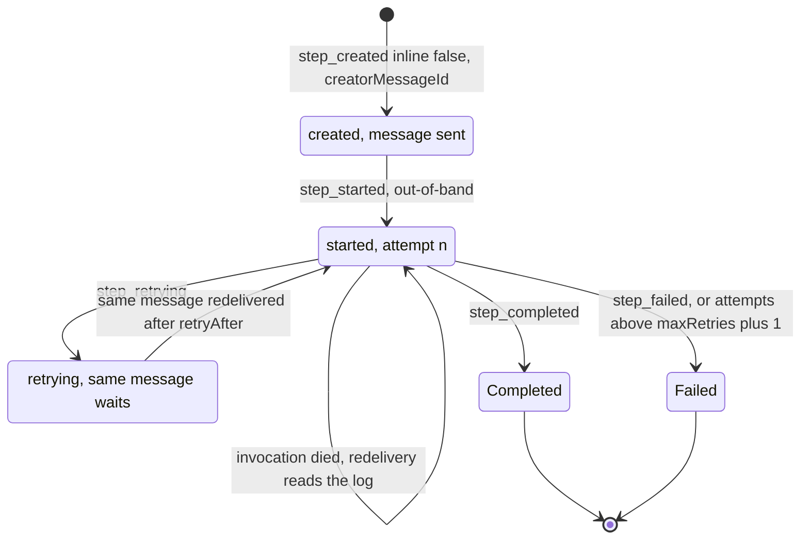
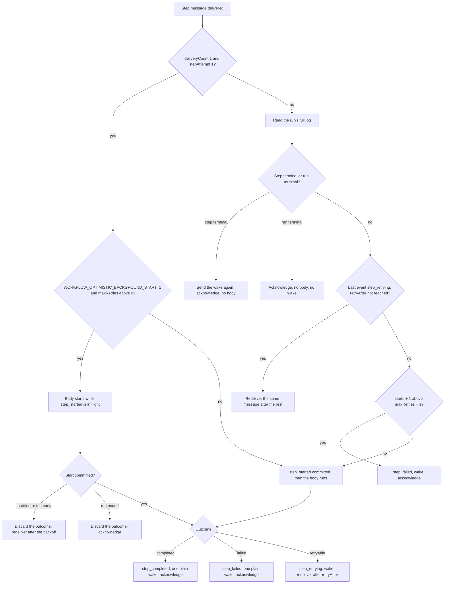
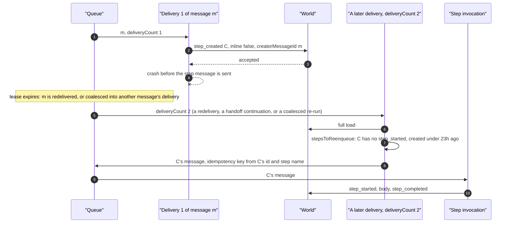
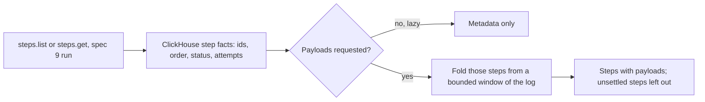

# Step ownership and data

<Callout type="warn">
Temporary review material for the spec 9 pull request, removed before merge. See [Review: single orchestrator](/docs/changelog/single-orchestrator-review).
</Callout>

A spec 9 step has one owner at a time, and its execution mode is fixed when it is created. The first `inlineSlots` new steps of a suspension are inline, the rest are background (`packages/core/src/runtime/spec9/step-wait-creation.ts:243`). `inlineSlots` is `WORKFLOW_MAX_INLINE_STEPS` (3 by default) less the inline steps already open or running, and 0 inside the inline-start margin or while a new hook waits on its conflict (`packages/core/src/runtime/spec9/delivery.ts:2961`).

- **Inline step.** Owned by the orchestrator delivery that created it, which runs the body in its own process and writes all of its events in-band. If its body fails with a retryable error, the retry moves to the step's own queue message, which owns the step from then on.
- **Background step.** Owned by its queue message, one message for the step's whole life. The step's invocation writes only `step_started` and the outcome, out-of-band, then sends the orchestrator one plain wake without reading the log. Its body starts once its `step_started` committed; under `WORKFLOW_OPTIMISTIC_BACKGROUND_START=1`, on a plain first delivery, a step that allows retries starts its body while the start is in flight, and the outcome waits for that start. The message carries when the step was created, and the `step_started` reports it.

## What each event carries

| Event | Writer | `inline` | `input` | `creatorMessageId` | `attempt` | Notes |
|---|---|---|---|---|---|---|
| `step_started`, first of an inline step | orchestrator, in-band | `true` | yes | no | 1 | Also the step's creation. Told apart by `inline: true`, which no other start carries (`packages/core/src/runtime/spec9/log-state.ts:72`). |
| `step_created` | orchestrator, in-band | `false` | yes | yes | no | A background step's creation (`step-wait-creation.ts:268`). |
| `step_created`, unserializable input | orchestrator, in-band | `true` | placeholder | yes | no | Followed at once by `step_failed` (`step-wait-creation.ts:625`). |
| `step_started`, later | step invocation, out-of-band; or the orchestrator for an inline re-run | no | no | no | starts + 1 | The backend requires `attempt` and refuses an input on any start but the first. |
| `step_retrying` | the step's current owner | no | no | only when the orchestrator moves an inline retry to the background | yes | Carries `retryAfter`. The orchestrator's `creatorMessageId` marks the retry as one the re-send rule covers. |
| `step_completed` / `step_failed` | the step's current owner | no | no | no | `step_failed` only | Terminal: every later event with the step's id is inert. |
| `wait_created` | orchestrator, in-band | n/a | n/a | yes | n/a | The wait chain's creator, read by the timer rules. |

`step_started.creatorMessageId` is gone: nothing reads an inline step's creator. A background step's `creatorMessageId` is kept for diagnostics; the re-send rule no longer reads it.

## Inline step

## Background step

## One delivery of a step message

The step's invocation never replays the workflow (`packages/core/src/runtime/spec9/step-handler.ts:95`). It decides from the message alone only on a plain first delivery; any other delivery reads the run's log first (`packages/core/src/runtime/spec9/step-delivery.ts:35`).

## The re-send rule

A background step's message is sent once, right after its `step_created` commits. A delivery that dies, or fails, between the two leaves the step with no message. Any orchestrator delivery whose `deliveryCount` is above 1 (a redelivery, a handoff continuation, a coalesced re-run, or a World that reports no count) re-sends every background step that has a `step_created` and no `step_started`, whichever message created it (`stepsToReenqueue`, `packages/core/src/runtime/spec9/creator-rules.ts`):

- once per invocation (`invocationResends`: coalesced re-runs share the invocation through `invocationStartedAt`, and later passes of a delivery skip what it re-sent);
- in batches, on both engines;
- under the step's stable idempotency key, so a re-send whose first message lives is deduped;
- only while the step's `step_created` is younger than 23 hours (`STEP_RESEND_MAX_AGE_MS`: `QUEUE_MIN_STEP_KEY_DEDUPE_WINDOW_MS` in `@workflow/world`, the 24 hours every World must dedupe a step key while its first message lives, less `STEP_RESEND_DEDUPE_MARGIN_MS`; world-postgres dedupes with `unsafe_dedupe` while the job exists), so a re-send never makes a second live message. The World does not have to refuse a second `step_started` of a running step, so this bound is what keeps two messages from both starting the step;
- marked as a re-send (`stepResent` on the payload). The re-send was decided from a log that may be older than the step's progress, so the step's message may have run the step to its outcome and been acknowledged since; a World is not required to keep the key past that acknowledgment. The marked message's handler reads the log even on its first delivery (`stepDeliveryNeedsLogRead`), so such a copy acknowledges without running the body.

The queue guarantees the pass: a delivery that dies is redelivered, or its message is coalesced into a running delivery whose re-run reports the next count. The span records `workflow.reenqueue.count` and `workflow.reenqueue.skipped_too_old`. An inline step whose last event is the `step_retrying` that moved it to the background (stamped with the orchestrator delivery's `creatorMessageId`) is re-sent the same way, by any delivery counted above 1, within the same bound counted from the `step_retrying`. The orchestrator never runs a retried inline step inline again (its `retried` set), so the re-send is the step's only way back to an owner after the delivery that moved it died before the send. A `step_retrying` the step's own message wrote carries no creator and is never re-sent: that message lives until the step ends.

A recovery delivery (world-local after a restart, `recovery: true`) also re-sends steps that started and have no outcome, with their next attempt so the handler reads the log first, and applies no age bound: the queue and its dedupe state died with the process.

The earlier rule allowed only a redelivery of the creating message to re-send, which left a step without a message when that redelivery was coalesced into another message's delivery, and when a fence-refused second delivery of the message acknowledged (review page, section 6, "Liveness").

## `maxRetries: 0`

- **No early start.** A step declared with `maxRetries: 0` never starts its body before its `step_started` commits, under turbo, under run-ahead, or on its background message's first delivery under `WORKFLOW_OPTIMISTIC_BACKGROUND_START=1` (`mayRunBeforeItsStart`, `packages/core/src/runtime/spec9/step-executor.ts:79`). A boundary that creates one commits its creations first (`delivery.ts:3016`).
- **Background redelivery.** A redelivered message reads the log, finds one start with no outcome, computes attempt 2, and writes `step_failed` without running the body (`step-delivery.ts:117`; tested in `packages/core/src/runtime/spec9/orchestrator.runtime.test.ts:589`).
- **Message retention.** A step that never retries keeps its message for one day, one that may retry for seven (`packages/core/src/runtime/spec9/step-retention.ts:25`).
- **Inline re-run after an orchestrator crash.** A redelivered orchestrator re-runs an open inline step with attempt `starts + 1` (`packages/core/src/runtime/spec9/delivery.ts`, the `runnableInline` loop). `executeStep` fails an attempt past `maxRetries + 1` without running the body (`failStepForExhaustedRetries`, `spec9/step-executor.ts`), so an inline `maxRetries: 0` step whose start committed is failed rather than run again. Covered by `runs an inline maxRetries: 0 step at most once across an orchestrator crash` in `spec9/orchestrator.runtime.test.ts`, on both engines.

## How the world-vercel backend serves steps

The world-vercel backend keeps no step or wait rows for spec 9 runs: step and wait events are plain appends, with no step state checked on write. Step state is folded from the log when it is read.

- **Step lists and gets, metadata.** Which steps a page holds, and in what order, comes from the run's step event facts aggregated in ClickHouse by the same terminal-inert rules replay applies. Facts lag their events, so a step written moments ago can be missing or behind.
- **Payloads.** A request for payloads folds each step of the page from the log with payloads resolved, reading a bounded window of events from the page's earliest first event. A step the window does not settle is left out of a list (or a 404 for a get) and logged.
- **A get the facts do not know.** Folded from a bounded window from the start of the log, since facts are best-effort.

## Edge cases

- **Terminal-inert rule.** Once a step's outcome is consumed, every later event with its id is inert, so a stalled step invocation's late `step_started` or `step_retrying` cannot change what the workflow observed (`packages/core/src/events-consumer.ts:658`).
- **Re-run of an open inline step.** A redelivered orchestrator, or a second overlapping one, runs an inline step that has a start and no outcome again in its own process (`packages/core/src/runtime/spec9/delivery.ts:3250`).
- **Inline retry moves to the background.** A retryable failure writes `step_retrying` in-band and sends the step's first message with the next attempt, delayed to `retryAfter` (`delivery.ts:3599`).
- **Owed retry message on a refusal.** A committed `step_retrying` of an inline step is tracked as an owed message and sent by a refused or restarted delivery (`delivery.ts:470`).
- **Retry past the message's retention.** A retry that would land after the step's message expires fails the step instead (`packages/core/src/runtime/spec9/step-executor.ts:974`, `packages/core/src/runtime/spec9/step-retention.ts:36`).
- **Retry longer than one redelivery.** A `retryAfter` beyond the queue's redelivery cap is waited out across several redeliveries of the same message (`packages/core/src/runtime/spec9/step-delivery.ts:102`; tested in `orchestrator.runtime.test.ts:540`).
- **Outcome already in the log.** A redelivered step message whose step is terminal acknowledges without a body (`step-delivery.ts:85`), and sends the plain orchestrator wake again first: the delivery that wrote the outcome may have died, or failed to send its wake, and that wake is the only thing that moves the run on. A live orchestrator absorbs it; one with nothing new acknowledges it after a tail read. Fixed in commit `76643fe621`; before it, a failed wake send stalled the run. Test: `re-sends the wake when a redelivered step message finds the step terminal` in `spec9/orchestrator.runtime.test.ts`, both engines.
- **Body before a refused start (opt-in only).** By default a background step's body runs only once its `step_started` committed, so a start that is throttled, refused as too early, or refused because the run ended (a cancelled run, for example) runs no body. Under `WORKFLOW_OPTIMISTIC_BACKGROUND_START=1`, on a plain first delivery the body of a step that allows retries runs while its `step_started` is in flight; such a refused start finds the body already run, and its outcome is discarded. Commit `83ee22003e` made that the default; it is now the opt-in. `WORKFLOW_OPTIMISTIC_INLINE_START=0` wins over the opt-in (`forceOptimisticStart`, `packages/core/src/runtime/spec9/step-handler.ts`; `reconcileOptimisticStart`, `step-executor.ts`).
- **Run terminal.** A step message for a run that ended acknowledges without a body (`step-delivery.ts:80`, `packages/core/src/runtime/spec9/step-handler.ts:294`).
- **Large inputs.** An input over 128 KiB is not carried on the message, and the step's invocation reads it from the step's creation event (`packages/core/src/runtime/spec9/log-state.ts:8`, `step-handler.ts:313`).
- **Unserializable arguments.** The step is finalized as `step_created` with a placeholder input plus `step_failed`, so the workflow observes the error (`packages/core/src/runtime/spec9/step-wait-creation.ts:593`).
- **world-postgres restarts `attempt` on a delayed reschedule.** A handoff keeps it (`1f7b912923`), and the re-send rule reads `deliveryCount`, so nothing strands; a fence refusal's redelivery does not count toward the delivery cap there (review page, section 7).
