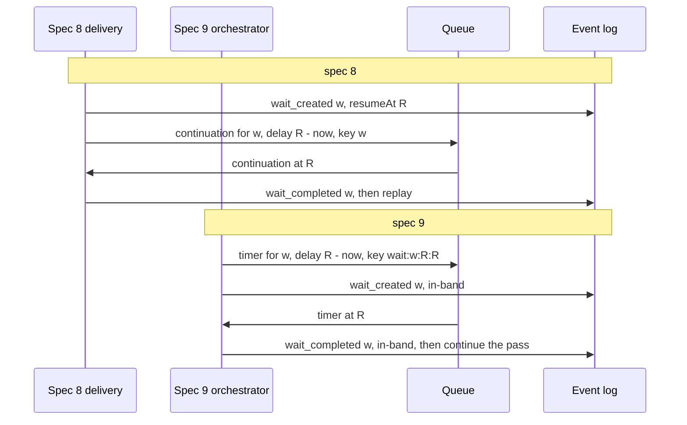
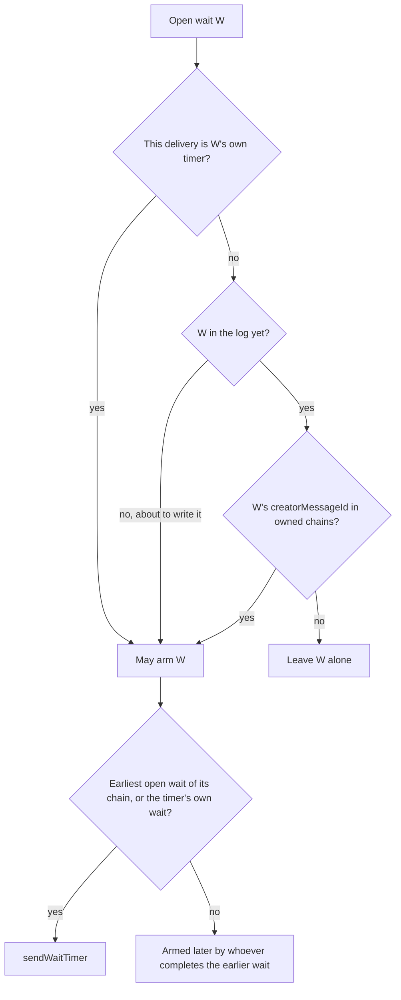
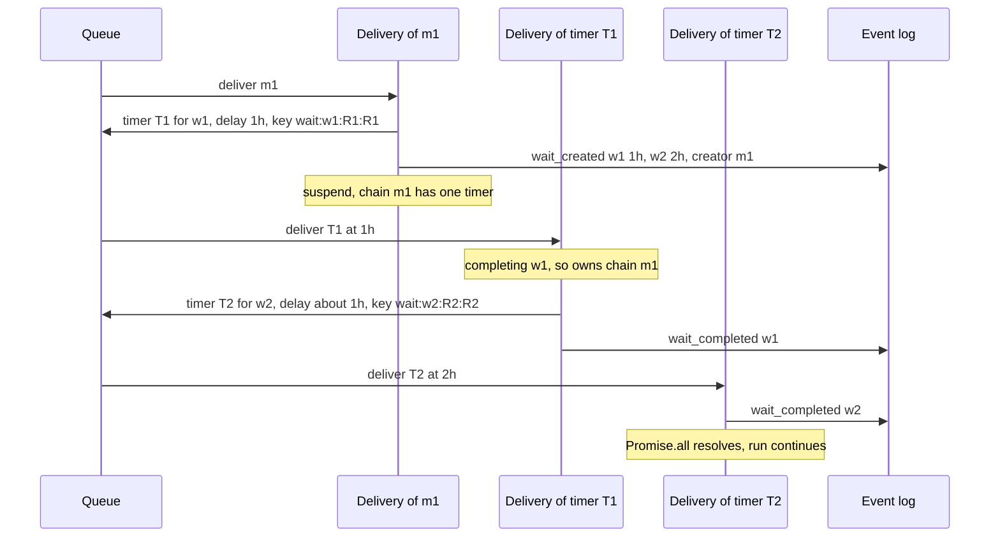
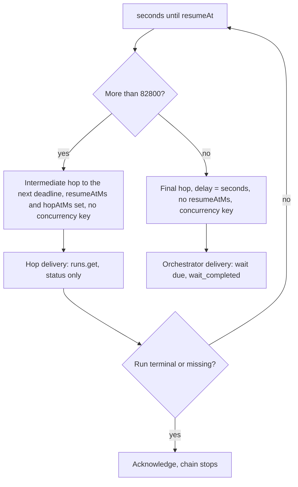
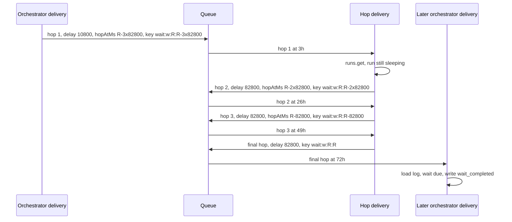
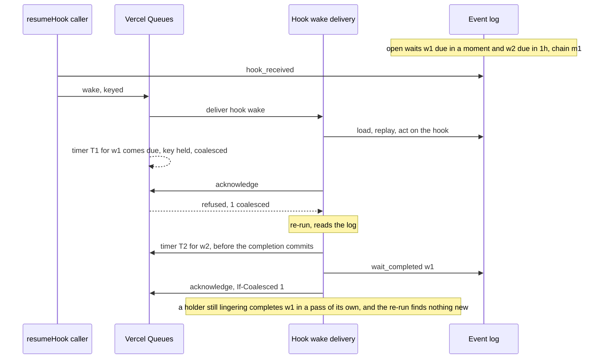
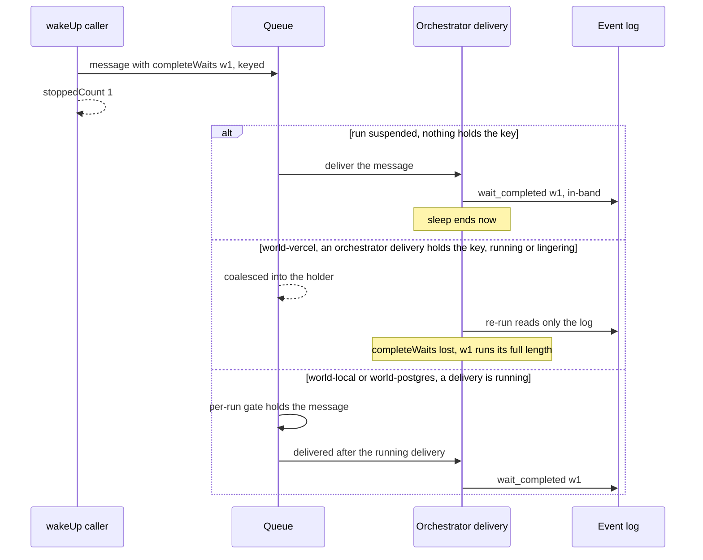

# Timers and waits

<Callout type="warn">
This page is temporary review material for the pull request that introduces spec version 9, and is removed before merge. The written review is [Review: single orchestrator](/docs/changelog/single-orchestrator-review).
</Callout>

Spec 9 is opt-in (`WORKFLOW_SPEC_VERSION=9`). New runs are spec 8 by default, and a spec 8 run keeps the timer handling described in the first section below for its whole life. Everything else on this page is about spec 9 runs.

## Spec 8 and spec 9 side by side

| | Spec 8 | Spec 9 |
|---|---|---|
| Who writes `wait_created` | The suspension handler of the delivery that reached `sleep()` | The orchestrator, in-band (fenced) |
| Who writes `wait_completed` | Any delivery that replays the run after the wait is due (the "complete elapsed waits" pass in `spec8/delivery.ts`), or `run.wakeUp()` directly | Only the orchestrator, in-band, at the top of a pass (`dueWaits`). An out-of-band `wait_completed` is refused ("Why `wait_completed` is in-band only" below) |
| The timer | One delayed continuation message for the run's earliest open wait, sent on every suspension and deduplicated by its key (`getWaitContinuationDispatch` in `wait-continuation.ts`) | One delayed message per wait chain, for the chain's earliest open wait, sent only by a delivery that owns the chain ("Who arms a timer" below) |
| A timer's delivery | A full replay of the run, which completes every elapsed wait and suspends again | An orchestrator delivery like any other: load the log, complete the due waits in-band, continue |
| Long sleeps | Hops of at most 23 hours, counted from the sender's clock: the first hop is a full one and the last is what is left. Every hop delivery is a full replay | Hops anchored on the wait's deadline: the last one is due at `resumeAt` and the first is the short one. An intermediate hop delivery reads only the run's status |
| Timer keys | `<correlationId>`, `<correlationId>:hop-<n>`, `<correlationId>:<second>` within the near-elapsed threshold, `:a<attempt>` after an early delivery | `wait:<correlationId>:<resumeAtMs>:<hopAtMs>`, `:a<attempt>`, and the near-due `wait:<correlationId>:<resumeAtMs>:s<second>` ("Timer keys" below) |
| A wait due while the delivery is alive | The delivery waits for its inline batch, then replays; a wait due within the inline window plus `WORKFLOW_OPEN_WAIT_CLOCK_SKEW_MS` gates the inline delta | The delivery waits in process until the earliest open wait is due (`waitForProgress` sleeps until `nextTimerAt`) and completes it in its next pass |
| `run.wakeUp()` | Writes `wait_completed` for each open wait, then sends a wake; `stoppedCount` counts completions | Sends one orchestrator message naming the waits (`completeWaits`); best-effort, and `stoppedCount` counts the waits it asked for |

Both specs share one thing: a sleep is a `wait_created` with a `resumeAt`, keyed by a fresh correlation id per `sleep()` call (`wait_${ctx.generateUlid()}`, `packages/core/src/workflow/sleep.ts`), and replay resolves the sleep's promise at its `wait_completed`.



On spec 9 the timer goes out before `wait_created` commits ("At creation" below), so the order in the diagram is deliberate.

## The pieces

On spec 9 the orchestrator writes both events of a sleep in-band: `wait_created` when the workflow reaches `sleep()`, and `wait_completed` at the top of a pass once the wait is due (`dueWaits`, `packages/core/src/runtime/spec9/delivery.ts`). Between the two, a timer message wakes the run. A timer is a delayed orchestrator message carrying `waitContinuation`, the wait it is for. Every timer carries an idempotency key ("Timer keys" below).

- `waitTimerHopAtMs` and `waitTimerMessage` (`spec9/wait-timer.ts`) build the message: the hop's deadline, anchored on the wait's (at most `WAIT_CONTINUATION_MAX_DELAY_SECONDS`, 82800 seconds, apart; `WORKFLOW_WAIT_CONTINUATION_MAX_DELAY_SECONDS` overrides it), its delay, its key, and `resumeAtMs` and `hopAtMs` on every hop but the last.
- `sendWaitTimer` (`spec9/delivery.ts`) sends one timer through `wakeSelf`, which stamps the run's spec version; `queueWaitTimer` (`spec9/quickjs-entrypoint.ts`) on QuickJS.
- `armTimers` (`spec9/delivery.ts`) sends the timers this delivery owns, once per wait per delivery; `armWaitsBeforeCreation` sends a new wait's timer before its `wait_created` commits; `armNearDueTimers` is the near-due rule; `armCreatedWaitTimers` arms, before a handoff, the timers of waits this delivery created and sent none for.
- `ownedWaitChains`, `schedulesWaitTimer`, `waitTimersToArm` and `chainTimersBeforeCompletion` (`spec9/creator-rules.ts`) decide which timers those are.

## Who arms a timer

Each `wait_created` records `creatorMessageId`, the queue message of the delivery that wrote it. All waits written by one message form a chain. A delivery owns, and arms the earliest open wait of:

- its own message's chain, including waits it is about to write;
- the chain of every wait whose `wait_completed` it committed, whatever message it is;
- on a redelivery of a timer message, that timer's chain;
- and the wait of a timer delivered before its wait is due (`timerFor`), which re-arms what is left.

**Why chain ownership is kept, now that every hop is keyed.** Keys make duplicates of one hop harmless, so a rule of "every delivery arms every open wait" would be correct. It would not be cheap: every wake of a run (each background step outcome, each hook) would send one timer per open wait, and on world-vercel each send is a queue operation even when the key drops it. Ownership keeps the number of sends per wait close to one; the keys cover the cases where ownership hands a timer to more than one sender.

Chain ownership lives in a delivery's memory, so a delivery that commits a write and then fails leaves the timer owed only to its message's redelivery, which the queue may coalesce into a delivery of another message, which owns no chain. Three rules close those gaps:

- **At creation.** A delivery that is about to commit the `wait_created` events of a pass first sends the timer of its own chain's earliest open wait, when that is one of the new waits (`armWaitsBeforeCreation` on node; the creating pass's `armWaitTimers` before `dispatchPendingOps` on QuickJS). `resumeAt` is known before the write. If the commit then fails, the stray timer finds no wait, or finds the wait the redelivery created and re-arms it under that wait's key; a failed send commits nothing. A wait already due gets no timer: the next delivery completes it.
- **At completion (C1).** A delivery that is about to commit the `wait_completed` of a wait first sends the timer of the chain's next open wait (`chainTimersBeforeCompletion`, `3ba56bbd43`). That includes a timer delivery completing its own wait: an earlier version left the timer's own wait out (the `timerFor` exclusion), on the grounds that the timer's redelivery owns the chain, but a redelivery the queue coalesces into another delivery is never made, so the exclusion was dropped (`af8f076626`). A failure after the commit then leaves the chain armed; a failed send commits nothing, and the redelivery decides again. Duplicates are deduplicated by the hop's key, or find their wait completed.
- **Near due (C2).** A suspending delivery that may hold a coalesced timer (any delivery but its message's first) arms every open wait due within `max(5s, WORKFLOW_NEAR_ELAPSED_WAIT_THRESHOLD_SECONDS)`, whatever its chain (`getNearDueWaitWindowSeconds`, `66b355d28c`), so a final timer coalesced slightly before its wait is due, into a delivery that does not own it, is not lost. Each such re-arm carries an idempotency key, so the cost stays linear in the number of waits ("Near-due re-arms" below).

A recovery delivery (world-local after a restart, `recovery: true` on the message) owns every chain and arms the earliest open wait of each: the timers died with the queue.

Every other delivery leaves a chain alone, so timers do not pile up across suspensions. A late or duplicate timer finds its wait completed and arms nothing.



The delivery that completes a wait sends its chain's next timer before the completion commits, and arms the chains it completed waits of again right after (`armTimers(log.events, 'other-chains')`), which `timedWaits` makes a no-op when the first send went out. The delivery may end in a handoff first, and the next delivery does not know which waits this one completed.

## Two sleeps in one `Promise.all`

{/* @skip-typecheck - illustrative workflow */}
```typescript
export async function reminders() {
  "use workflow";
  await Promise.all([sleep("1h"), sleep("2h")]);
}
```

Both waits are created by message `m1`, so they form one chain, and only the earliest gets a timer.



An earlier rule let only the wait's own timer delivery arm the next one, and a timer coalesced into another delivery then lost the second sleep's timer. See [Two concurrent sleeps](/docs/changelog/single-orchestrator-diagrams/edge-cases#two-concurrent-sleeps) and [Coalesced timer losing its re-arm](/docs/changelog/single-orchestrator-diagrams/edge-cases#coalesced-timer-losing-its-re-arm).

## Races: a hook or a step against a sleep

{/* @skip-typecheck - illustrative workflow */}
```typescript
export async function approval(id: string) {
  "use workflow";
  const hook = createHook<{ ok: boolean }>({ token: `approve:${id}` });
  const timeout = sleep("1d");
  const winner = await Promise.race([hook, timeout.then(() => "timeout")]);
  return winner;
}
```

- The sleep's timer is armed as for any sleep. The race does not cancel it: if the hook wins, the wait stays open in the log, and its timer, when it comes, completes it in a delivery that replays the finished race and changes nothing. If the run has finished by then, the timer finds a terminal run and acknowledges.
- If the hook payload and the timer arrive close together on world-vercel, the second wake is coalesced into the delivery handling the first. The holder's re-run reads the log, so it sees both the `hook_received` and the due wait, and the replay picks the winner by log order, which is the same on every later replay.
- Several open sleeps of one delivery form one chain and get one timer between them, for the earliest. Sleeps created by different deliveries are different chains, each with its own timer.
- A wait due within the invocation's inline window plus `OPEN_WAIT_CLOCK_SKEW_MS` (30 seconds, `WORKFLOW_OPEN_WAIT_CLOCK_SKEW_MS`) makes the next boundary path-changing, so the orchestrator does not run ahead past it (`waitDue` in `observeOutOfBandWriters`). See [Run-ahead and turbo](/docs/changelog/single-orchestrator-diagrams/run-ahead-and-turbo).
- [Why `wait_completed` is in-band only](#why-wait_completed-is-in-band-only) below covers the ordering this protects.

## Long sleeps are reached in hops

A wait more than 82800 seconds (23 hours) away is reached in hops. The hops are anchored on the wait's deadline: the last is due at `resumeAt`, and each one before it 82800 seconds earlier, so a sender sends the earliest hop still ahead of it, and the first hop takes what is left over whole hops. Every hop but the last carries the wait's deadline (`waitContinuation.resumeAtMs`), which `isIntermediateWaitHop` reads, and its own (`waitContinuation.hopAtMs`). An intermediate hop has no concurrency key on world-vercel and no per-run gate on world-local and world-postgres. Its delivery reads only the run's status, writes nothing, sends the hop after its own (`hopAtMs` plus one hop, whatever its clock says, so a hop delivered a little early does not send itself again), and acknowledges (the intermediate-hop branch near the top of the spec 9 delivery in `spec9/delivery.ts`). The last hop is an ordinary timer with the run's concurrency key.



A 3-day sleep (259200 seconds), with `R` its deadline:



Any other sender of the same hop (the creating delivery's redelivery, a hop's own redelivery after it sent the next one) computes the same deadline and key, so the queue keeps one message per hop instead of starting a second chain of hops. That is what anchoring on the deadline buys over spec 8's scheme, where the hop index depended on the sender's clock and every hop delivery was a full replay.

An intermediate hop is never coalesced. A coalesced hop is never delivered, and the holder's re-run would find the wait not yet due and send no next hop (`isIntermediateWaitHop` in `packages/world/src/queue.ts`).

## A timer coalesced into a running delivery

A final timer carries the run's concurrency key. If it comes due while another delivery of the run holds that key (a hook wake, a step wake), Vercel Queues coalesces it. The timer's payload is lost, and that is harmless: the holder's re-run reads the log, finds the wait due, completes it, and, having completed it, owns its chain.



If the key was released before a keyed timer came due, the review states that Vercel Queues compares the timer's due time with the release and delivers it normally. That is queue behavior and is not verified here.

## Timer keys

Every spec 9 timer carries an idempotency key of the form `wait:<correlationId>:<resumeAtMs>:<slot>` (`spec9/wait-timer.ts`). The slot names which timer of the wait it is:

| Timer | Slot | Key |
|---|---|---|
| A hop, intermediate or last | the hop's deadline, epoch ms | `wait:<correlationId>:<resumeAtMs>:<hopAtMs>` (`waitTimerIdempotencyKey`) |
| A timer delivery's re-arm of its own wait, which came before the wait was due | the hop's deadline and the next attempt | `wait:<correlationId>:<resumeAtMs>:<hopAtMs>:a<attempt>` |
| A near-due re-arm (C2), and a last hop sent by a delivery that may hold a coalesced timer | the sender's second | `wait:<correlationId>:<resumeAtMs>:s<second>` (`nearDueTimerIdempotencyKey`) |

**Why the hop's deadline.** Before this, a wait's own timers carried no key, so every sender that owed one sent one: the creating delivery, its redelivery, a delivery completing an earlier wait of the chain, and a hop's own redelivery. Duplicates of a final timer cost one delivery each, but a duplicate intermediate hop started a second chain of hops, each sending its own next hop, until the wait was due. The key must be one string that every such sender computes for the same timer, and a different one for every timer the wait still needs. Hops anchored on the wait's deadline give that: the hop deadline depends only on the wait's deadline and which hop window the sender's clock is in (`waitTimerHopAtMs`), and the delivery of an intermediate hop names the next one from its own `hopAtMs`, so a hop delivered a little early does not compute its own deadline and drop its successor against its own key.

**Why `resumeAt`.** Two deadlines must never share a key. A creation that did not commit can leave a stray timer whose wait a replay then creates with another deadline; with `resumeAt` in it, that stray timer is a different message, and its delivery finds the wait not yet due and re-arms it under a fresh attempt. `run.wakeUp()` completes a wait (`wait_completed`) instead of moving it, and every `sleep()` mints a fresh correlation id.

**Why the attempt.** A last hop that arrives before its wait is due (clock skew between the queue and the host, or a World that clamps the delay below a hop) has spent the key of the hop due at `resumeAt`. Its delivery is the wait's timer delivery (`timerFor`), finds the wait open, and re-arms it with `attempt + 1` in the key, and every hop of that re-arm keeps the attempt. A redelivery of the early timer computes the same re-arm key.

**Why the sender's second.** The near-due rule (`dcddeb7378`) keys its re-arms by the sender's second, written `s<second>` in the slot so that its keys never equal a hop's. A near-due re-arm stands in for a last hop that the queue coalesced into a delivery and never delivered, and whose key the queue still holds, so it cannot take the hop's key. A last hop sent by any delivery that may hold a coalesced timer (any but its message's first) takes the same key for the same reason (`rearmsCoalescableTimer`): such a delivery may own the wait's chain, hold that wait's coalesced early timer and find the wait not yet due; the hop's key would drop its re-arm. Intermediate hops are never coalesced, so they keep the hop's key from every sender, and a long wait's hops never form a second chain.

**What is still sent twice.** A last hop sent by a first delivery under the hop's key and again by a later delivery of the same message that may hold a coalesced timer (a creator's redelivery, a timer's redelivery) under its second. This only happens on a failure path, and the duplicate costs one delivery that finds its wait completed or re-arms what is left. Within one delivery, `timedWaits` (node) and `scheduledWaitContinuations` (QuickJS) send each wait's timer once.

### How each World deduplicates a timer key

| World | A second send under the key |
|---|---|
| world-vercel | Dropped for `min(retention, 24h)` after the first send, acknowledged or not |
| world-local | Dropped while the first message lives (held, delayed or being delivered) |
| world-postgres | Dropped while a Graphile job holds the key (`unsafe_dedupe`: waiting, locked or in backoff); each worker also skips a key it completed recently |

The near-due key's second makes the dedupe window irrelevant for C2: every new second is a new key.

### Near-due re-arms

**The early-timer case.** A wait's last timer is due with the wait on the sender's clock, rounded up to a whole second. A host whose clock runs behind the queue's can receive it before the wait is due. Delivered on its own, it is the wait's `timerFor` and re-arms under the next attempt. Coalesced into a delivery that does not own the wait's chain, it is never delivered on its own, and that delivery finds nothing due and arms nothing: the wait would never complete. C2 covers that case.

**Why the rule needed a key.** Without a key, every suspending delivery sent a timer for every open wait due within the window, and nothing deduplicated them across deliveries. A fan-out of `step(i); sleep('3s')` whose outcomes each woke the run in its own delivery (no coalescing and no live feed: world-local, world-postgres, world-vercel without the push transport) sent `n(n + 1) / 2` timers instead of `n`. On QuickJS a wake that brought nothing new re-armed too. See [Near-due re-arms on every delivery](/docs/changelog/single-orchestrator-diagrams/edge-cases#near-due-re-arms-on-every-delivery).

**Who re-arms.** Only a delivery that may hold a coalesced timer: any delivery but its message's first (`mayHoldCoalescedTimer` in `spec9/delivery.ts`; `armsNearDueWaits` in `quickjs-entrypoint.ts`). A coalesced message never reaches the first run of the delivery that absorbs it: the holder runs again, and the re-run reports the next `deliveryCount`. A process also sends each key once (`sendNearDueTimerOnce`, the 10,000 newest keys), so a busy run's re-runs do not each pay a queue round trip per near-due wait.

**Why the second, once more.** A re-arm is sent with a delay of at least a second, since its wait is not yet due on the sender's clock. If it is itself delivered early and coalesced into another non-owner, that delivery re-arms in a later second of its clock, under a fresh key. A key of the wait alone would be spent by the first re-arm (for a day on world-vercel), and the next one dropped. A sender and receiver whose clocks differ by more than the re-arm's delay can still share a second; spec 8's near-elapsed keys have the same second bucket and the same limit.

**Alternatives considered.** The gate alone (on world-vercel every coalesced re-run of a busy run would still send a timer per near-due wait); the key alone (every first delivery of every wake would send a re-arm the queue then drops); deduplication within one delivery (the quadratic case); no re-arm (the coalesced-early hole comes back); and the hop's key (drops the re-arm, above).

**Cost**, measured on `AppendOnlyWorld.runOnClock`, which honours delays and keys (`packages/core/src/runtime/spec9/near-due-timers.runtime.test.ts`; timers sent / timers delivered / all deliveries):

| Fan-out of `step(i); sleep('3s')` | Before | After |
|---|---|---|
| 20 wide, one outcome per delivery, both engines | 210 / 210 / 251 | 20 / 20 / 61 |
| 40 wide, the same | 820 / 820 / 901 | 40 / 40 / 121 |
| 40 wide, every step done before the first wake, QuickJS | 1600 / 1600 / 1681 | 1 / 1 / 82 |
| 40 wide, the same, node | 40 / 40 / 121 | 1 / 1 / 82 |
| 40 wide, every delivery a coalesced re-run, frozen clock | | 40 / 40 / 121 |
| 20 and 40 wide, coalesced re-runs a quarter second apart | | node 80 and 120, QuickJS 38 and 36 |

## Timers inside a live delivery, and linger

A delivery that is still running inline steps completes a due wait itself. `waitForProgress` sleeps at most until the earliest open wait's deadline (`nextTimerAt`), and the next pass writes `wait_completed`. The timer message also goes out before the delivery waits (`armTimers` in `awaitInlineProgress`), so the wait is covered if the delivery ends first. When it comes due while the delivery still holds the key, it is coalesced and costs a re-run that finds nothing to do.

After its last pass, a delivery on a World with a live event feed (`events.subscribe`, world-vercel) lingers for up to `WORKFLOW_ORCHESTRATOR_LINGER_MS` (default 30 seconds, capped by the inline deadline) when the run waits on an open hook or a background step (`awaitsExternalWork`, `lingerForExternalWork`). A sleep alone never makes it linger. While it lingers:

- a wait that falls due ends the linger and the next pass completes it in process, the same as during inline work;
- it still holds the run's concurrency key, so a timer or a `run.wakeUp()` message arriving then is coalesced into it ("`run.wakeUp()`" below);
- timers for the chains it owns are armed when the linger ends without new work, on the suspend path (`armNearDueTimers`, then `armTimers`). The first timer of a wait it created went out before the creation anyway.

**Guidance.** A run with a long-lived hook (an approval or cancel token held for days) next to a polling `sleep()` lingers for the whole window on every wake, so each poll costs up to `WORKFLOW_ORCHESTRATOR_LINGER_MS` of function time. Dispose a hook once it is no longer needed, or lower the linger for such a deployment. A burst-aware hook linger is [follow-up 4](/docs/changelog/single-orchestrator-review#4-hook-linger-policy).

## `run.wakeUp()`

On a spec 9 run, `wakeUpRun` does not write `wait_completed`. It sends one orchestrator message with `completeWaits`, the waits to complete now, and returns `stoppedCount` as the number of waits it asked to complete, not the number completed (`packages/core/src/runtime/runs.ts`). The orchestrator completes the named waits on its first pass, whatever their `resumeAt` (`dueWaits` with `wakeUpWaits`, `spec9/log-state.ts`). On a spec 8 run, `wakeUpRun` writes each `wait_completed` out-of-band and then sends a wake, as before, and `stoppedCount` counts those writes.

The message is an ordinary keyed orchestrator message, so on spec 9 it is best-effort for this release:



On world-local the running delivery does not linger past its work, because world-local has no `events.subscribe`, so `@workflow/vitest`'s `waitForSleep()` and `wakeUp()` keep working. A durable wake-up is [follow-up 3](/docs/changelog/single-orchestrator-review#3-durable-runwakeup-on-spec-9). See also [`run.wakeUp()` lost under coalescing](/docs/changelog/single-orchestrator-diagrams/edge-cases#runwakeup-lost-under-coalescing).

## Why `wait_completed` is in-band only

An out-of-band `wait_completed` could commit below events the orchestrator already acted on while running ahead, and a later replay would see them in a different order. world-vercel refuses an out-of-band `wait_completed` on a spec 9 run with 409 `wait-completion-in-band-only`, and the run-ahead hazard check treats any `wait_completed` from another writer as a hazard (`spec9/run-ahead.ts`).

{/* @skip-typecheck - illustrative workflow */}
```typescript
export async function digest(userId: string) {
  "use workflow";
  const first = await fetchUpdates(userId); // run-ahead: outcome reaches the workflow before it commits
  const timeout = sleep("1h");
  return await Promise.race([timeout, nextUpdate(userId, first)]);
}
```

If a `wait_completed` committed below `fetchUpdates`'s outcome, the live run saw the step first and a replay would see the wait first.

## Failure and recovery

- **A crash after `wait_created`.** The timer went out before the creation committed, so the wait is armed whichever delivery comes next. See [A new wait's creator coalesced away](/docs/changelog/single-orchestrator-diagrams/edge-cases#a-new-waits-creator-coalesced-away).
- **A crash after `wait_completed`.** The chain's next timer went out before the completion committed (C1). See [A timer delivery's redelivery coalesced away](/docs/changelog/single-orchestrator-diagrams/edge-cases#a-timer-deliverys-redelivery-coalesced-away).
- **A crash in a hop chain.** A hop delivery that fails after sending the next hop is redelivered and sends the next hop again under the same key, which dedupes it.
- **A coalesced redelivery.** The holder's re-run reads the log; whatever is due it completes, and C2 re-arms what is near due.
- **world-local restart.** The in-memory queue and every queued timer die with the process. The recovery messages carry `recovery: true`, and a recovery delivery owns every chain, so it arms the earliest open wait of each (`ownedOpenWaits` in `spec9/delivery.ts`). See [world-local restart](/docs/changelog/single-orchestrator-diagrams/edge-cases#world-local-restart).
- **Message rotation near expiry.** A world-vercel orchestrator message close to its retention is continued on a new message instead of being handed off. The continuation carries `waitContinuation` and `completeWaits` (`SINGLE_ORCHESTRATOR_CONTINUATION_FIELDS` in `packages/world/src/queue.ts`), so a rotated timer still names its wait and a rotated wake-up still names its waits. Before a handoff, the delivery also arms the timers of waits it created and sent none for (`armCreatedWaitTimers`), since the new message's deliveries do not own the old message's chain.
- **The delivery cap.** Timer messages are orchestrator messages, so their deliveries count toward `WORKFLOW_MAX_QUEUE_DELIVERIES` like any other. An intermediate hop is acknowledged on its first delivery, and each hop is a new message, so a long sleep does not accumulate deliveries on one message.
- **Cancel.** `cancel()` writes `run_cancelled` out-of-band. A pending timer still arrives: an intermediate hop finds the run terminal and stops the chain, and a final timer's delivery finds a terminal run and acknowledges without writing. No timer is withdrawn from the queue.

## Per-World differences

| | world-vercel | world-local | world-postgres |
|---|---|---|---|
| Longest delay of one message | 23 hours by default (`VERCEL_QUEUE_MAX_DELAY_SECONDS`, below the 24-hour message retention) | `setTimeout`, capped at about 24.8 days | A job's `run_at`, no cap |
| Hop length | 82800 seconds on every World (`WAIT_CONTINUATION_MAX_DELAY_SECONDS`), so a hop never exceeds world-vercel's limit | the same | the same |
| Timer key dedupe | `min(retention, 24h)` after the first send | while the first message lives | while a job holds the key (`unsafe_dedupe`) |
| A final timer while a delivery runs | Coalesced into it (concurrency key) | Held behind the run's gate, then delivered | Held behind the run's named queue, then delivered |
| A due wait during linger | Completed in process | No linger (no live feed) | No linger (no live feed) |
| Timers after a restart | Survive (the queue is a service) | Lost; re-armed by the recovery delivery | Survive (jobs in the database); a hard-killed worker's job waits for its lock to clear ([follow-up 7](/docs/changelog/single-orchestrator-review#7-world-postgres-stale-named-queue-lock-after-a-hard-kill)) |

On world-vercel, a `delaySeconds` with a fraction is rounded up, so a timer can land up to a second after its deadline.

## What changes for a user who opts in

- **Timing precision.** A sleep completes when its final timer is delivered, or earlier when a live delivery reaches its deadline in process. Expect up to about a second of rounding on world-vercel, plus queue latency, as on spec 8.
- **Cost of a long sleep.** One message and one invocation per 23-hour hop, as on spec 8, but an intermediate hop delivery reads only the run's status instead of replaying the run, and a crash or duplicate send no longer starts a second chain of hops.
- **Cost of many concurrent sleeps.** One timer per chain rather than one per suspension, and C2's re-arms are linear in the number of waits.
- **`run.wakeUp()` is best-effort.** It can be dropped while a delivery of the run is running or lingering on world-vercel, and `stoppedCount` counts the waits it asked to complete. Tests that call `waitForSleep()` and `wakeUp()` on world-local keep working.
- **Cancel** leaves pending timers in the queue; each costs one delivery that finds the run terminal.
- **The dashboard's wake-up action**: the review states it calls a pinned `@workflow/core` that writes `wait_completed` out-of-band, which world-vercel refuses on spec 9 runs; not verified here.
- **Opting out** (unsetting `WORKFLOW_SPEC_VERSION`) does not change runs already created as spec 9: their timers, hops and wake-ups keep following spec 9's rules, because routing follows the run's stamped version.

## Edge cases

- A delivery that commits `wait_completed` and dies before its next send no longer leaves that chain without a timer. Tests in `spec9/wait-chains.runtime.test.ts`, both engines, including a timer delivery that fails after completing its sleep with two more open, whose redelivery is coalesced into another message's delivery.
- A delivery that commits `wait_created` and dies before its send no longer leaves the wait without a timer. Tests in `spec9/wait-chains.runtime.test.ts`, both engines: a failed timer send and a lost creation response, each with the redelivery coalesced into another message's delivery.
- A long sleep's hops are each one message, whichever deliveries send them: a creating delivery that fails after its creation, and hops whose deliveries fail after sending the next one, each deliver every hop once (`spec9/wait-chains.runtime.test.ts`, both engines).
- `VERCEL_QUEUE_MAX_DELAY_SECONDS` below 82800 clamps a final hop so it arrives early. Delivered on its own it re-arms its wait under the next attempt's key; coalesced into a delivery that owns its chain, it is re-armed under the sender's second (`spec9/wait-chains.runtime.test.ts`, a timer coalesced a minute early into a redelivery of the chain's message); coalesced into a delivery that does not own it, it is re-armed by the near-due rule only when it arrives within that window of its wait, so a clamp far below the hop length can still lose it.
- A world-local restart loses every queued timer; the recovery delivery re-arms every chain (`world-local-restart-recovery.test.ts`).
- A timer delivered slightly early (clock skew) is its own wait's `timerFor` and re-arms the rest, under the next attempt's key (`schedulesWaitTimer`).
- A timer delivery skips the no-op fast path, because an early one must still arm the next hop.
- A delivery that owns waits of two chains arms the earliest of each chain, not the earliest of all (`waitTimersToArm`).
- An intermediate hop for a run that ended stops the chain without writing anything.
- A last hop can still be sent twice on a failure path ("What is still sent twice" above).
- A near-due re-arm that is itself delivered early and coalesced into a non-owner is re-armed under a fresh key in a later second; clocks that differ by more than its delay can make the keys collide. Not covered by a test.

## Open items

- A durable `run.wakeUp()` on spec 9: [follow-up 3](/docs/changelog/single-orchestrator-review#3-durable-runwakeup-on-spec-9).
- Lingering on hooks only while a burst is plausible: [follow-up 4](/docs/changelog/single-orchestrator-review#4-hook-linger-policy).
- Sharing timer sends between the node and QuickJS engines: [follow-up 17](/docs/changelog/single-orchestrator-review#17-share-timer-sends-between-the-spec-9-engines).
- The near-due key collision under large clock differences, and a clamped `VERCEL_QUEUE_MAX_DELAY_SECONDS` far below the hop length (edge cases above), are accepted for this release.
