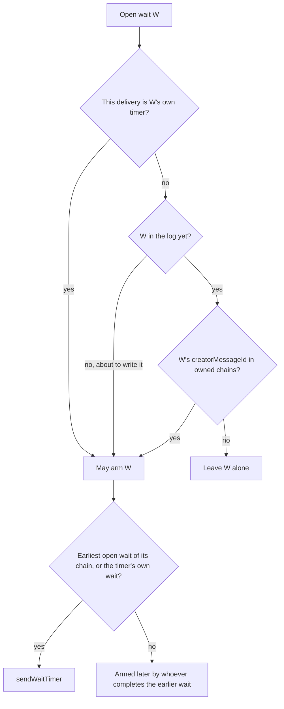
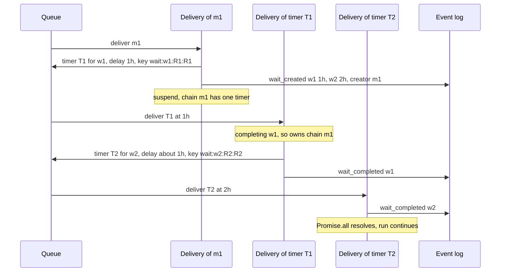
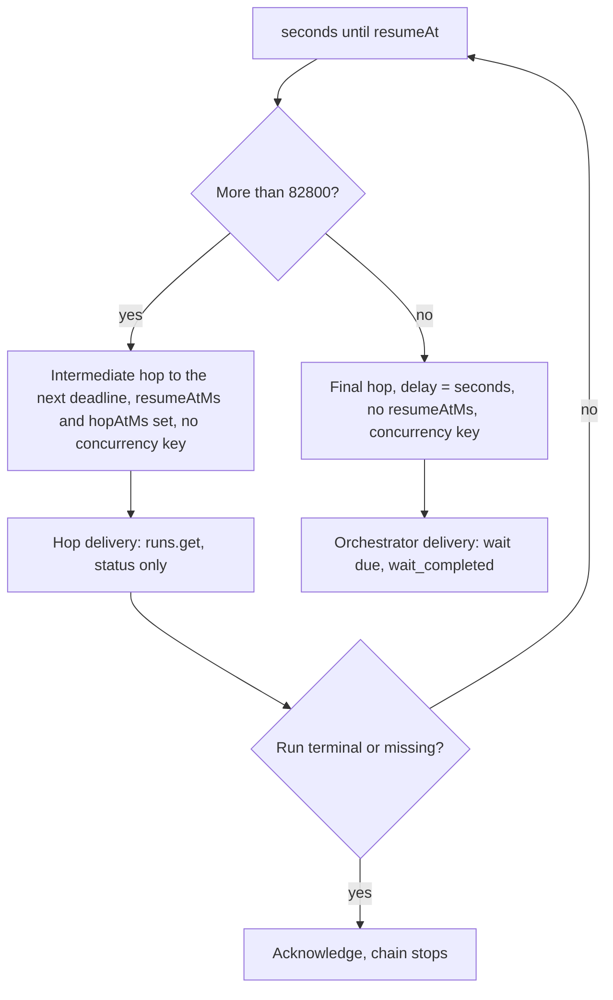
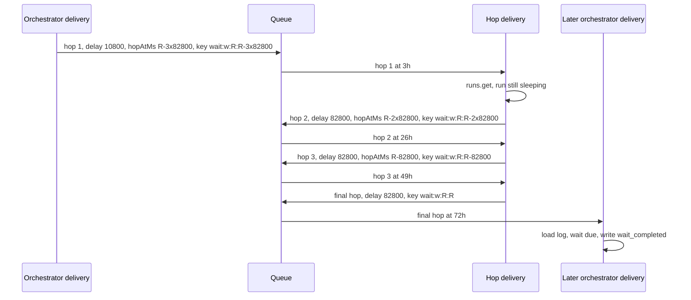
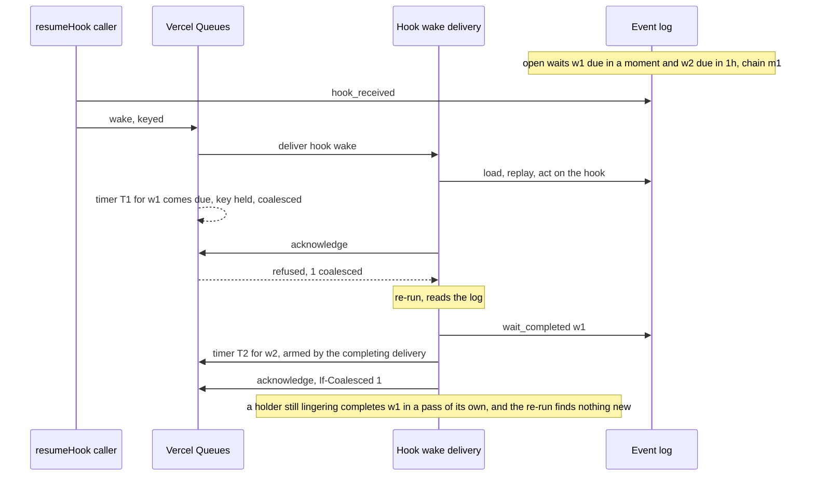
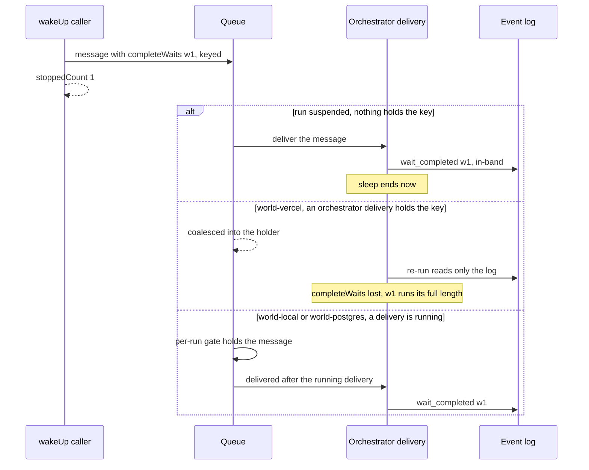

# Timers and waits

<Callout type="warn">
This page is temporary review material for the pull request that introduces spec version 9, and is removed before merge. The written review is [Review: single orchestrator](/docs/changelog/single-orchestrator-review).
</Callout>

On spec 9, the orchestrator writes both events of a sleep in-band: `wait_created` when the workflow reaches `sleep()`, and `wait_completed` at the top of a pass once the wait is due (`dueWaits`, `packages/core/src/runtime/spec9/delivery.ts:2452`). Between the two, a timer message wakes the run. A timer is a delayed orchestrator message carrying `waitContinuation`, the wait it is for. Every timer carries an idempotency key: each hop of a wait's timer is keyed by the wait and the hop's deadline, and the near-due rule's re-arms by the sender's second ("Timer keys" below).

The pieces:

- `waitTimerHopAtMs` and `waitTimerMessage` (`spec9/wait-timer.ts`) build the message: the hop's deadline, anchored on the wait's (at most `WAIT_CONTINUATION_MAX_DELAY_SECONDS`, 82800 seconds, apart), its delay, its key, and `resumeAtMs` and `hopAtMs` on every hop but the last.
- `sendWaitTimer` (`spec9/delivery.ts`) sends one timer through `wakeSelf`, which stamps the run's spec version; `queueWaitTimer` (`spec9/quickjs-entrypoint.ts`) on QuickJS.
- `armTimers` (`spec9/delivery.ts`) sends the timers this delivery owns, once per wait per delivery; `armWaitsBeforeCreation` sends a new wait's timer before its `wait_created` commits.
- `ownedWaitChains`, `schedulesWaitTimer`, `waitTimersToArm` and `chainTimersBeforeCompletion` (`spec9/creator-rules.ts`) decide which timers those are.

## Who arms a timer

Each `wait_created` records `creatorMessageId`, the queue message of the delivery that wrote it. All waits written by one message form a chain. A delivery owns, and arms the earliest open wait of:

- its own message's chain, including waits it is about to write;
- the chain of every wait whose `wait_completed` it committed, whatever message it is;
- on a redelivery of a timer message, that timer's chain;
- and the wait of a timer delivered before its wait is due (`timerFor`), which re-arms what is left.

Chain ownership lives in a delivery's memory, so a delivery that commits a write and then fails leaves the timer owed only to its message's redelivery, which the queue may coalesce into a delivery of another message, which owns no chain. Three rules close those gaps:

- **At creation.** A delivery that is about to commit the `wait_created` events of a pass first sends the timer of its own chain's earliest open wait, when that is one of the new waits (`armWaitsBeforeCreation` on node; the creating pass's `armWaitTimers` before `dispatchPendingOps` on QuickJS). `resumeAt` is known before the write. If the commit then fails, the stray timer finds no wait, or finds the wait the redelivery created and re-arms it under that wait's key; a failed send commits nothing. A wait already due gets no timer: the next delivery completes it.
- **At completion.** A delivery that is about to commit the `wait_completed` of a wait first sends the timer of the chain's next open wait (`chainTimersBeforeCompletion`, `3ba56bbd43`). That includes a timer delivery completing its own wait: its redelivery owns the chain, but a redelivery coalesced into another delivery is never made. A failure after the commit then leaves the chain armed; a failed send commits nothing, and the redelivery decides again. Duplicates are deduplicated by the hop's key, or find their wait completed.
- **Near due.** A suspending delivery that may hold a coalesced timer (any delivery but its message's first) arms every open wait due within `max(5s, WORKFLOW_NEAR_ELAPSED_WAIT_THRESHOLD_SECONDS)`, whatever its chain (`getNearDueWaitWindowSeconds`, `66b355d28c`), so a final timer coalesced slightly before its wait is due, into a delivery that does not own it, is not lost. Each such re-arm carries an idempotency key, so the cost stays linear in the number of waits ("The near-due re-arm key" below).

A recovery delivery (world-local after a restart, `recovery: true` on the message) owns every chain and arms the earliest open wait of each: the timers died with the queue.

Every other delivery leaves a chain alone, so timers do not pile up across suspensions. A late or duplicate timer finds its wait completed and arms nothing (`packages/core/src/runtime/spec9/creator-rules.ts:112`).



The delivery that completes a wait sends its chain's next timer before the completion commits, and arms the chains it completed waits of again right after (`armTimers(log.events, 'other-chains')`, `packages/core/src/runtime/spec9/delivery.ts`), which `timedWaits` makes a no-op when the first send went out. The delivery may end in a handoff first, and the next delivery does not know which waits this one completed.

## Two sleeps in one `Promise.all`

{/* @skip-typecheck - illustrative workflow */}
```typescript
export async function reminders() {
  "use workflow";
  await Promise.all([sleep("1h"), sleep("2h")]);
}
```

Both waits are created by message `m1`, so they form one chain, and only the earliest gets a timer.



An earlier rule let only the wait's own timer delivery arm the next one. A timer coalesced into another delivery then lost the second sleep's timer. See [Edge cases](/docs/changelog/single-orchestrator-diagrams/edge-cases).

## Long sleeps are reached in hops

A wait more than 82800 seconds (23 hours) away is reached in hops. The hops are anchored on the wait's deadline: the last is due at `resumeAt`, and each one before it 82800 seconds earlier, so a sender sends the earliest hop still ahead of it, and the first hop takes what is left over whole hops. Every hop but the last carries the wait's deadline (`waitContinuation.resumeAtMs`), which `isIntermediateWaitHop` reads, and its own (`waitContinuation.hopAtMs`). An intermediate hop has no concurrency key on world-vercel and no per-run gate on world-local and world-postgres. Its delivery reads only the run's status, writes nothing, sends the hop after its own (`hopAtMs` plus one hop, whatever its clock says, so a hop delivered a little early does not send itself again), and acknowledges (`continueWaitHop`, `packages/core/src/runtime/spec9/delivery.ts`). The last hop is an ordinary timer with the run's concurrency key.



A 3-day sleep (259200 seconds), with `R` its deadline:



Any other sender of the same hop (the creating delivery's redelivery, a hop's own redelivery after it sent the next one) computes the same deadline and key, so the queue keeps one message per hop instead of starting a second chain of hops.

An intermediate hop is never coalesced. A coalesced hop is never delivered, and the holder's re-run would find the wait not yet due and send no next hop (`packages/world/src/queue.ts:635`).

## A timer coalesced into a running delivery

A final timer carries the run's concurrency key. If it comes due while another delivery of the run holds that key (a hook wake, a step wake), Vercel Queues coalesces it. The timer's payload is lost, and that is harmless: the holder's re-run reads the log, finds the wait due, completes it, and, having completed it, owns its chain.



If the key was released before a keyed timer came due, the review states that Vercel Queues compares the timer's due time with the release and delivers it normally. That is queue server behavior and is not verified here.

## Timer keys

Every spec 9 timer carries an idempotency key of the form `wait:<correlationId>:<resumeAtMs>:<slot>` (`spec9/wait-timer.ts`). The slot names which timer of the wait it is:

| Timer | Slot | Key |
|---|---|---|
| A hop, intermediate or last | the hop's deadline, epoch ms | `wait:<correlationId>:<resumeAtMs>:<hopAtMs>` (`waitTimerIdempotencyKey`) |
| A timer delivery's re-arm of its own wait, which came before the wait was due | the hop's deadline and the next attempt | `wait:<correlationId>:<resumeAtMs>:<hopAtMs>:a<attempt>` |
| A near-due re-arm, and a last hop sent by a delivery that may hold a coalesced timer | the sender's second | `wait:<correlationId>:<resumeAtMs>:s<second>` (`nearDueTimerIdempotencyKey`) |

**Why the hop's deadline.** Before this, a wait's own timers carried no key, so every sender that owed one sent one: the creating delivery, its redelivery, a delivery completing an earlier wait of the chain, and a hop's own redelivery. Duplicates of a final timer cost one delivery each, but a duplicate intermediate hop started a second chain of hops, each sending its own next hop, until the wait was due. The key must be one string that every such sender computes for the same timer, and a different one for every timer the wait still needs. Hops anchored on the wait's deadline give that: the hop deadline depends only on the wait's deadline and which hop window the sender's clock is in (`waitTimerHopAtMs`), and the delivery of an intermediate hop names the next one from its own `hopAtMs`, so a hop delivered a little early does not compute its own deadline and drop its successor against its own key.

**Why `resumeAt`.** Two deadlines must never share a key. A creation that did not commit can leave a stray timer whose wait a replay then creates with another deadline; with `resumeAt` in it, that stray timer is a different message, and its delivery finds the wait not yet due and re-arms it under a fresh attempt. `run.wakeUp()` completes a wait (`wait_completed`) instead of moving it, and every `sleep()` mints a fresh correlation id (`wait_${ctx.generateUlid()}`, `packages/core/src/workflow/sleep.ts`).

**Why the attempt.** A last hop that arrives before its wait is due (clock skew between the queue and the host, or a World that clamps the delay below a hop) has spent the key of the hop due at `resumeAt`. Its delivery is the wait's timer delivery (`timerFor`), finds the wait open, and re-arms it with `attempt + 1` in the key, and every hop of that re-arm keeps the attempt. A redelivery of the early timer computes the same re-arm key.

**Why the sender's second, and how it relates to the near-due key.** The near-due rule (`dcddeb7378`) already keyed its re-arms by the sender's second; it now writes `s<second>` in the slot so that its keys never equal a hop's. A near-due re-arm stands in for a last hop that the queue coalesced into a delivery and never delivered, and whose key the queue still holds, so it cannot take the hop's key. A last hop sent by any delivery that may hold a coalesced timer (any but its message's first) takes the same key for the same reason (`rearmsCoalescableTimer`): such a delivery may own the wait's chain, hold that wait's coalesced early timer and find the wait not yet due; the hop's key would drop its re-arm. Intermediate hops are never coalesced (`isIntermediateWaitHop`), so they keep the hop's key from every sender, and a long wait's hops never form a second chain.

**What is still sent twice.** A last hop sent by a first delivery and again by a later delivery of the same message that may hold a coalesced timer (a creator's redelivery, a timer's redelivery), which costs one delivery that finds its wait completed or re-arms what is left. Within one delivery, `timedWaits` (node) and `scheduledWaitContinuations` (QuickJS) send each wait's timer once.

### Near-due re-arms

**Why the rule needed a key.** Without a key, every suspending delivery sent a timer for every open wait due within the window, and nothing deduplicated them across deliveries. A fan-out of `step(i); sleep('3s')` whose outcomes each woke the run in its own delivery (no coalescing and no live feed: world-local, world-postgres, world-vercel without the push transport) sent `n(n + 1) / 2` timers instead of `n`. On QuickJS a wake that brought nothing new re-armed too.

**Who re-arms now.** Only a delivery that may hold a coalesced timer: any delivery but its message's first (`mayHoldCoalescedTimer`, `packages/core/src/runtime/spec9/delivery.ts`; `armsNearDueWaits` in `quickjs-entrypoint.ts`). A coalesced message never reaches the first run of the delivery that absorbs it: the holder runs again, and the re-run reports the next `deliveryCount`. A process also sends each key once (`sendNearDueTimerOnce`, the 10,000 newest keys), so a busy run's re-runs do not each pay a queue round trip per near-due wait.

**Why the second.** A re-arm is sent with a delay of at least a second, since its wait is not yet due on the sender's clock. If it is itself delivered early and coalesced into another non-owner, that delivery re-arms in a later second of its clock, under a fresh key. A key of the wait alone would be spent by the first re-arm (for a day on world-vercel), and the next one dropped. A sender and receiver whose clocks differ by more than the re-arm's delay can still share a second; spec 8's near-elapsed keys have the same second bucket and the same limit.

**How each World deduplicates a timer key.**

| World | A second send under the key |
|---|---|
| world-vercel | Dropped for `min(retention, 24h)` after the first send, acknowledged or not |
| world-local | Dropped while the first message lives (held, delayed or being delivered) |
| world-postgres | Dropped while a Graphile job holds the key (`unsafe_dedupe`: waiting, locked or in backoff); each worker also skips a key it completed recently |

**Alternatives considered.** The gate alone (on world-vercel every coalesced re-run of a busy run would still send a timer per near-due wait); the key alone (every first delivery of every wake would send a re-arm the queue then drops); deduplication within one delivery (the quadratic case); no re-arm (the coalesced-early hole comes back); and the hop's key (drops the re-arm, above).

**Cost**, measured on `AppendOnlyWorld.runOnClock`, which honours delays and keys (`packages/core/src/runtime/spec9/near-due-timers.runtime.test.ts`; timers sent / timers delivered / all deliveries):

| Fan-out of `step(i); sleep('3s')` | Before | After |
|---|---|---|
| 20 wide, one outcome per delivery, both engines | 210 / 210 / 251 | 20 / 20 / 61 |
| 40 wide, the same | 820 / 820 / 901 | 40 / 40 / 121 |
| 40 wide, every step done before the first wake, QuickJS | 1600 / 1600 / 1681 | 1 / 1 / 82 |
| 40 wide, the same, node | 40 / 40 / 121 | 1 / 1 / 82 |
| 40 wide, every delivery a coalesced re-run, frozen clock | | 40 / 40 / 121 |
| 20 and 40 wide, coalesced re-runs a quarter second apart | | node 80 and 120, QuickJS 38 and 36 |

## Timers inside a live delivery

A delivery that is still running inline steps, or lingering on a live feed, completes a due wait itself. `waitForProgress` sleeps at most until the earliest open wait's deadline (`nextTimerAt`, `packages/core/src/runtime/spec9/delivery.ts:1697`), and the next pass writes `wait_completed`. The timer message also goes out before the delivery waits (`armTimers` in `awaitInlineProgress`, `packages/core/src/runtime/spec9/delivery.ts:3533`), so the wait is covered if the delivery ends first. When it comes due while the delivery still holds the key, it is coalesced and costs a re-run that finds nothing to do.

A wait due within the invocation's inline window plus `OPEN_WAIT_CLOCK_SKEW_MS` (30 seconds) makes the boundary path-changing, so the orchestrator does not run ahead past it (`waitDue`, `packages/core/src/runtime/spec9/delivery.ts:2820`). See [Run-ahead and turbo](/docs/changelog/single-orchestrator-diagrams/run-ahead-and-turbo).

## `run.wakeUp()`

On a spec 9 run, `wakeUpRun` does not write `wait_completed`. It sends one orchestrator message with `completeWaits`, the waits to complete now, and returns `stoppedCount` as the number of waits it asked for (`packages/core/src/runtime/runs.ts:476`). The orchestrator completes the named waits on its first pass, whatever their `resumeAt` (`dueWaits` with `wakeUpWaits`, `packages/core/src/runtime/spec9/log-state.ts:210`).

The message is an ordinary keyed orchestrator message, so it is best-effort:



On world-local the running delivery does not linger past its work, because world-local has no `events.subscribe`, so `@workflow/vitest`'s `waitForSleep()` and `wakeUp()` keep working.

## Why `wait_completed` is in-band only

An out-of-band `wait_completed` could commit below events the orchestrator already acted on while running ahead, and a later replay would see them in a different order. The world-vercel backend refuses an out-of-band `wait_completed` on a spec 9 run with 409 `wait-completion-in-band-only`, and the run-ahead hazard check treats any `wait_completed` from another writer as a hazard (`packages/core/src/runtime/spec9/run-ahead.ts:64`).

{/* @skip-typecheck - illustrative workflow */}
```typescript
export async function digest(userId: string) {
  "use workflow";
  const first = await fetchUpdates(userId); // run-ahead: outcome reaches the workflow before it commits
  const timeout = sleep("1h");
  return await Promise.race([timeout, nextUpdate(userId, first)]);
}
```

If a `wait_completed` committed below `fetchUpdates`'s outcome, the live run saw the step first and a replay would see the wait first.

## Edge cases

- A delivery that commits `wait_completed` and dies before its next send no longer leaves that chain without a timer: the next timer goes out before the commit, a timer delivery completing its own wait included. Tests in `spec9/wait-chains.runtime.test.ts`, both engines, including a timer delivery that fails after completing its sleep with two more open, whose redelivery is coalesced into another message's delivery.
- A delivery that commits `wait_created` and dies before its send no longer leaves the wait without a timer: the timer goes out before the creation commits. Tests in `spec9/wait-chains.runtime.test.ts`, both engines: a failed timer send and a lost creation response, each with the redelivery coalesced into another message's delivery.
- A long sleep's hops are each one message, whichever deliveries send them: a creating delivery that fails after its creation, and hops whose deliveries fail after sending the next one, each deliver every hop once (`spec9/wait-chains.runtime.test.ts`, both engines).
- `VERCEL_QUEUE_MAX_DELAY_SECONDS` below 82800 clamps a final hop so it arrives early. Delivered on its own it re-arms its wait under the next attempt's key; coalesced into a delivery that owns its chain, it is re-armed under the sender's second (`spec9/wait-chains.runtime.test.ts`, a timer coalesced a minute early into a redelivery of the chain's message); coalesced into a delivery that does not own it, it is re-armed by the near-due rule only when it arrives within that window of its wait, so a clamp far below the hop length can still lose it.
- A world-local restart loses every queued timer; the recovery delivery re-arms every chain (`world-local-restart-recovery.test.ts`).
- A timer delivered slightly early (clock skew) is its own wait's `timerFor` and re-arms the rest, under the next attempt's key (`schedulesWaitTimer`, `packages/core/src/runtime/spec9/creator-rules.ts`).
- A timer delivery skips the no-op fast path, because an early one must still arm the next hop (`packages/core/src/runtime/spec9/delivery.ts:978`).
- A delivery that owns waits of two chains arms the earliest of each chain, not the earliest of all (`packages/core/src/runtime/spec9/creator-rules.ts:176`).
- An intermediate hop for a run that ended stops the chain without writing anything (`packages/core/src/runtime/spec9/delivery.ts:885`).
- A last hop can still be sent twice, by a first delivery under the hop's key and by a later delivery of the same message under its second ("Timer keys" above); the duplicate costs one delivery that finds its wait completed.
- A near-due re-arm that is itself delivered early and coalesced into a non-owner is re-armed under a fresh key in a later second; clocks that differ by more than its delay can make the keys collide. Not covered by a test.
- `run.wakeUp()` is lost on world-vercel while an orchestrator delivery holds the key, and `stoppedCount` still counts the waits (`packages/core/src/runtime/runs.ts:468`).
- The review states that the Vercel dashboard's wake-up action calls a pinned `@workflow/core` that writes `wait_completed` out-of-band, which the backend refuses on spec 9 runs; not verified here.
