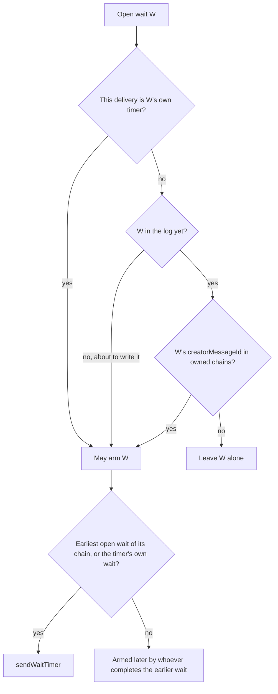
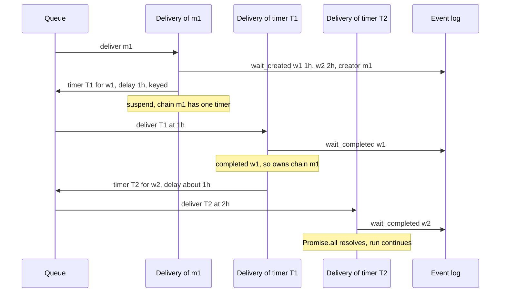
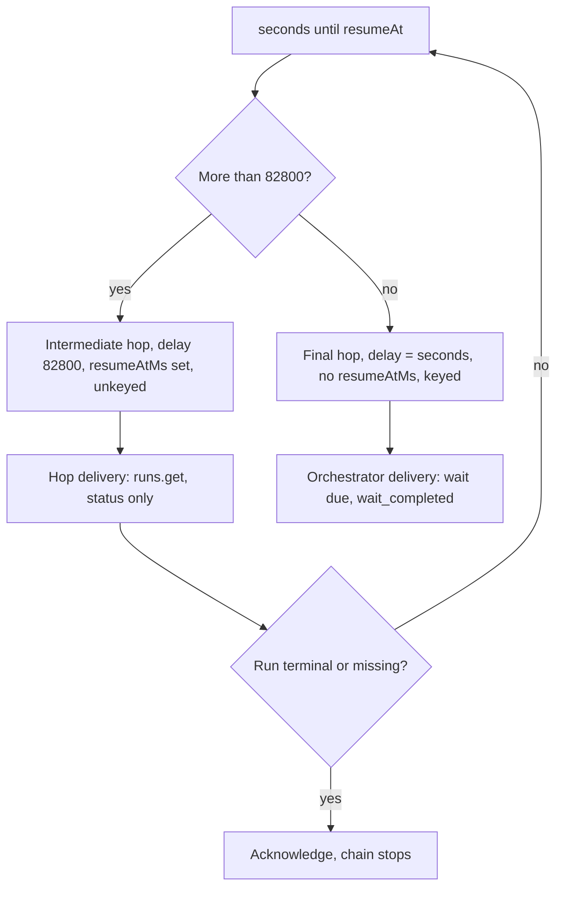
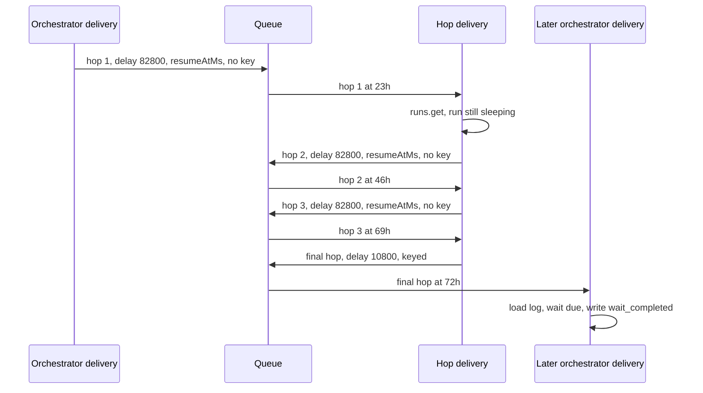
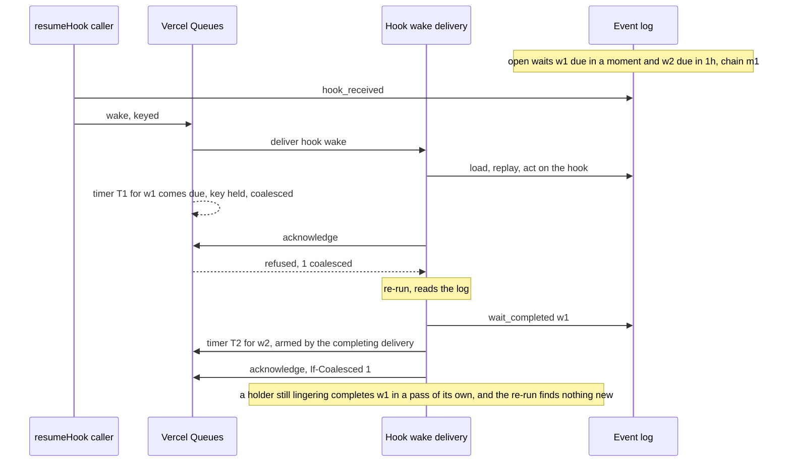
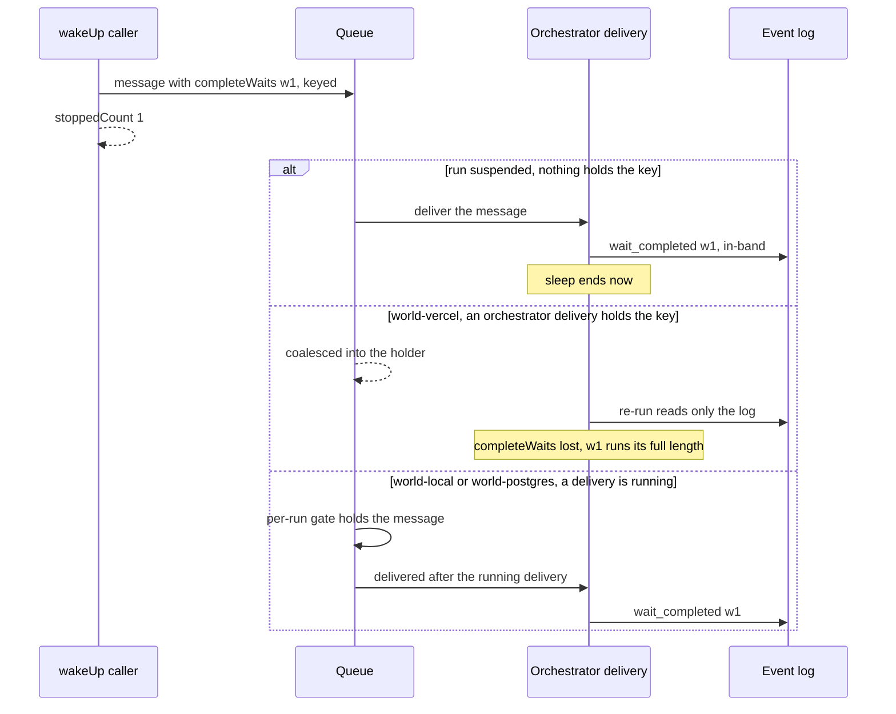

# Timers and waits

<Callout type="warn">
This page is temporary review material for the pull request that introduces spec version 9, and is removed before merge. The written review is [Review: single orchestrator](/docs/changelog/single-orchestrator-review).
</Callout>

On spec 9, the orchestrator writes both events of a sleep in-band: `wait_created` when the workflow reaches `sleep()`, and `wait_completed` at the top of a pass once the wait is due (`dueWaits`, `packages/core/src/runtime/spec9/delivery.ts:2452`). Between the two, a timer message wakes the run. A timer is a delayed orchestrator message carrying `waitContinuation`, the wait it is for. Spec 9 timers carry no idempotency key (`packages/core/src/runtime/spec9/wait-timer.ts:19`).

The pieces:

- `waitTimerMessage` (`spec9/wait-timer.ts`) builds the message: the delay from `getWaitContinuationDispatch` (at most `WAIT_CONTINUATION_MAX_DELAY_SECONDS`, 82800 seconds), and `resumeAtMs` on every hop but the last.
- `sendWaitTimer` (`spec9/delivery.ts:3822`) sends one timer through `wakeSelf`, which stamps the run's spec version.
- `armTimers` (`spec9/delivery.ts:3802`) sends the timers this delivery owns, once per wait per delivery.
- `ownedWaitChains`, `schedulesWaitTimer` and `waitTimersToArm` (`spec9/creator-rules.ts`) decide which timers those are.

## Who arms a timer

Each `wait_created` records `creatorMessageId`, the queue message of the delivery that wrote it. All waits written by one message form a chain. A delivery owns, and arms the earliest open wait of:

- its own message's chain, including waits it is about to write;
- the chain of every wait whose `wait_completed` it committed, whatever message it is;
- on a redelivery of a timer message, that timer's chain;
- and the wait of a timer delivered before its wait is due (`timerFor`), which re-arms what is left.

Two more rules cover the gaps chain ownership left:

- A delivery that is about to commit the `wait_completed` of a wait it does not own through `timerFor` first sends the timer of the chain's next open wait (`chainTimersBeforeCompletion`, `3ba56bbd43`). A failure after the commit then leaves the chain armed; a failed send commits nothing, and the redelivery decides again.
- A suspending delivery arms every open wait due within `max(5s, WORKFLOW_NEAR_ELAPSED_WAIT_THRESHOLD_SECONDS)`, whatever its chain (`getNearDueWaitWindowSeconds`, `66b355d28c`), so a final timer coalesced slightly before its wait is due, into a delivery that does not own it, is not lost.

A recovery delivery (world-local after a restart, `recovery: true` on the message) owns every chain and arms the earliest open wait of each: the timers died with the queue.

Every other delivery leaves a chain alone, so timers do not pile up across suspensions. A late or duplicate timer finds its wait completed and arms nothing (`packages/core/src/runtime/spec9/creator-rules.ts:112`).



The delivery that completes a wait arms its chain's next timer right after the completion, not at suspend (`armTimers(log.events, 'other-chains')`, `packages/core/src/runtime/spec9/delivery.ts:2477`). The delivery may end in a handoff first, and the next delivery does not know which waits this one completed.

## Two sleeps in one `Promise.all`

{/* @skip-typecheck - illustrative workflow */}
```typescript
export async function reminders() {
  "use workflow";
  await Promise.all([sleep("1h"), sleep("2h")]);
}
```

Both waits are created by message `m1`, so they form one chain, and only the earliest gets a timer.



An earlier rule let only the wait's own timer delivery arm the next one. A timer coalesced into another delivery then lost the second sleep's timer. See [Edge cases](/docs/changelog/single-orchestrator-diagrams/edge-cases).

## Long sleeps are reached in hops

A wait more than 82800 seconds (23 hours) away is reached in hops. Every hop but the last carries the wait's deadline (`waitContinuation.resumeAtMs`), which `isIntermediateWaitHop` reads. An intermediate hop has no concurrency key on world-vercel and no per-run gate on world-local and world-postgres. Its delivery reads only the run's status, writes nothing, sends the next hop, and acknowledges (`packages/core/src/runtime/spec9/delivery.ts:875`). The last hop is an ordinary keyed timer.



A 3-day sleep (259200 seconds):



An intermediate hop is never coalesced. A coalesced hop is never delivered, and the holder's re-run would find the wait not yet due and send no next hop (`packages/world/src/queue.ts:635`).

## A timer coalesced into a running delivery

A final timer is keyed. If it comes due while another delivery of the run holds the key (a hook wake, a step wake), Vercel Queues coalesces it. The timer's payload is lost, and that is harmless: the holder's re-run reads the log, finds the wait due, completes it, and, having completed it, owns its chain.



If the key was released before a keyed timer came due, the review states that Vercel Queues compares the timer's due time with the release and delivers it normally. That is queue server behavior and is not verified here.

## Timers inside a live delivery

A delivery that is still running inline steps, or lingering on a live feed, completes a due wait itself. `waitForProgress` sleeps at most until the earliest open wait's deadline (`nextTimerAt`, `packages/core/src/runtime/spec9/delivery.ts:1697`), and the next pass writes `wait_completed`. The timer message also goes out before the delivery waits (`armTimers` in `awaitInlineProgress`, `packages/core/src/runtime/spec9/delivery.ts:3533`), so the wait is covered if the delivery ends first. When it comes due while the delivery still holds the key, it is coalesced and costs a re-run that finds nothing to do.

A wait due within the invocation's inline window plus `OPEN_WAIT_CLOCK_SKEW_MS` (30 seconds) makes the boundary path-changing, so the orchestrator does not run ahead past it (`waitDue`, `packages/core/src/runtime/spec9/delivery.ts:2820`). See [Run-ahead and turbo](/docs/changelog/single-orchestrator-diagrams/run-ahead-and-turbo).

## `run.wakeUp()`

On a spec 9 run, `wakeUpRun` does not write `wait_completed`. It sends one orchestrator message with `completeWaits`, the waits to complete now, and returns `stoppedCount` as the number of waits it asked for (`packages/core/src/runtime/runs.ts:476`). The orchestrator completes the named waits on its first pass, whatever their `resumeAt` (`dueWaits` with `wakeUpWaits`, `packages/core/src/runtime/spec9/log-state.ts:210`).

The message is an ordinary keyed orchestrator message, so it is best-effort:



On world-local the running delivery does not linger past its work, because world-local has no `events.subscribe`, so `@workflow/vitest`'s `waitForSleep()` and `wakeUp()` keep working.

## Why `wait_completed` is in-band only

An out-of-band `wait_completed` could commit below events the orchestrator already acted on while running ahead, and a later replay would see them in a different order. The world-vercel backend refuses an out-of-band `wait_completed` on a spec 9 run with 409 `wait-completion-in-band-only`, and the run-ahead hazard check treats any `wait_completed` from another writer as a hazard (`packages/core/src/runtime/spec9/run-ahead.ts:64`).

{/* @skip-typecheck - illustrative workflow */}
```typescript
export async function digest(userId: string) {
  "use workflow";
  const first = await fetchUpdates(userId); // run-ahead: outcome reaches the workflow before it commits
  const timeout = sleep("1h");
  return await Promise.race([timeout, nextUpdate(userId, first)]);
}
```

If a `wait_completed` committed below `fetchUpdates`'s outcome, the live run saw the step first and a replay would see the wait first.

## Edge cases

- A delivery that commits `wait_completed` and dies before its next send no longer leaves that chain without a timer: the next timer goes out before the commit. Tests in `spec9/wait-chains.runtime.test.ts`, both engines.
- `VERCEL_QUEUE_MAX_DELAY_SECONDS` below 82800 clamps a final hop so it arrives early. Delivered on its own it re-arms its wait; coalesced, it is re-armed by the near-due rule only when it arrives within that window of its wait, so a clamp far below the hop length can still lose it. Not covered by a test.
- A world-local restart loses every queued timer; the recovery delivery re-arms every chain (`world-local-restart-recovery.test.ts`).
- A timer delivered slightly early (clock skew) is its own wait's `timerFor` and re-arms the rest (`packages/core/src/runtime/spec9/creator-rules.ts:161`).
- A timer delivery skips the no-op fast path, because an early one must still arm the next hop (`packages/core/src/runtime/spec9/delivery.ts:978`).
- A delivery that owns waits of two chains arms the earliest of each chain, not the earliest of all (`packages/core/src/runtime/spec9/creator-rules.ts:176`).
- An intermediate hop for a run that ended stops the chain without writing anything (`packages/core/src/runtime/spec9/delivery.ts:885`).
- Spec 9 timers have no idempotency key, so a duplicate timer is possible and costs one delivery that finds its wait completed (`packages/core/src/runtime/spec9/wait-timer.ts:19`).
- `run.wakeUp()` is lost on world-vercel while an orchestrator delivery holds the key, and `stoppedCount` still counts the waits (`packages/core/src/runtime/runs.ts:468`).
- The review states that the Vercel dashboard's wake-up action calls a pinned `@workflow/core` that writes `wait_completed` out-of-band, which the backend refuses on spec 9 runs; not verified here.
