# Spec 9: single orchestrator

Spec 9 is an opt-in run format, driven by a single orchestrator per run. New runs stay on spec 8 unless you set [`WORKFLOW_SPEC_VERSION=9`](/docs/configuration/runtime-tuning#workflow_spec_version), and nothing on this page applies to spec 8 runs.

This page is long, and its sections serve different readers:

- **Opting in:** [Overview](#overview), [Settings and behaviour on spec 9 runs](#settings-and-behaviour-on-spec-9-runs), and [Known limitations](#known-limitations).
- **Building or maintaining a World:** [World contract changes](#world-contract-changes), including [Implementing spec 9 in a World](#implementing-spec-9-in-a-world), and [Queue topology, handoffs and rotation](#queue-topology-handoffs-and-rotation), then [Spec 8 and spec 9 side by side](#spec-8-and-spec-9-side-by-side).
- **Reviewing or maintaining the runtime:** [The spec 9 model](#the-spec-9-model), [Lifecycles and flows](#lifecycles-and-flows), [Edge cases and failure handling](#edge-cases-and-failure-handling), [Decisions and trade-offs](#decisions-and-trade-offs), [Bugs found and fixed](#bugs-found-and-fixed), [Follow-ups](#follow-ups) and [Benchmarks](#benchmarks).

Code references name functions and files rather than lines. Unless a section says otherwise, everything below describes spec 9 runs.

## Overview

### What spec 9 is

Runs created at spec version 9 follow one rule: **only the run's orchestrator decides**. One orchestrator invocation at a time replays the run, runs the workflow code, writes every decision (`step_created`, `wait_created`, `wait_completed`, hook and attribute events, `run_completed` or `run_failed`), and runs inline steps. A step that runs from its own queue message only runs its body and reports its outcome. The World no longer keeps step and wait state to refuse a second start or a second outcome: it fences the orchestrator as the run's only in-band writer instead, and step and wait events become plain appends.

The previous orchestrator stays, side by side. A run keeps the orchestrator of the version it was created with, so in-flight runs are unaffected when a deployment opts in to spec 9, and spec 9 runs keep theirs when it opts out again.

### What changes for a spec 9 run

- A step that runs from its own queue message only runs its body. It writes `step_started` and the outcome, then sends the orchestrator one wake, without reading the log. It never replays the workflow or continues the run. On a World that coalesces a run's orchestrator messages (Vercel), a fan-out's wakes fold into the running orchestrator invocation instead of starting one each. Its body runs once its `step_started` committed, so a step queued before `run.cancel()` is refused before its body runs, and a throttled start runs no body. [`WORKFLOW_OPTIMISTIC_BACKGROUND_START=1`](/docs/configuration/runtime-tuning#workflow_optimistic_background_start) instead starts the body while the start is in flight, on the first delivery of a step that allows retries.
- Each step's execution mode is fixed on its creation (`inline`), and a background step's creation records the queue message that created it (`creatorMessageId`). An inline step is created by its first `step_started` alone, so it writes one event before its outcome; a background step writes `step_created` and then its own `step_started`. An enqueued step never runs inline.
- A background step's message is sent right after its `step_created` commits. An orchestrator invocation that died between the two left the step with no message, so any orchestrator delivery that is not its message's first (a redelivery, a continuation after a handoff, a folded-in re-run) sends again, once per invocation, every background step that has no `step_started`. A re-send uses the step's stable idempotency key and happens only while the step was created less than 23 hours ago, inside the queue's 24-hour deduplication window, so it never creates a second live message for the step.
- A background step's message carries when its step was created, and its `step_started` reports that time, so the latency from a step's creation to its start can be read off the start alone.
- A background step keeps one queue message for its whole life and retries in place on it. Any delivery other than a plain first one reads the log before running the body, so a committed outcome is not run again and a `maxRetries: 0` step runs at most once per live owner (a duplicate delivery after a lease expiry can still run it twice).
- Step events carry `stepName`, and `step_started` carries `attempt`.
- Wakes carry no idempotency key, and a wake with nothing new exits without a replay. A sleep's timer is armed by the delivery that creates the wait, which sends it before the `wait_created` commits, or by the one that completes an earlier wait it was created with, which sends the next timer before it commits the completion, a timer delivery completing its own wait included. Each hop of a timer is keyed `wait:<correlationId>:<resumeAt>:<hopAt>`, with hops anchored on the wait's deadline, so every delivery that sends a given hop sends the same message. A suspending delivery that may hold a coalesced timer (any but its message's first) also arms any wait due within a few seconds, under `wait:<correlationId>:<resumeAt>:s<second>`, so the re-arms of a fan-out stay linear.

### Why the World can stop keeping step state

The backend used to keep step and wait rows, written in the same transaction as each event, and those rows were what refused a second start or a second outcome. With one decider per run and a fence on its writes, the rows have nothing left to guard, so step and wait events become plain appends and the transactions go away.

### Opting in

Set [`WORKFLOW_SPEC_VERSION=9`](/docs/configuration/runtime-tuning#workflow_spec_version). The Vercel, Local and Postgres Worlds implement the in-band fence spec 9 runs need. A World that does not declare it (`capabilities.inBandFence`) keeps creating spec 8 runs, and the runtime logs a one-time warning.

- **Upgrade the whole fleet first.** Every deployment and process that calls `start()`, resumes hooks, receives webhooks, cancels runs or consumes the World's queue must run this release or later before anyone sets the variable.
- **Set it on every caller of `start()`.** A start that targets another deployment stamps the lower of the caller's and the target's versions, so set the variable on every deployment and process that calls `start()`, not only on the target.
- **To stop creating spec 9 runs**, unset the variable (or set `8`) on a deployment of this release or later. Runs already created as spec 9 keep their orchestrator, and hook resumes, webhooks, `cancel()` and `wakeUp()` still work for them (see [below](#runs-already-created-as-spec-9-when-the-variable-is-unset)).

### The rollback floor

Once spec 9 runs exist, do not roll back below this release. An older SDK fails writes to a spec 9 run: `RunNotSupportedError` on the Local and Postgres Worlds, an HTTP 400 on Vercel. Reads still work, and nothing is corrupted.

- **On Vercel**, a spec 9 run's deliveries go only to the deployment that created it, so only an older process's `resumeHook()` and `cancel()` fail. The run itself keeps going.
- **On a shared Local or Postgres queue**, an older process can also take the run's orchestrator, step and timer messages, and every write it makes for them fails, so the run stalls while it does.
- **After re-upgrading**, the run continues, unless the older release used up a message's delivery budget ([`WORKFLOW_MAX_QUEUE_DELIVERIES`](/docs/configuration/runtime-tuning#workflow_max_queue_deliveries), 48 by default). Past it, the older release gives up on the message: its attempt to fail the run is refused too, so it logs that the run stays in its current state and acknowledges the message. On world-local the restart re-enqueues the run with a recovery marker, which re-sends its steps and timers. On world-postgres the re-enqueued message carries no such marker, so steps and timers whose messages the older release acknowledged stay lost until something else wakes the run, and the run can need a manual wake.

Spec 8 runs are unaffected: upgrading in place, rolling back, and running old and new processes against one World work as on earlier releases.

### How new runs get their version

One knob, `WORKFLOW_SPEC_VERSION`, gates minting only: the version a World stamps on a new run. Nothing that reads, routes, gates or writes to an existing run reads it; every such decision follows the run's stamped version. That is what makes unsetting it safe for runs already created as spec 9.

| `WORKFLOW_SPEC_VERSION` | World passes `inBandFence: true` | Minted |
|---|---|---|
| unset | any | 8 (6 when `WORKFLOW_SEALED_LOG=0`) |
| `9` | yes | 9 |
| `9` | no | 8, with a one-time warning ("the World does not declare the in-band writer fence") |
| `6` to `8` | any | that value |
| any other value | any | the default above, with a one-time warning |

`mintedSpecVersion(env, { inBandFence })` in `@workflow/world` implements the table. A call with no options never returns 9, so a custom World written to the earlier "Building a World" guide (`specVersion: mintedSpecVersion()`) keeps creating spec 8 runs. First-party Worlds call it with their declared capability when they are created. `SPEC_VERSION_CURRENT` is 8 (`SPEC_VERSION_DEFAULT_MINTED` names the default), the spec 9 runtime stamps `SPEC_VERSION_SINGLE_ORCHESTRATOR` explicitly, and `SPEC_VERSION_MAX_SUPPORTED` is 9.

### Runs already created as spec 9 when the variable is unset

Assuming the deployment that unsets it runs this release or newer:

| Path | Behaviour |
|---|---|
| Orchestrator deliveries | Spec 9 orchestrator: routing uses the run's stamp, or `runs.get`. Skew protection keeps the run on its creating deployment anyway. |
| Hook resumes and webhooks from a deployment without the variable | Work: `hook_received` is stamped with the run's spec (`specVersionForRunWrite` caps at `SPEC_VERSION_MAX_SUPPORTED`, not at the minted version) and written on v5, and the wake goes to the run's deployment with its spec version. |
| `cancel()` | Works: stamped via `specVersionForRunWrite(run.specVersion)`. |
| `wakeUp()` | Works, best-effort as for any spec 9 run. |
| world-local and world-postgres gate | Serialized: the gate reads the message stamp, and recovery messages are stamped (`dd5037fef7`). |
| Rollback below this release | Not safe (see [The rollback floor](#the-rollback-floor)). |

Unsetting the variable reduces exposure, not correctness: the items in [Follow-ups](#follow-ups) still apply to runs already created as spec 9.

### Costs

- A background step's outcome reaches the workflow through the orchestrator: over the World's live event feed or the tail poll when the orchestrator is running, otherwise one queue hop.
- An inline step is created by its first `step_started`, which goes out in the suspension's creation batch when the World has `createBatch`, so it costs two writes (that start and its outcome), as with lazy start. A World without `createBatch` writes each start on its own.
- Hooks, aborts and cancellations that arrive while the orchestrator runs a long inline step reach it through the live feed or the tail poll ([`WORKFLOW_ORCHESTRATOR_POLL_INTERVAL_MS`](/docs/configuration/runtime-tuning#workflow_orchestrator_poll_interval_ms), and [`WORKFLOW_ORCHESTRATOR_FEED_POLL_INTERVAL_MS`](/docs/configuration/runtime-tuning#workflow_orchestrator_feed_poll_interval_ms) while the feed is up).

### What spec 9 runs no longer use

Lazy inline step start, batched step claims, optimistic inline start outside turbo's first delivery, inline step ownership and its backstop wakes, and the precondition guard. They remain on spec 8 runs, and their settings are listed under [Runtime tuning](/docs/configuration/runtime-tuning#replay-and-queue-delivery).

### Status

- Spec 9 is opt-in. Spec 8 is the default for new runs, and default runs use the same events API routes and batch transport as earlier releases.
- A required e2e lane (`e2e-vercel-spec9`) deploys a preview with `WORKFLOW_SPEC_VERSION=9` and runs the full suite on both engines, with the variable on the test runner too, and asserts that its runs are spec 9 while the other lanes assert spec 8. The Event Log Race Repro races spec 9 runs on Vercel in its own cell as well.
- Open work is listed under [Follow-ups](#follow-ups).

## Settings and behaviour on spec 9 runs

The rest of the documentation describes spec 8 runs. This section collects what differs for a spec 9 run in the settings, retries, the event log, `run.wakeUp()`, and each first-party World. [Runtime tuning](/docs/configuration/runtime-tuning#spec-9-experimental) lists the spec 9 settings briefly and links here.

### Runtime settings

Settings that apply to every run, read differently on spec 9 runs:

- **`WORKFLOW_MAX_QUEUE_DELIVERIES`**:
  - Only orchestrator messages count toward the cap. A delivery whose write the in-band fence refused asks for a redelivery of its message, which counts, so a run whose every write is refused fails here instead of looping. A handoff does not count.
  - Step messages are exempt. A step keeps one message for its whole life and retries in place on it, so each userland retry and each early redelivery is another delivery of that message. A step is bounded by its `maxRetries` and its message's retention instead.
  - Past this many deliveries, a step message whose step shows no activity for an hour (no creation, start or retry in that time, and no retry due) fails the step with a `FatalError` naming `MAX_DELIVERIES_EXCEEDED`, which the workflow can catch. That is a step whose every delivery fails before it starts, for example because its input cannot be read. A step past the cap that is still starting or retrying keeps running as before. Every shipped World keeps redelivering a failing step message for at least that hour, so such a step is failed on each of them.
- **`WORKFLOW_REPLAY_DIVERGENCE_MAX_RETRIES`**: on a spec 8 run each recovery replay is a new queue message that carries the count. On a spec 9 run each recovery replay runs in the same delivery: the orchestrator reloads the log and replays it from cold in a fresh VM. Once the budget is spent the run fails with [`CORRUPTED_EVENT_LOG`](/docs/errors/corrupted-event-log). A crash or redelivery starts the count again, bounded by [`WORKFLOW_MAX_QUEUE_DELIVERIES`](/docs/configuration/runtime-tuning#workflow_max_queue_deliveries).
- **`WORKFLOW_OPEN_WAIT_CLOCK_SKEW_MS`**: the same window decides a different thing: an open wait due within the inline window plus this allowance makes [run-ahead](#workflow_run_ahead_depth) wait for its writes at that boundary.
- **`WORKFLOW_MAX_INLINE_STEPS`**: clamped to `0` to `16`. `0` enqueues every step, each on its own message, and a step's execution mode is fixed when its `step_created` is written: an inline step runs in the orchestrator (and runs again in the next orchestrator delivery if that invocation dies), and an enqueued step never runs inline. An inline step whose retry is due moves to the background. On spec 8 runs `0` is read as unset.
- **`WORKFLOW_OPTIMISTIC_INLINE_START`**: only `0` or `false` has an effect: it keeps step bodies waiting for their start to commit on turbo's first delivery, under run-ahead, and for background steps under [`WORKFLOW_OPTIMISTIC_BACKGROUND_START`](#workflow_optimistic_background_start). A step declared with `maxRetries: 0` always waits for its start to commit there, whatever this is set to.
- **`WORKFLOW_SEALED_LOG`**: deprecated in favour of [`WORKFLOW_SPEC_VERSION`](#workflow_spec_version), and read only while that is unset.
- **Not read for spec 9 runs**: `WORKFLOW_INLINE_OWNERSHIP`, `WORKFLOW_INLINE_OWNERSHIP_LEASE_SECONDS`, `WORKFLOW_BATCH_TRANSITIONS` (which writes a suspension's step creations in batches on spec 8 runs, `0` or `false` writing one event at a time), and the `WORKFLOW_PRECONDITION_*` settings. Spec 9 runs have no precondition guard (the 412 on a stale snapshot, with in-process restarts and re-invocations, that spec 8 runs keep). The fence replaces it.

Settings that exist only for spec 9 runs:

#### `WORKFLOW_SPEC_VERSION`

- Default: unset. New runs use spec version 8, or 6 with [`WORKFLOW_SEALED_LOG=0`](/docs/configuration/runtime-tuning#workflow_sealed_log).
- Values: an integer from `6` to `9` (surrounding whitespace is ignored). Any other value is ignored, and the runtime logs a one-time warning naming it.
- Set `9` to create spec 9 runs, which the runtime drives with the single orchestrator: one orchestrator invocation per run makes every decision, and the World's in-band fence keeps the run to one writer. The Vercel, Local and Postgres Worlds implement the fence. A World that does not declare the fence (`capabilities.inBandFence`) keeps creating spec 8 runs, and the runtime logs a one-time warning.
- A run keeps the version it was created with, so the setting changes only what new runs get. Everything that reads, routes or writes to an existing run follows that run's version, never this setting. A run in flight keeps its orchestrator either way: the Vercel World may raise a running run's version only across versions that change no log format, never from 8 to 9.
- When it is set, it takes precedence over [`WORKFLOW_SEALED_LOG`](/docs/configuration/runtime-tuning#workflow_sealed_log), and the runtime logs a one-time warning if both are set.
- On the Vercel World, the events of a spec 9 run go through version 5 of the events API; every other run's events stay on the routes earlier releases use, whatever this is set to.
- A custom World chooses the versions it can create by what it declares as `specVersion` (see [Building a World](#implementing-spec-9-in-a-world)).

Before opting in:

- **Upgrade the whole fleet first.** Every deployment and process that calls `start()`, resumes hooks, receives webhooks, cancels runs or consumes the World's queue must run this release or later before anyone sets `WORKFLOW_SPEC_VERSION=9`. An older SDK fails writes to a spec 9 run: `RunNotSupportedError` on the Local and Postgres Worlds, an HTTP 400 on Vercel. Reads still work, and nothing is corrupted. On Vercel a run's deliveries go only to the deployment that created it, so there only an older process's `resumeHook()` and `cancel()` fail. On a shared Local or Postgres queue, an older process can also take the run's messages, and the run stalls while it does. The run continues after re-upgrading unless the older release used up a message's delivery budget ([`WORKFLOW_MAX_QUEUE_DELIVERIES`](/docs/configuration/runtime-tuning#workflow_max_queue_deliveries), 48 by default): it then gives up on that message, and the run can need a manual wake.
- **Set it on every caller of `start()`, not only the target.** A start that targets another deployment stamps the lower of the two deployments' versions, so a spec 9 run needs `WORKFLOW_SPEC_VERSION=9` on the caller and on the target.
- **Rollback floor.** Once spec 9 runs exist, rolling a deployment back to a release older than this one stalls those runs as described above. To stop creating spec 9 runs, unset the variable (or set `8`) on a deployment of this release or later instead. That is safe for runs already created as spec 9: they keep their orchestrator, and hook resumes, webhooks, `cancel()` and `wakeUp()` from the deployment with the variable unset still work for them.
- Spec 8 runs are unaffected: upgrading in place, rolling back and running old and new processes against one World work as on earlier releases.

#### One orchestrator per run, and the in-band fence

- Not a variable: this is how a spec 9 run stays correct when two invocations of its orchestrator overlap.
- One orchestrator invocation per run makes every decision: it replays the log, writes `step_created`, `wait_created`, `wait_completed`, hook and attribute events, runs inline steps, and completes or fails the run. Its writes are **in-band**. Everything else is **out-of-band**: a background step's own events, `hook_received` from `resumeHook()` and webhooks, `run_cancelled` from `cancel()`.
- The queue delivers a run's orchestrator messages one at a time, so two orchestrators rarely run at once. That is a frequency mechanism. An invocation whose event loop stalls past its queue lease can still be redelivered while it is alive.
- The World fences in-band writes, and the runtime refuses to create or drive a spec 9 run on a World that does not declare it (`capabilities.inBandFence`; see [Building a World](#single-writer-guarantee-and-the-in-band-fence)). Its log load returns the count of in-band positions (`snapshot.seqInBand`), the orchestrator sends that count with each in-band write and advances it locally, and the World refuses a write whose count is stale with `InBandSupersededError`. The refused invocation stops writing and runs no further inline step bodies. It sends the queue messages its own committed writes still owe (the message of a background step it created, a timer for a wait it created), then asks for a redelivery of its own message about a second later (`{ timeoutSeconds: 1 }`) instead of acknowledging it. A refusal does not prove that another invocation is running, and the other writer may be a second delivery of the same message that died before it sent what it owed: the redelivery, like any orchestrator delivery that is not its message's first, sends again the message of every background step that has no `step_started` and was created less than 23 hours ago, under the step's stable idempotency key. The redelivery counts toward [`WORKFLOW_MAX_QUEUE_DELIVERIES`](/docs/configuration/runtime-tuning#workflow_max_queue_deliveries) on the Vercel and Local Worlds; the Postgres World starts `attempt` over on a delayed redelivery. The Vercel, Local and Postgres Worlds implement the fence.
- A write that resolves a promise in the workflow (a `wait_completed`, an inline step's outcome) is consumed only after it commits, behind whatever its response reports landed below it, so the workflow sees events in log order.
- Spec 9 runs have no precondition guard (the 412 on a stale snapshot, with in-process restarts and re-invocations, that spec 8 runs keep). The fence replaces it.

##### Terminal events written out-of-band

Classification is by writer, so a run's terminal event is not always in-band:

- `run_completed` and `run_failed` from the orchestrator are in-band, including `run_failed` for an exceeded delivery cap ([`WORKFLOW_MAX_QUEUE_DELIVERIES`](/docs/configuration/runtime-tuning#workflow_max_queue_deliveries)) and for a misrouted orchestrator delivery (`DEPLOYMENT_MISMATCH`).
- `run_cancelled` from `cancel()` is always out-of-band: the caller is not the run's orchestrator.
- `run_failed` is out-of-band when a background step's own invocation fails the run, for a misrouted step message or a run it cannot set up.

An out-of-band terminal event has these effects, all of them benign:

- It does not move the in-band count, so it does not supersede a live orchestrator. That orchestrator keeps going until it sees the event (on its live feed, tail poll or next load) or until the World refuses its next `step_created`, `step_started`, `step_retrying` or `wait_created` on the terminal run. An inline step body already running finishes, and its outcome is accepted and inert.
- The orchestrator can still commit its own `run_completed` or `run_failed` above it. The run's status follows the first terminal event by position, and the runtime dispatches completion or failure lifecycle hooks only when the World reports that outcome as the run's.
- Events the terminal-run check does not cover (`hook_created`, `hook_disposed`, a workflow `attr_set`, `wait_completed`) can land after it. Replay never runs past a run's terminal event, so they change nothing.
- It gets no skipped-slot report, which nothing needs: no one replays a terminal run.

#### `WORKFLOW_ORCHESTRATOR_POLL_INTERVAL_MS`

- Default: `2000`
- While an orchestrator is busy running inline steps, it polls the run's log tail, and also listens on the World's live event feed when the World has one. Events other writers commit (a background step's outcome, a hook payload, a cancellation) then reach the running workflow without a queue hop.
- This is the poll's interval while no live feed covers the run: the World has none, the subscription was refused or ended, or the feed showed it missed an event. While the feed is up, the poll runs at [`WORKFLOW_ORCHESTRATOR_FEED_POLL_INTERVAL_MS`](#workflow_orchestrator_feed_poll_interval_ms) instead.
- `0` turns polling off, leaving the live feed and queue wakes.

#### `WORKFLOW_ORCHESTRATOR_FEED_POLL_INTERVAL_MS`

- Default: `10000`
- The log-tail poll's interval while the World's live event feed is up. The feed pushes every event in position order, and a closed or ended subscription reports itself, so the poll only catches an event the feed missed without a sign: the newest one, with nothing pushed after it.
- While the feed keeps up (the last poll found nothing the feed had not delivered), the interval doubles per poll, up to 2 times this value. A feed error, a failed poll, an event only the poll found, or a pushed event that skips a position puts it back at [`WORKFLOW_ORCHESTRATOR_POLL_INTERVAL_MS`](#workflow_orchestrator_poll_interval_ms) at once.
- Never below `WORKFLOW_ORCHESTRATOR_POLL_INTERVAL_MS`, so `0` polls at that interval whether the feed is up or not.

#### `WORKFLOW_ORCHESTRATOR_LINGER_MS`

- Default: `30000`
- When an orchestrator has nothing left to run, but the run is still waiting on an open hook or on a step running from its own queue message, the orchestrator stays live on the World's live event feed for this long before acknowledging its message.
- Each event another writer commits in that time (a hook payload, a background step's outcome, a cancellation) starts another pass in the same invocation. The next pass that again finds nothing to run starts the time over. A burst of resumes or step outcomes is then handled by one warm invocation instead of one queued wake each.
- Only used while the World's live event feed (`events.subscribe`), such as the Vercel World's, is up. A World without one does not linger, and a subscription that fails, at the start or during the linger, ends it: on the tail poll alone, an invocation would stay open for a poll's latency per event. It never runs past the invocation's inline-step deadline.
- An open hook alone is enough, however rarely it is resumed. Any hook the run created and has not disposed keeps an invocation that has nothing left to run lingering for up to this long after each pass, including a pass that just armed a much longer sleep. Each such invocation stays open, and holds the run, for that time.
- Avoid a long-lived hook beside a polling `sleep()`. A cancel or approval hook that stays open for the run's whole life, next to a loop that sleeps and checks something, makes every timer wake hold a function for up to this long, although the wake's own work takes milliseconds. Dispose the hook once it is no longer needed, or give the loop a structure that does not keep one open. If the pattern is needed, lower this value for that deployment, or set it to `0`; `0` also turns off the linger for background steps, whose outcomes usually arrive within it.
- `0` turns it off.

#### `WORKFLOW_ORCHESTRATOR_READ_TIMEOUT_MS`

- Default: `5000`
- How long an orchestrator waits on one read of the event log it has already loaded part of (the events appended since its last read, and each live-feed poll) before it abandons the read and sends it again. Each later attempt waits twice as long as the one before. After three attempts the invocation fails with a retryable error and the queue redelivers the run.
- The orchestrator is the run's only reader of its log, so a read that never returns would hold the whole run, with the events it waits for already committed. A fresh read of the same position normally returns in tens of milliseconds.
- Full loads of a run's log, which can be large, are not bounded by it.
- `0` turns the deadline off.

#### `WORKFLOW_INLINE_STEP_DEADLINE_MARGIN_MS`

- Default: `60000`
- The orchestrator stops starting inline steps this long before its inline window ([`WORKFLOW_V2_TIMEOUT_MS`](/docs/configuration/runtime-tuning#workflow_v2_timeout_ms)) ends. Steps created inside the margin are enqueued instead, so the platform does not cut a body off at the function's deadline.

#### `WORKFLOW_OPTIMISTIC_BACKGROUND_START`

- Default: unset. A background step (one that runs from its own queue message) starts its body only once its `step_started` committed.
- Set `1` or `true` to start the body of a background step that allows retries while its `step_started` is in flight, on the first delivery of its message. The outcome is still written only once the start committed.
- The trade-off is latency against cancel and throttle behaviour. It saves one round trip to the World before each background body. In exchange, a step queued before `run.cancel()` runs its body, side effects included, before the refused start arrives, and a start the World throttles or refuses as too early has already run the body: its outcome is discarded, and a throttled start runs the body again when the message is redelivered. Only turn it on when background step bodies are idempotent and running one after a cancel is acceptable.
- A step declared with `maxRetries: 0`, and any redelivery or retry of a step's message, always waits for the start. An explicit `WORKFLOW_OPTIMISTIC_INLINE_START=0` wins over this setting.
- No other value has an effect.

#### `WORKFLOW_RUN_AHEAD_DEPTH`

- Default: `10`
- Clamp: `0` to `16`
- Node.js VM engine only, on Worlds that record an in-band write at the time the orchestrator sent with it (world-local, world-postgres and world-vercel do). When no other writer could change what the workflow does next (no hook the workflow waits on, no `AbortController`, no step running elsewhere, no wait due within the invocation), an inline step's outcome reaches the workflow as soon as its body returns, and the next step's creation and body start before that outcome's write commits. Every write still lands in the order the workflow made it.
- At most this many step outcomes are unconfirmed at once. When a boundary is not eligible, the orchestrator waits for its writes to commit and reads what landed below them before it continues, and runs ahead again at the next eligible boundary.
- A refused or failed write while running ahead stops the delivery's decisions before anything else is written. The outcomes of steps whose start committed are still written. The delivery then continues in place: it reloads the log and replays from cold, with run-ahead off for the rest of the delivery. A fence refusal is handled as for any in-band write (see [One orchestrator per run](#one-orchestrator-per-run-and-the-in-band-fence)).
- An event from another writer that could change the workflow's path and lands below a speculative write stops the delivery the same way, but it is a detector, not a recovery. The boundary was classified so that no such event could land there, and writes that committed together with the one that reported the event were decided without it. The cold replay that follows may then diverge from the log. The orchestrator logs the stop at error level with `possibleLogCorruption: true` and counts it in the `workflow.run_ahead.hazard_stops` span attribute; report one with the workflow's code.
- `0` disables run-ahead.

#### Other differences on spec 9 runs

- `WORKFLOW_SEQUENTIAL_REPLAYS` (Vercel World) is still read. Spec 9 runs are kept to one orchestrator at a time by a queue concurrency key without it; the setting serializes spec 8 runs too. See [Vercel World](/worlds/vercel#workflow_sequential_replays).
- A trade-off follows from one orchestrator per run: a hook payload, an abort or a cancellation that arrives while the orchestrator is busy with a long inline step is seen by the running workflow through the live feed or the tail poll. Without either it waits for the next delivery, which queues behind the busy one.

### Retries

Spec 9 runs retry differently from spec 8 runs. A failed step is retried after about a second by default, and:

- A step that runs from the queue keeps one queue message for its whole life. A retry writes a `step_retrying` event and asks for that same message again after the retry delay, so a retry never creates a second message, and the message is acknowledged only once the step completes or fails for good.
- A step that ran inline in the workflow's own invocation moves to the queue for its retry.
- The attempt number comes from the event log: it is the number of times the step has started, plus one. `getStepMetadata().attempt` reports it, and `stepStartedAt` stays the time of the first attempt.
- A queue may deliver a retry before its delay has passed (Vercel Queues waits at most 15 minutes per delivery). The step checks the log and asks for the remaining time without running its body.
- A step whose next retry would land after its queue message expires (7 days) fails with the error instead.

If the invocation running a step with `maxRetries = 0` dies after the step started, the step fails instead of running again, so it runs at most once per live owner. A duplicate delivery after the queue lease expired can still run it twice, so make a step that must never repeat idempotent. See [`maxRetries: 0` is at most once per live owner](#maxretries-0-is-at-most-once-per-live-owner).

### The event log

On spec 9 runs, steps and waits are folded from the run's events rather than materialized in storage. Step and wait events are plain appends to the log. Nothing in storage checks a step or wait write against a step or wait row, so the runtime keeps those lifecycles correct itself: one orchestrator per run decides every step and wait event, and replay treats any event for an entity after its terminal event as inert (see [Duplicate events](/docs/how-it-works/event-sourcing#duplicate-events)). A World may still keep step and wait records for its read APIs; the runtime never relies on them.

A spec 9 run has a single decider. One orchestrator invocation at a time replays the run, runs the workflow code, and makes every decision: it writes `run_started` (once per run), `step_created`, `wait_created`, `wait_completed`, hook and attribute events, runs the steps it executes inline, and writes `run_completed` or `run_failed`. These writes are **in-band**. A step that runs from its own queue message only writes its `step_started` and outcome, then wakes the orchestrator; it never replays the workflow. Those writes, `hook_received` from `resumeHook()` and webhooks, `run_cancelled` from `cancel()`, and `setAttributes()` outside a workflow are **out-of-band**. Classification is by writer, so an inline step's events are in-band.

- **Execution mode on the step's creation.** Each step's creation records whether it runs inline in the orchestrator (`inline: true`) or from its own queue message. A background step's creation also records which queue message's delivery created it (`creatorMessageId`). An inline step is created by its first `step_started`, which carries the step's input, so the log holds one event per inline step before its outcome. A background step is created by a `step_created`, followed by its own invocation's `step_started`. An enqueued step never runs inline. Its message is enqueued once, after `step_created` commits. Any orchestrator delivery that is not its message's first (a redelivery, a continuation after a handoff, a coalesced re-run) sends it again, once per invocation and under the step's stable idempotency key, while the step has not started and was created less than 23 hours ago.
- **One message per step.** A background step keeps one queue message for its whole life. A userland retry writes `step_retrying` and asks for the same message again after `retryAfter`. The message is acknowledged only after a terminal step or run event is committed. Any delivery other than a plain first one reads the run's log first: a terminal outcome is acknowledged without running the body, a retry that is not due yet is delivered again later, and a step whose next attempt would exceed `maxRetries + 1` is failed (so a `maxRetries: 0` step runs at most once per live owner; a duplicate delivery after a lease expiry can still run it twice).
- **The in-band fence.** The World refuses an in-band write from an orchestrator that another invocation of the same run has superseded. The log load returns the count of in-band positions, the orchestrator sends it with each in-band write and advances it by what each write allocated, and a stale count is refused with `InBandSupersededError`. The refused invocation stops, sends the queue messages its own committed writes still owe, and asks for a redelivery of its own message about a second later instead of acknowledging it; that redelivery loads the log afresh and re-sends any background step message a delivery that died left unsent.
- **Consume after commit.** A write that resolves a promise in the workflow (a `wait_completed`, an inline step's outcome) is consumed only after it commits, behind the events its response reports at lower positions, so the workflow observes events in log order.
- **Wakes carry no idempotency key.** Every out-of-band writer enqueues a wake after its event commits. A wake that finds nothing new exits without a replay. A sleep's timer is scheduled by the delivery that writes its `wait_created`, which sends it before that write commits, or by the delivery that completes the wait before it in its chain, which sends it before it commits that completion. Each hop of a timer carries an idempotency key naming the wait and the hop's deadline, so the timers several deliveries send for one hop are one message. A suspending delivery also arms any wait due within a few seconds, and a Local World recovery delivery arms every open wait.

Each `step_started` records the attempt it starts (`attempt`). A step's attempt count is the number of `step_started` events in the log. An attempt that follows a `step_retrying` is a retry; one that follows another `step_started` with nothing recorded in between is a redelivery (the earlier attempt's invocation died or stalled).

An inline step's first `step_started` also creates the step: it carries the step name, input and `inline: true`, and no `step_created` precedes it. Only the run's orchestrator writes `wait_created` and `wait_completed`, so a wait is completed once without a storage-side check, and replay treats `wait_completed` as one-shot: a second one for the same wait is inert.

On spec 9 runs one orchestrator per run removes almost all duplicates, but a log can still hold some: a background step invocation that stalled past its queue lease can be delivered again and write a second `step_started` after the step's outcome.

On spec 9 runs, **any event for an entity after its terminal event is inert**, whatever its type: once a step's outcome, a `wait_completed`, a `hook_disposed`, or a workflow `attr_set` has been consumed, nothing claims another event under that correlation ID, and replay steps over it. A `step_started` or `step_retrying` after a step's outcome is read past rather than reported as divergence, whether or not an earlier event of its type exists.

Spec 9 runs always use the [sealed log](/docs/how-it-works/event-sourcing#sealed-positions-noop-events): the single-orchestrator version counts the in-band fence in sequencer positions.

#### Events returned on a write

Every in-band write names the position it was decided from (`eventCount`), and the World returns the events on the positions between that one and the write's own (the *skipped-slot report*) on the success response, in position order. The orchestrator folds the report and its own event into its log and continues without a read.

For an in-band write on a spec 9 run the report is authoritative. When the World cannot produce it completely in time, the write still succeeds with `hasMore: true`, and the orchestrator reloads the log before it consumes anything that write resolves. Out-of-band writes (a background step's events, `resumeHook()`, `cancel()`) hold no log and get no report; they wake the orchestrator, which reads the log.

| Event | Writer | Sends |
|-------|--------|-------|
| `run_created` | `start()` | Nothing. No log exists yet. |
| `run_started`, `step_created`, `wait_created`, `wait_completed`, `hook_created`, `hook_disposed`, workflow `attr_set`, `run_completed`, `run_failed` | Orchestrator | `eventCount`, in-band |
| `step_started`, `step_retrying`, `step_completed`, `step_failed` of an inline step | Orchestrator | `eventCount`, in-band |
| `step_started`, `step_retrying`, `step_completed`, `step_failed` of a background step | The step's own invocation | Nothing, out-of-band |
| `hook_received` | `resumeHook()` or a webhook | Nothing, out-of-band |
| `run_cancelled` | `cancel()` | Nothing, out-of-band |

A hook create made alone in a suspension also asks for the events after the cursor the orchestrator had read to (`sinceCursor`), so a hook whose create commits a `hook_conflict` or whose payload already arrived resolves in the same invocation. A batch write (`events.createBatch()`) names the position for its whole block, and its report rides at the top level of the batch result. On a spec 9 run a batch is not atomic: an item can fail while others commit, and the failed item's position is sealed.

### `run.wakeUp()` and `waitForSleep()`

On spec 9 runs, `wakeUp()` returns once the run's orchestrator has been asked to complete the sleeps: the orchestrator writes their `wait_completed` events itself, in order with the run's other decisions, shortly after. `stoppedCount` is the number of sleeps it asked to complete, not the number completed.

On spec 9 runs the request is best-effort on the Vercel World while an orchestrator invocation of the run is running. The request is a queue message to the run's orchestrator, and Vercel Queues folds such a message into the running invocation, which only re-reads the event log and so never sees which sleeps to complete. The sleeps then run their full length, and `stoppedCount` still counts them. An invocation also stays live for up to [`WORKFLOW_ORCHESTRATOR_LINGER_MS`](#workflow_orchestrator_linger_ms) (30 seconds by default) after its last pass while the run waits on an open hook or a background step, so a wake-up sent shortly after such a run was active can be dropped too. When no invocation of the run is live, the message is delivered on its own and completes the sleeps. The Local and Postgres Worlds hold the message until the running invocation ends, then deliver it. On spec 9 runs this is the intended behavior for this release; if you need a sleep to end reliably while the run is active, resume a hook the workflow races against the sleep instead.

In `@workflow/vitest`, `waitForSleep()` skips a sleep that `wakeUp()` already named in this process while the run completes it. See [`run.wakeUp()`](#runwakeup) and [`run.wakeUp()` stays best-effort](#runwakeup-stays-best-effort) for the mechanism.

### First-party Worlds

**world-local.** On restart recovery, the recovery message is marked as one (`recovery: true`), and its delivery sends the message of every background step without an outcome again, started ones included, and arms the timer of every open sleep, since those messages died with the in-memory queue. If you re-enqueue runs yourself with `reenqueueActiveRuns()` from `@workflow/world`, pass `{ queueLost: true }` as its options so the messages carry the mark.

**world-postgres.** A spec 9 run's orchestrator deliveries (starts, wakes after a step outcome, hook resumes, cancellations and timers) execute one at a time, with or without invocation. Each one is a Graphile job in the run's named queue, `workflow_flows:<runId>:executor`, and Graphile permits one active job per named queue across worker processes. Step jobs and health checks carry no named queue, so a run's steps execute concurrently with each other and with its orchestrator. An orchestrator blocked on an inline step reads new events, such as a hook payload, from the log while it waits, so it never needs a second delivery of its own run to make progress. A spec 8 run's deliveries (without invocation) carry no named queue either: a spec 8 orchestrator can hold an inline step until another wake of the same run aborts it. A delayed job does not hold its queue. This is the queue half of the single-writer guarantee; the other half is the in-band fence on event writes, which refuses a stale orchestrator that outlived its job's lock.

A worker that is killed mid-job (`SIGKILL`, out of memory, container eviction) leaves that run's named queue locked. Graphile Worker only takes jobs from an unlocked queue, and it clears a stale lock only once it is older than 4 hours (`resetLockedAt`). Until then every later orchestrator delivery of that run (step completions, hook resumes, timers) waits, so a spec 9 run whose worker was hard-killed can stall for up to 4 hours. A graceful shutdown releases the lock. With `jobLockStaleSeconds` set, another process releases the job and the queue lock once they go unrenewed for that window (see [Postgres World](/worlds/postgres#workflow_postgres_job_lock_stale_seconds)). Spec 8 runs without invocation use no named queue and are not affected.

With invocation disabled, a spec 9 run's workflow execution jobs use the `workflow_flows` task identifier in the same per-run named queue. A message sent with an idempotency key becomes a Graphile job with that job key. A spec 9 run's keyed messages (a step's execution message, a near-due wait timer) use the `unsafe_dedupe` job key mode: a send is a no-op while any job holds the key, locked (being delivered), delayed, or in retry backoff, so a re-send from a later orchestrator delivery never adds a second job for a step, which another worker could run, and never resets a job's attempts or `run_at`. The key is free once the job completes and is deleted. This meets the queue contract's dedupe window (`QUEUE_MIN_STEP_KEY_DEDUPE_WINDOW_MS` in `@workflow/world`) while the step's message lives. A reschedule (a handoff, a retry in place) is sent while its job is locked, and keyed messages of earlier runs keep their behaviour, so both use `preserve_run_at`.

**world-vercel.** Spec 9 runs run one orchestrator invocation at a time without `WORKFLOW_SEQUENTIAL_REPLAYS=1`: their orchestrator messages carry the run's id as a [Vercel Queues](https://vercel.com/docs/queues) concurrency key on the shared flow topic, and world-vercel fences the orchestrator's writes. Spec 8 runs, the default, are the ones this variable serializes. Under `WORKFLOW_SEQUENTIAL_REPLAYS=1`, spec 9 runs use the same per-run and per-step topics, and their messages are sent without a concurrency key: Vercel Queues refuses a keyed send to a topic that a `maxConcurrency` consumer reads. The per-run topic then serializes their orchestrator, and nothing is coalesced, so a burst of step completions wakes the orchestrator once per completion instead of being folded into the running invocation.

## The spec 9 model

### One decider

Only the orchestrator writes decisions: `step_created`, `wait_created`, `wait_completed`, hook and attribute events, `run_completed` and `run_failed`. It also runs inline steps. A background step's own invocation writes only that step's `step_started` and outcome, then sends the orchestrator one plain wake, without reading the log. Its body starts once its `step_started` committed; `WORKFLOW_OPTIMISTIC_BACKGROUND_START=1` starts it while the start is in flight instead (see [Background step bodies start once their start commits](#background-step-bodies-start-once-their-start-commits)).

{/* @skip-typecheck - illustrative workflow */}
```typescript
export async function checkout(orderId: string) {
  "use workflow";
  const order = await loadOrder(orderId);   // inline: run by the orchestrator
  const charge = await chargeCard(order);   // inline
  await sendReceipt(charge);                // inline
  return charge.id;
}

async function chargeCard(order: Order) {
  "use step";
  return await payments.charge(order.total);
}
```

A run of `checkout` typically completes in one orchestrator invocation. If a step fails with a retryable error, its retry moves to its own queue message, and that step invocation only reports the outcome. The orchestrator decides what happens next. Spec 8 does the same with an inline step's retry. The step's message then owns its remaining attempts: the queue holds the backoff instead of a live invocation, and the at-most-once and retention rules for retries are enforced on that one message. Retrying a short backoff inline, within the inline deadline, is possible and is not implemented.

### Step and wait events are plain appends

The world-vercel backend no longer writes step and wait rows in the same transaction as each event. Step state is folded from the log when it is read. Replay treats any event for an entity after its terminal event as inert, which is what lets a late duplicate append be harmless.

### The in-band fence

Every orchestrator write is **in-band** (`inBand: true`). It carries `expectedSeqInBand`, the orchestrator's count of in-band positions, which it took from the `snapshot` of its log load. The World refuses a stale count with `InBandSupersededError` (HTTP 412). Two live orchestrators of one run can therefore never both write. Everything else that writes to the run is **out-of-band**: a background step's own events, `hook_received` from `resumeHook()` and webhooks, `run_cancelled` from `cancel()`, and `attr_set` from `setAttributes()` outside the workflow body. Classification is by writer, not by event type.

The queue keeps a spec 9 run to one orchestrator delivery at a time (a concurrency key on world-vercel, a per-run gate on world-local and world-postgres), but that is a frequency mechanism: an invocation whose event loop stalls past its lease can be redelivered while it is still alive. The fence is what makes an overlap the queue lets through safe. A World that creates spec 9 runs implements it and declares `capabilities.inBandFence`; the runtime refuses to create or drive a spec 9 run on a World that does not ([Single-writer guarantee and the in-band fence](#single-writer-guarantee-and-the-in-band-fence)).

**Example: an invocation that stalls past its lease.** An orchestrator's event loop blocks for longer than its queue lease (for example, a CPU-heavy inline step). The queue redelivers the run's message, and a second orchestrator starts. The second one writes first and moves the count. The first one wakes up, tries to write its next decision, gets a 412, and stops. Nothing is written twice, and the second one drives the run on.

#### Counters and the snapshot

| Counter | Moves on | Who reads it |
|---|---|---|
| `seq` | every allocation, in-band or not | the snapshot, as the highest slot handed out |
| `seqInBand` | in-band allocations only, starting at 1 for `run_created` | the snapshot, and the check on every in-band write |

- Every page of a spec 9 log load carries `snapshot: { seq, seqInBand }`. The writer adopts the first page's snapshot of a full load and never counts events itself (`adoptSnapshot` in `packages/core/src/runtime/spec9/in-band-writer.ts`). A count derived from events cannot say which slots were in-band.
- The world-vercel backend allocates an in-band block with one conditional update: add `n` to `seq` and to `seqInBand`, on condition that `seqInBand` equals `expectedSeqInBand`. A failed condition allocates nothing, so a refused write leaves no hole. An out-of-band allocation is unconditional and moves `seq` only.
- After an accepted write the writer adds the reported `allocated` to its count (`in-band-writer.ts`).

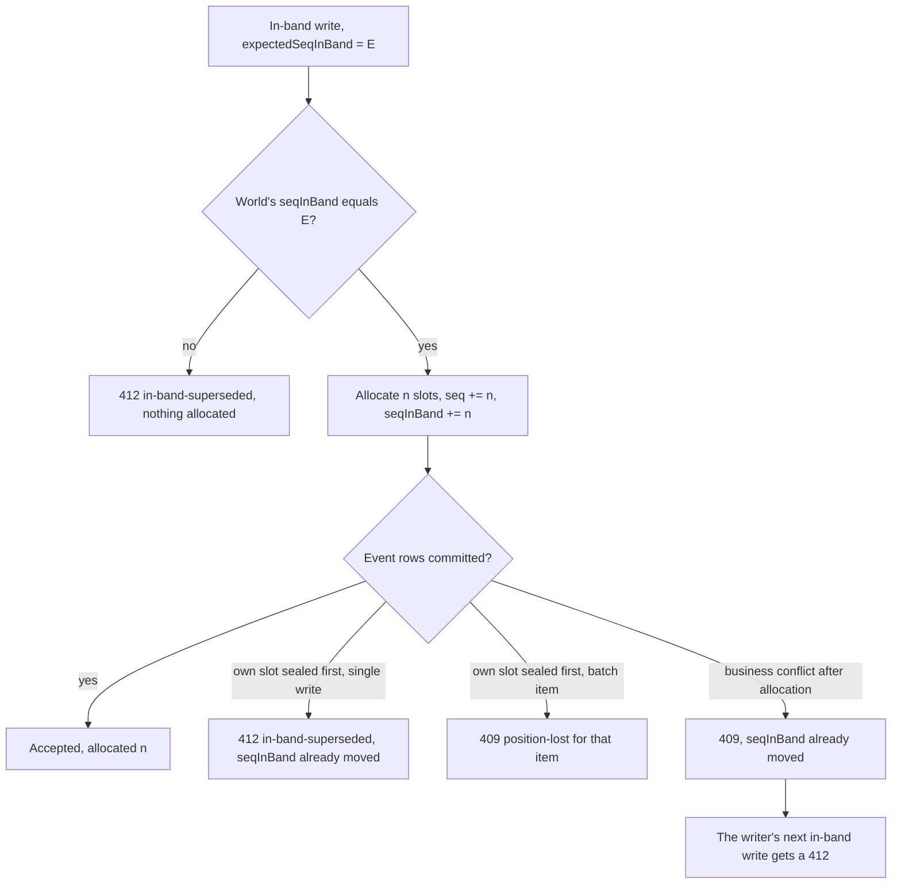

#### What returns 412 `InBandSupersededError`

The world-vercel backend answers 412 `in-band-superseded` in these cases:

1. **Another orchestrator wrote in-band.** Its writes moved `seqInBand` past this writer's count. This is the overlap the fence exists for.
2. **The writer's own slot was sealed.** The allocation succeeded, but the event row's put took longer than the backend's staleness bound, and a reader sealed the slot as a `noop` first. The single-write path answers 412, because the allocation already moved `seqInBand` and the writer's count is stale either way. A terminal run event that loses its slot the same way gets the same answer. In a batch, the item gets 409 `position-lost` instead and the batch's `allocated` still counts it.
3. **A 409 after allocation.** Some refusals come after the block was allocated: a hook or attribute write whose row logic conflicts, or a terminal event that lost to another terminal event that committed first. `seqInBand` moved, the writer keeps its count after a non-fence 4xx (`in-band-writer.ts`), and its next in-band write gets 412.

Only case 1 involves a second orchestrator. In cases 2 and 3 nothing else is queued for the run, which is why a refused delivery never acknowledges (below). In case 1 the other orchestrator may be a second delivery of the same message, which may die owing a send.

#### What a refused delivery does

The first 412 stops the writer for good: that write and every later one throw `OrchestratorSupersededError` without reaching the World, and `assertActive` refuses to start further inline bodies (`in-band-writer.ts`). The delivery's catch then (`packages/core/src/runtime/spec9/delivery.ts`):

1. forgets the consumed position recorded for the run;
2. sends what its own committed writes owe the queue, from the writer's accepted events (`sendOwedMessages`): the message of each background step whose `step_created` it committed, the message of each inline step whose retry it moved to the background, and the timers of the wait chains it owns. When its own delivery count is above 1 it also sends what the re-send rule sends (`stepsToReenqueue`);
3. returns `{ timeoutSeconds: 1 }` (`FENCE_REFUSAL_REDELIVERY_SECONDS`): a counted redelivery of its own message. It sends no wake and does not acknowledge.

The redelivery is not its message's first delivery, so it re-sends every background step that has a `step_created` and no `step_started`, created less than 23 hours ago, under the step's stable key: whatever a second delivery of the same message committed and died before sending. Where the World counts the redelivery as an attempt (world-vercel, world-local), a run refused on every pass fails at the delivery cap.

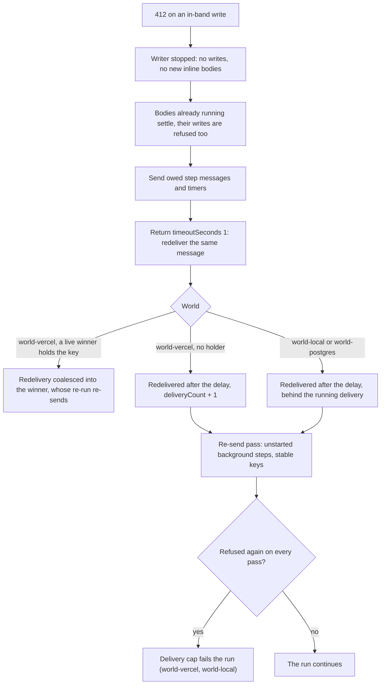

Why it asks for a redelivery instead of acknowledging:

- A refusal does not prove that another orchestrator is running. world-vercel also answers 412 `in-band-superseded` when it sealed the writer's own position, and a 409 it returns after it allocated the position moves `seqInBand` past the writer's count, so the writer's next write gets the 412. In both cases nothing else is queued for the run.
- The other writer may be a second delivery of the same message: one of the two outlived its lease. That delivery can commit a `step_created` and die before the step's message goes out. An acknowledgment plus a plain wake would leave that step with no message, because the wake is the first delivery of a different message and re-sends nothing. The redelivery is counted above 1, so the re-send rule sends it.

What the redelivery costs: one more invocation after about a second (Vercel Queues clamps the delay to 5 seconds at least). On world-vercel the message keeps the run's key during the delay, so a wake sent meanwhile is coalesced into the redelivery, which reads the log anyway; a live winner that still holds the key absorbs the redelivery as a coalesced message. On world-local and world-postgres it is delivered after the running delivery. Repeated refusals count toward the delivery cap where the World counts the redelivery as an attempt (world-vercel, world-local), so a run refused on every pass fails with `MAX_DELIVERIES_EXCEEDED` instead of looping; world-postgres starts `attempt` over on a `{ timeoutSeconds: n > 0 }` reschedule (see [Known limitations](#known-limitations)). The streak is logged at warn. Tests in `spec9/fenced-overlap.runtime.test.ts`, both engines.

#### Two overlapping orchestrators

A delivery stalls past its lease (a CPU-bound inline step), and the queue redelivers the run's message.

##### The second delivery writes first

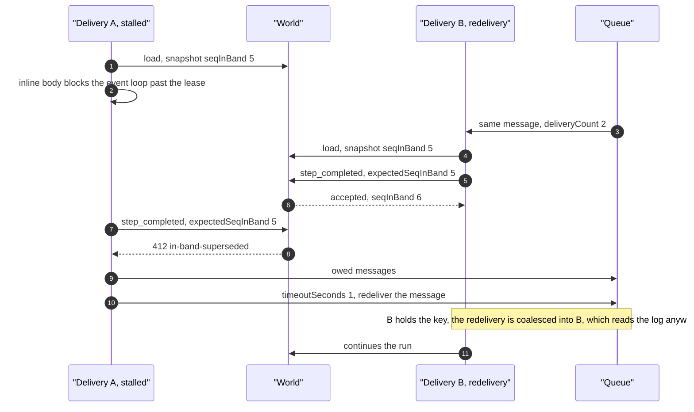

##### The stalled delivery writes first

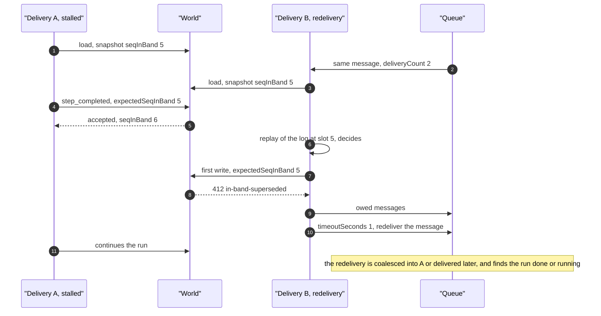

In the first order, if A was inside an inline body, B finds that step started with no outcome and runs it again (`packages/core/src/runtime/spec9/delivery.ts`): B's `step_started` commits, so the body runs in both deliveries. The fence keeps the log to one writer; it does not stop a body from running twice. The exception is a `maxRetries: 0` step: B's attempt 2 is past `maxRetries + 1`, so `executeStep` fails the step without running the body (commit `75ddd45207`, `packages/core/src/runtime/spec9/step-executor.ts`). In the second order, B's first write is refused, and a body B would start behind an awaited start never starts.

#### A self-superseded write with no winner

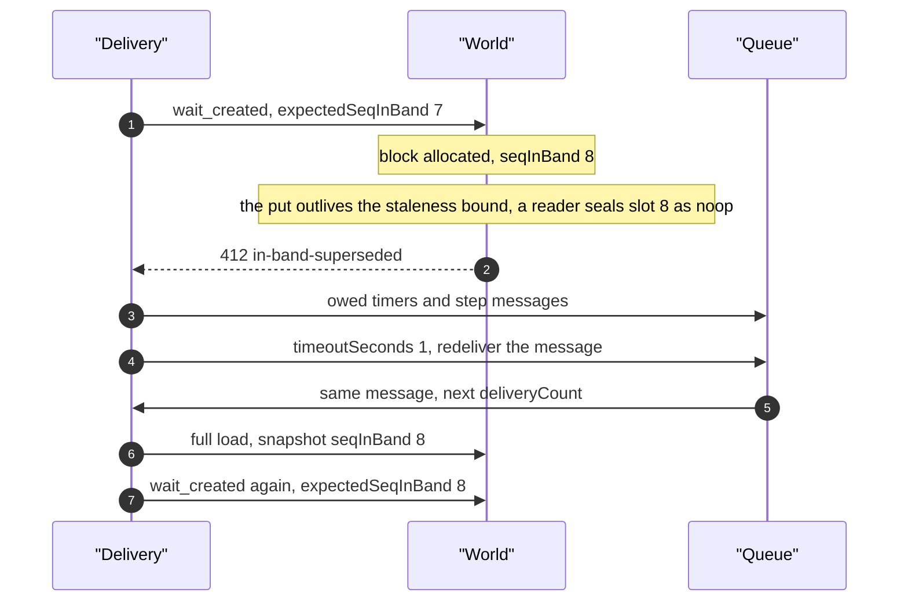

Before any of this, the refused delivery acknowledged and this case stranded the run: nothing else was queued for it. A plain wake fixed it, and the redelivery replaces the wake because of the next case.

#### A second delivery of the same message dies owing a send

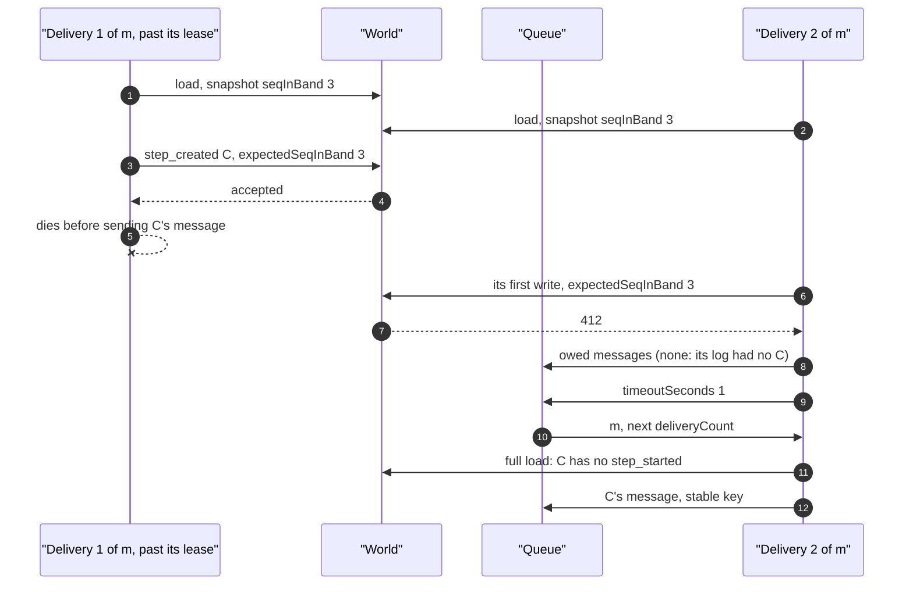

With a plain wake and an acknowledgment, C never got a message: the wake is a first delivery of another message, and the re-send rule skips a first delivery (`fenced-overlap.runtime.test.ts`, "two deliveries of one message after a lease lapse", both engines).

#### A crash before the owed sends

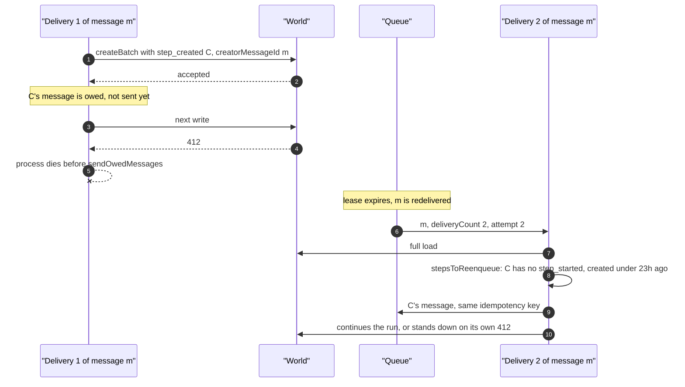

#### Fence edge cases

- **Refusal while bodies run.** Bodies already running settle, their outcome writes are refused, and supersession wins over any other failure (`packages/core/src/runtime/spec9/delivery.ts`).
- **Refused turbo `run_started`.** A fence refusal of the backgrounded `run_started` stops every later write and the delivery asks for a redelivery; the redelivery is not turbo (tested in `packages/core/src/runtime/spec9/turbo.runtime.test.ts`).
- **Refused on every pass.** Each refused pass asks for a redelivery of the same message, each an attempt on world-vercel and world-local, so the delivery cap fails the run with `MAX_DELIVERIES_EXCEEDED`; the streak is logged at warn (tested in `packages/core/src/runtime/spec9/fenced-overlap.runtime.test.ts`). world-postgres starts `attempt` over on a delayed reschedule, so there the loop is not capped (see [Follow-ups](#follow-ups)).
- **Retained VM after a refusal.** The retained session is discarded and the redelivery replays to the same result (`fenced-overlap.runtime.test.ts`).
- **Overlap through a hook or timer wake.** A parked delivery is fenced out when a hook or wait wake overlaps it, and the final log replays from cold to the same result (`fenced-overlap.runtime.test.ts`).
- **Timer delivery refused on its `wait_completed`.** It re-sends its own timer, and its own message is redelivered too (`packages/core/src/runtime/spec9/orchestrator.runtime.test.ts`); a duplicate timer finds its wait completed and arms nothing.
- **A non-fence 4xx.** The count stays and the caller may handle it; a required write (turbo `run_started`, run-ahead) stops the writer either way (`packages/core/src/runtime/spec9/in-band-writer.ts`).
- **5xx or transport error.** Not a fence refusal: the writer stops with that error and the delivery is retried as the error is, never reported as superseded (`in-band-writer.ts`).
- **Stale-holder acknowledgment.** A refused delivery no longer acknowledges, so what Vercel Queues does with the acknowledgment of a delivery whose lease already expired no longer matters on this path. What Vercel Queues does with a `{ timeoutSeconds }` answer from a delivery whose lease already lapsed is not verified; the message then has a live delivery either way, and any later non-first delivery of the run re-sends what is missing.
- **Sequencer item expiry.** The world-vercel backend's sequencer item expires after a period without allocations, and a revived item restarts `seqInBand` at 1; a writer that starts from the snapshot follows it. Not exercised by a test in this repository.

### Event posting

Every in-band write of one delivery goes through one `InBandWriter` (`packages/core/src/runtime/spec9/in-band-writer.ts`). It marks each write `inBand: true`, carries `expectedSeqInBand`, and sends one write at a time. Everything else that writes to the run is out-of-band and never carries a count.

#### Slot numbering

Every event of a spec 9 run has a dense, 1-based slot, encoded in its id as `evnt_` plus a zero-padded decimal (`packages/world/src/slot-identity.ts`). The World keeps two counters: `seq`, the highest slot handed out to anyone, and `seqInBand`, the number of slots handed out to in-band writes, `run_created` included (`IN_BAND_SEQ_AT_RUN_CREATION = 1`, `packages/world/src/events.ts`).

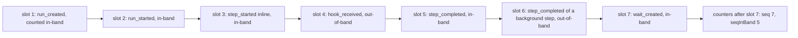

An out-of-band write moves `seq` only. It never invalidates the orchestrator's count, which is why a hook resume or a background step's outcome can land between two orchestrator writes without refusing either.

#### What one write carries

| Field | Set by | Meaning |
|---|---|---|
| `inBand: true` | `fenceParams` (`in-band-writer.ts`) | The orchestrator made this write. |
| `expectedSeqInBand` | `fenceParams` | The writer's count: the load snapshot's `seqInBand`, advanced by every accepted write's `allocated`. |
| `eventCount` | `sendPosition` (`in-band-writer.ts`) | The slot the decision was made against, raised to the highest slot the writer knows it holds every event below. The World reports what lies between it and the write's own slot. |
| `occurredAt` | run-ahead writes (`packages/core/src/runtime/spec9/delivery.ts`, `spec9/delivery.ts`) | The time the workflow already used. On spec 9 the World stores it as the event's `createdAt` (`packages/world/src/interfaces.ts`). Writes that are not speculative do not send it, so the World's own time is stored. |

The response carries:

| Field | Meaning |
|---|---|
| `event` / `results` | The committed event, or per-item results of a batch. |
| `allocated` | Positions the write took: 1 for a new event, 0 for an idempotent replay, the admitted items for a batch (`EventResult` in `EventBatchResult` in `events.ts`). |
| `events` | The skipped-slot report: every event in slots `eventCount + 1` up to the write's first slot. |
| `hasMore` | The report is incomplete; the orchestrator reloads before it consumes anything the write resolves. |

#### One batched write with a foreign event in between

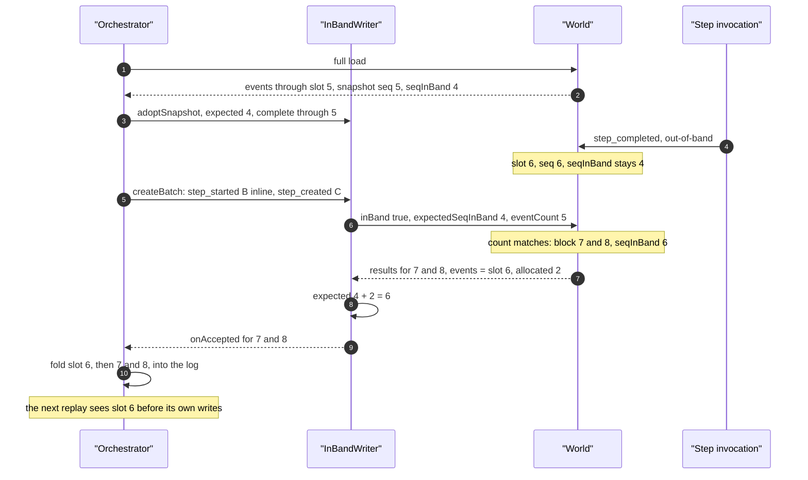

#### Serialization and batches

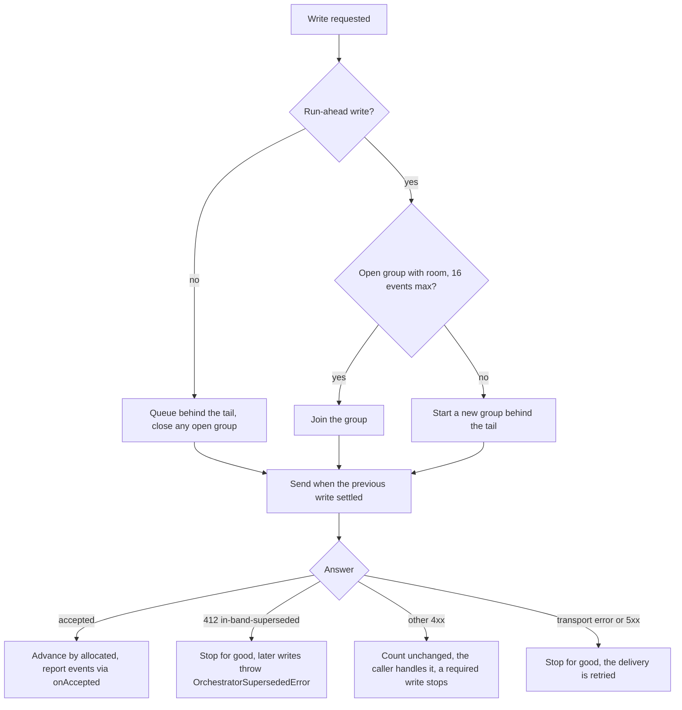

- **One at a time.** Two concurrent in-band writes would carry the same count and the second would be refused, so the writer chains every write on one promise (`serialize`, `in-band-writer.ts`). A suspension's creations go out, on the awaited path, as `createBatch` calls of at most `MAX_IN_BAND_CREATION_BATCH_EVENTS` (64) events and `MAX_IN_BAND_CREATION_BATCH_BYTES` (512 KiB, each event's payload bytes plus a 1 KiB allowance), one after another; the inline steps' creation-bearing starts go first and share the first batch with background creations (`batchChunks`, `packages/core/src/runtime/spec9/step-wait-creation.ts`; `packages/core/src/runtime/constants.ts`, `constants.ts`). A single creation over the byte budget goes out alone. `MAX_BATCH_EVENTS` (16, `constants.ts`) still bounds run-ahead's coalesced write groups and the speculative creation batch run-ahead sends ahead of a boundary. On the node engine, an inline step's outcome is queued on the writer only after a fan-out's last creation batch was queued, so it never lands between two creation batches.
- **Per-entity order.** A batch on a spec 9 run is not atomic, but once the World refuses an item it refuses every later item with the same `correlationId` (`packages/world/src/interfaces.ts`). The world-vercel backend answers those with 409 `batch-earlier-item-failed`. This is what lets one run-ahead group carry a step's creation and its outcome.
- **Run-ahead groups.** Run-ahead writes queued behind a write in flight go out together as one batch when their turn comes (`enqueueAhead`, `in-band-writer.ts`); any other write closes the group, so writes are never reordered.
- **No resolved payloads on a batch.** A batch is sent without `resolveData`, which world-vercel sends as `lazy`, unless one of its writes explicitly asks for `'all'`. A write's `skip-step-inputs` (the replay default) no longer escalates the batch to `'all'`: it describes how a single write's event-log page is read, a batch returns no such page, and the writer overlays the payload it sent on every committed event anyway (`withWrittenEventData`). Single in-band writes already behaved this way (`in-band-writer.ts`, #5034).

### Consume after commit

Two operations happen to every event the orchestrator writes for itself:

- **Commit.** The World accepts the write at a log position: it checks the in-band fence (`expectedSeqInBand`), allocates the next slot, and answers with the event, `allocated`, and the skipped-slot report of every event between the write's `eventCount` and its own slot. Until that answer arrives, the event has no position, and the orchestrator does not know what lies below it.
- **Consume.** The orchestrator takes the event into the log it replays from, and the next pass of the VM acts on it: a promise resolves, the deterministic clock moves to the event's time, and the workflow's next decisions follow from it.

Replay consumes a log in slot order. Every later replay of the run, in this delivery or a cold one, reads the committed log and resolves promises in that order. So the live orchestrator must consume the same events in the same order, and it can only know that order once the write committed: the slot, and what the report says landed below it, come with the commit.

A write that resolves a promise in the workflow (`wait_completed`, an inline step's `step_completed` or `step_failed`) is therefore consumed only after it committed and after the events its report names (`consumeOwnResolvingWrite`, `packages/core/src/runtime/spec9/consume-after-commit.ts`):

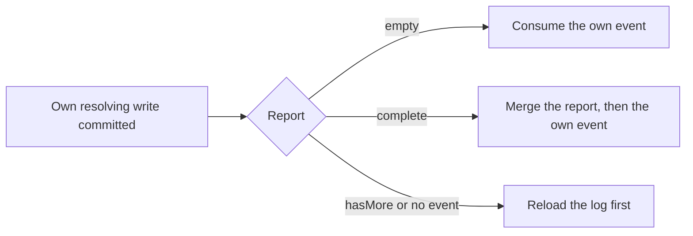

The reason: an out-of-band event below the write (a background step's outcome, a `hook_received`, a `run_cancelled`) is consumed first by every later replay, and resolution order is observable through correlation ids and the workflow clock.

#### Example: a hook payload lands while an inline step runs

The workflow races a hook against an inline step:

```js
const hook = createHook({ token: 'race' });
return await Promise.race([hook.then(() => 'hook'), gated()]);
```

The first pass writes `hook_created` and the inline step's `step_started` (slots 3 and 4, `seqInBand` 4) and starts the body. While the body runs, `resumeHook()` commits a `hook_received` out-of-band at slot 5. Then the body returns, and its `step_completed` is written in-band.

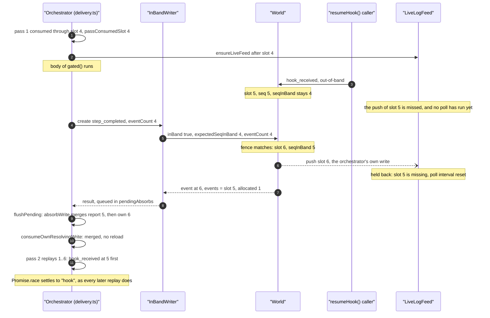

The report in step 7 names slot 5 whatever the feed did, so the order is right even with no push at all. The push in step 6 and the response in step 7 can arrive in either order, and the feed passes on slot 6 only after slot 5, by push or poll. Had the push of slot 5 arrived while the body ran, the delivery would have run a pass on it there and then (a committed foreign event ends the wait in `awaitInlineProgress`, `spec9/delivery.ts`), and the race settles to `"hook"` just the same: consuming a committed event is always safe, only its position must be known. This is the case `inline-step-writes.runtime.test.ts` ("feeds an out-of-band event that landed below an inline outcome before the outcome") runs, with the poll off and no push, so the report alone carries the hook payload.

**What would go wrong otherwise.** Had the orchestrator handed `step_completed` to the VM when the body returned, pass 2 would settle the race to the step's value and the workflow would act on it (return, or create its next step). The committed log says the hook resolved first. The next cold replay, after a handoff, a redelivery or a retained session's discard, settles the race to `"hook"` and diverges from what the run already wrote. The same holds for a `run_cancelled` below a `wait_completed`: consumed in commit order, the run stops before the sleep's continuation runs (`hook-wait.runtime.test.ts`, "stops when a run_cancelled lands below its own wait_completed").

#### Other orderings the rule covers

| Situation | What the code does | What would go wrong otherwise |
|---|---|---|
| The write's report is incomplete (`hasMore`) or the World answers without the event | `consumeOwnResolvingWrite` returns `reload`; the delivery drops the retained session and does a full load before the next pass (`spec9/delivery.ts`). `absorbWrite` sets `logBehind` instead of merging (`spec9/delivery.ts`). | The VM would consume the own event above a hole. If the hole held an out-of-band resolution, the order would be wrong, as in the example. |
| The own slot is more than one above everything held and the report names nothing between | `absorbWrite` marks the log behind rather than merge across the hole (`spec9/delivery.ts`). | Same as above: an unseen event below the own one. |
| The fence refuses the write (412 `in-band-superseded`) | Nothing committed, so nothing is consumed. The writer stops for good and every later write throws `OrchestratorSupersededError` (`stop`, `in-band-writer.ts`). The delivery forgets its consumed position, sends the messages its committed writes owe, and asks for a redelivery of its own message (`{ timeoutSeconds: 1 }`). Its retained session is discarded, and the redelivery replays from a fresh load. | A VM that consumed the refused event would hold a state the log never had: another orchestrator wrote at that count, and its decisions, not this one's, are the run's. Covered by `fenced-overlap.runtime.test.ts` ("discards the retained session when a later write is fenced out..."). |
| The live feed pushes the orchestrator's own write before the response | `isOwnEvent` does not start a pass for it (`spec9/delivery.ts`); `mergeReportedEvents` keeps one copy per event id; `allocatedBy` counts only slots unknown when the write was sent, so the echo does not read as an idempotent replay (`in-band-writer.ts`). | A pass per echo, and a fence count that undercounts the write, so the next in-band write is refused. Covered by `orchestrator.runtime.test.ts` ("takes one workflow pass per inline step when the live feed echoes its own writes") and `inline-step-writes.runtime.test.ts` ("keeps the fence count when the feed shows a batch and later events before its response"). |
| An inline step finishes while a fan-out's later creation batches are still committing | Its outcome is queued on the writer only after every creation batch was queued (`creationBatchesQueuing`, `spec9/delivery.ts`), and no pass decides while a creation is in flight (`creationsInFlight`, `spec9/delivery.ts`). | A pass before the creations committed would not see them in the log, re-derive them as uncreated, and create the steps again. An outcome between two creation batches would also hold up the background creations behind it. |
| Another writer's event lands above what the pass consumed, after the VM decided | Before suspending, the delivery replays again if the log holds a foreign event above `passConsumedSlot` (`spec9/delivery.ts`). It records its consumed position (`recordConsumedPosition`, `consumed-position.ts`) only after its writes committed and its messages and timers went out. | That event's own wake would find the tail at the recorded position and be acknowledged as a no-op (`isNoopDelivery`, `consumed-position.ts`), so the event would never be consumed. Covered by `small-rules.test.ts` ("skips a delivery whose tail is the consumed position..."). |

#### The one exception: run-ahead

Run-ahead consumes an inline step's outcome before its write commits, and only where the order cannot matter. At a boundary that `observeOutOfBandWriters` (`packages/core/src/runtime/out-of-band-observation.ts`) classifies inert (no hook the workflow waits on, no abort-signal hook, no step running in another invocation, no wait due within the invocation), the outcome is placed at the slot the writer predicts (`predictNextSlot`, `in-band-writer.ts`) and handed to the VM while the write is in flight, at most `WORKFLOW_RUN_AHEAD_DEPTH` writes deep. Every event that then lands below a speculative slot is checked by `checkRunAheadHazard` (`spec9/delivery.ts`, `runAheadHazard` in `packages/core/src/runtime/spec9/run-ahead.ts`). A path-changing one stops the writer's decisions (`stopDecisions`, `in-band-writer.ts`) so nothing decided from the speculative state is written, and the redelivery decides from the log. An inert one displaced by a foreign event is repaired in place. Before a boundary that is not inert, the delivery drains run-ahead and replays if anything foreign landed below (`hasUnconsumedForeignEvent`, `spec9/delivery.ts`). Covered by `run-ahead.runtime.test.ts`.

#### Where the code enforces it

- `consumeOwnResolvingWrite` (`consume-after-commit.ts`): the decision between merge and reload; unit tests in `consume-after-commit.test.ts` (unseen out-of-band event first, empty report, incomplete report, truncated report).
- `absorbWrite` (`spec9/delivery.ts`): folds every accepted in-band write into the log as report, then own event, in slot order; refuses to merge across a hole.
- `flushPending` (`spec9/delivery.ts`): the only place buffered feed events and inline writes join the log, between passes and never under a replay.
- `InBandWriter` (`in-band-writer.ts`): one write at a time, the fence, `sendPosition` and `noteComplete` for the report's lower bound, and the stop on a refusal or an unknown outcome.
- `LiveLogFeed` (`live-feed.ts`): passes on only a gap-free run of slots, so the feed never hands over an event above one it has not delivered.
- `recordConsumedPosition` and `isNoopDelivery` (`consumed-position.ts`): a position counts as consumed only once the delivery that consumed it finished cleanly.

### Out-of-band writers

| Writer | Event | Code | Wake it sends |
|---|---|---|---|
| Background step invocation | `step_started`, `step_retrying`, `step_completed`, `step_failed` | `packages/core/src/runtime/spec9/step-handler.ts` | One plain orchestrator message per outcome, no idempotency key, no delay, no log read; sent again by a redelivery that finds the step terminal (`wakeOrchestrator`, `step-handler.ts`) |
| `resumeHook()` | `hook_received` | `packages/core/src/runtime/resume-hook.ts` | Orchestrator message, no idempotency key on spec 9 |
| `cancel()` | `run_cancelled` | `cancelRun` in `packages/core/src/runtime/runs.ts`, `packages/core/src/runtime/run.ts` | `wakeRunAfterOutOfBandWrite` (`runs.ts`) |
| `setAttributes()` in a step body | `attr_set` | `packages/core/src/set-attributes.ts` | none |
| `start()` | `run_created` | `packages/core/src/runtime/start.ts` | the run's first message |

Each lands at the next slot when it commits. The orchestrator sees it in three ways: in the skipped-slot report of its next in-band write, in the live feed, or in its next load.

### Run-ahead

Run-ahead starts work before the writes it depends on commit: it hands an inline step's outcome to the workflow before its `step_completed` commits. [Turbo](#turbo) does the same on a run's first delivery. Every write still goes through the one in-band writer, in decision order.

`WORKFLOW_RUN_AHEAD_DEPTH` is 10 by default, clamped to 0..16, and 0 turns it off (`RUN_AHEAD_DEPTH` in `packages/core/src/runtime/constants.ts`). It caps how many step outcomes are unconfirmed at once. Run-ahead exists on the node:vm engine only: the QuickJS entry point has no run-ahead code.

#### When a boundary may run ahead

At each suspension that schedules inline steps, the delivery classifies who else could append an event that changes what the workflow does next (`observeOutOfBandWriters`, `packages/core/src/runtime/out-of-band-observation.ts`; called at `packages/core/src/runtime/spec9/delivery.ts`).

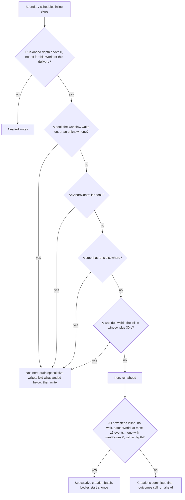

A hook the workflow has created but not awaited is inert on node:vm: its payload is buffered as an unarmed delivery and moves neither step results nor the clock (`out-of-band-observation.ts`).

#### A clean run-ahead

{/* @skip-typecheck - illustrative workflow */}
```typescript
export async function pipeline(input: string) {
  "use workflow";
  const a = await stepA(input);
  const b = await stepB(a);
  return await stepC(b);
}
```

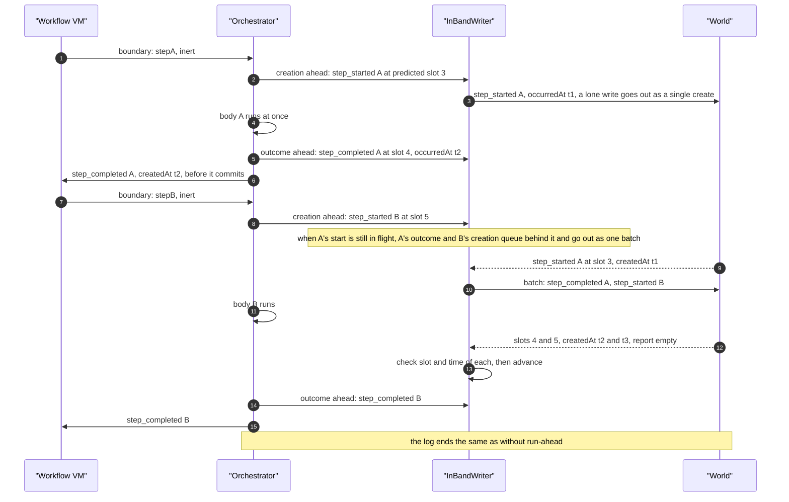

Each speculative write is checked when it commits (`writeOutcomeAhead`, `spec9/delivery.ts`; `writeCreationAhead`, `spec9/delivery.ts`):

- every event in its skipped-slot report is tested for a hazard;
- its stored `createdAt` must equal the `occurredAt` the workflow used, or the delivery stops and run-ahead is off for that World for the rest of the process (`spec9/delivery.ts`);
- a slot other than the predicted one is a repair, not a stop: another writer appended first, and the delivery rebuilds its log from the responses and replays, keeping the retained session when it can (`spec9/delivery.ts`).

#### Hazards

`runAheadHazard` (`packages/core/src/runtime/spec9/run-ahead.ts`) names an event below a speculative write that would have made the boundary path-changing:

| Event below a speculative write | Hazard when |
|---|---|
| `hook_received`, `hook_disposed`, `hook_conflict` | the hook was sensitive at a boundary still in flight: awaited, unknown, or a system abort hook |
| `step_started`, `step_completed`, `step_failed`, `step_retrying` | the step is not one this delivery runs inline |
| `wait_completed` | always: on spec 9 only the orchestrator completes waits |
| anything else (`run_cancelled`, `attr_set`, `noop`) | never |

The classification rules these out, so a hazard means a writer the classification missed. The world-vercel backend refuses an out-of-band `wait_completed` on spec 9 runs (409 `wait-completion-in-band-only`). The run-ahead tests produce a hazard by appending one directly (`packages/core/src/runtime/spec9/run-ahead.runtime.test.ts`).

#### A hazard stop and the restart in place

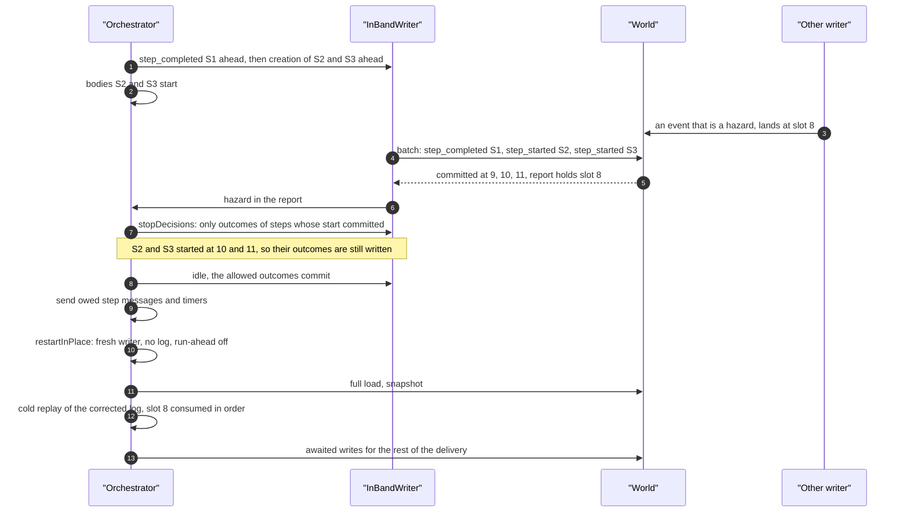

If the stop had refused the batch that creates S2 and S3 (a refused speculative write stops the writer before anything else is sent), their bodies ran with no committed start, and the restarted pass runs them again. That is how a stop can run a body twice: at most the steps of refused speculative creations, which the test bounds at the run-ahead depth (`run-ahead.runtime.test.ts`). A `maxRetries: 0` step is never one of them, because it never starts ahead of its start (`mayRunBeforeItsStart` in `packages/core/src/runtime/spec9/step-executor.ts`, `spec9/delivery.ts`).

`MAX_RUN_AHEAD_RESTARTS` is 1 (`constants.ts`). With run-ahead off after the first restart, a second stop cannot come from run-ahead; a stop past the cap hands the message off instead (`spec9/delivery.ts`).

#### Recovering from a run-ahead stop

The delivery lets the outcomes a hazard stop still allows commit, sends what its writes owe, takes a fresh writer, reloads the log and replays from cold in the same delivery, with run-ahead off for the rest of the delivery. With run-ahead off a second stop cannot occur; `MAX_RUN_AHEAD_RESTARTS` (1) still bounds the restarts, and a stop past it hands the message off. The inline deadline applies to the restarted pass as to any other. A hazard stop detects a classification gap rather than recovering from one: the check runs on the report of a write that already committed, and a coalesced run-ahead group can commit the decisions made without the event in the same batch. It is logged at error level with `possibleLogCorruption: true`.

#### Replay divergence

A replay that diverges from the log discards the VM, reloads the log and replays from cold in a fresh VM, in the same delivery, up to [`WORKFLOW_REPLAY_DIVERGENCE_MAX_RETRIES`](/docs/configuration/runtime-tuning#workflow_replay_divergence_max_retries) times, then fails the run with the same `CORRUPTED_EVENT_LOG` error and message as before. The first natural write after a recovered divergence still carries `replayDivergenceCount`. Across crashes and redeliveries the count starts again, and the delivery cap bounds it. The QuickJS engine had no divergence recovery before this change and has none after it.

### Turbo

[Turbo mode](/docs/changelog/turbo-mode) still fast-paths a run's first delivery. On that delivery the log holds only `run_created`, whose position counts as the run's first in-band write, and no other orchestrator exists yet. So it writes `run_started` without waiting, starts the in-band writer from the count after the run's creation instead of loading the log, and starts the first inline step bodies before their start commits. Every in-band write queues behind `run_started` in the delivery's writer, and a refused `run_started` stops the delivery like any fence refusal.

Turbo is on by default (`WORKFLOW_TURBO`, `isTurboEnabled` in `constants.ts`) and applies to a delivery when all of these hold (`spec9/delivery.ts`):

- the message carries `runInput`, so it is the message `start()` enqueued;
- `attempt` is 1 and `deliveryCount` is 1, so it is neither a redelivery, a handoff's next delivery nor a coalesced re-run;
- it is not a step message, a legacy hook resume or a timer.

A restart in place is never turbo (`restartInPlace` in `spec9/delivery.ts`).

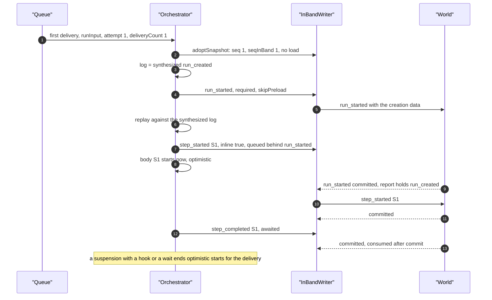

The optimistic start applies only while every step of the boundary is inline and the boundary has no wait and no step that failed to serialize (`spec9/delivery.ts`). A boundary with a background step commits its creations first.

#### Why turbo is safe on spec 9 runs (and where it stops)

##### Detection

The first message is the only one that carries the queued **run input**. Turbo engages when it does, its delivery count is 1 (a redelivery, including the one after a fence refusal, counts higher), and the delivery is not a background step, a divergence recovery, a hook resume or a timer.

##### One orchestrator, one writer

Starting a body before its start commits is unsafe in general: if the in-band fence then refuses the start because another orchestrator invocation of the run holds it, the body ran without a durable record and runs again. On the first delivery of the first message there is no other orchestrator yet: the run was created moments ago by `start()`, and this one message is the only one in flight. The body therefore runs once.

##### Turbo stops on the first hook or wait

A hook or a wait gives the run writers other than this delivery (a hook resume, a timer, `wakeUp()`), each of which wakes the orchestrator. Turbo stops starting bodies ahead of their start for the rest of the delivery as soon as a suspension has a hook or a wait. Later inline steps of that delivery wait for their start to commit, as on every other delivery. Attribute writes resolve in this process and do not end it.

##### Every write still lands after `run_started`

- Every in-band write of the delivery goes through one in-band writer, which serializes them. `run_started` is the first, so `step_created`, `step_started`, `wait_created`, hook events and the run's terminal event all queue behind it. The log still reads `run_created → run_started → step_created → step_started → step_completed`.
- Writes made outside the in-band writer by an optimistic step body wait on the run-ready barrier: stream writes through `getWritable()`, a writable stream passed as a step argument, a stream the step returns, and `setAttributes()`.
- An awaited start (with `WORKFLOW_OPTIMISTIC_INLINE_START=0`) also waits for `run_started` before it is sent.

##### When `run_started` or a later write is refused

If the backgrounded `run_started` fails for any reason, a definite refusal included, the in-band writer stops: nothing else this delivery would write reaches the World, and no further inline body starts. Bodies that already started settle first, their outcomes are discarded, and the delivery ends as an awaited `run_started` failing the same way would end it:

- refused by the in-band fence (`InBandSupersededError`): redelivered about a second later instead of acknowledged; the redelivery is not a first delivery, so it loads the log and takes the normal path;
- the run already finished (for example cancelled before its first delivery): acknowledged with nothing written;
- anything else: retried by the queue, or recorded as a setup failure.

Stream and attribute writes waiting on the barrier fail instead of writing, so a refused start leaves no chunks or attributes on a run whose log does not record the step that made them. A body that ran before such a refusal does run again on the redelivery.

The same holds for the step's own start: if its batch is refused, the body's outcome is not written, and the start's error decides (a throttle defers the run, a finished run ends the delivery, anything else fails it).

##### A run cancelled before its first delivery still runs the first step body

The normal path loads the run up front and returns before any workflow or step code runs if the run was cancelled or expired between `start()` and this delivery. Turbo synthesizes `status: 'running'` and runs the first step body before `run_started` returns, so the cancellation is only observed when `run_started` is refused, after the body's side effects ran. `WORKFLOW_TURBO=0` restores the up-front check.

##### `workflowStartedAt` reflects the first delivery's clock

Replay matching (step, wait and hook correlation IDs, the VM seed, and the in-VM `Date.now()`) is derived from a replay-stable timestamp recovered from the run ID, so it does **not** depend on `startedAt` and is identical on every delivery. The one value that still tracks `startedAt` is the user-facing `getWorkflowMetadata().workflowStartedAt`: under turbo the first delivery synthesizes it from the local clock, while a later delivery reads the World's `startedAt`, so the two can differ by the start-to-first-delivery latency. Treat `workflowStartedAt` as an approximate, human-facing timestamp, and do not branch workflow control flow on it. For timing logic that must survive replay, use the in-VM `Date.now()` / `new Date()`.

##### Attributes seeded at `start()` survive the skipped event load

`start({ attributes })` does **not** disable turbo. Seed attributes are folded into the `run_created` event's data and ride along in the queued run input, so the synthesized run carries them. This is safe because **attributes are write-only inside a workflow**: there is no in-workflow read API, and `run_created` is consumed structurally during replay. If an in-workflow attribute *read* API is ever added, it MUST read from the run snapshot (which turbo populates from the run input), not by replaying `run_created` / `attr_set` events, or it would see no seed attributes on the first turbo delivery only.

#### Turbo configuration on spec 9 runs

Turbo mode is **on by default**. Set `WORKFLOW_TURBO=0` (or `false`) to disable it: every delivery then loads the log, awaits `run_started`, and waits for each inline step's start to commit before its body runs. Use it for deployments whose first-step bodies are not idempotent, or to isolate behavior while debugging.

`WORKFLOW_OPTIMISTIC_INLINE_START=0` (or `false`) keeps turbo's backgrounded `run_started` and skipped initial load, and makes the first delivery's inline bodies wait for their start to commit. No other value of it does anything: on single-orchestrator runs there is no optimistic inline start outside turbo's first delivery, because only that delivery is known to have no other orchestrator.

Turbo mode is client-side and needs no World changes. A World with `createBatch` saves the separate `step_started` write; one without it gets the start as its own write, chained behind `step_created`.

#### Run-ahead and turbo edge cases

- **World stores its own time.** A speculative write whose `createdAt` differs from its `occurredAt` stops the delivery and turns run-ahead off for that World in the process (`packages/core/src/runtime/spec9/delivery.ts`, `disableRunAheadFor` in `packages/core/src/runtime/spec9/run-ahead.ts`).
- **World without `createBatch`.** Speculative creation needs a batch World; outcomes still run ahead as single required writes (`spec9/delivery.ts`, `packages/core/src/runtime/spec9/in-band-writer.ts`).
- **Depth cap.** An outcome at the cap waits for an earlier speculative write to settle and then runs ahead too, so the next creation shares a round trip (`spec9/delivery.ts`).
- **Displaced speculative write.** Another writer took the predicted slot; the delivery repairs from the write responses without a log read and keeps the session (`spec9/delivery.ts`; tested in `packages/core/src/runtime/spec9/run-ahead.runtime.test.ts`).
- **Cancellation below a speculative write.** Not a hazard; no outcome is left without its creation (`run-ahead.runtime.test.ts`).
- **Refused speculative creation.** The writer stops before any later write, so no outcome is written without its creation (`run-ahead.runtime.test.ts`).
- **Fence refusal while running ahead.** Handled as any refusal, with no orphan writes, and the redelivery completes (`run-ahead.runtime.test.ts`).
- **Slot gap from a queued sibling start.** A sibling's start queued ahead of a speculative outcome is not read as a hole; the delivery drains before judging the log (`spec9/delivery.ts`).
- **Failed turbo `run_started`.** Its error decides the delivery whatever later write surfaced it: a fence refusal asks for a redelivery of the message, a conflict or expired run acknowledges, anything else is recorded as a setup failure or redelivered (`spec9/delivery.ts`).
- **Resilient start under turbo.** A `run_started` carrying the creation data creates a run whose `run_created` never landed (`packages/core/src/runtime/spec9/turbo.runtime.test.ts`).
- **A step body's own out-of-band writes under turbo.** Stream and attribute writes from an optimistic body wait for the backgrounded `run_started` (`turbo.runtime.test.ts`, `spec9/delivery.ts`).
- **`WORKFLOW_OPTIMISTIC_INLINE_START=0`.** Each start is awaited, and the log load is still skipped (`turbo.runtime.test.ts`).
- **Coalesced re-run of the first delivery.** Reported with `deliveryCount` 2, so it loads the log (`turbo.runtime.test.ts`).
- **Rotated start message.** A world-vercel rotation delivers a new message with `attempt` 1 and `deliveryCount` 1. A copy of the start message would carry `runInput` too, satisfy every condition above, and replay a progressed run against a synthesized `run_created`-only log, starting completed inline bodies again before the fence refused its `run_started`. The rotation sends a continuation without `runInput` (`singleOrchestratorContinuationPayload` in `@workflow/world`), so the new message loads the log. Tested on both engines with optimistic inline starts on (`turbo.runtime.test.ts`, "continues on a World's rotated start message").

### `maxRetries: 0` is at most once per live owner

A background step keeps one queue message for its whole life and retries in place on it. Any delivery other than a plain first delivery reads the log before running the body.

{/* @skip-typecheck - illustrative workflow */}
```typescript
async function sendWireTransfer(amount: number) {
  "use step";
  await bank.transfer(amount); // must never run twice
}
sendWireTransfer.maxRetries = 0;
```

If the step's invocation crashes after the transfer but before `step_completed`, the redelivery reads the log, sees a started attempt with no outcome, and fails the step instead of running the body again.

The guarantee holds per live owner. A duplicate delivery after a lease expiry is a second owner: if it reads the log before the first delivery's `step_started` lands, both run the body. A guarantee would need the World to make the first start conditional, which spec 9 does not require.

## Spec 8 and spec 9 side by side

The runtime keeps two orchestrators side by side: `runtime/spec8/` (the previous one) and `runtime/spec9/`. A run keeps the spec version family it was created with, and every delivery is routed by that stored version. Runs at 9 or later go to the spec 9 orchestrator, anything earlier to spec 8 (`orchestratorForSpecVersion` in `packages/core/src/runtime.ts`). The backend may raise a run's version across capability-only versions (for example 5 to 8, see `CAPABILITY_ONLY_SPEC_VERSIONS`), never across 9, so a run never changes orchestrator.

### Comparison

| | Spec 8 run | Spec 9 run |
|---|---|---|
| Orchestrator | `runtime/spec8` | `runtime/spec9` |
| Writers | Several orchestrator invocations may write; the World's step and wait rows refuse duplicates | One fenced in-band writer; out-of-band writers for hook payloads, step outcomes, cancellation, attributes |
| world-vercel topic | `__wkf_workflow_<name>`, unkeyed | Same topic, orchestrator messages keyed by run id |
| world-vercel `{ timeoutSeconds: n }` | New message, up to 23 hours | Same message redelivered; `0` is a handoff |
| world-local, world-postgres | Not serialized per run | Serialized per run (run gate, Graphile named queue) |
| Wake idempotency keys | `hook-<resumeId>`, `hook-force-claim-<hookId>` | None on wakes; each hop of a wait's timer carries `wait:<correlationId>:<resumeAt>:<hopAt>`, and a near-due re-arm `wait:<correlationId>:<resumeAt>:s<second>` |
| `run.wakeUp()` | Writes `wait_completed` out-of-band | Sends `completeWaits` to the orchestrator |
| world-vercel events API | v4 routes, batches over HTTP | v5 routes, batches over the run's socket when the WS transport is on |

world-local and world-postgres serialize only spec 9 runs (`singleOrchestratorRunIdOf`, `packages/world/src/queue.ts`). A spec 8 delivery can hold an inline step until another wake of the same run aborts it, and a per-run gate would hold that wake back.

### Sleeps and timers, spec 8 against spec 9

| | Spec 8 | Spec 9 |
|---|---|---|
| Who writes `wait_created` | The suspension handler of the delivery that reached `sleep()` | The orchestrator, in-band (fenced) |
| Who writes `wait_completed` | Any delivery that replays the run after the wait is due (the "complete elapsed waits" pass in `spec8/delivery.ts`), or `run.wakeUp()` directly | Only the orchestrator, in-band, at the top of a pass (`dueWaits`). An out-of-band `wait_completed` is refused ("Why `wait_completed` is in-band only" below) |
| The timer | One delayed continuation message for the run's earliest open wait, sent on every suspension and deduplicated by its key (`getWaitContinuationDispatch` in `wait-continuation.ts`) | One delayed message per wait chain, for the chain's earliest open wait, sent only by a delivery that owns the chain ("Who arms a timer" below) |
| A timer's delivery | A full replay of the run, which completes every elapsed wait and suspends again | An orchestrator delivery like any other: load the log, complete the due waits in-band, continue |
| Long sleeps | Hops of at most 23 hours, counted from the sender's clock: the first hop is a full one and the last is what is left. Every hop delivery is a full replay | Hops anchored on the wait's deadline: the last one is due at `resumeAt` and the first is the short one. An intermediate hop delivery reads only the run's status |
| Timer keys | `<correlationId>`, `<correlationId>:hop-<n>`, `<correlationId>:<second>` within the near-elapsed threshold, `:a<attempt>` after an early delivery | `wait:<correlationId>:<resumeAtMs>:<hopAtMs>`, `:a<attempt>`, and the near-due `wait:<correlationId>:<resumeAtMs>:s<second>` ("Timer keys" below) |
| A wait due while the delivery is alive | The delivery waits for its inline batch, then replays; a wait due within the inline window plus `WORKFLOW_OPEN_WAIT_CLOCK_SKEW_MS` gates the inline delta | The delivery waits in process until the earliest open wait is due (`waitForProgress` sleeps until `nextTimerAt`) and completes it in its next pass |
| `run.wakeUp()` | Writes `wait_completed` for each open wait, then sends a wake; `stoppedCount` counts completions | Sends one orchestrator message naming the waits (`completeWaits`); best-effort, and `stoppedCount` counts the waits it asked for |

Both specs share one thing: a sleep is a `wait_created` with a `resumeAt`, keyed by a fresh correlation id per `sleep()` call (`wait_${ctx.generateUlid()}`, `packages/core/src/workflow/sleep.ts`), and replay resolves the sleep's promise at its `wait_completed`.

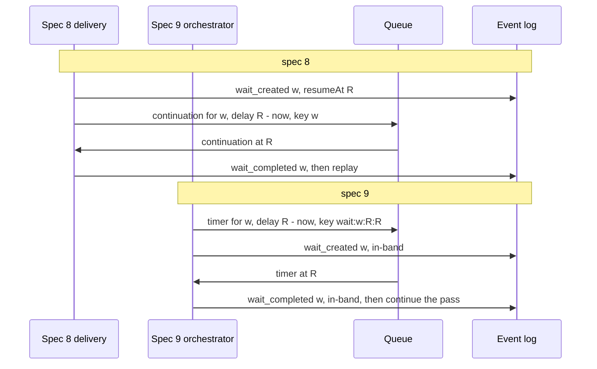

On spec 9 the timer goes out before `wait_created` commits ("At creation" below), so the order in the diagram is deliberate.

### Resolving a delivery's spec

`resolveRunSpec` (`packages/core/src/runtime/run-spec-routing.ts`) tries, in order:

1. `runInput.specVersion`, on a run's first delivery from `start()`.
2. `runContext.specVersion`, on a step message.
3. `runSpecVersion`, the hint on every other message of a run, a world-vercel rotation's continuation included: it drops the start message's `runInput` and stamps the version `runInput` carried (`singleOrchestratorContinuationPayload` in `@workflow/world`).
4. `runs.get(runId, { resolveData: 'none' })`. A run without a stored version is `SPEC_VERSION_LEGACY`. A run that is not found takes the World's own spec version, and the orchestrator handles the missing run. The run read here is handed on, so the orchestrator does not read it again.

Nothing is remembered between messages: a stamped message never reads the run, and an unstamped one reads it once. A wrong hint routes the message to the other orchestrator, which finds the run's own version on the row it loads and sends the message again with that version before it replays anything (`handOffToRunOrchestrator`, `packages/core/src/runtime/delivery.ts`).

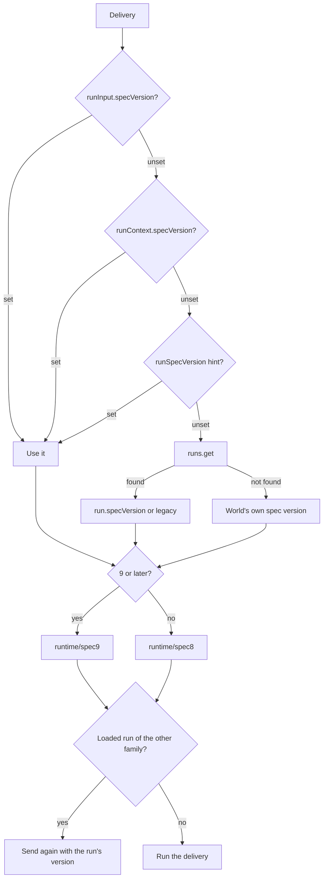

The World decides the queue side from the payload alone, with `messageRunSpecVersion` (steps 1 to 3 only). It never reads the run. An unstamped message is spec 8 there, whatever the run is. See [Queue topology](#queue-topology-handoffs-and-rotation).

### Writers outside the orchestrator

Writes made outside a delivery (cancel, resume, wake-up, external attributes) stamp the run's own version (`specVersionForRunWrite(run.specVersion)`), not the SDK's current one. A spec 8 run never receives a spec 9 event. The in-band fence is required only when the World declares spec 9 (checked in `start()`), or when the run itself is spec 9.

### Stamps at every send site

Every send of a run's message in this runtime names the run's version, for spec 8 runs as well as spec 9 ones. A producer either puts `runSpecVersion` (or `runContext`, `runInput`) on the payload itself, or passes the run's version as `opts.specVersion`, which `queueMessage` and `queueMessages` copy onto the payload (`withRunSpecVersion`, `packages/core/src/runtime/run-spec-routing.ts`; `packages/core/src/runtime/helpers.ts`). `spec9/spec-stamp.runtime.test.ts` checks every message of a spec 9 run on both engines, and `spec-stamp-world-local.test.ts` checks spec 8 and spec 9 runs end to end on world-local, including that routing reads the run only for an unstamped message.

| Producer | Field | Where |
|---|---|---|
| `start()`, first delivery | `runInput.specVersion` | `packages/core/src/runtime/start.ts` |
| Background step message, both engines | `runContext` | `stepDispatchMessage` in `packages/core/src/runtime/spec9/step-message.ts` |
| Orchestrator wake, timer, intermediate hop | `runSpecVersion` from the routed spec | `wakeSelf` in `packages/core/src/runtime/spec9/delivery.ts` |
| Deployment-mismatch re-enqueue | `runSpecVersion`, the run's or the routed spec | the `reenqueue` that `guardDeployment` passes, in `packages/core/src/runtime/spec9/delivery.ts` |
| Step handler's wake | `runSpecVersion` | `wakeOrchestrator` in `packages/core/src/runtime/spec9/step-handler.ts` |
| QuickJS wakes and timers | `runSpecVersion` | `queueWaitTimer`, `requeueImmediately` and the throttled-claim replay in `packages/core/src/runtime/spec9/quickjs-entrypoint.ts`; the hook-conflict wake in `dispatchPendingOps`, `packages/core/src/runtime/quickjs-pending-ops.ts` (spec 8 only, `SPEC_VERSION_LEGACY` for a run that records no version) |
| Spec 8 replay message, wakes, timers, requeues, backstops, divergence recovery | `runSpecVersion` from the routed spec | `packages/core/src/runtime/spec8/delivery.ts`, `spec9/delivery.ts` |
| Spec 8 deployment-mismatch re-enqueue | `runSpecVersion`, the run's or the routed spec | `packages/core/src/runtime/spec8/delivery.ts` |
| Spec 8 step messages, both engines | `runContext` | `packages/core/src/runtime/spec8/delivery.ts`, `spec9/delivery.ts`; `packages/core/src/runtime/spec8/suspension-handler.ts`; `packages/core/src/runtime/spec8/quickjs-entrypoint.ts` |
| Spec 8 QuickJS wakes and timers | `runSpecVersion` from the run | `packages/core/src/runtime/spec8/quickjs-entrypoint.ts`, `quickjs-entrypoint.ts` |
| `resumeHook()` wake | `runSpecVersion`, explicit, left off when unknown | `packages/core/src/runtime/resume-hook.ts` |
| Force-claim victim wake | `runSpecVersion` from `claimedFrom`, left off when unknown | `packages/core/src/runtime/hook-wake.ts` |
| `cancel()` wake | `runSpecVersion`, explicit | `packages/core/src/runtime/runs.ts` |
| `run.wakeUp()` | `runSpecVersion`, explicit | `packages/core/src/runtime/runs.ts`, `runs.ts` |
| `reenqueueRun()` | `runSpecVersion`, explicit | `packages/core/src/runtime/runs.ts` |
| `reenqueueActiveRuns()` (world-local, world-postgres restart recovery) | `runSpecVersion` when the run records one | `packages/world/src/recovery.ts` |
| `resumeHook()` and `cancel()` from an older SDK | none | outside this runtime |
| Other clients of the World | not known | outside this runtime |

### An unstamped message

A message to a spec 9 run without a stamp still reaches the right orchestrator, because `resolveRunSpec` falls through to `runs.get`. The World treats it as spec 8: on world-vercel it is sent unkeyed and a `{ timeoutSeconds }` result continues on a new message; on world-local and world-postgres it skips the per-run gate. It then runs next to the keyed holder, and the in-band fence keeps that safe: the loser's write gets a 412, and it asks for a redelivery of its own message (see [The in-band fence and its 412s](#the-in-band-fence)). The log stays linear, but the overlap can cost more than one invocation: a spec 9 inline step's start carries no owner, so the unserialized delivery can start and run the body of an inline step the holder is still running, and the fence refuses only the later outcome write. Every producer in this runtime stamps its messages for that reason, including the restart recovery of world-local and world-postgres (`reenqueueActiveRuns`). A producer outside it can still send an unstamped message, or one stamped below 9, for a spec 9 run, and nothing in the runtime can prevent that; a hint below 9 reaches the spec 8 orchestrator first, which hands the message on once it loads the run. The comments on `resolveRunSpec` and on `messageRunSpecVersion` in `@workflow/world` record this.

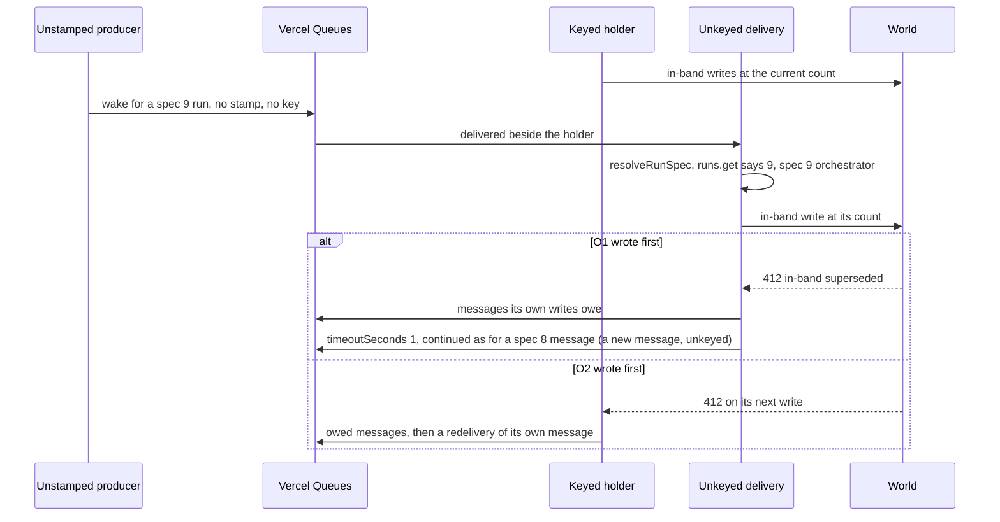

A spec 9 step message without a stamp would lose its same-message retry on world-vercel and arrive as a plain first delivery, which skips the log read the at-most-once rule of `maxRetries: 0` depends on. Every step message this runtime sends carries `runContext`, so this applies only to a producer outside it.

### A spec 8 run after an upgrade

A run created as spec 8 keeps spec 8 after the app upgrades and opts in to spec 9 (sets `WORKFLOW_SPEC_VERSION=9`, on a World that passes `{ inBandFence: true }`). Upgrading alone keeps new runs on spec 8. `packages/world-testing/test/spec8-upgrade.test.ts` does this with world-local.

{/* @skip-typecheck - illustrative workflow */}
```typescript
export async function approval(requestId: string) {
  "use workflow";
  await notifyApprover(requestId);
  await sleep("7d");
  return await escalate(requestId);
}
```

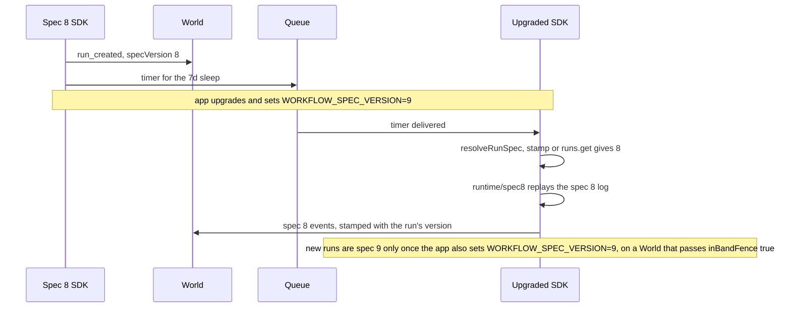

Writes made outside a delivery (cancel, resume, wake-up, attributes) stamp the run's own version through `specVersionForRunWrite(run.specVersion)`, so a spec 8 run never receives a spec 9 event (`packages/core/src/runtime/resume-hook.ts`).

### An older SDK and a spec 9 run

The world-vercel backend accepts writes to a spec 9 run only over its API version 5. Every older API version gets 400 `spec-version-requires-api-v5` on a write, while reads stay available. An older SDK (a deployment rolled back, or another deployment's `resumeHook()`) therefore fails on the write, before it sends any wake. It cannot resume a hook or cancel a spec 9 run. On the Local and Postgres Worlds the same write fails with `RunNotSupportedError`. See [The rollback floor](#the-rollback-floor) for what happens to the run.

```mermaid
sequenceDiagram
    participant Old as Older SDK
    participant B as world-vercel backend
    participant Q as Vercel Queues
    Old->>B: hook_received or run_cancelled on a spec 9 run, API below 5
    B-->>Old: 400 spec-version-requires-api-v5
    Note over Old,Q: no wake is sent, the run is unchanged
```

### Events API routing on world-vercel

On world-vercel, every run-scoped events call (single create, batch, the `hook_received` preload, get and list) routes by the run's or the event's spec version: spec 8 and below use the v4 routes exactly as earlier releases do, and spec 9 uses v5. Writes route by the version stamped on the event (and by the attested executor version on `run_started`). Reads take a hint, `ListEventsParams.specVersion` and `GetEventParams.specVersion`, which the spec 9 orchestrator passes on every read it makes, on both engines; a read without it uses v4. The route never reads `WORKFLOW_SPEC_VERSION`. A spec 8 run's batches go over HTTP whatever the WebSocket transport setting; only a spec 9 run's batches may use the run's socket (`eventsApiVersion` in `packages/world-vercel/src/events-v4.ts`).

### Code layout

- `packages/core/src/runtime.ts`: the shared entrypoint. It parses the message, resolves the run's spec, and hands the delivery to one orchestrator through a small `Orchestrator` interface (`runDelivery`, `countsTowardMaxDeliveries`, `writeMaxDeliveriesFailure`).
- `runtime/spec8/`: the previous orchestrator and its tests.
- `runtime/spec9/`: the single orchestrator.
- Shared: `runtime/delivery.ts`, `suspension-hooks.ts`, `quickjs-pending-ops.ts`, `hook-creation.ts`, `step-streams.ts`, `quickjs-delivery-shared.ts`, `step-single-flight.ts`, and the end-of-run drain in `workflow.ts`. Each spec passes its own options, such as the event spec version to stamp, into the shared code.

The delivery bodies and step executors were left separate: they are mostly different code, and sharing them further would add more parameters than it removes.

### Routing edge cases

- A run that is not found during routing takes the World's own spec version, and that orchestrator then handles the missing run (`packages/core/src/runtime/run-spec-routing.ts`).
- Routing keeps no per-process memory of run versions. An earlier version cached them; the spec 8 orchestrator's own sends relied on that cache for their hint and now stamp it explicitly.
- `withRunSpecVersion` never overwrites a `runSpecVersion` the payload already carries (`packages/core/src/runtime/run-spec-routing.ts`).
- A health check has no run spec and is never keyed or gated (`packages/world/src/queue.ts`).
- The in-band fence is checked where a spec 9 run is created (`start()`) and where its orchestrator delivery begins writing (the `InBandWriter`); a World that declares spec 8 creates spec 8 runs and is not checked (`assertWorldSupportsInBandFence`, `packages/core/src/runtime/world-compatibility.ts`).
- On world-vercel, the events API route follows the run: spec 8 and below on v4, spec 9 on v5. Writes route by the version stamped on the event, reads by the `specVersion` hint the spec 9 orchestrator passes; a read without it uses v4. Spec 8 batches always go over HTTP (`eventsApiVersion`, `packages/world-vercel/src/events-v4.ts`).
- `WORKFLOW_SPEC_VERSION` accepts an integer from 6 to 9; any other value is ignored with a one-time warning and the default (8) is minted, and 9 on a World without the fence mints 8 with a warning (`mintedSpecVersion`, `packages/world/src/spec-version.ts`).
- An older SDK's 400 is answered on the write, so no stale wake is left queued for a spec 9 run.

## World contract changes

A World written to the earlier "Building a World" guide (`specVersion: mintedSpecVersion()`, no fence) passes `createTestSuite()` and keeps creating spec 8 runs, on either engine, with or without `WORKFLOW_SPEC_VERSION=9`. Everything below is required only of a World that creates spec 9 runs. `@workflow/world-testing` skips its in-band fence tests for a World that does not declare `capabilities.inBandFence`, and runs its embedded suite once at the default and once with `WORKFLOW_SPEC_VERSION=9`. The guide is [Implementing spec 9 in a World](#implementing-spec-9-in-a-world) below.

### What changes, surface by surface

| Surface | Change |
|---|---|
| `capabilities.inBandFence` | **Required** for a World that declares spec 9. The runtime refuses such a World without it, in `start()` and at the start of every spec 9 delivery. This is the only new capability. |
| Handler result `{ timeoutSeconds }` | Its meaning now depends on the message's run, read off the payload (`messageRunSpecVersion`, `isSingleOrchestratorMessage` in `@workflow/world`). Spec 9 run: `n > 0` redelivers the same message after `n` seconds; `0` is a **handoff** (see [Handoffs](#handoffs)). Spec 8 and earlier: unchanged from earlier releases, continue after `n` seconds by a redelivery or a new message (world-vercel sends a new message, up to 23 hours out). An unstamped message counts as spec 8. |
| Handoff, `{ timeoutSeconds: 0 }` on a spec 9 run | New, required of every World that creates spec 9 runs. Deliver the same message again at once and do not count this delivery toward `attempt`. world-vercel uses the Vercel Queues lease handoff. world-local redelivers the same message with `attempt` unchanged, behind any orchestrator message of the run already waiting at its gate; world-postgres reschedules it on a new Graphile job with no delay, behind jobs already on the run's queue, and carries `attempt` over (`1f7b912923`). A fence-refused delivery returns `{ timeoutSeconds: 1 }` instead, an ordinary counted redelivery (see [Queue topology](#queue-topology-handoffs-and-rotation)). |
| `meta.attempt` | `deliveryCount` less the deliveries that followed a handoff and less coalesced re-runs. The delivery cap counts it. On a World with neither it equals `deliveryCount`. |
| `meta.deliveryCount` on a coalesced re-run | The delivery's count plus the re-run number, so the runtime treats the re-run as a redelivery (turbo off, log read). There is no separate re-run field. |
| `meta.deliveryCount` above 1 | Now load-bearing for liveness: an orchestrator delivery counted above 1 re-sends every unstarted background step (see [The re-send rule](#the-re-send-rule)). A World must follow a delivery that dies with one counted above 1 (a redelivery of the same message, or a re-run of the delivery it was coalesced into), and dedupe a step's stable key for at least `QUEUE_MIN_STEP_KEY_DEDUPE_WINDOW_MS` (24 hours, `@workflow/world`; world-postgres with `unsafe_dedupe`, [Decisions and trade-offs](#decisions-and-trade-offs)) while the step's first message lives. |
| `recovery: true` on an orchestrator message | New, optional. `reenqueueActiveRuns(..., { queueLost: true })` sets it for a World whose queue did not survive a restart (world-local); world-postgres does not set it. A spec 9 delivery of it re-sends every open step message, started or not, and arms every open wait chain. Older handlers ignore the field (the payload schema strips unknown keys). |
| `meta.invocationStartedAt` | New, optional. Epoch milliseconds at which the function invocation began. world-vercel passes it to every coalesced re-run, and the spec 9 delivery measures its inline deadline from it. |
| Incomplete skipped-slot report | `hasMore: true` on the write's `EventResult` or `EventBatchResult`. world-vercel maps the backend's `reportIncomplete` to it. |
| In-band `occurredAt` as `createdAt` | Part of the spec 9 storage contract, no capability. The runtime still checks each speculative write's stored time and turns run-ahead off for the World on a mismatch. world-postgres now stores it (it did not before, so run-ahead was off there); the shared fence conformance suite checks it. |
| Per-entity `createBatch` order | Part of the spec 9 storage contract, no capability. world-vercel's backend orders batches; world-local and world-postgres have no `createBatch`. |
| `step_started.creatorMessageId` | Removed. Only a background step's `step_created`, a `wait_created` and an orchestrator's `step_retrying` record their creator; nothing reads an inline step's. A background step's creator is kept for diagnostics: the re-send rule no longer reads it. |

world-local and world-postgres declare the fence and serialize orchestrator deliveries per run for spec 9 runs only, with an in-process per-run gate and a per-run Graphile named queue. Spec 8 runs are not serialized there, as in earlier releases: a spec 8 delivery can hold an inline step until another wake of the same run aborts it, and run-level exclusion would hold that wake back. Neither coalesces, and both mint spec 9 runs only when `WORKFLOW_SPEC_VERSION=9` is set (see [world-local and world-postgres do not coalesce](#world-local-and-world-postgres-do-not-coalesce)).

### The dedupe contract

A spec 9 step has one queue message for its whole life, and the runtime sometimes sends that message again (the [re-send rule](#the-re-send-rule)). A second live message for a step would be a second owner of its body, and the World does not refuse a second `step_started` (that would need a read on every insert). The queue's deduplication is what keeps a re-send from becoming a second message, so a World that creates spec 9 runs must:

- deduplicate a send that carries the same idempotency key for at least `QUEUE_MIN_STEP_KEY_DEDUPE_WINDOW_MS` (24 hours, `@workflow/world`) after the first send, while the message that send made lives;
- keep redelivering a failing step message for at least `QUEUE_MIN_STEP_REDELIVERY_SPAN_MS` (one hour), the runtime's step stall window;
- follow a delivery that dies with one counted above 1: a redelivery of the same message, or a re-run of the delivery it was coalesced into.

The runtime's re-send bound, `STEP_RESEND_MAX_AGE_MS`, is that window less `STEP_RESEND_DEDUPE_MARGIN_MS` (an hour, for clock differences and a re-send started just inside the bound), so a re-send never outlives the dedupe. A re-send is decided from the log its delivery loaded, which can be older than the step's progress, so it can reach the queue after the step's message ran the step to its outcome and was acknowledged. A World that dedupes only while a message lives and keeps no step state would then take it as a new message. Rather than require more of every World, the runtime marks a re-sent message (`stepResent`), and its handler reads the log on every delivery (`stepDeliveryNeedsLogRead`), so the copy finds the outcome and acknowledges without running the body. Two guarantees make that read redundant on the shipped Worlds: world-vercel keeps the key for its whole window whether or not the message was acknowledged, and world-local and world-postgres refuse a `step_started` for a terminal step.

Timer hops carry idempotency keys too ([Timer keys](#timer-keys)), and are deduplicated the same way. How each shipped World meets the contract:

| World | A second send under the key |
|---|---|
| world-vercel | Dropped for `min(retention, 24h)` after the first send, acknowledged or not |
| world-local | Dropped while the first message lives (held, delayed or being delivered) |
| world-postgres | Dropped while a Graphile job holds the key (`unsafe_dedupe`: waiting, locked or in backoff); each worker also skips a key it completed recently |

The near-due key's second makes the dedupe window irrelevant for C2: every new second is a new key.

world-vercel retains a step message for at least a day; world-local and world-postgres keep a key while the first message lives, which a step message outlives only by completing.

#### How world-postgres deduplicates a spec 9 run's keyed sends

([4394000422](https://github.com/vercel/workflow/pull/4661#discussion_r4394000422); `ab3713146b`.) world-postgres published every keyed message with Graphile's `preserve_run_at` job-key mode. In graphile-worker 0.16.6 (`add_job` / `add_jobs`), checked against a real Postgres:

- next to a **locked** job (a worker is delivering it), `preserve_run_at` clears the key on that job (and sets its attempts to the maximum, so it is not retried) and inserts a second, runnable job. Another worker delivers it as the step's first delivery, without a log read, and world-postgres accepts a second `step_started` on a running step: the body runs twice. `inflightMessages` and the step single flight dedupe only within one process.
- an **unlocked** job is replaced in place: its attempts go back to 0, and its `run_at` to now unless it had no attempts yet. A step whose deliveries keep failing before its start lost its backoff on every sweep, and never reached the step delivery cap.

`queue()` now publishes a keyed message of a single-orchestrator run (`isSingleOrchestratorMessage`: a step's execution message, a near-due re-arm) with `jobKeyMode: 'unsafe_dedupe'`: a no-op while any job holds the key, locked or not. The rest keep `preserve_run_at`, from an audit of every job key world-postgres sets:

| Send | Key | Mode | Why |
|---|---|---|---|
| `queue()`, spec 9 keyed message | the idempotency key | `unsafe_dedupe` | Sent only to be deduplicated; a second job is a second owner. |
| `queue()`, keyless message (every wake) | its message id | either; never collides | One job per message. |
| `queue()`, keyed message of a run below spec 9 | the idempotency key | `preserve_run_at` (unchanged) | Spec 8 behaviour is not changed here; see below. |
| Reschedule after `{ timeoutSeconds }` (handoff, retry in place, fence-refusal redelivery) | the message's key, or its id | `preserve_run_at` (unchanged) | Sent while the job it continues is locked, so it must insert a second job; `unsafe_dedupe` would drop the continuation. |
| Transfer of a legacy orchestration to the executor | `<executor task>:transfer:<messageId>` | `preserve_run_at` (unchanged) | A distinct key next to the still-locked legacy job. |
| pg-boss migration | the pg-boss singleton key | Graphile's default (unchanged) | One-time import. |
| `invoke()` wake | none | | Every invocation gets a wake. |

What a re-send does now: next to a locked job, nothing, and the running delivery stays the only owner; next to a job in retry backoff, nothing, and its attempts and `run_at` are kept, so the step delivery cap counts; once the job completes it is deleted and the key is free again. So world-postgres deduplicates while the job exists, not for a fixed 24 hours; a step message lives until its step has an outcome, which is what the re-send rule needs, and a re-send of a step whose job completed finds a `step_started` in the log and is not made. A job that exhausted its Graphile attempts stays in the table and keeps its key, so a later re-send of that step is a no-op; that needs 73 failed deliveries, past the delivery cap at 49.

Spec 8 has the same exposure and is not changed here: its runtime republishes a delivery's step messages under their keys after a failed send (`queueMessages`), and a republish next to a locked job inserts a second job. Whether that runs a spec 8 body twice across processes was not verified.

Tests, against Docker Postgres (`world-postgres/test/queue-dedupe.test.ts`): a locked job plus a re-send leaves one job; a job in backoff (attempts 5, `run_at` an hour out) keeps both; a free key takes a new job; and a spec 9 run whose step message is re-sent while its body runs, with a second World's worker idle, runs the body once (the runtime's in-process single flight is bypassed in that test, as it would be across processes). Without the fix the first two fail, and the run test runs the body twice. Unit tests in `world-postgres/src/queue.test.ts` pin the mode per send.

### Implementing spec 9 in a World

This is the guide for a World author, moved here from [Building a World](/worlds/building-a-world), which describes the spec 8 contract.

Spec 9 (`SPEC_VERSION_SINGLE_ORCHESTRATOR`, the single-orchestrator model) is opt-in, for users and for Worlds. A World that does nothing in this section keeps working and creates spec 8 runs. To let users opt in with `WORKFLOW_SPEC_VERSION=9`:

1. Implement the [single-writer guarantee](#single-writer-guarantee-and-the-in-band-fence) below: one orchestrator delivery per run at a time, and the in-band fence.
2. Implement the spec 9 storage and queue rules: the event rules below, and [the spec 9 queue rules](#spec-9-queue-rules).
3. Declare `capabilities.inBandFence: true`, and pass it to `mintedSpecVersion`:

{/* @skip-typecheck - partial World, the other members are elided */}
```typescript
import { mintedSpecVersion } from '@workflow/world';

export function createWorld(): World {
  const capabilities = { inBandFence: true, maxConcurrency: true };
  return {
    specVersion: mintedSpecVersion(process.env, {
      inBandFence: capabilities.inBandFence,
    }),
    capabilities,
    // ...
  };
}
```

4. Keep serving the spec 8 runs the World already created: they keep running on the spec 8 orchestrator. Decide from each run's stored `specVersion`, as world-local, world-postgres and world-vercel do. A World that drops what spec 8 needs fails those runs.

The runtime refuses to create or drive a spec 9 run on a World that does not declare the fence. A World that hard-codes `specVersion: 9` without it fails `start()` with an error naming `capabilities.inBandFence`.

#### Spec 9 event rules

**Step and wait events are appends (spec 9).** On a single-orchestrator run, `step_created`, `step_started`, `step_retrying`, `step_completed`, `step_failed`, `wait_created` and `wait_completed` are plain appends. The runtime keeps the step and wait lifecycles correct itself: one orchestrator per run decides every step and wait event, a background step's invocation decides from the log alone, and replay treats any event after an entity's terminal event as inert. Your World may keep step and wait records for `steps.get()` / `steps.list()`, and may refuse writes that do not fit them, but the runtime never relies on such a refusal, and a World that accepts every step and wait append is fully correct. Two run checks still apply: refuse `step_created`, `step_started`, `step_retrying` and `wait_created` on a terminal run (`RunExpiredError`), and keep accepting `step_completed`, `step_failed` and `wait_completed` after it. Return no step or wait entity on the result.

**Inline steps are created by their first `step_started` (spec 9).** A step the orchestrator runs inline has no `step_created`: its first `step_started` (`attempt: 1`) carries what a `step_created` carries, `stepName`, `workflowName`, `input` and `inline: true` (but no `creatorMessageId`, which only a background step's creation needs), and is the step's creation. Store it as one event, keep its `input` (as for a `step_created`), and write no `step_created` beside it. A background step keeps `step_created` followed by its invocation's own `step_started`. Only a step's first start carries an input; later starts are ordinary starts. The runtime still reads logs with a `step_created` for an inline step, so a World does not rewrite older runs.

Persist the fields the runtime adds to `eventData` and return them from `events.list()`: `inline` and `creatorMessageId` on `step_created`, `inline` on an inline step's first `step_started`, `creatorMessageId` on `wait_created`, `attempt` on `step_started`, `attempt` on `step_retrying` and `step_failed`, and `stepName` on every step event.

**In-band and out-of-band writes.** Every write says whether the run's orchestrator made it (`params.inBand`). In-band writes also carry `params.expectedSeqInBand` and `params.eventCount`, and your World must fence them: see [Single-writer guarantee and the in-band fence](#single-writer-guarantee-and-the-in-band-fence).

**Batch writes (spec 9).** The runtime writes a suspension's step and wait creations (inline steps' `step_started`, background steps' `step_created`, and `wait_created`) as one batch only when the method exists, and otherwise writes them one at a time. The events land in request order at consecutive positions. On a spec 9 run a batch is not atomic: an item may fail while the others commit, and each item reports its own outcome. Batch params carry `inBand`, `expectedSeqInBand` and `eventCount` for the whole block; the World allocates the block in one conditional allocation and returns the block's skipped-slot report and `allocated` count at the top level of the result. Reject the whole batch, with a request-level error, for anything other than step and wait events, and for a batch over your own size caps.

#### Single-writer guarantee and the in-band fence

On a spec 9 run one orchestrator invocation at a time makes every decision for the run. Its writes are **in-band**: `run_started`, `run_completed`, `run_failed`, `step_created`, `wait_created`, `wait_completed`, `hook_created`, `hook_disposed`, an `attr_set` from the workflow body, a `hook_received` it writes for a resume carried on its own queue message, and every event of a step it runs inline. Everything else is **out-of-band**: a background step's own events, `hook_received` from `resumeHook()` and webhooks, `run_cancelled` from `cancel()`, and `attr_set` from `setAttributes()` outside the workflow. Classification is by writer, not by event type, and the runtime states it on every write as `params.inBand`.

Two mechanisms keep a run to one in-band writer, and a World implements both:

1. **Queue serialization** makes two orchestrators of one run rare.
2. **The in-band fence** makes the overlap the queue cannot rule out safe: a delivery that outlives its queue lease (an event loop stalled past its visibility timeout, then resumed) while a redelivery of the same run is already running.

##### Queue: one orchestrator delivery per run

`singleOrchestratorRunIdOf(payload)` from `@workflow/world` returns the run a message is an orchestrator delivery for (a start, a wake, a hook resume, a cancellation, a timer) when the run is a spec 9 run, or `undefined` for a step message, a health check, an intermediate hop of a long wait's timer (below), or an earlier run's message. While one delivery for such a run is in flight, hold the run's other orchestrator deliveries until it responds; never hold step messages back. Do not hold back an earlier run's deliveries: a spec 8 orchestrator can hold an inline step until another wake of the same run aborts it. A delivery that is waiting out a `{ timeoutSeconds }` delay is not in flight. The runtime never needs a second delivery of a run to make progress: an orchestrator blocked on an inline step reads new events from the log itself.

Declare `capabilities.maxConcurrency` when your queue does this. world-postgres uses a Graphile named queue per run and world-local an in-process per-run gate. world-vercel uses a concurrency key per run on the shared flow topic (below), or, under `WORKFLOW_SEQUENTIAL_REPLAYS=1`, a per-run topic consumed with `maxConcurrency: 1`. This half is a frequency mechanism: the runtime takes no fast path from it, and correctness rests on the fence.

A queue may **coalesce** instead of holding: while one delivery of a run is in flight, it drops the run's other orchestrator messages and records them on that delivery, as world-vercel does with the queue's concurrency key. That is safe because whatever an orchestrator message is sent for is committed to the log before it is sent, with one exception, and one thing the World has to do:

- **Re-run the delivery.** When messages were coalesced into a delivery, call the handler again within it before acknowledging, with `meta.deliveryCount` advanced by one per re-run and `meta.attempt` unchanged. The runtime treats a re-run as a redelivery and reads the log. Pass the same `meta.invocationStartedAt` (when the function invocation began, epoch ms) to every re-run: the runtime measures its inline deadline from it, so a late re-run hands off instead of taking a fresh budget. When you bound the re-runs, hand the message off once they are used up instead of failing it.
- **`run.wakeUp()` is best-effort.** Its message names the waits to complete (`completeWaits`), which the log does not hold. Coalesced, the names are lost and the waits run their full length. That is accepted: coalesce it like any other orchestrator message. A queue that holds messages instead delivers it after the running delivery.
- **A timer names its wait** (`waitContinuation`), which is the other payload field the log does not hold. Coalescing a final timer, the one due with its wait, loses nothing: the holder's re-run sees the wait due and completes it, and the delivery that completes a wait arms the next timer of the waits created with it. A wait longer than one queue delay (23 hours) is reached in hops, and every hop but the last carries the wait's deadline (`waitContinuation.resumeAtMs`; `isIntermediateWaitHop(payload)` from `@workflow/world` reads it). Never serialize or coalesce an intermediate hop: its delivery reads only the run's status, writes nothing, and sends the next hop, and a coalesced hop would leave the rest of the sleep without a timer. `singleOrchestratorRunIdOf` already returns `undefined` for one, so a World that keys and holds by it is right without more work.

This is why an orchestrator that has to end early hands its message off (`{ timeoutSeconds: 0 }`) rather than sending itself a new message: on a coalescing queue the new message would be coalesced into its own delivery and run again in the same invocation.

##### Storage: the in-band fence

Declare `capabilities.inBandFence: true`. A World that creates spec 9 runs must: the runtime checks it in `start()` and at the start of every spec 9 orchestrator delivery, and throws a `WorkflowRuntimeError` naming the capability when it is missing, before anything is written. A spec 9 run has no unfenced mode.

Keep, per run, two counters next to whatever allocates event positions: `seq`, the highest position allocated to any write, and `seqInBand`, the number of positions allocated to in-band writes. `run_created` counts as in-band, so a new run holds `seq = 1, seqInBand = 1`. Then:

- **List snapshot.** On every `events.list()` page of a spec 9 run, return `snapshot: { seq, seqInBand }`, read (strongly consistently) before the listing. A full load, followed to `hasMore: false`, must cover every position up to the first page's `seq`, each one committed or sealed. The runtime takes its count from the first page of a full load, never from counting events: a count cannot tell which positions were in-band. A load of a non-empty log without a snapshot fails the run as a World contract error.
- **Fenced in-band creates.** An in-band write (`inBand: true`) carries `expectedSeqInBand`. Accept it only when that equals `seqInBand`, and advance both counters by the positions it allocates (1 for a create, the block size for a batch) in the same atomic operation as the allocation. On a mismatch, throw `InBandSupersededError` (HTTP 412, `in-band-superseded`) and write and allocate nothing, so a refusal never leaves a hole. Never use the conflict (409) path for it.
- **Fence first.** Decide the fence before anything else the write does. A stale writer must touch no entity row and must hear 412, never a 409 for an entity the current writer created. If the write updates entity state as well as appending, make the check, the update and the append one atomic operation (Postgres: one transaction that locks the run's counter row first).
- **Missing count.** Answer an in-band write without `expectedSeqInBand` with a 400 (`WorkflowWorldError` with `status: 400`).
- **Out-of-band creates** (`inBand: false` or absent) allocate unconditionally, move `seq`, and never move `seqInBand`. The fence never refuses them.
- **Allocation and report.** Return `allocated` on the result: how many positions the write took (0 for a write that converged on an event the log already held). For an in-band write, return the events on the positions between `eventCount` and the write's own (the skipped-slot report) in `events`, complete, or with `hasMore: true` when you could not produce all of it.
- **Event time.** Store an in-band write's `occurredAt` as the event's `createdAt`, on creates and batch items alike. The runtime hands an inline step's outcome to the workflow before the write commits (run-ahead), and the workflow clock moves to that time; replay reads the stored one. The runtime checks every such write's stored time, and on a mismatch stops the delivery and turns run-ahead off for your World for the rest of the process.
- **Batch order.** If you implement `createBatch`, order it per entity: once you refuse an item, refuse every later item of the batch with the same `correlationId`, so a step's outcome never commits behind its refused creation. The runtime puts a step's creation and outcome in one batch.

When a write is refused, the runtime stops that orchestrator invocation: it writes nothing more and starts no further inline step bodies. It sends the queue messages its own committed writes still owe, the message of each background step it created and the timer of each wait it created that it had not sent yet (each step message under its usual idempotency key, so one sent twice is deduplicated), and then returns `{ timeoutSeconds: 1 }` instead of acknowledging its message. A refusal does not prove that another orchestrator is running (a World may refuse a write whose own position it sealed), and when the other writer is a second delivery of the same message it may die before sending what its writes owe. The redelivery is counted above 1, so it re-sends what is missing (see `meta.deliveryCount` above) and continues the run. Count it toward `meta.attempt`, so that a run whose every write is refused reaches the delivery cap. If the invocation dies before those messages go out, the handler never responds, and your queue redelivers the message, with the same effect. It never adopts the counts the error carries.

##### Conformance

Run the shared suite against your events storage. It checks the capability, the snapshot of a new run, acceptance and advancement at the current count, a refused stale write that leaves the log and counts unchanged, out-of-band writes that move only `seq`, a race of concurrent in-band writers holding the same count (exactly one wins), the 400 for a missing count, that an in-band write is stored at its `occurredAt`, and that the step bookkeeping fields survive the round trip. It imports `vitest`.

{/* @skip-typecheck - depends on your World's own factories */}
```typescript
import { inBandFenceConformance } from '@workflow/world/test-support/in-band-fence-conformance.js';
import { createWorld } from './index.js';

inBandFenceConformance({
  name: 'my-world',
  events: () => createWorld().events, // fresh storage per test
  capabilities: () => createWorld().capabilities,
  newRunId: () => null, // or a `wrun_` id when your World needs the client to mint it
  atRunCreation: 1, // in-band positions a new run holds
});
```

`createTestSuite()` from `@workflow/world-testing`, which runs workflows against your configured World, also checks the snapshot of a finished run's log and a stale in-band write end to end when the World declares the capability, and skips those checks when it does not.

#### Spec 9 queue rules

The handler's result is queue control. What a `{ timeoutSeconds }` result asks for depends on the spec version of the message's run, which `messageRunSpecVersion(payload)` and `isSingleOrchestratorMessage(payload)` from `@workflow/world` read off the message (the runtime stamps every message of a spec 9 run):

- **Spec 9 run, `{ timeoutSeconds: n }` with `n > 0`**: do not acknowledge; deliver the **same** message again (same `messageId`, next `deliveryCount`) after about `n` seconds. The runtime returns it from a step's message to retry the step in place, and from an orchestrator delivery to defer the run (an inline step start refused for load) or to stand down after the in-band fence refused its write (`n` is 1; the redelivery must report the next `deliveryCount`, see below). You may clamp `n`; the runtime checks the log on an early redelivery and asks again. Sleeps never use it: a timer is a new delayed message.
- **Spec 9 run, `{ timeoutSeconds: 0 }`: a handoff.** The delivery is not done. Deliver the **same** message again at once, and leave this delivery out of `meta.attempt`. A spec 9 orchestrator returns it when its invocation has to end before its work does: the invocation deadline, a stream flush, the replay budget, a wait or write it cannot read yet. A World that creates spec 9 runs implements it. Do not treat a non-finite `n` as a handoff: a handoff is not an attempt, so a handler that kept returning one would be redelivered forever. world-vercel redelivers after its longest delay (900 seconds) instead.
- **Earlier runs (spec 8 and below), `{ timeoutSeconds: n }`**: continue the run after about `n` seconds, `0` meaning at once. Redeliver the same message, or publish a new message with the same payload and acknowledge this one. Count the redelivery toward `meta.attempt` as usual. world-vercel publishes a new message, with up to 23 hours of delay, so a long sleep or retry chain is bounded by neither the queue's redelivery delay nor the delivery cap. A message whose spec version cannot be read is an earlier run's.
- **Anything else**: acknowledge.
- **A rejection**: retry the same message with your own backoff.

For spec 9 runs, `meta.messageId` must be stable across redeliveries of one message, and `meta.deliveryCount` must be 1 only on a message's first delivery (leave it `undefined` if your queue cannot say; the runtime then reads the log before every step body). A spec 9 orchestrator delivery counted above 1 re-sends, once per invocation and under each step's stable idempotency key, every background step that has a `step_created`, no `step_started`, and a creation less than 23 hours old, and every inline step whose last event is the orchestrator's `step_retrying` that moved its retry to the background, less than 23 hours old: a delivery that died between the write and the send left it with no message. So a delivery that dies must be followed by one counted above 1 (a redelivery of the same message, or a re-run of the delivery it was coalesced into), and your queue must deduplicate a step's key for at least `QUEUE_MIN_STEP_KEY_DEDUPE_WINDOW_MS` (24 hours, exported by `@workflow/world`) after its first send, while the message that send made lives, or the re-send gives the step a second message. The runtime stops re-sending an hour inside that window. Deduplicate whatever state the first message is in: waiting out a delay, being delivered, or backing off after a failed delivery. A send next to a message that is being delivered must not create a second one, and one next to a message in backoff must not reset its attempts or its schedule. world-vercel keeps a key for `min(retention, 24h)`; world-local while the first message lives; world-postgres while a Graphile job holds the key (`unsafe_dedupe`).

A re-send is decided from the log the delivery loaded, which can be older than the step's progress: by the time it reaches your queue, the step's message may have run the step to its outcome and been acknowledged. Your World does not have to keep the key past that acknowledgment, nor to refuse a `step_started` for a step that already has an outcome: the runtime marks a re-sent message (`stepResent` on the payload), and its handler reads the run's log before running the body even on the message's first delivery, so a re-send the queue takes as a new message acknowledges without running the step. Either guarantee makes that read redundant, and the first-party Worlds give one: world-vercel keeps the key for its whole window whether or not the message was acknowledged, and world-local and world-postgres refuse a `step_started` for a step that already has an outcome. Carry `stepResent` through as you carry the rest of the payload.

Keep redelivering a step message whose deliveries fail for at least `QUEUE_MIN_STEP_REDELIVERY_SPAN_MS` (one hour, exported by `@workflow/world`) from its first delivery. A delivery that throws before it writes anything leaves the step's log unchanged; past the delivery cap, the runtime fails such a step (`MAX_DELIVERIES_EXCEEDED`) once its log shows no activity for that long, and wakes the run. A queue that gives up on the message sooner leaves the run running with no step message. world-local backs its retries off, as Vercel Queues does, so that its 256-delivery safety limit spans hours.

The runtime also sends an idempotency key on every wait timer. Each hop of a wait's timer carries `wait:<correlationId>:<resumeAt>:<hopAt>`, where `hopAt` is the hop's own deadline in epoch milliseconds (a long wait is reached in hops anchored on its deadline, at most 23 hours apart), so the timers several deliveries send for one hop are one message; a re-arm after a timer that came before its wait was due appends `:a<attempt>`, and a near-due re-arm, or a wait's last hop sent by a delivery that may hold a coalesced timer, carries `wait:<correlationId>:<resumeAt>:s<second>`. These need the same deduplication as a step key. An intermediate hop (`waitContinuation.resumeAtMs` set, see `isIntermediateWaitHop`) also carries `waitContinuation.hopAtMs`. A step with `maxRetries: 0` runs at most once per live owner only if a redelivery never reports 1 (a duplicate delivery after a lease expiry is a second owner). `meta.attempt` is `deliveryCount` less the deliveries that followed a handoff (and less coalesced re-runs, below); the runtime's delivery cap counts it, so on a World with neither it equals `deliveryCount`.

**Spec 9 runs: deliver a run's orchestrator messages one at a time.** This is the queue half of the [single-writer guarantee](#single-writer-guarantee-and-the-in-band-fence), described there with the fence. It applies to the Workflow SDK's own prefix only; a queue consumer's own messages on another prefix are delivered as they come.

On a spec 9 run's messages, `QueueOptions.idempotencyKey` is set on step messages, with a key stable for the step, and on wait timers (above). No wake of a spec 9 run's orchestrator carries a key: each background step's outcome sends one undelayed wake, which your queue coalesces into the run's running orchestrator delivery if it coalesces, or delivers after it. Step messages also carry `retentionSeconds`, which you cap at what your queue supports.

Optionally, implement `events.subscribe(runId, afterSlot, onEvent, options)` to push a run's newly committed events, in slot order, to a running orchestrator. It is best effort: the runtime also polls the log tail and drops any pushed event that is not the next slot it expects. Return an unsubscribe function, and report a dropped connection through `options.onError`.

**Abandoned reads:** `events.list()` may receive a `signal` (an `AbortSignal`). The runtime aborts it when it gives up on a read and sends the read again, and it never uses the abandoned read's result. Cancel the request when the signal aborts, so a held read does not keep a connection open. A World that ignores the signal is still correct.

If your World re-enqueues active runs when it starts and its queue does not survive a restart (an in-memory queue, as the Local World's), pass `{ queueLost: true }` as the fifth argument of `reenqueueActiveRuns()`: each message then carries `recovery: true`, and a spec 9 delivery of it re-sends every open step message, started or not, and arms every open wait's timer, which died with the queue. A queue that persists its messages leaves it unset.

On a spec 9 run, step and wait events are appends, and the result of `events.create()` carries no step or wait entity. On a spec 9 run every in-band write carries `eventCount`, and out-of-band writes (a background step's events, `resumeHook()`, `cancel()`) carry none. The runtime does not act on a precondition rejection there: the in-band fence is the only refusal it acts on, and a stale snapshot is answered with a skipped-slot report. Spec 8 runs keep the [hooks-only suspension](/worlds/building-a-world#event-id-allocation) shortcut that omits `eventCount` and `sinceCursor`.

## Queue topology, handoffs and rotation

On Vercel, a spec 9 run is kept to one orchestrator invocation by a Vercel Queues concurrency key, the run id, on the same `__wkf_workflow_<name>` topic spec 8 runs use. Spec 8 runs keep the earlier topology: no key, and a `{ timeoutSeconds }` result continues on a new message. The in-band fence that makes an overlap safe when the key does not hold is on [The in-band fence and its 412s](#the-in-band-fence).

### Spec 8 queues, as in earlier releases

All flow messages, orchestrator and step, go to one topic per workflow name (`__wkf_workflow_<name>`). Its consumer has no `maxConcurrency`, so two orchestrator invocations of one run can run at the same time, and the World's step and wait rows refuse the loser's duplicate writes.

`WORKFLOW_SEQUENTIAL_REPLAYS=1` is an existing opt-in. It gives each run its own topic (`__wkf_workflow_<name>_<runId>`), each step its own topic, and the flow trigger `maxConcurrency: 1`, so a run has at most one orchestrator invocation at a time.

Spec 8 runs keep all of that: the shared unkeyed topic, the new-message continuation of a `{ timeoutSeconds }` result, and the opt-in.

### What decides the topic and the key

world-vercel decides from the payload alone, at send and at delivery. Three helpers from `@workflow/world` do it:

- `messageRunSpecVersion` reads `runInput.specVersion`, then `runContext.specVersion`, then the `runSpecVersion` hint. `isSingleOrchestratorMessage` is true when that is 9 or more. An unstamped message counts as spec 8 (`packages/world/src/queue.ts`, `queue.ts`).
- `orchestratorRunIdOf` returns the run id for an orchestrator message, and `undefined` for a step message (`stepId`), a health check, and an intermediate hop of a long wait's timer (`isIntermediateWaitHop`, `waitContinuation.resumeAtMs` set) (`packages/world/src/queue.ts`, `queue.ts`).
- `concurrencyKeyOf` in world-vercel combines them: a flow topic (`FLOW_TOPIC_PATTERN`), the opt-in off, a spec 9 message, then `orchestratorRunIdOf` (`packages/world-vercel/src/queue.ts`).

```mermaid
flowchart TD
    M["Queue message"] --> F{"Flow topic? FLOW_TOPIC_PATTERN"}
    F -->|"no"| U["No key"]
    F -->|"yes"| S{"WORKFLOW_SEQUENTIAL_REPLAYS=1?"}
    S -->|"yes"| U2["No key, per-run or per-step topic"]
    S -->|"no"| V{"isSingleOrchestratorMessage? spec 9 or later by stamp"}
    V -->|"no, spec 8 or unstamped"| U
    V -->|"yes"| O{"orchestratorRunIdOf returns a run id?"}
    O -->|"step message, health check, intermediate hop"| U
    O -->|"orchestrator message"| K["Key = runId"]
```

### Spec 8 on Vercel

Every flow message of a workflow, orchestrator and step, goes to one topic. The trigger has no `maxConcurrency`, so two orchestrator invocations of one spec 8 run can run at once. A `{ timeoutSeconds }` result sends a new message (delay up to 23 hours) before acknowledging (`packages/world-vercel/src/queue.ts`).

```mermaid
flowchart LR
    P1["start()"] --> T
    P2["Step completion wake"] --> T
    P3["resumeHook() wake"] --> T
    P4["Timer, new message per continuation"] --> T
    T["Topic __wkf_workflow_NAME, unkeyed"] --> TR["Flow trigger, no maxConcurrency"]
    TR --> C1["Orchestrator invocation A"]
    TR --> C2["Orchestrator invocation B, same run, may overlap A"]
    TR --> C3["Step invocations"]
```

### Spec 9 on Vercel

Same topic and same trigger. Orchestrator messages carry the run id as the key. Vercel Queues keeps at most one push delivery per key active, and a keyed message claimed while another delivery holds the key is coalesced into that delivery. Step messages, health checks and intermediate wait hops carry no key and keep full parallelism. A run's step dispatches share one topic, so a fan-out's step messages go out in parallel queue batch requests of up to `STEP_DISPATCH_QUEUE_BATCH_SIZE` (16) each on the node engine (`enqueueStepMessages`, `packages/core/src/runtime/spec9/delivery.ts`); world-vercel caps one request at 100 (`MAX_QUEUE_SEND_BATCH` in `packages/world-vercel/src/queue.ts`).

```mermaid
flowchart LR
    P1["start(), runInput.specVersion 9"] --> T
    P2["Step completion wake, runSpecVersion 9"] --> T
    P3["resumeHook() wake, runSpecVersion 9"] --> T
    P4["Final timer hop, keyed"] --> T
    P5["Intermediate timer hop, unkeyed"] --> T
    P6["Step message, runContext, unkeyed"] --> T
    T["Topic __wkf_workflow_NAME"] --> TR["Flow trigger, no maxConcurrency"]
    TR -->|"key runId, one active"| C1["Orchestrator delivery"]
    TR -.->|"keyed while held: coalesced"| C1
    TR -->|"no key"| C2["Step invocations, parallel"]
    TR -->|"no key"| C3["Intermediate hop delivery, reads run status only"]
```

### The `WORKFLOW_SEQUENTIAL_REPLAYS=1` opt-in

The opt-in keeps the earlier topology for every run: a per-run topic for orchestrator messages, a per-step topic for step messages, a per-probe topic for health checks (`getPhysicalQueueName`, `packages/world-vercel/src/queue.ts`), and `maxConcurrency: 1` on the flow trigger (`packages/builders/src/constants.ts`). Spec 9 messages are then sent unkeyed, because Vercel Queues refuses (400) a keyed send to a topic a `maxConcurrency` consumer reads. The per-run topic serializes the orchestrator, nothing is coalesced, and handoffs still work.

```mermaid
flowchart LR
    P1["Orchestrator messages, spec 8 and 9"] --> T1["__wkf_workflow_NAME_RUNID"]
    P2["Step messages"] --> T2["__wkf_workflow_NAME_RUNID_STEPID"]
    P3["Health checks"] --> T3["__wkf_workflow_NAME_CORRELATIONID"]
    T1 --> TR["Flow trigger, maxConcurrency 1 per topic"]
    T2 --> TR
    T3 --> TR
    TR --> C1["At most one orchestrator invocation per run, no key, no coalescing"]
    TR --> C2["Step invocations, one per step topic at a time"]
```

### The Vercel Queues client (`@vercel/queue` 0.9.0)

What the client does with a keyed message (`experimental_concurrencyKey`), in `src/consumer-group.ts` and `src/api-client.ts` of `@vercel/queue`:

- **Send.** The key travels as an experimental concurrency-key header. A coalesced message is never delivered, so its sender must commit what the message is for before sending it.
- **Conditional acknowledgment.** The holder's acknowledgment is refused with 409 `concurrency_coalesced_pending` and a coalesced count while coalesced messages it has not covered are pending (`ConcurrencyCoalescedPendingError`). The next acknowledgment carries the count it covers: acknowledge only if at most that many were coalesced.
- **Re-runs with the lease held.** Between refusals the client renews the lease at once and runs the handler again, with `experimental_coalesced: { rerun, coalescedCount }` in the metadata, up to `experimental_maxCoalescedReruns` times (world-vercel passes `MAX_COALESCED_RERUNS`, 32). Past that, the refusal is thrown to the retry hook.
- **Handoff.** A retry directive `{ afterSeconds: 0, experimental_handoff: true }` changes visibility to 0 with the experimental handoff header. The queue answers `accepted`, or `not_immediate` / `limit_reached` when it applied an ordinary reschedule instead (it bounds handoffs per message). The next delivery reports `experimental_handoffCount`.

```mermaid
sequenceDiagram
    participant S as Step invocation
    participant Q as Vercel Queues
    participant O as Orchestrator delivery
    participant L as Event log
    Q->>O: deliver wake m1, key runId, deliveryCount 1
    O->>L: load log, replay, write in-band
    S->>L: step_completed, committed first
    S->>Q: wake m2, key runId
    Note over Q: key held by m1, m2 coalesced, count 1
    O->>Q: acknowledge m1
    Q-->>O: 409 concurrency_coalesced_pending, coalesced 1
    Note over O: re-run 1, lease renewed, meta deliveryCount 2, attempt 1
    O->>L: read log, sees step_completed, decides
    O->>Q: acknowledge m1, If-Coalesced 1
    Q-->>O: acknowledged
    Note over O,Q: If every pass is refused, after 32 re-runs the client throws and world-vercel hands off
```

### Coalescing and re-runs

- **One delivery per run.** Vercel Queues keeps at most one delivery per key active. A keyed message claimed while another delivery holds the key is **coalesced**: it is never delivered, and it is counted on the holder.
- **Coalesced re-runs.** The holder's acknowledgment is refused while coalesced messages it has not covered are pending. The client then runs the handler again within the same delivery, with the lease still held (`experimental_maxCoalescedReruns`, 32 in world-vercel), and acknowledges again covering the reported count. world-vercel reports each re-run with the next `deliveryCount` and the same `attempt`, so the runtime treats it as a redelivery: turbo is off and the log is read.
- **Which runs are spec 9.** world-vercel decides from the payload alone, at send and at delivery alike: `runInput.specVersion`, `runContext.specVersion` or the `runSpecVersion` hint, which every runtime that creates spec 9 runs stamps. A message without a stamp is treated as spec 8 (unkeyed, new-message continuation). An unstamped spec 9 orchestrator message is then fenced but not serialized. Every spec 9 send site in this runtime names the run's spec version itself; producers outside it do not (see [Spec detection rests on the payload stamp](#spec-detection-rests-on-the-payload-stamp)).

**Example: a fan-out whose completions coalesce.**

{/* @skip-typecheck - illustrative workflow */}
```typescript
export async function resizeAll(urls: string[]) {
  "use workflow";
  const sizes = await Promise.all(urls.map((url) => resize(url))); // 50 background steps
  return sizes;
}
```

The 50 step invocations finish over a few seconds, and each one sends the orchestrator one plain wake, without reading the log first. While the orchestrator is running, every wake is coalesced into it. When it finishes a pass and tries to acknowledge, it is told how many wakes arrived, reads the log once, and sees all the outcomes that landed. The run is woken a few times instead of 50, and there is never a second orchestrator to refuse. Without coalescing (world-local, world-postgres, and world-vercel under `WORKFLOW_SEQUENTIAL_REPLAYS=1`), each of the 50 wakes is its own orchestrator delivery, one after another (see [Known limitations](#known-limitations)).

Coalescing is safe because every producer commits what the wake is for (a step outcome, a `hook_received`) before it sends the wake, so the holder's next read sees it. The exceptions are `run.wakeUp()`, which is best-effort (see [Known limitations](#known-limitations)), and a timer, which names its wait (see [Timers and waits](#timers-and-waits)).

### `{ timeoutSeconds }` by run spec

`createQueueHandler` in world-vercel reads the run's spec off the payload (`packages/world-vercel/src/queue.ts`).

| Handler result | Spec 9 run | Spec 8 run or unstamped |
|---|---|---|
| `{ timeoutSeconds: n }`, `n > 0` | Same message redelivered after `n` seconds (`RedeliverSameMessage`; Vercel Queues clamps to 5 to 900 seconds) | New message with `delaySeconds: min(n, 82800)`, sent before the acknowledgment |
| `{ timeoutSeconds: 0 }` | Handoff: same message, at once, not an attempt | New message with no delay |
| Non-finite `timeoutSeconds` | Redelivery after 900 seconds, counted | `Infinity` is clamped to a new message 82800 seconds out |
| Anything else | Acknowledge | Acknowledge |

A spec 9 delivery ends with `{ timeoutSeconds: 0 }` when `wakeSelf()` is called with nothing to carry and no delay (`packages/core/src/runtime/spec9/delivery.ts`, `spec9/delivery.ts`): the inline deadline, a stream flush, a hook conflict, a run-ahead stop past its restart, and the QuickJS continuations.

### Handoffs

A spec 9 delivery that has to end before the run's work is done hands its message off (`{ timeoutSeconds: 0 }`) instead of sending itself a new one, on every World. On a keyed topic, a message the orchestrator sent itself would be coalesced into its own delivery and run again in the same invocation, which defeats the point of ending it. On world-vercel, the client marks the lease change as a handoff, Vercel Queues redelivers the same message at once, and the handed-off delivery counts toward neither its backoff nor `maxAttempts`. Handoffs are used for:

- the invocation deadline (node engine);
- inline step stream writes still flushing in the background;
- a hook conflict the workflow has to consume in a fresh pass;
- QuickJS exits on the replay budget, an elapsed wait, or an unread write of its own.

**Example: a long workflow crossing the inline deadline.**

{/* @skip-typecheck - illustrative workflow */}
```typescript
export async function nightlyReport() {
  "use workflow";
  for (let day = 0; day < 365; day++) {
    await aggregateDay(day); // inline steps, about 2 seconds each
  }
}
```

The run needs about 12 minutes of inline work, longer than one invocation's inline budget. Near the deadline, the orchestrator ends its delivery and the next invocation continues from the log: with a handoff when an inline step runs into the deadline, or through one background step when the inline-start margin comes first (see [Known limitations](#known-limitations)). A handoff is not an attempt, so handoffs do not fail the run through the delivery cap (`WORKFLOW_MAX_QUEUE_DELIVERIES`, 48 by default). They do not extend the message's life either: a handoff keeps the message, its retention counts from its first send, and the queue bounds how often one message can be handed off. On world-vercel, a handoff of a message close to its expiry or to that bound continues the run on a new message instead: the old one is acknowledged once the new one, delayed by a second, is sent. Nothing is lost with the old message, because the delivery sent every message its writes owe, and the timers of the waits it created, before it asked for the handoff. The new message is a continuation built from a fixed list of payload fields, never a copy, so a rotated start message never takes turbo's fresh-start path (see [The continuation payload](#the-continuation-payload)). Only an orchestrator message rotates; a step message hands off on its own message. A delivery whose coalesced re-runs are used up is handed off by `@vercel/queue` itself, from a synchronous hook that cannot send, so world-vercel makes the same decision on the delivery's last re-run instead: a message due for rotation is continued there, before the acknowledgment the queue may refuse (see [Rotation of a coalesced-overflow handoff](#rotation-of-a-coalesced-overflow-handoff)).

**Example: a webhook whose response stream is still flushing.**

{/* @skip-typecheck - illustrative workflow */}
```typescript
export async function webhookWorkflow() {
  "use workflow";
  const webhook = createWebhook();
  for await (const request of webhook) {
    await respond(request);
  }
}

async function respond(request: RequestWithResponse) {
  "use step";
  await request.respondWith(new Response("ok"));
}
```

`respondWith` writes the HTTP response into a stream that is flushed in the background. The step can return before the flush finishes. The orchestrator then ends its delivery so the flush can finish in `waitUntil`, and continues in a handoff. This is the path the e2e `webhookWorkflow` test exercises.

#### A handoff on world-vercel

```mermaid
sequenceDiagram
    participant Q as Vercel Queues
    participant O1 as Delivery 1
    participant W as world-vercel handler
    participant O2 as Delivery 2
    Q->>O1: deliver m1, deliveryCount 1, no handoffs
    Note over O1: inline deadline reached at the top of a pass
    O1-->>W: result timeoutSeconds 0
    W->>W: throw RedeliverSameMessage(0)
    W->>Q: retry hook, afterSeconds 0 with experimental_handoff
    Q-->>W: handoff accepted
    Q->>O2: deliver m1 again, deliveryCount 2, handoffCount 1
    Note over O2: attempt = 2 - 1 = 1, same messageId, loads the log and continues
```

A message the orchestrator sent itself would be coalesced into its own delivery and re-run in the same invocation, which is why a spec 9 delivery hands off instead (`packages/core/src/runtime/spec9/delivery.ts`).

### Rotation near expiry

A handoff keeps the message, and so its expiry and its handoff count. When the runtime asks for a handoff of an orchestrator message that expires within 4 hours, or is within 100 handoffs of the queue's bound, world-vercel sends a new message a second later and acknowledges the old one (`orchestratorMessageRotation`, `packages/world-vercel/src/queue.ts`). The new message is never a copy: it is `singleOrchestratorContinuationPayload(payload)` from `@workflow/world`, built from a fixed record of every payload field (`SINGLE_ORCHESTRATOR_CONTINUATION_FIELDS`). It carries `runId`, `runContext`, `traceCarrier`, `waitContinuation`, `completeWaits` and `hookInput`, stamps `runSpecVersion`, and drops everything else, `runInput` first: on the run's start message, `runInput` plus the new message's first delivery count would satisfy turbo's first-delivery predicate, and the fresh-start path would replay a progressed run against a synthesized log and run completed step bodies again. A step message is not rotated; it hands off on its own message. The handoff world-vercel makes itself after 32 coalesced re-runs takes the same decision on the delivery's last re-run (see [Rotation of a coalesced-overflow handoff](#rotation-of-a-coalesced-overflow-handoff)).

#### The continuation payload

([4392902286](https://github.com/vercel/workflow/pull/4661#discussion_r4392902286); `1a02e52b42`.) world-vercel's rotation used to send the rotated message's whole payload. The run's start message carries `runInput` through every handoff, and the new message is delivered with `attempt = 1` and `deliveryCount = 1`: together that is turbo's first-delivery predicate (`spec9/delivery.ts`). A rotated start message therefore took the fresh-start path over a progressed log: it synthesized a log holding only `run_created`, adopted the fence count at the run's creation, and started inline step bodies optimistically while its stale `run_started` was in flight. The fence refused that write, but a body that had already started kept its side effects. `turbo.runtime.test.ts` reproduced it on both engines: the first step's body ran a second time.

A rotation now sends `singleOrchestratorContinuationPayload(payload)` (`@workflow/world`), built from `SINGLE_ORCHESTRATOR_CONTINUATION_FIELDS`, a record of every field of `WorkflowInvokePayload` whose type fails the typecheck when a new field is left unclassified:

| Rule | Fields | Why |
|---|---|---|
| Carried | `runId`, `runContext`, `traceCarrier` | The run, its identity, and the trace link. |
| Carried | `waitContinuation`, `completeWaits`, `hookInput` | What the message is a wake for: a timer's wait (so the next delivery still re-arms what is left of it), the waits a `run.wakeUp()` names, a legacy hook resume (written deduplicated by its `resumeId`, so a second copy writes nothing). |
| Stamped | `runSpecVersion` | Set to `messageRunSpecVersion(payload)`, which reads `runInput.specVersion` first, so the continuation is still routed and serialized as a spec 9 message after `runInput` is dropped. |
| Dropped | `runInput` | Marks the run's first orchestrator message; with a first delivery count it selects the fresh-start path. A rotation happens only after hours of handoffs, so `run_started` (and the resilient start it carries) has long committed. |
| Dropped | `requestedAt`, `hookResumeTiming` | Measure the request that sent the replaced message; on the continuation they would measure the wrong thing. |
| Dropped | `recovery` | Asks a delivery to re-send what a lost queue held; the replaced message's delivery did. |
| Dropped | `invoke`, `requestId`, `input` | A request/response invocation, not a continuation. |
| Dropped | `replayDivergence`, `preconditionReinvocations`, `serverErrorRetryCount`, `deploymentMismatchRetryCount` | Retry counters of runs below spec 9, or of one chain of re-enqueues. |
| Dropped | `stepId`, `stepName`, `stepAttempt`, `stepCreatedEventId`, `stepCreatedAt`, `stepInput` | Never on an orchestrator message. |

A step message is no longer rotated at all: its idempotency key would drop the copy, and a continuation would turn it into an orchestrator wake. It hands off on its own message. No explicit "continuation" marker was added: without `runInput` the turbo predicate cannot hold, and the field list is the guarantee. `AppendOnlyWorld`'s `rotateHandoff` builds the same continuation, so the core tests rotate as world-vercel does. Tests: `continues on a World's rotated start message without running a completed step's body again` (`spec9/turbo.runtime.test.ts`, both engines, turbo and optimistic inline starts on, the rotated delivery's `run_started` held until a body runs; three bodies without the fix, two with it), the field-list and builder tests in `world/src/queue.test.ts`, and the start-message and step-message rotation tests in `world-vercel/src/queue.test.ts`.

### Attempt accounting

world-vercel computes `attempt` as `max(1, deliveryCount - handoffCount)` and reports `deliveryCount + rerun` as the delivery count (`packages/world-vercel/src/queue.ts`). A re-run is not a queue delivery, so it never raises `attempt`. The spec 9 re-send rule reads `meta.deliveryCount`: every delivery counted above 1 re-sends unstarted background steps, once per invocation. A timer's redelivery owning its chain still reads `min(deliveryCount, attempt)`.

One message, in order:

| Delivery | Queue `deliveryCount` | `handoffCount` | `rerun` | `meta.deliveryCount` | `meta.attempt` | Re-send pass |
|---|---:|---:|---:|---:|---:|---|
| First delivery | 1 | 0 | 0 | 1 | 1 | no |
| Coalesced re-run 1 | 1 | 0 | 1 | 2 | 1 | yes |
| Coalesced re-run 2 | 1 | 0 | 2 | 3 | 1 | no, same invocation |
| After a handoff | 2 | 1 | 0 | 2 | 1 | yes |
| After a lease lapse (crash) | 3 | 1 | 0 | 3 | 2 | yes |
| After a fence refusal (`{ timeoutSeconds: 1 }`) | 4 | 1 | 0 | 4 | 3 | yes |

`meta.deliveryCount` drops from 3 to 2 across the handoff, because the queue never counted the re-runs. Turbo needs `attempt === 1` and `deliveryCount === 1`, and the delivery after a handoff reports 2, so the drop does not turn turbo on (`packages/core/src/runtime/spec9/delivery.ts`). Every delivery but the first, and but later re-runs of an invocation that already ran the pass, re-sends unstarted background steps created less than 23 hours ago (see [Step ownership and data](#step-ownership-and-data)). A handoff counts, so a busy fan-out that keeps handing off re-sends deduped messages on each continuation; the count is on the span as `workflow.reenqueue.count`.

```mermaid
stateDiagram-v2
    [*] --> Delivered
    Delivered --> Rerun: "ack refused, coalesced pending"
    Rerun --> Rerun: "ack refused again, up to 32"
    Rerun --> Acked: "ack covers count"
    Delivered --> Acked: "ack accepted"
    Rerun --> HandedOff: "ConcurrencyCoalescedPendingError"
    Delivered --> HandedOff: "timeoutSeconds 0"
    HandedOff --> Delivered: "handoffCount + 1, attempt unchanged"
    Delivered --> Delivered: "lease lapse or rejected handler, attempt + 1"
    Acked --> [*]
```

### No orchestrator message carries state the log needs

A coalesced message is never delivered, and its holder only re-reads the log, so a message may be coalesced only if losing its payload loses nothing the log does not hold. Every orchestrator message is keyed except an intermediate hop of a long wait's timer. Earlier versions of spec 9 sent three kinds unkeyed (`QueueOptions.coalesce: false`), because they carried state that existed only on the message. All three are gone or demoted, and timers are the fourth row:

| Message | Message-only state | Now |
|---|---|---|
| Replacement after a fence refusal or a run-ahead stop | `replacesMessage`: the creator identity of the replaced message | Removed. A fence-refused delivery sends the messages its own writes owe and asks for a redelivery of its own message (`{ timeoutSeconds: 1 }`). A run-ahead stop continues in place. |
| Replay-divergence recovery | `replayDivergence`: the divergence history | Removed for spec 9. The delivery replays again in place and counts divergences in memory. Spec 8 still sends it. |
| `run.wakeUp()` | `completeWaits`: the waits to complete now | Keyed, best-effort (see [Known limitations](#known-limitations)). |
| Timer | `waitContinuation`: the wait it is for | A final timer (due with its wait) is keyed: coalesced, the holder's re-run sees the wait due, and the delivery that completes a wait arms its chain's next timer. An intermediate hop of a wait longer than one queue delay is unkeyed and never coalesced (see [Timers and waits](#timers-and-waits)). |

`QueueOptions.coalesce` and the payload's `replacesMessage` are removed from `@workflow/world`, with `MAX_MESSAGE_REPLACEMENTS` and `WORKFLOW_FENCE_REDELIVERY_DELAY_SECONDS`.

**Fence refusal.** A delivery whose in-band write is refused keeps, from its writer's accepted events, what those writes owe the queue: the message of each background step whose `step_created` it committed (trailing fan-out batches included), the message of each inline step whose retry it moved to the background with a committed `step_retrying`, and the timers of the wait chains it owns (see [Timers and waits](#timers-and-waits)). It sends exactly the ones it has not sent, with their usual idempotency keys, plus what the re-send rule sends when its own delivery count is above 1.

Then it returns `{ timeoutSeconds: 1 }` (`FENCE_REFUSAL_REDELIVERY_SECONDS`): a counted redelivery of its own message, never an acknowledgment and never a separate wake. Two reasons:

- A refusal does not prove that another orchestrator is running. The world-vercel backend also answers 412 `in-band-superseded` when it sealed the writer's own position (its put outlived the staleness bound), and a 409 it returns after it allocated the position moves `seqInBand` past the writer's count, so the writer's next write gets the 412. In both cases nothing else is queued for the run (see [A refused write with no other orchestrator stranded the run](#a-refused-write-with-no-other-orchestrator-stranded-the-run)).
- The other writer may be a second delivery of the same message: one of the two outlived its lease. That delivery can commit a `step_created` and die before the step's message goes out. An acknowledgment plus a plain wake left that step with no message, because the wake is the first delivery of a different message and re-sends nothing ([4365355467](https://github.com/vercel/workflow/pull/4661#discussion_r4365355467), reproduced on both engines). The redelivery is counted above 1, so the re-send rule sends it.

What the redelivery costs: one more invocation after about a second (Vercel Queues clamps the delay to 5 seconds at least). On world-vercel the message keeps the run's key during the delay, so a wake sent meanwhile is coalesced into the redelivery, which reads the log anyway; a live winner that still holds the key absorbs the redelivery as a coalesced message. On world-local and world-postgres it is delivered after the running delivery. Repeated refusals count toward the delivery cap where the World counts the redelivery as an attempt (world-vercel, world-local), so a run refused on every pass fails with `MAX_DELIVERIES_EXCEEDED` instead of looping ([4365355583](https://github.com/vercel/workflow/pull/4661#discussion_r4365355583)); world-postgres starts `attempt` over on a `{ timeoutSeconds: n > 0 }` reschedule (see [Known limitations](#known-limitations)). The streak is still logged at warn (`a26b9a431d`). Tests in `spec9/fenced-overlap.runtime.test.ts`, both engines: the two-deliveries-of-one-message case completes, a self-refused write completes on a serializing and on a coalescing queue, and a run refused on every pass reaches the cap (commit `6b4c0cea3b`).

**Run-ahead stop.** The delivery lets the outcomes a hazard stop still allows commit, sends what its writes owe (as above), takes a fresh writer, reloads the log and replays from cold in the same delivery, with run-ahead off for the rest of the delivery. With run-ahead off a second stop cannot occur; `MAX_RUN_AHEAD_RESTARTS` (1) still bounds the restarts, and a stop past it hands the message off. The inline deadline applies to the restarted pass as to any other. A hazard stop detects a classification gap rather than recovering from one: the check runs on the report of a write that already committed, and a coalesced run-ahead group can commit the decisions made without the event in the same batch. It is logged at error level with `possibleLogCorruption: true`.

**Replay divergence.** The delivery discards the VM, reloads the log and replays from cold in a fresh VM, up to `WORKFLOW_REPLAY_DIVERGENCE_MAX_RETRIES` times, then fails the run with the same `CORRUPTED_EVENT_LOG` error and message as before. The first natural write after a recovered divergence still carries `replayDivergenceCount`. Across crashes and redeliveries the count starts again, and the delivery cap bounds it. The QuickJS engine had no divergence recovery before this change and has none after it.

### world-local and world-postgres

Both declare the fence, mint spec 9 runs when `WORKFLOW_SPEC_VERSION=9` is set (`mintedSpecVersion(process.env, { inBandFence })` in `packages/world-local/src/index.ts` and `packages/world-postgres/src/index.ts`), and serialize a spec 9 run's orchestrator deliveries with `singleOrchestratorRunIdOf` (spec 9 by stamp, then `orchestratorRunIdOf`). Spec 8 runs, step messages, health checks and intermediate hops are not gated. Neither coalesces: a second orchestrator message waits and is delivered after the running one, so every background completion's wake is its own orchestrator delivery.

| | world-local | world-postgres |
|---|---|---|
| Per-run gate | In-process run gate (`createRunGate`, `packages/world-local/src/queue.ts`) | Graphile named queue per run (`serialRunId`, `packages/world-postgres/src/queue.ts`) |
| Handoff | Same message, `handoffs++`, `attempt = delivery + 1 - handoffs` (`packages/world-local/src/queue.ts`, `queue.ts`), up to 10,000 handoffs. The delivery releases the run gate and takes it again in FIFO order, so orchestrator messages already waiting run first | Reschedule on a new Graphile job with the same `messageId`, no delay, on the run's named queue behind jobs already there (`packages/world-postgres/src/queue.ts`) |
| `attempt` after a handoff | Unchanged | Carried over (`attemptOffset`); a delayed reschedule starts it over |
| Coalescing | None | None |
| Dedupe of a keyed send | While the first message lives | While a Graphile job holds the key: `unsafe_dedupe` for a spec 9 run's keyed sends, `preserve_run_at` for a reschedule and for earlier runs |
| Re-runs with the gate held, coalesced count | None | None |
| `invocationStartedAt` | Not passed | Not passed |

```mermaid
sequenceDiagram
    participant P as Producer
    participant G as Per-run gate
    participant O1 as Delivery 1
    participant O2 as Delivery 2
    G->>O1: deliver wake m1
    P->>G: wake m2 for the same spec 9 run
    Note over G: m2 waits behind m1, not coalesced
    O1-->>G: done, acknowledged
    G->>O2: deliver m2, attempt 1
```

#### Follow-up: coalescing on world-local and world-postgres

A fan-out of `n` background steps sends `n` wakes, and here each is one orchestrator delivery, in series. A delivery that finds the log tail at the position this process last consumed acknowledges after one tail read (`packages/core/src/runtime/spec9/consumed-position.ts`); every other one loads the full log and replays. world-vercel under `WORKFLOW_SEQUENTIAL_REPLAYS=1` has the same shape, with each wake one function invocation, because its spec 9 messages are unkeyed on per-run topics.

What these Worlds would need to match world-vercel:

1. Drop an orchestrator message for a spec 9 run that arrives while the run's delivery holds the gate, and count it on the holder.
2. When the holder's handler returns, run it again in the same process while counted messages are uncovered, reporting `deliveryCount + rerun` and the same `attempt`, and the first run's `invocationStartedAt`.
3. Cap the re-runs (world-vercel: 32) and hand off past the cap.
4. Give a handoff the front of the run's queue, instead of a place behind the waiting wakes.

Intermediate wait hops are already ungated and must stay that way, since a hop's delivery depends on its own message. Every other spec 9 orchestrator message is safe to coalesce (see [No orchestrator message carries state the log needs](#no-orchestrator-message-carries-state-the-log-needs)). Not implemented.

### Queue edge cases

- An unstamped spec 9 orchestrator message is sent unkeyed and continues on new messages, so it runs next to the keyed holder and only the fence keeps it safe (`concurrencyKeyOf` in `packages/world-vercel/src/queue.ts`).
- A keyed send to a `maxConcurrency` topic is refused with 400, which is why the opt-in sends spec 9 messages unkeyed (`concurrencyKeyOf` in `packages/world-vercel/src/queue.ts`).
- A delivery whose acknowledgment is refused 32 times in a row gets `ConcurrencyCoalescedPendingError`, and the retry hook hands the message off instead of backing off (`packages/world-vercel/src/queue.ts`).
- Every coalesced re-run measures its inline deadline from the invocation's start (`invocationStartedAt`), so a late re-run does not get a fresh budget (`packages/world-vercel/src/queue.ts`, `packages/core/src/runtime/spec9/delivery.ts`).
- A non-finite `timeoutSeconds` on a spec 9 message is a 900-second redelivery, never a handoff, so a handler that kept returning it is still bounded by the delivery cap (`packages/world-vercel/src/queue.ts`).
- Vercel Queues bounds handoffs per message and past the bound applies an ordinary reschedule (`limit_reached`), which counts as an attempt; world-local mirrors this with `MAX_LOCAL_HANDOFFS` (`packages/world-local/src/queue.ts`).
- The client logs the queue's answer to a handoff (`accepted` at debug, `not_immediate` at info, `limit_reached` at warn) by wrapping the `@vercel/queue` API object found under `Symbol.for('@vercel/queue.apiClient')`; if a `@vercel/queue` release moves that object, the lines stop silently (`observeHandoffOutcomes`, `packages/world-vercel/src/queue.ts`).
- A spec 8 continuation sends its new message before acknowledging, so a crash in between duplicates the wake instead of losing it (`packages/world-vercel/src/queue.ts`).
- world-postgres publishes a spec 9 run's keyed message (a step message, a wait timer's hop) with Graphile's `unsafe_dedupe`, a no-op while any job holds the key. With `preserve_run_at` a re-send next to a locked job inserted a second job, which another worker ran as a first delivery, and a re-send next to a job in backoff reset its attempts and `run_at`. A reschedule keeps `preserve_run_at`, because it is sent while the job it continues is locked and must insert one (`jobKeyModeFor`, `packages/world-postgres/src/queue.ts`).
- world-postgres starts `attempt` over on a delayed reschedule, because the new Graphile job starts its own count and `attemptOffset` is carried unchanged; a spec 9 handoff carries `attempt` over (`attemptOffset: attempt - 1`, `1f7b912923`), and `deliveryCount` carries over on both (`deliveryOffset`) (`packages/world-postgres/src/queue.ts`, `queue.ts`). See [Edge cases](#edge-cases-and-failure-handling).
- An intermediate wait hop has no key, so it is delivered beside a running orchestrator; its delivery writes nothing (`packages/world/src/queue.ts`). See [Timers and waits](#timers-and-waits).

## Lifecycles and flows

Each flow below follows one part of a spec 9 run with diagrams, then lists the edge cases that part has to handle.

### Run lifecycle

This section follows one run of the workflow below from `start()` to `run_completed`. With the default `WORKFLOW_MAX_INLINE_STEPS` of 3 (`MAX_INLINE_STEPS` in `packages/core/src/runtime/constants.ts`), the four-way `Promise.all` gets three inline steps and one background step.

{/* @skip-typecheck - illustrative workflow */}
```typescript
export async function order(id: string) {
  "use workflow";
  const order = await loadOrder(id);   // inline, first delivery (turbo)
  await Promise.all([1, 2, 3, 4].map((n) => reserve(order, n))); // 3 inline, 1 background
  await sleep("1h");                   // suspends; a timer message wakes the run
  return await confirm(order);         // inline, timer delivery
}
```

Terms used below:

- **Delivery**: one call of the orchestrator handler for one queue message (`runSpec9Delivery`, `packages/core/src/runtime/spec9/delivery.ts`).
- **In-band**: a write the orchestrator makes, fenced with `expectedSeqInBand`. **Out-of-band**: any other writer (a background step's invocation, `resumeHook()`, `cancel()`).
- **Handoff**: the delivery returns `{ timeoutSeconds: 0 }` and the World delivers the same message again at once without counting an attempt (`spec9/delivery.ts`).

#### On world-vercel

```mermaid
sequenceDiagram
    autonumber
    participant App as "start()"
    participant Q as "Vercel Queues"
    participant O as "Orchestrator delivery"
    participant S as "Step invocation"
    participant W as "World"

    App->>W: run_created, out-of-band, slot 1
    App->>Q: orchestrator message with runInput, key = runId
    Q->>O: delivery 1, attempt 1, deliveryCount 1
    Note over O: turbo: no log load, count from creation
    O-)W: run_started, in-band, not awaited
    O->>O: replay, suspension: loadOrder
    O-)W: step_started inline true, carries the input
    Note over O: body starts before its start commits
    O-)W: step_completed, in-band
    Note over O: inert boundary: run-ahead hands the outcome over before it commits
    O->>O: replay, suspension: 4 reserve steps
    Note over O: not inert, a step runs elsewhere: in-flight writes drain first
    O->>W: createBatch: 3 step_started inline, 1 step_created inline false
    W-->>O: results, allocated 4
    O->>Q: step message for the background step
    par inline bodies in this process
        O->>W: 3 step_completed, in-band, serialized
    and background step
        Q->>S: step message, deliveryCount 1
        S-)W: step_started, out-of-band
        Note over S: body starts once the start committed
        S->>W: step_completed, out-of-band
        S->>Q: one plain wake, key runId, no idempotency key, no log read
        Note over Q: O holds the key, so the wake is coalesced
    end
    W--)O: live feed pushes the background outcome
    O->>O: replay, suspension: sleep 1h
    O->>W: wait_created with creatorMessageId
    O->>Q: timer message, delay 3600s, keyed
    O->>Q: acknowledge
    Q-->>O: refused, a coalesced wake is pending
    Q->>O: coalesced re-run, deliveryCount 2, attempt 1
    Note over O: no turbo: full load, replay, nothing new
    O->>Q: acknowledge, covering the coalesced count
    Note over Q: one hour later
    Q->>O: timer delivery, waitContinuation names the wait
    O->>W: full load, snapshot seq and seqInBand
    O->>W: wait_completed, in-band
    O->>W: step_started inline true for confirm, then step_completed
    O->>W: run_completed, in-band
    O->>Q: acknowledge
```

#### On world-local

world-local has no `createBatch`, no live-feed push (`events.subscribe`) and no coalescing. It serializes a spec 9 run's orchestrator deliveries with an in-process per-run gate (`packages/world-local/src/queue.ts`); step messages are not gated.

```mermaid
sequenceDiagram
    autonumber
    participant App as "start()"
    participant G as "Local queue, per-run gate"
    participant O as "Orchestrator delivery"
    participant S as "Step invocation"
    participant W as "World, files on disk"

    App->>W: run_created
    App->>G: orchestrator message with runInput
    G->>O: delivery 1, gate held
    Note over O: turbo as on world-vercel
    O-)W: run_started
    O->>W: step_started, step_completed for loadOrder
    O->>W: 3 step_started inline true, one write each
    O->>W: step_created inline false, one write
    O->>G: step message, not gated
    par inline bodies
        O->>W: 3 step_completed
    and background step
        G->>S: step message
        S->>W: step_started, step_completed, out-of-band
        S->>G: one plain wake, waits behind the gate
    end
    O->>W: poll every 2s while bodies run
    W-->>O: the background outcome
    O->>W: wait_created
    O->>G: timer message, delay 3600s
    O->>G: acknowledge, gate released
    G->>O: the wake, delivered after delivery 1
    Note over O: nothing new since the recorded position: ack without a replay
    Note over G: one hour later
    G->>O: timer delivery
    O->>W: full load, wait_completed, confirm, run_completed
```

#### One delivery's main loop

```mermaid
flowchart TD
    A["Delivery starts"] --> B{"Step message?"}
    B -->|"yes"| STEP["Run the step body, see Step ownership"]
    B -->|"no"| C{"Nothing new since the recorded position?"}
    C -->|"yes"| ACK["Acknowledge"]
    C -->|"no"| D{"Turbo: first delivery with runInput?"}
    D -->|"yes"| E["Background run_started, count from creation"]
    D -->|"no"| F["Full load with fence snapshot, run_started if missing"]
    E --> L
    F --> L
    L["Loop top"] --> M{"Replay budget spent?"}
    M -->|"yes"| MB["Reject for redelivery, or fail the run"]
    M -->|"no"| N{"Inline deadline reached?"}
    N -->|"yes"| HO["Hand off"]
    N -->|"no"| P["Fold buffered writes and feed events"]
    P --> Q2{"Terminal run event in the log?"}
    Q2 -->|"yes"| ACK
    Q2 -->|"no"| R["Complete due waits, arm the next timer of their chains"]
    R --> S2["Replay: retained session or cold VM"]
    S2 --> T{"Workflow returned?"}
    T -->|"yes"| RC["run_completed"] --> ACK
    T -->|"no"| U["Run-ahead gate, hooks and attributes"]
    U --> V["Create steps and waits, enqueue background steps"]
    V --> X{"Inline steps to run or in flight?"}
    X -->|"yes"| Y["Run bodies, wait for a settle, a feed event or a due timer"]
    Y --> Z{"Throttled, stream writes pending, or a retry?"}
    Z -->|"throttled"| TS["Return timeoutSeconds"]
    Z -->|"stream writes"| HO
    Z -->|"retry"| RB["Send the retry on the step's own message"] --> L
    Z -->|"no"| L
    X -->|"no"| SU["Drain writes, read what landed"]
    SU --> SV{"Foreign event above what the pass consumed?"}
    SV -->|"yes"| L
    SV -->|"no"| LI{"Linger: live feed up and external work?"}
    LI -->|"new event or due wait"| L
    LI -->|"no"| AT["Arm owned timers, record the position"] --> ACK
    S2 -.->|"fence refusal"| FR["Send owed messages, redeliver the same message in 1s"]
    S2 -.->|"run-ahead stop"| RA["Restart in place once, then hand off"]
    S2 -.->|"replay divergence"| RD["Full load and cold replay, or fail the run"]
```

The dotted exits are exceptions caught around the whole pass (`spec9/delivery.ts`). The fence and run-ahead exits have their own pages: [The in-band fence](#the-in-band-fence) and [Run-ahead and turbo](#run-ahead).

#### Run lifecycle edge cases

- **Resilient start.** When `run_created` never landed, the first delivery creates the run from `run_started` carrying `runInput`, and the writer starts at the count a run has at creation (`packages/core/src/runtime/spec9/delivery.ts`).
- **Run already finished at setup.** A `run_started` refused as a conflict or an expired run acknowledges without writing (`spec9/delivery.ts`).
- **Wake with nothing new.** A delivery that is its message's first (or whose invocation already ran the re-send pass), carries no `runInput`, hook or timer, and finds the log tail at the position this process recorded, acknowledges without a replay (`isNoopDelivery` in `packages/core/src/runtime/spec9/consumed-position.ts`).
- **Coalesced re-run.** world-vercel reports a re-run with the next `deliveryCount` and the same `attempt`, so turbo is off and the log is read, and the first re-run of an invocation re-sends unstarted background steps (`packages/world-vercel/src/queue.ts`, `stepsToReenqueue`).
- **Non-first delivery.** A redelivery, a handoff continuation or a coalesced re-run re-sends, once per invocation and under each step's stable key, every background step with a `step_created`, no `step_started`, and a creation less than 23 hours old.
- **Recovery delivery.** On world-local after a restart, the recovery message carries `recovery: true`; its delivery also re-sends started steps with no outcome and arms every open wait chain.
- **Coalesced re-run of the wait's creator re-arms its timer.** A re-run is a new handler call with no memory of the timer the first pass sent. It may also hold a coalesced early timer of that wait, so it re-arms a wait's last hop under the sender's second rather than the hop's key (`rearmsCoalescableTimer`, `packages/core/src/runtime/spec9/wait-timer.ts`), and the run can hold two timers for one wait; the later one finds the wait completed and arms nothing. An intermediate hop the re-run sends is deduplicated by its hop's key.
- **Inline deadline.** At the top of each pass the delivery hands off once `invocationStartedAt` plus the inline window has passed (`spec9/delivery.ts`); the window is 2, 5 or 10 minutes depending on the function's deadline (`getMaxInlineDurationMs` in `packages/core/src/runtime/delivery.ts`).
- **Inline-start margin.** Within `WORKFLOW_INLINE_STEP_DEADLINE_MARGIN_MS` (60s) of the window's end, new steps are created as background steps instead of inline (`mayStartInlineStep` in `packages/core/src/runtime/spec9/deadline.ts`, `spec9/delivery.ts`).
- **Stream writes still flushing.** An inline step that returned with stream writes pending makes the delivery hand off once no body runs (`spec9/delivery.ts`).
- **Hook conflict.** A hook conflict the workflow has to consume in a fresh pass hands off (`spec9/delivery.ts`).
- **An event that landed after the VM decided.** Before suspending, a foreign event above the pass's consumed slot starts another pass instead of acknowledging, because its own wake would find the position already recorded (`spec9/delivery.ts`).
- **Linger.** While the World's live feed is up (`LiveLogFeed.isLive`), a delivery with an open hook or a background step stays live up to `WORKFLOW_ORCHESTRATOR_LINGER_MS` (30s), capped by the inline-start margin, and runs a pass for each foreign event (`lingerForExternalWork` in `spec9/delivery.ts`, `DEFAULT_ORCHESTRATOR_LINGER_MS` in `packages/core/src/runtime/spec9/live-feed.ts`).
- **Throttled inline start.** A throttled inline start defers the run by the longest backoff once every sibling settled (`spec9/delivery.ts`).
- **Out-of-band terminal event first.** A `run_completed` that loses to an earlier `run_cancelled` or `run_failed` by position does not dispatch completion hooks (`spec9/delivery.ts`).
- **Background step after its body.** The step's invocation writes its outcome once its `step_started` committed (the body starts after that commit; only under `WORKFLOW_OPTIMISTIC_BACKGROUND_START=1` does a plain first delivery start it while the start is in flight), then sends one plain orchestrator wake without reading the log (`packages/core/src/runtime/spec9/step-handler.ts`, `wakeOrchestrator`). That wake is the only thing that moves the run on. A redelivery of the step message that finds the step terminal sends the wake again, so a wake whose send failed is not lost; one that finds the run terminal sends nothing (commit `76643fe621`).
- **Uncoalesced wakes.** On world-local, world-postgres, and world-vercel under `WORKFLOW_SEQUENTIAL_REPLAYS=1`, each background outcome's wake is its own orchestrator delivery, delivered after the running one. A fan-out's wakes are then a series of deliveries; one that finds nothing new since the last consumed position acknowledges after one tail read, the others load the log and replay (see [Known limitations](#known-limitations)).
- **QuickJS engine.** The same delivery hands the run to the QuickJS entry point after setup, with the same writer; it has no run-ahead and no divergence recovery (`spec9/delivery.ts`).

### Event posting with consume-after-commit

The in-band writer and the consume-after-commit rule are described under [Event posting](#event-posting) and [Consume after commit](#consume-after-commit). The live feed that brings other writers' events in while a delivery runs is under [The live event feed and polling](#the-live-event-feed-and-polling).

#### Event posting edge cases

- **Idempotent replay.** A write answered with an event at a slot the writer already knew allocated nothing, and the count does not move when the World reports no `allocated` (`allocatedBy` in `packages/core/src/runtime/spec9/in-band-writer.ts`).
- **No `allocated` from the World.** The writer assumes 1 per create and the whole block per batch, less items answered at known slots (`in-band-writer.ts`).
- **Per-item batch failure.** A failed item leaves a hole the World seals as a `noop`; the next replay re-derives the event and the next suspension writes it again (`packages/core/src/runtime/spec9/step-wait-creation.ts`).
- **Throttle or terminal run in a batch.** A 429 or 410 on an inline step's creation-bearing start is that step's start refusal; any other 429 or a 5xx fails the delivery (`step-wait-creation.ts`).
- **Unknown outcome.** A transport error or 5xx may have allocated, so the writer stops for good and the delivery is retried from a fresh load (`in-band-writer.ts`).
- **Definite refusal that did allocate.** The writer keeps its count after a non-fence 4xx; when the world-vercel backend had allocated anyway, the next in-band write is refused with 412 and the delivery stands down with a redelivery of its message (`in-band-writer.ts`).
- **Write before any snapshot.** Fails without reaching the World (`fenceParams` in `in-band-writer.ts`).
- **Non-empty log without a snapshot.** Fails the run with a World contract error instead of writing unfenced (`requireLoadSnapshot` in `in-band-writer.ts`).
- **Payload missing from the response.** The writer fills the event's `eventData` from what it sent, so replay has the bytes (`withWrittenEventData` in `in-band-writer.ts`).
- **Report incomplete or truncated.** `hasMore` marks the log behind and the next pass reloads before replaying (`absorbWrite` in `packages/core/src/runtime/spec9/delivery.ts`).
- **Own write above an unreported gap.** If the own slot is more than one above everything held, the log is marked behind instead of merged with a hole (`spec9/delivery.ts`).
- **Writes queued behind others.** A queued write names the highest slot known complete, not the older slot it was decided from, so its report does not repeat the earlier writes' events (`sendPosition` in `in-band-writer.ts`).
- **Feed echo of own writes.** Feed events at own slots or of own inline steps do not start a pass (`isOwnEvent` in `spec9/delivery.ts`).
- **World that rewrites `occurredAt`.** A speculative write stored at another time stops the delivery and turns run-ahead off for that World for the process (`spec9/delivery.ts`, `disableRunAheadFor` in `packages/core/src/runtime/spec9/run-ahead.ts`).
- **Feed failure.** A failed subscribe or poll is logged at debug level and the feed continues on what remains (`pollNow` in `live-feed.ts`).

### Fan-out

{/* @skip-typecheck - illustrative workflow */}
```typescript
export async function resizeAll(urls: string[]) {
  "use workflow";
  return await Promise.all(urls.map((url) => resize(url))); // 100 urls
}
```

#### The constants

| Constant | Value | Where |
|---|---|---|
| `WORKFLOW_MAX_INLINE_STEPS` | 3 by default, clamped to 0..16 | `MAX_INLINE_STEPS` in `getMaxInlineSteps` in `constants.ts` |
| `MAX_IN_BAND_CREATION_BATCH_EVENTS` | 64 events per creation `createBatch` | `constants.ts` |
| `MAX_IN_BAND_CREATION_BATCH_BYTES` | 512 KiB per creation batch, payload bytes plus 1 KiB per event | `constants.ts` |
| `MAX_BATCH_EVENTS` | 16: run-ahead's write groups and speculative creation batch, not the fan-out's creation batches | `constants.ts` |
| `STEP_DISPATCH_QUEUE_BATCH_SIZE` | 16 step messages per queue batch request, requests sent in parallel (node engine) | `constants.ts` |
| Step messages per Vercel Queues batch request | 100, world-vercel's ceiling | `MAX_QUEUE_SEND_BATCH` in `packages/world-vercel/src/queue.ts` |
| Inline window | 2 min, or 5 min when the function may run 10 min or more, or 10 min at 25 min or more; `WORKFLOW_V2_TIMEOUT_MS` overrides | `getMaxInlineDurationMs` in `packages/core/src/runtime/delivery.ts` |
| `WORKFLOW_INLINE_STEP_DEADLINE_MARGIN_MS` | 60 s: no inline step starts this close to the window's end | `DEFAULT_INLINE_STEP_DEADLINE_MARGIN_MS` in `packages/core/src/runtime/spec9/deadline.ts` |
| `WORKFLOW_ORCHESTRATOR_LINGER_MS` | 30 s, only on a World with a live feed | `DEFAULT_ORCHESTRATOR_LINGER_MS` in `packages/core/src/runtime/spec9/live-feed.ts` |
| Coalesced re-runs per delivery | 32 | `MAX_COALESCED_RERUNS` in `packages/world-vercel/src/queue.ts` |

#### How the creations are split

The suspension's events are the inline steps' creation-bearing `step_started` events first, then the background steps' `step_created` (`packages/core/src/runtime/spec9/step-wait-creation.ts`). They go out in batches of up to `MAX_IN_BAND_CREATION_BATCH_EVENTS` (64) events and 512 KiB, in order, so the inline starts share the first batch with background creations (`batchChunks`). The inline bodies start once that first batch commits. This is the node engine's path (`spec9/delivery.ts`); the QuickJS engine writes a suspension's creations through its own code in `spec9/quickjs-entrypoint.ts`, which these numbers were not checked against.

| `WORKFLOW_MAX_INLINE_STEPS` | Events | Batches | First batch | Later batches | Step-message sends |
|---|---|---|---|---|---|
| 3 (default) | 3 starts + 97 `step_created` | 2 | 3 starts + 61 `step_created` | 1 of 36 | 61 after batch 1, 36 after batch 2 |
| 16 | 16 starts + 84 `step_created` | 2 | 16 starts + 48 `step_created` | 1 of 36 | 48 after batch 1, 36 after batch 2 |
| 0 | 100 `step_created` | 2 | 64 `step_created` | 1 of 36 | 64 after batch 1, 36 after batch 2 |

Step messages go out in parallel queue batch requests of at most `STEP_DISPATCH_QUEUE_BATCH_SIZE` (16) messages (`enqueueStepMessages`, `spec9/delivery.ts`).

All batches are in-band writes, so they go out one at a time (`packages/core/src/runtime/spec9/in-band-writer.ts`). The later batches run in the background of the delivery (`commitInChunks`); their background steps' messages go out once they committed. An inline step's outcome is queued on the writer only after the last creation batch, so it never holds up a creation batch behind it. No pass decides while a creation batch is in flight.

A background step's body starts once its out-of-band `step_started` committed. Under the opt-in `WORKFLOW_OPTIMISTIC_BACKGROUND_START=1`, the first delivery of a step that allows retries starts its body while that start is in flight, and writes the outcome only once the start committed (`spec9/step-handler.ts`).

A fan-out boundary with background steps is never run ahead: a step outside the delivery's inline slots runs elsewhere, so the boundary is not inert (`packages/core/src/runtime/out-of-band-observation.ts`).

#### Sequence, default settings, world-vercel

```mermaid
sequenceDiagram
    autonumber
    participant O as "Orchestrator delivery"
    participant W as "World"
    participant Q as "Vercel Queues"
    participant S as "97 step invocations"

    O->>O: replay, suspension with 100 new steps
    O->>W: batch 1: 3 step_started inline true, 61 step_created
    W-->>O: committed
    par inline bodies
        O->>O: 3 bodies run in this process
        O->>W: 3 step_completed, in-band, queued behind batch 2
    and step messages and later creations
        O->>Q: 61 step messages, 4 parallel batch requests
        O->>W: batch 2: 36 step_created
        O->>Q: 36 step messages, 3 parallel batch requests
    end
    Q->>S: 97 deliveries
    S->>W: step_started, step_completed, out-of-band
    S->>Q: one plain wake per outcome, no key, no delay
    Note over Q: O holds the run's key, wakes are coalesced
    W--)O: live feed: each outcome, a pass per batch of events
    O->>O: suspend with nothing to run, linger up to 30 s
    W--)O: the last outcome
    O->>W: run_completed
    O->>Q: acknowledge
    Q-->>O: refused, coalesced wakes pending
    Q->>O: coalesced re-run: full load, run terminal, return
    O->>Q: acknowledge covering the count
```

#### Timeline with the default numbers

Times below are positions in the delivery, not measurements. Measurements on record are under [Benchmarks](#benchmarks).

| Order | What happens | Count |
|---|---|---|
| 1 | Replay reaches `Promise.all`; 100 steps, 3 inline slots | 1 replay |
| 2 | Batch 1 commits; 3 inline bodies start; its 61 step messages go out | 1 `createBatch`, 64 events; 4 queue requests |
| 3 | Batch 2 commits while the bodies run; its 36 step messages go out | 1 `createBatch`, 36 events; 3 queue requests |
| 4 | Background steps write their `step_started` and start their bodies once it committed | 97 invocations |
| 5 | Inline outcomes commit behind the last creation batch | 3 `step_completed`, in-band |
| 6 | Background steps run; each writes start and outcome and sends a wake, without reading the log | 97 invocations, 194 out-of-band writes, 97 wakes |
| 7 | The orchestrator takes outcomes from the live feed, lingering while steps are open | up to 30 s per idle stretch, never past 60 s after the invocation started with a 2 min window |
| 8 | The last outcome lands; the workflow returns | 1 `run_completed` |
| 9 | Coalesced wakes re-run the handler in the same invocation | 1 or more re-runs, at most 32 |

Function invocations, if every background step finishes while the orchestrator lingers: 1 orchestrator invocation plus 97 step invocations. A wake that arrives after the orchestrator acknowledged is one more short orchestrator delivery that finds the run finished; wakes that arrive while that delivery runs are coalesced into it. Not measured.

If the steps take longer than the linger allows, the delivery acknowledges and the next wake starts a new delivery, into which the following ones are coalesced. Each one loads the log, takes in the outcomes since the last pass, and lingers again.

#### Fan-out on world-local

world-local has no `createBatch`, so the 100 creations are 100 single in-band writes, all committed before the inline bodies start (`spec9/delivery.ts`). It has no `queueBatch` either, so the 97 messages are sent as parallel single sends (`packages/core/src/runtime/helpers.ts`). It has no live-feed push, so the orchestrator polls every 2 s while bodies run, and it never lingers. It does not coalesce, so each of the 97 completion wakes is its own orchestrator delivery, delivered after the running one, one at a time: a delivery that finds nothing new since the last consumed position acknowledges after one tail read, the others load the log and replay. world-postgres behaves the same through its per-run Graphile queue, and so does world-vercel under `WORKFLOW_SEQUENTIAL_REPLAYS=1`. Coalescing there is an open follow-up (see [world-local and world-postgres do not coalesce](#world-local-and-world-postgres-do-not-coalesce)).

#### Fan-out edge cases

- **Inline slots already taken.** Open inline steps and running bodies count against `WORKFLOW_MAX_INLINE_STEPS`, so a second fan-out while the first runs gets fewer inline slots (`packages/core/src/runtime/spec9/delivery.ts`).
- **Inside the margin.** A fan-out created within 60 s of the window's end gets no inline slots, and every step is a background step (`spec9/delivery.ts`).
- **Window end with bodies running.** A pass that starts after the window's end hands off; running bodies settle first (`spec9/delivery.ts`).
- **A later batch fails.** The delivery fails with that error once the bodies settled, and its redelivery writes the missing creations (`spec9/delivery.ts`).
- **A batch item refused.** A refused item leaves a sealed hole; the next replay creates that step again (`packages/core/src/runtime/spec9/step-wait-creation.ts`).
- **Fence refusal mid fan-out.** The writer's accepted events record every background step created so far, including later batches, and a refused delivery sends exactly those messages, then asks for a redelivery of its own message (`spec9/delivery.ts`).
- **Busy fan-out runs out of re-runs.** Past 32 coalesced re-runs world-vercel hands the message off instead of counting an attempt (`packages/world-vercel/src/queue.ts`).
- **Re-sends on continuations.** Each delivery after the first of its message (a coalesced re-run, a handoff continuation, a redelivery) re-sends, once per invocation, every background step created and not yet started, under its stable key. A fan-out whose steps are throttled at their start and whose orchestrator keeps handing off can therefore re-send a few thousand deduped messages over a run. Accepted; the count is on the delivery span as `workflow.reenqueue.count`.
- **Completion wakes.** Every background outcome, completed or failed, sends one unkeyed, undelayed wake and reads nothing first; a delivery that finds nothing new since the position this process last consumed acknowledges after one tail read (`handleStepMessage` in `packages/core/src/runtime/spec9/step-handler.ts`, `consumed-position.ts`).
- **A completion wake that failed to send.** The step message is redelivered, finds the step terminal, and sends the wake again before acknowledging (commit `76643fe621`; `packages/core/src/runtime/spec9/step-handler.ts`).
- **Feed echo.** The live feed's copy of the delivery's own writes does not start a pass (`isOwnEvent` in `spec9/delivery.ts`).

### Step ownership and data

A spec 9 step has one owner at a time, and its execution mode is fixed when it is created. The first `inlineSlots` new steps of a suspension are inline, the rest are background (`packages/core/src/runtime/spec9/step-wait-creation.ts`). `inlineSlots` is `WORKFLOW_MAX_INLINE_STEPS` (3 by default) less the inline steps already open or running, and 0 inside the inline-start margin or while a new hook waits on its conflict (`packages/core/src/runtime/spec9/delivery.ts`).

- **Inline step.** Owned by the orchestrator delivery that created it, which runs the body in its own process and writes all of its events in-band. If its body fails with a retryable error, the retry moves to the step's own queue message, which owns the step from then on.
- **Background step.** Owned by its queue message, one message for the step's whole life. The step's invocation writes only `step_started` and the outcome, out-of-band, then sends the orchestrator one plain wake without reading the log. Its body starts once its `step_started` committed; under `WORKFLOW_OPTIMISTIC_BACKGROUND_START=1`, on a plain first delivery, a step that allows retries starts its body while the start is in flight, and the outcome waits for that start. The message carries when the step was created, and the `step_started` reports it.

#### What each event carries

| Event | Writer | `inline` | `input` | `creatorMessageId` | `attempt` | Notes |
|---|---|---|---|---|---|---|
| `step_started`, first of an inline step | orchestrator, in-band | `true` | yes | no | 1 | Also the step's creation. Told apart by `inline: true`, which no other start carries (`stepCreationOf` in `packages/core/src/runtime/spec9/log-state.ts`). |
| `step_created` | orchestrator, in-band | `false` | yes | yes | no | A background step's creation (`step-wait-creation.ts`). |
| `step_created`, unserializable input | orchestrator, in-band | `true` | placeholder | yes | no | Followed at once by `step_failed` (`step-wait-creation.ts`). |
| `step_started`, later | step invocation, out-of-band; or the orchestrator for an inline re-run | no | no | no | starts + 1 | The backend requires `attempt` and refuses an input on any start but the first. |
| `step_retrying` | the step's current owner | no | no | only when the orchestrator moves an inline retry to the background | yes | Carries `retryAfter`. The orchestrator's `creatorMessageId` marks the retry as one the re-send rule covers. |
| `step_completed` / `step_failed` | the step's current owner | no | no | no | `step_failed` only | Terminal: every later event with the step's id is inert. |
| `wait_created` | orchestrator, in-band | n/a | n/a | yes | n/a | The wait chain's creator, read by the timer rules. |

`step_started.creatorMessageId` is gone: nothing reads an inline step's creator. A background step's `creatorMessageId` is kept for diagnostics; the re-send rule no longer reads it.

#### Inline step

```mermaid
stateDiagram-v2
    state "created and started, attempt 1" as Started1
    state "running in the orchestrator" as Inline
    state "retrying, moved to its own message" as Moved
    state "started by the step message, attempt n" as StartedBg
    [*] --> Started1: step_started inline true, in-band
    Started1 --> Inline
    Inline --> Completed: step_completed, in-band
    Inline --> Failed: step_failed, in-band
    Inline --> Moved: step_retrying, in-band
    Inline --> Started1: orchestrator died, redelivery runs it again
    Moved --> StartedBg: step message after retryAfter
    StartedBg --> Moved: step_retrying, out-of-band
    StartedBg --> Completed: step_completed, out-of-band
    StartedBg --> Failed: step_failed, out-of-band
    Completed --> [*]
    Failed --> [*]
```

#### Background step

```mermaid
stateDiagram-v2
    state "created, message sent" as Created
    state "started, attempt n" as Started
    state "retrying, same message waits" as Retrying
    [*] --> Created: step_created inline false, creatorMessageId
    Created --> Started: step_started, out-of-band
    Started --> Retrying: step_retrying
    Retrying --> Started: same message redelivered after retryAfter
    Started --> Started: invocation died, redelivery reads the log
    Started --> Completed: step_completed
    Started --> Failed: step_failed, or attempts above maxRetries plus 1
    Completed --> [*]
    Failed --> [*]
```

#### One delivery of a step message

The step's invocation never replays the workflow (`handleStepMessage` in `packages/core/src/runtime/spec9/step-handler.ts`). It decides from the message alone only on a plain first delivery; any other delivery reads the run's log first (`stepDeliveryNeedsLogRead` in `packages/core/src/runtime/spec9/step-delivery.ts`).

```mermaid
flowchart TD
    A["Step message delivered"] --> B{"deliveryCount 1 and stepAttempt 1?"}
    B -->|"yes"| OS{"WORKFLOW_OPTIMISTIC_BACKGROUND_START=1 and maxRetries above 0?"}
    OS -->|"yes"| OPT["Body starts while step_started is in flight"]
    OS -->|"no"| RUN
    B -->|"no"| L["Read the run's full log"]
    L --> C{"Step terminal or run terminal?"}
    C -->|"step terminal"| ACKW["Send the wake again, acknowledge, no body"]
    C -->|"run terminal"| ACK["Acknowledge, no body, no wake"]
    C -->|"no"| D{"Last event step_retrying, retryAfter not reached?"}
    D -->|"yes"| RD["Redeliver the same message after the rest"]
    D -->|"no"| E{"starts + 1 above maxRetries + 1?"}
    E -->|"yes"| F["step_failed, wake, acknowledge"]
    E -->|"no"| RUN["step_started committed, then the body runs"]
    OPT --> ST{"Start committed?"}
    ST -->|"throttled or too early"| TH["Discard the outcome, redeliver after the backoff"]
    ST -->|"run ended"| GONE["Discard the outcome, acknowledge"]
    ST -->|"yes"| G
    RUN --> G{"Outcome"}
    G -->|"completed"| H["step_completed, one plain wake, acknowledge"]
    G -->|"failed"| I["step_failed, one plain wake, acknowledge"]
    G -->|"retryable"| J["step_retrying, wake, redeliver after retryAfter"]
```

#### The re-send rule

A background step's message is sent once, right after its `step_created` commits. A delivery that dies, or fails, between the two leaves the step with no message. Any orchestrator delivery whose `deliveryCount` is above 1 (a redelivery, a handoff continuation, a coalesced re-run, or a World that reports no count) re-sends every background step that has a `step_created` and no `step_started`, whichever message created it (`stepsToReenqueue`, `packages/core/src/runtime/spec9/creator-rules.ts`):

- once per invocation (`invocationResends`: coalesced re-runs share the invocation through `invocationStartedAt`, and later passes of a delivery skip what it re-sent);
- in batches, on both engines;
- under the step's stable idempotency key, so a re-send whose first message lives is deduped;
- only while the step's `step_created` is younger than 23 hours (`STEP_RESEND_MAX_AGE_MS`: `QUEUE_MIN_STEP_KEY_DEDUPE_WINDOW_MS` in `@workflow/world`, the 24 hours every World that creates spec 9 runs must dedupe a step key while its first message lives, less `STEP_RESEND_DEDUPE_MARGIN_MS`; world-postgres dedupes with `unsafe_dedupe` while the job exists), so a re-send never makes a second live message. The World does not have to refuse a second `step_started` of a running step, so this bound is what keeps two messages from both starting the step;
- marked as a re-send (`stepResent` on the payload). The re-send was decided from a log that may be older than the step's progress, so the step's message may have run the step to its outcome and been acknowledged since; a World is not required to keep the key past that acknowledgment. The marked message's handler reads the log even on its first delivery (`stepDeliveryNeedsLogRead`), so such a copy acknowledges without running the body.

The queue guarantees the pass: a delivery that dies is redelivered, or its message is coalesced into a running delivery whose re-run reports the next count. The span records `workflow.reenqueue.count` and `workflow.reenqueue.skipped_too_old`. An inline step whose last event is the `step_retrying` that moved it to the background (stamped with the orchestrator delivery's `creatorMessageId`) is re-sent the same way, by any delivery counted above 1, within the same bound counted from the `step_retrying`. The orchestrator never runs a retried inline step inline again (its `retried` set), so the re-send is the step's only way back to an owner after the delivery that moved it died before the send. A `step_retrying` the step's own message wrote carries no creator and is never re-sent: that message lives until the step ends.

A recovery delivery (world-local after a restart, `recovery: true`) also re-sends steps that started and have no outcome, with their next attempt so the handler reads the log first, and applies no age bound: the queue and its dedupe state died with the process.

```mermaid
sequenceDiagram
    autonumber
    participant Q as "Queue"
    participant O1 as "Delivery 1 of message m"
    participant W as "World"
    participant O2 as "A later delivery, deliveryCount 2"
    participant S as "Step invocation"

    Q->>O1: m, deliveryCount 1
    O1->>W: step_created C, inline false, creatorMessageId m
    W-->>O1: accepted
    O1--xO1: crash before the step message is sent
    Note over Q: lease expires: m is redelivered, or coalesced into another message's delivery
    Q->>O2: deliveryCount 2 (a redelivery, a handoff continuation, or a coalesced re-run)
    O2->>W: full load
    O2->>O2: stepsToReenqueue: C has no step_started, created under 23h ago
    O2->>Q: C's message, idempotency key from C's id and step name
    Q->>S: C's message
    S->>W: step_started, body, step_completed
```

The earlier rule allowed only a redelivery of the creating message to re-send, which left a step without a message when that redelivery was coalesced into another message's delivery, and when a fence-refused second delivery of the message acknowledged (see [Liveness](#liveness-any-non-first-delivery-re-sends-without-a-creator-anchor)).

A plain first delivery re-sends nothing, and a no-op delivery (nothing new since the consumed position) is skipped only once its invocation ran the re-send pass. The span records `workflow.reenqueue.recovery` on a recovery delivery. The cost is deduped sends on redeliveries, handoffs and coalesced re-runs: a handoff counts as a redelivery, so a busy fan-out that keeps handing off under throttling can re-send a few thousand deduped messages per run. That is accepted, and the count is on the delivery span so it can be watched.

#### `maxRetries: 0`

- **No early start.** A step declared with `maxRetries: 0` never starts its body before its `step_started` commits, under turbo, under run-ahead, or on its background message's first delivery under `WORKFLOW_OPTIMISTIC_BACKGROUND_START=1` (`mayRunBeforeItsStart`, `packages/core/src/runtime/spec9/step-executor.ts`). A boundary that creates one commits its creations first (`spec9/delivery.ts`).
- **Background redelivery.** A redelivered message reads the log, finds one start with no outcome, computes attempt 2, and writes `step_failed` without running the body (`step-delivery.ts`; tested in `packages/core/src/runtime/spec9/orchestrator.runtime.test.ts`).
- **Message retention.** A step that never retries keeps its message for one day, one that may retry for seven (`stepMessageRetentionSeconds` in `packages/core/src/runtime/spec9/step-retention.ts`).
- **Inline re-run after an orchestrator crash.** A redelivered orchestrator re-runs an open inline step with attempt `starts + 1` (`packages/core/src/runtime/spec9/delivery.ts`, the `runnableInline` loop). `executeStep` fails an attempt past `maxRetries + 1` without running the body (`failStepForExhaustedRetries`, `spec9/step-executor.ts`), so an inline `maxRetries: 0` step whose start committed is failed rather than run again. Covered by `runs an inline maxRetries: 0 step at most once across an orchestrator crash` in `spec9/orchestrator.runtime.test.ts`, on both engines.

#### How world-vercel serves steps

The world-vercel backend keeps no step or wait rows for spec 9 runs: step and wait events are plain appends, with no step state checked on write. Step state is folded from the log when it is read.

- **Step lists and gets, metadata.** Which steps a page holds, and in what order, comes from the run's step event facts, aggregated by the same terminal-inert rules replay applies. Facts lag their events, so a step written moments ago can be missing or behind.
- **Payloads.** A request for payloads folds each step of the page from the log with payloads resolved, reading a bounded window of events from the page's earliest first event. A step the window does not settle is left out of a list (or a 404 for a get) and logged.
- **A get the facts do not know.** Folded from a bounded window from the start of the log, since facts are best-effort.

```mermaid
flowchart LR
    A["steps.list or steps.get, spec 9 run"] --> B["Step facts: ids, order, status, attempts"]
    B --> C{"Payloads requested?"}
    C -->|"no, lazy"| D["Metadata only"]
    C -->|"yes"| E["Fold those steps from a bounded window of the log"]
    E --> F["Steps with payloads; unsettled steps left out"]
```

#### Step edge cases

- **Terminal-inert rule.** Once a step's outcome is consumed, every later event with its id is inert, so a stalled step invocation's late `step_started` or `step_retrying` cannot change what the workflow observed (`packages/core/src/events-consumer.ts`).
- **Re-run of an open inline step.** A redelivered orchestrator, or a second overlapping one, runs an inline step that has a start and no outcome again in its own process (`packages/core/src/runtime/spec9/delivery.ts`).
- **Inline retry moves to the background.** A retryable failure writes `step_retrying` in-band and sends the step's first message with the next attempt, delayed to `retryAfter` (`spec9/delivery.ts`).
- **Owed retry message on a refusal.** A committed `step_retrying` of an inline step is tracked as an owed message and sent by a refused or restarted delivery (`spec9/delivery.ts`).
- **Retry past the message's retention.** A retry that would land after the step's message expires fails the step instead (`packages/core/src/runtime/spec9/step-executor.ts`, `retryOutlivesMessage` in `packages/core/src/runtime/spec9/step-retention.ts`).
- **Retry longer than one redelivery.** A `retryAfter` beyond the queue's redelivery cap is waited out across several redeliveries of the same message (`decideStepDelivery` in `packages/core/src/runtime/spec9/step-delivery.ts`; tested in `orchestrator.runtime.test.ts`).
- **Outcome already in the log.** A redelivered step message whose step is terminal acknowledges without a body (`step-delivery.ts`), and sends the plain orchestrator wake again first: the delivery that wrote the outcome may have died, or failed to send its wake, and that wake is the only thing that moves the run on. A live orchestrator absorbs it; one with nothing new acknowledges it after a tail read. Fixed in commit `76643fe621`; before it, a failed wake send stalled the run. Test: `re-sends the wake when a redelivered step message finds the step terminal` in `spec9/orchestrator.runtime.test.ts`, both engines.
- **Body before a refused start (opt-in only).** By default a background step's body runs only once its `step_started` committed, so a start that is throttled, refused as too early, or refused because the run ended (a cancelled run, for example) runs no body. Under `WORKFLOW_OPTIMISTIC_BACKGROUND_START=1`, on a plain first delivery the body of a step that allows retries runs while its `step_started` is in flight; such a refused start finds the body already run, and its outcome is discarded. Commit `83ee22003e` made that the default; it is now the opt-in. `WORKFLOW_OPTIMISTIC_INLINE_START=0` wins over the opt-in (`forceOptimisticStart`, `packages/core/src/runtime/spec9/step-handler.ts`; `reconcileOptimisticStart`, `step-executor.ts`).
- **Run terminal.** A step message for a run that ended acknowledges without a body (`step-delivery.ts`, `resolveRunIdentity` in `packages/core/src/runtime/spec9/step-handler.ts`).
- **Large inputs.** An input over 128 KiB is not carried on the message, and the step's invocation reads it from the step's creation event (`MAX_STEP_MESSAGE_INPUT_BYTES` in `packages/core/src/runtime/spec9/log-state.ts`, `resolveStepInput` in `step-handler.ts`).
- **Unserializable arguments.** The step is finalized as `step_created` with a placeholder input plus `step_failed`, so the workflow observes the error (`finalizeUnserializableStep` in `packages/core/src/runtime/spec9/step-wait-creation.ts`).
- **world-postgres restarts `attempt` on a delayed reschedule.** A handoff keeps it (`1f7b912923`), and the re-send rule reads `deliveryCount`, so nothing strands; a fence refusal's redelivery does not count toward the delivery cap there (see [Known limitations](#known-limitations)).

### Hooks

A hook has two writers. The orchestrator writes `hook_created` and `hook_disposed` in-band, through its fenced writer, from the suspension (`startSuspensionHookWrites`, `packages/core/src/runtime/spec9/suspension-handler.ts`). `resumeHook()` writes `hook_received` out-of-band (`inBand: false`, `packages/core/src/runtime/resume-hook.ts`), then wakes the orchestrator. How out-of-band writes enter the in-band count is on [Event posting](#event-posting).

#### `resumeHook()`

The dispatch is strictly serial: the `hook_received` write is acknowledged first, then the wake is published (`packages/core/src/runtime/resume-hook.ts`). The wake carries no payload, so a lost or coalesced wake loses nothing the log does not hold.

- The wake is `{ runId, runSpecVersion, traceCarrier, hookResumeTiming }`, with the run's spec version set explicitly (`packages/core/src/runtime/resume-hook.ts`).
- On a spec 9 run it has no idempotency key. A key could be absorbed by a delivery that is already exiting and lose the wakeup; a duplicate wake costs one cheap delivery. Spec 8 runs keep `hook-<resumeId>` (`packages/core/src/runtime/resume-hook.ts`).
- `publishHookWakeWithRetry` retries transport-shaped failures after 25 and 100 milliseconds. A wake that still fails throws, and the `hook_received` stays durable for the next wake of the run (`packages/core/src/runtime/hook-wake.ts`).

##### Resume while the orchestrator is suspended

```mermaid
sequenceDiagram
    participant C as resumeHook caller
    participant W as World
    participant Q as Queue
    participant O as Orchestrator delivery
    C->>W: hook_received, inBand false
    W-->>C: committed
    C->>Q: wake, runSpecVersion 9, keyed by runId, no idempotency key
    Note over Q: no delivery holds the key
    Q->>O: deliver the wake
    O->>W: load log
    O->>O: replay, the hook's await resolves with the payload
    O->>W: next decisions, in-band
```

##### Resume while the orchestrator is running

A spec 9 delivery that has nothing left to run, while the run waits on an open hook or a background step, lingers for up to `WORKFLOW_ORCHESTRATOR_LINGER_MS` (30 seconds by default), bounded by the inline deadline minus the inline-start margin (`lingerForExternalWork`, `packages/core/src/runtime/spec9/delivery.ts`). It lingers only while the World's `events.subscribe` feed is live (world-vercel implements it in `packages/world-vercel/src/storage.ts`; world-local and world-postgres do not). world-vercel defines `subscribe` even when its push transport is unavailable and then reports the failure through `onError`, so the linger checks `LiveLogFeed.isLive` after starting the feed and after every wake, and the feed's `onFeedDown` callback wakes it to end at once (`packages/core/src/runtime/spec9/live-feed.ts`). A subscription that never acknowledges and never errors still counts as live ([Live event feed](#linger-interaction)). While it lingers, or while it waits on inline bodies, a live feed pushes other writers' events and starts a new pass in the same delivery.

```mermaid
sequenceDiagram
    participant C as resumeHook caller
    participant W as World
    participant Q as Queue
    participant O as Running orchestrator delivery
    O->>W: subscribe to the run's events
    C->>W: hook_received
    alt live feed, world-vercel
        W-->>O: pushed event at the next slot
        Note over O: new pass in the same delivery, acts on the payload
        C->>Q: wake, keyed
        Note over Q: key held, wake coalesced
        O->>Q: acknowledge, refused
        Note over O: re-run, nothing past the consumed position, exits without a replay
    else no live feed or the delivery is busy, world-vercel
        C->>Q: wake, keyed
        Note over Q: key held, wake coalesced
        O->>Q: acknowledge, refused
        Note over O: re-run reads the log, acts on the payload
    else world-local or world-postgres
        C->>Q: wake
        Note over Q: per-run gate holds it
        Q->>O: delivered after the running delivery ends
    end
```

The feed accepts an event only at exactly the next slot, so a late, duplicate or out-of-order push is dropped and the log-tail poll fills in (every 2 seconds by default once the push has shown a gap, `WORKFLOW_ORCHESTRATOR_POLL_INTERVAL_MS`) (`packages/core/src/runtime/spec9/live-feed.ts`). The no-op exit applies to a re-run only once its invocation ran the re-send pass: the first re-run of an invocation (counted above 1) reads the log and re-sends unstarted background steps, later ones may exit after a tail read (`invocationResends`, `packages/core/src/runtime/spec9/creator-rules.ts`).

#### Run-ahead and awaited hooks

The orchestrator runs ahead only at an inert boundary (`observation.inert`, `packages/core/src/runtime/spec9/delivery.ts`). A boundary is not inert while any open hook is awaited by workflow code, has unknown observation, or is a system (abort) hook, or while a step runs elsewhere or a wait is due in the window (`observeOutOfBandWriters`, `packages/core/src/runtime/out-of-band-observation.ts`). At a boundary that is not inert, the delivery first drains its speculative writes and takes in what landed below them, in log order (`packages/core/src/runtime/spec9/delivery.ts`).

An unawaited hook is inert: on the node engine its payload is buffered as an unarmed delivery and moves neither step results nor `Date.now()`, so a `hook_received` for it may land anywhere below speculative writes (`admitBelowSpeculation`, `packages/core/src/runtime/spec9/run-ahead.ts`). The first `then()` on the hook marks it observed (`observedHookIds`), and from that boundary on, run-ahead waits for its writes.

`sensitiveHookIds` (`runAheadContextFor`, `packages/core/src/runtime/spec9/run-ahead.ts`) keeps, per run-ahead context, the hooks a hazard check names. A hook event for one of them below an unconfirmed speculative write stops run-ahead (`runAheadHazard`, `packages/core/src/runtime/spec9/run-ahead.ts`). The code comment on that check says the classification and the fence rule this case out, so it is a guard (`packages/core/src/runtime/spec9/delivery.ts`). What a stop does is on [Run-ahead and turbo](#run-ahead).

{/* @skip-typecheck - illustrative workflow */}
```typescript
export async function moderate(postId: string) {
  "use workflow";
  const hook = createHook<{ approved: boolean }>();
  const score = await classify(postId);  // hook not awaited yet: inert, may run ahead
  await notifyModerators(postId, score); // still inert
  return await hook;                     // observed: drain speculative writes first
}
```

```mermaid
flowchart TD
    B["Boundary that schedules inline steps"] --> I{"Any open hook awaited, unknown, or system? Step elsewhere? Wait due?"}
    I -->|"no, inert"| RA["Run ahead, up to WORKFLOW_RUN_AHEAD_DEPTH outcomes"]
    I -->|"yes"| DR["Drain speculative writes, fold what landed below, then write"]
    RA --> H{"Hook event lands below a speculative write"}
    H -->|"hook not sensitive"| AD["Admitted, buffered as an unarmed delivery"]
    H -->|"hook sensitive, guard"| ST["Run-ahead stop"]
```

#### Hook conflicts

A `hook_created` for a token another run holds is answered with a `hook_conflict` event in the creator's log (`createHookEvent` in `packages/core/src/runtime/hook-creation.ts`). The workflow observes it on its next pass: an awaited payload rejects, `hook.getConflict()` resolves with the conflicting run. While a suspension has a hook creation with a conflict awaiter, no inline step starts (`hookAwaitingConflict`, `packages/core/src/runtime/spec9/delivery.ts`).

```mermaid
sequenceDiagram
    participant A as Run A, holds token t
    participant W as World
    participant B as Run B orchestrator
    participant Q as Queue
    B->>W: hook_created token t, in-band
    W-->>B: hook_conflict event, run A holds t
    Note over B: first conflict for this hook, continue in the same delivery
    B->>B: next pass consumes hook_conflict, awaiters settle
    alt the pass makes progress
        B->>W: next decisions
    else the conflict ids were already continued once
        Note over B: exit hook-conflict
        B->>Q: handoff, timeoutSeconds 0
        Q->>B: same message, fresh delivery, attempt unchanged
    end
```

The continue-or-hand-off rule is in `packages/core/src/runtime/spec9/delivery.ts`: each conflicting hook id gets one in-place continuation per delivery, then the delivery hands off.

#### Force-claim

`createHook({ token, experimental_force: true })` takes a token from another run. The World writes `hook_disposed{forceClaimedBy}` into the victim's log and records the victim on the new hook (`claimedFrom`). The World has no queue, so the claimer's runtime wakes the victim (`publishForceClaimVictimWake`, `packages/core/src/runtime/hook-wake.ts`). The victim's `await hook` then throws `HookForceClaimedError`.

```mermaid
sequenceDiagram
    participant B as Claimer run B
    participant W as World
    participant Q as Queue
    participant A as Victim run A
    participant R as resumeHook caller
    B->>W: hook_created token t, force
    W->>W: hook_disposed forceClaimedBy B in run A's log
    W-->>B: hook with claimedFrom run A
    B->>Q: wake run A, runSpecVersion from claimedFrom, no key on spec 9
    Q->>A: deliver the wake
    A->>A: replay, await hook throws HookForceClaimedError
    R->>W: hook_received for run A's old hook
    W-->>R: HookForceClaimedError
    R->>W: look up token t again, write to run B
    R->>Q: wake run B
```

A claimer that dies between its `hook_created` and the victim wake repays it on every replay within 24 hours of the creation (`forcedCreationsOwingWake`, `FORCE_CLAIM_WAKE_REPUBLISH_WINDOW_MS` in `packages/core/src/runtime/hook-wake.ts`). A `resumeHook()` in flight follows the token to its new owner up to `MAX_FORCE_CLAIM_REDIRECTS` (3) times (`packages/core/src/runtime/resume-hook.ts`).

#### Terminal hook disposal

When the workflow completes or fails, the end-of-run drain writes the pending queue through the in-band writer with `terminalDrain: true` (`pendingQueueDrain`, `packages/core/src/runtime/spec9/suspension-handler.ts`). The run's terminal event releases non-retained hooks, so the drain skips their `hook_disposed`. It still writes a disposal for a hook with `tokenRetentionUntil`, which releases a retained token early, and for a hook created before a later creation in the same drain, so a later same-token registration does not conflict with this run's own hook (`packages/core/src/runtime/suspension-hooks.ts`, `suspension-hooks.ts`). A system hook that was never created and has no abort request is not created at all (`packages/core/src/runtime/spec9/suspension-handler.ts`). This is the spec 9 side of #4990.

```mermaid
flowchart TD
    H["Hook item in the terminal drain"] --> D{"disposed?"}
    D -->|"no"| KEEP["No hook_disposed, terminal event releases it"]
    D -->|"yes"| R{"tokenRetentionUntil set?"}
    R -->|"yes"| W["Write hook_disposed, releases the retained token early"]
    R -->|"no"| L{"Before a later hook creation in this drain?"}
    L -->|"yes"| W
    L -->|"no"| KEEP
```

#### Hook edge cases

- A wake that fails after `hook_received` committed is reported as `WorkflowRuntimeError`, never `HookNotFoundError`, because the payload is durable (`packages/core/src/runtime/hook-wake.ts`).
- A 409 on the `hook_received` write is passed through as retryable instead of being mapped to `HookNotFoundError`, since it committed nothing (`packages/core/src/runtime/resume-hook.ts`).
- A resume to an ended run is refused by the World and surfaces as `HookNotFoundError` for the token (`packages/core/src/runtime/resume-hook.ts`).
- A spec 9 wake without an idempotency key can be duplicated by a retried publish; the extra delivery exits without a replay when nothing new is in the log (`packages/core/src/runtime/resume-hook.ts`).
- Linger is skipped when the remaining time to the inline deadline minus the margin is zero, so a late delivery does not hold the invocation (`packages/core/src/runtime/spec9/delivery.ts`).
- A payload for an unawaited hook may land below speculative writes and is admitted; once the workflow awaits the hook, the boundary drains instead of running ahead (`admitBelowSpeculation` in `packages/core/src/runtime/spec9/run-ahead.ts`, `packages/core/src/runtime/spec9/delivery.ts`). See [Edge cases](#edge-cases-and-failure-handling).
- An older SDK's `resumeHook()` on a spec 9 run gets 400 `spec-version-requires-api-v5` from the world-vercel backend on the `hook_received` write, before it sends a wake. See [Spec routing](#spec-8-and-spec-9-side-by-side).
- A force-claim victim with no recorded `workflowName` (a legacy hook) gets no wake, and reads the disposal on its next invocation for any reason (`packages/core/src/runtime/hook-wake.ts`).

### Timers and waits

#### The pieces

On spec 9 the orchestrator writes both events of a sleep in-band: `wait_created` when the workflow reaches `sleep()`, and `wait_completed` at the top of a pass once the wait is due (`dueWaits`, `packages/core/src/runtime/spec9/delivery.ts`). Between the two, a timer message wakes the run. A timer is a delayed orchestrator message carrying `waitContinuation`, the wait it is for. Every timer carries an idempotency key ("Timer keys" below).

- `waitTimerHopAtMs` and `waitTimerMessage` (`spec9/wait-timer.ts`) build the message: the hop's deadline, anchored on the wait's (at most `WAIT_CONTINUATION_MAX_DELAY_SECONDS`, 82800 seconds, apart; `WORKFLOW_WAIT_CONTINUATION_MAX_DELAY_SECONDS` overrides it), its delay, its key, and `resumeAtMs` and `hopAtMs` on every hop but the last.
- `sendWaitTimer` (`spec9/delivery.ts`) sends one timer through `wakeSelf`, which stamps the run's spec version; `queueWaitTimer` (`spec9/quickjs-entrypoint.ts`) on QuickJS.
- `armTimers` (`spec9/delivery.ts`) sends the timers this delivery owns, once per wait per delivery; `armWaitsBeforeCreation` sends a new wait's timer before its `wait_created` commits; `armNearDueTimers` is the near-due rule; `armCreatedWaitTimers` arms, before a handoff, the timers of waits this delivery created and sent none for.
- `ownedWaitChains`, `schedulesWaitTimer`, `waitTimersToArm` and `chainTimersBeforeCompletion` (`spec9/creator-rules.ts`) decide which timers those are.

#### Who arms a timer

Each `wait_created` records `creatorMessageId`, the queue message of the delivery that wrote it. All waits written by one message form a chain. A delivery owns, and arms the earliest open wait of:

- its own message's chain, including waits it is about to write;
- the chain of every wait whose `wait_completed` it committed, whatever message it is;
- on a redelivery of a timer message, that timer's chain;
- and the wait of a timer delivered before its wait is due (`timerFor`), which re-arms what is left.

**Why chain ownership is kept, now that every hop is keyed.** Keys make duplicates of one hop harmless, so a rule of "every delivery arms every open wait" would be correct. It would not be cheap: every wake of a run (each background step outcome, each hook) would send one timer per open wait, and on world-vercel each send is a queue operation even when the key drops it. Ownership keeps the number of sends per wait close to one; the keys cover the cases where ownership hands a timer to more than one sender.

Chain ownership lives in a delivery's memory, so a delivery that commits a write and then fails leaves the timer owed only to its message's redelivery, which the queue may coalesce into a delivery of another message, which owns no chain. Three rules close those gaps:

- **At creation.** A delivery that is about to commit the `wait_created` events of a pass first sends the timer of its own chain's earliest open wait, when that is one of the new waits (`armWaitsBeforeCreation` on node; the creating pass's `armWaitTimers` before `dispatchPendingOps` on QuickJS). `resumeAt` is known before the write. If the commit then fails, the stray timer finds no wait, or finds the wait the redelivery created and re-arms it under that wait's key; a failed send commits nothing. A wait already due gets no timer: the next delivery completes it.
- **At completion (C1).** A delivery that is about to commit the `wait_completed` of a wait first sends the timer of the chain's next open wait (`chainTimersBeforeCompletion`, `3ba56bbd43`). That includes a timer delivery completing its own wait: an earlier version left the timer's own wait out (the `timerFor` exclusion), on the grounds that the timer's redelivery owns the chain, but a redelivery the queue coalesces into another delivery is never made, so the exclusion was dropped (`af8f076626`). A failure after the commit then leaves the chain armed; a failed send commits nothing, and the redelivery decides again. Duplicates are deduplicated by the hop's key, or find their wait completed.
- **Near due (C2).** A suspending delivery that may hold a coalesced timer (any delivery but its message's first) arms every open wait due within `max(5s, WORKFLOW_NEAR_ELAPSED_WAIT_THRESHOLD_SECONDS)`, whatever its chain (`getNearDueWaitWindowSeconds`, `66b355d28c`), so a final timer coalesced slightly before its wait is due, into a delivery that does not own it, is not lost. Each such re-arm carries an idempotency key, so the cost stays linear in the number of waits ("Near-due re-arms" below).

A recovery delivery (world-local after a restart, `recovery: true` on the message) owns every chain and arms the earliest open wait of each: the timers died with the queue.

Every other delivery leaves a chain alone, so timers do not pile up across suspensions. A late or duplicate timer finds its wait completed and arms nothing.

```mermaid
flowchart TD
    W["Open wait W"] --> T{"This delivery is W's own timer?"}
    T -->|"yes"| ARM["May arm W"]
    T -->|"no"| N{"W in the log yet?"}
    N -->|"no, about to write it"| ARM
    N -->|"yes"| C{"W's creatorMessageId in owned chains?"}
    C -->|"yes"| ARM
    C -->|"no"| SKIP["Leave W alone"]
    ARM --> E{"Earliest open wait of its chain, or the timer's own wait?"}
    E -->|"yes"| SEND["sendWaitTimer"]
    E -->|"no"| WAITN["Armed later by whoever completes the earlier wait"]
```

The delivery that completes a wait sends its chain's next timer before the completion commits, and arms the chains it completed waits of again right after (`armTimers(log.events, 'other-chains')`), which `timedWaits` makes a no-op when the first send went out. The delivery may end in a handoff first, and the next delivery does not know which waits this one completed.

#### Two sleeps in one `Promise.all`

{/* @skip-typecheck - illustrative workflow */}
```typescript
export async function reminders() {
  "use workflow";
  await Promise.all([sleep("1h"), sleep("2h")]);
}
```

Both waits are created by message `m1`, so they form one chain, and only the earliest gets a timer.

```mermaid
sequenceDiagram
    participant Q as Queue
    participant D1 as Delivery of m1
    participant D2 as Delivery of timer T1
    participant D3 as Delivery of timer T2
    participant L as Event log
    Q->>D1: deliver m1
    D1->>Q: timer T1 for w1, delay 1h, key wait:w1:R1:R1
    D1->>L: wait_created w1 1h, w2 2h, creator m1
    Note over D1: suspend, chain m1 has one timer
    Q->>D2: deliver T1 at 1h
    Note over D2: completing w1, so owns chain m1
    D2->>Q: timer T2 for w2, delay about 1h, key wait:w2:R2:R2
    D2->>L: wait_completed w1
    Q->>D3: deliver T2 at 2h
    D3->>L: wait_completed w2
    Note over D3: Promise.all resolves, run continues
```

An earlier rule let only the wait's own timer delivery arm the next one, and a timer coalesced into another delivery then lost the second sleep's timer. See [Two concurrent sleeps](#two-concurrent-sleeps) and [Coalesced timer losing its re-arm](#coalesced-timer-losing-its-re-arm).

#### Races: a hook or a step against a sleep

{/* @skip-typecheck - illustrative workflow */}
```typescript
export async function approval(id: string) {
  "use workflow";
  const hook = createHook<{ ok: boolean }>({ token: `approve:${id}` });
  const timeout = sleep("1d");
  const winner = await Promise.race([hook, timeout.then(() => "timeout")]);
  return winner;
}
```

- The sleep's timer is armed as for any sleep. The race does not cancel it: if the hook wins, the wait stays open in the log, and its timer, when it comes, completes it in a delivery that replays the finished race and changes nothing. If the run has finished by then, the timer finds a terminal run and acknowledges.
- If the hook payload and the timer arrive close together on world-vercel, the second wake is coalesced into the delivery handling the first. The holder's re-run reads the log, so it sees both the `hook_received` and the due wait, and the replay picks the winner by log order, which is the same on every later replay.
- Several open sleeps of one delivery form one chain and get one timer between them, for the earliest. Sleeps created by different deliveries are different chains, each with its own timer.
- A wait due within the invocation's inline window plus `OPEN_WAIT_CLOCK_SKEW_MS` (30 seconds, `WORKFLOW_OPEN_WAIT_CLOCK_SKEW_MS`) makes the next boundary path-changing, so the orchestrator does not run ahead past it (`waitDue` in `observeOutOfBandWriters`). See [Run-ahead and turbo](#run-ahead).
- [Why `wait_completed` is in-band only](#why-wait_completed-is-in-band-only) below covers the ordering this protects.

#### Long sleeps are reached in hops

A wait more than 82800 seconds (23 hours) away is reached in hops. The hops are anchored on the wait's deadline: the last is due at `resumeAt`, and each one before it 82800 seconds earlier, so a sender sends the earliest hop still ahead of it, and the first hop takes what is left over whole hops. Every hop but the last carries the wait's deadline (`waitContinuation.resumeAtMs`), which `isIntermediateWaitHop` reads, and its own (`waitContinuation.hopAtMs`). An intermediate hop has no concurrency key on world-vercel and no per-run gate on world-local and world-postgres. Its delivery reads only the run's status, writes nothing, sends the hop after its own (`hopAtMs` plus one hop, whatever its clock says, so a hop delivered a little early does not send itself again), and acknowledges (the intermediate-hop branch near the top of the spec 9 delivery in `spec9/delivery.ts`). The last hop is an ordinary timer with the run's concurrency key.

```mermaid
flowchart TD
    S["seconds until resumeAt"] --> D{"More than 82800?"}
    D -->|"yes"| I["Intermediate hop to the next deadline, resumeAtMs and hopAtMs set, no concurrency key"]
    D -->|"no"| F["Final hop, delay = seconds, no resumeAtMs, concurrency key"]
    I --> R["Hop delivery: runs.get, status only"]
    R --> X{"Run terminal or missing?"}
    X -->|"yes"| STOP["Acknowledge, chain stops"]
    X -->|"no"| S
    F --> O["Orchestrator delivery: wait due, wait_completed"]
```

A 3-day sleep (259200 seconds), with `R` its deadline:

```mermaid
sequenceDiagram
    participant D as Orchestrator delivery
    participant Q as Queue
    participant H as Hop delivery
    participant O as Later orchestrator delivery
    D->>Q: hop 1, delay 10800, hopAtMs R-3x82800, key wait:w:R:R-3x82800
    Q->>H: hop 1 at 3h
    H->>H: runs.get, run still sleeping
    H->>Q: hop 2, delay 82800, hopAtMs R-2x82800, key wait:w:R:R-2x82800
    Q->>H: hop 2 at 26h
    H->>Q: hop 3, delay 82800, hopAtMs R-82800, key wait:w:R:R-82800
    Q->>H: hop 3 at 49h
    H->>Q: final hop, delay 82800, key wait:w:R:R
    Q->>O: final hop at 72h
    O->>O: load log, wait due, write wait_completed
```

Any other sender of the same hop (the creating delivery's redelivery, a hop's own redelivery after it sent the next one) computes the same deadline and key, so the queue keeps one message per hop instead of starting a second chain of hops. That is what anchoring on the deadline buys over spec 8's scheme, where the hop index depended on the sender's clock and every hop delivery was a full replay.

An intermediate hop is never coalesced. A coalesced hop is never delivered, and the holder's re-run would find the wait not yet due and send no next hop (`isIntermediateWaitHop` in `packages/world/src/queue.ts`).

#### A timer coalesced into a running delivery

A final timer carries the run's concurrency key. If it comes due while another delivery of the run holds that key (a hook wake, a step wake), Vercel Queues coalesces it. The timer's payload is lost, and that is harmless: the holder's re-run reads the log, finds the wait due, completes it, and, having completed it, owns its chain.

```mermaid
sequenceDiagram
    participant C as resumeHook caller
    participant Q as Vercel Queues
    participant O as Hook wake delivery
    participant L as Event log
    Note over L: open waits w1 due in a moment and w2 due in 1h, chain m1
    C->>L: hook_received
    C->>Q: wake, keyed
    Q->>O: deliver hook wake
    O->>L: load, replay, act on the hook
    Q-->>Q: timer T1 for w1 comes due, key held, coalesced
    O->>Q: acknowledge
    Q-->>O: refused, 1 coalesced
    Note over O: re-run, reads the log
    O->>Q: timer T2 for w2, before the completion commits
    O->>L: wait_completed w1
    O->>Q: acknowledge, If-Coalesced 1
    Note over O: a holder still lingering completes w1 in a pass of its own, and the re-run finds nothing new
```

If the key was released before a keyed timer came due, Vercel Queues compares the timer's due time, not its send time, with the release, so the timer is delivered normally. That is queue behavior and is not verified by a test in this repository.

#### Timer keys

Every spec 9 timer carries an idempotency key of the form `wait:<correlationId>:<resumeAtMs>:<slot>` (`spec9/wait-timer.ts`). The slot names which timer of the wait it is:

| Timer | Slot | Key |
|---|---|---|
| A hop, intermediate or last | the hop's deadline, epoch ms | `wait:<correlationId>:<resumeAtMs>:<hopAtMs>` (`waitTimerIdempotencyKey`) |
| A timer delivery's re-arm of its own wait, which came before the wait was due | the hop's deadline and the next attempt | `wait:<correlationId>:<resumeAtMs>:<hopAtMs>:a<attempt>` |
| A near-due re-arm (C2), and a last hop sent by a delivery that may hold a coalesced timer | the sender's second | `wait:<correlationId>:<resumeAtMs>:s<second>` (`nearDueTimerIdempotencyKey`) |

**Why the hop's deadline.** Before this, a wait's own timers carried no key, so every sender that owed one sent one: the creating delivery, its redelivery, a delivery completing an earlier wait of the chain, and a hop's own redelivery. Duplicates of a final timer cost one delivery each, but a duplicate intermediate hop started a second chain of hops, each sending its own next hop, until the wait was due. The key must be one string that every such sender computes for the same timer, and a different one for every timer the wait still needs. Hops anchored on the wait's deadline give that: the hop deadline depends only on the wait's deadline and which hop window the sender's clock is in (`waitTimerHopAtMs`), and the delivery of an intermediate hop names the next one from its own `hopAtMs`, so a hop delivered a little early does not compute its own deadline and drop its successor against its own key.

**Why `resumeAt`.** Two deadlines must never share a key. A creation that did not commit can leave a stray timer whose wait a replay then creates with another deadline; with `resumeAt` in it, that stray timer is a different message, and its delivery finds the wait not yet due and re-arms it under a fresh attempt. `run.wakeUp()` completes a wait (`wait_completed`) instead of moving it, and every `sleep()` mints a fresh correlation id.

**Why the attempt.** A last hop that arrives before its wait is due (clock skew between the queue and the host, or a World that clamps the delay below a hop) has spent the key of the hop due at `resumeAt`. Its delivery is the wait's timer delivery (`timerFor`), finds the wait open, and re-arms it with `attempt + 1` in the key, and every hop of that re-arm keeps the attempt. A redelivery of the early timer computes the same re-arm key.

**Why the sender's second.** The near-due rule (`dcddeb7378`) keys its re-arms by the sender's second, written `s<second>` in the slot so that its keys never equal a hop's. A near-due re-arm stands in for a last hop that the queue coalesced into a delivery and never delivered, and whose key the queue still holds, so it cannot take the hop's key. A last hop sent by any delivery that may hold a coalesced timer (any but its message's first) takes the same key for the same reason (`rearmsCoalescableTimer`): such a delivery may own the wait's chain, hold that wait's coalesced early timer and find the wait not yet due; the hop's key would drop its re-arm. Intermediate hops are never coalesced, so they keep the hop's key from every sender, and a long wait's hops never form a second chain.

**What is still sent twice.** A last hop sent by a first delivery under the hop's key and again by a later delivery of the same message that may hold a coalesced timer (a creator's redelivery, a timer's redelivery) under its second. This only happens on a failure path, and the duplicate costs one delivery that finds its wait completed or re-arms what is left. Within one delivery, `timedWaits` (node) and `scheduledWaitContinuations` (QuickJS) send each wait's timer once.

##### Near-due re-arms

**The early-timer case.** A wait's last timer is due with the wait on the sender's clock, rounded up to a whole second. A host whose clock runs behind the queue's can receive it before the wait is due. Delivered on its own, it is the wait's `timerFor` and re-arms under the next attempt. Coalesced into a delivery that does not own the wait's chain, it is never delivered on its own, and that delivery finds nothing due and arms nothing: the wait would never complete. C2 covers that case.

**Why the rule needed a key.** Without a key, every suspending delivery sent a timer for every open wait due within the window, and nothing deduplicated them across deliveries. A fan-out of `step(i); sleep('3s')` whose outcomes each woke the run in its own delivery (no coalescing and no live feed: world-local, world-postgres, world-vercel without the push transport) sent `n(n + 1) / 2` timers instead of `n`. On QuickJS a wake that brought nothing new re-armed too. See [Near-due re-arms on every delivery](#near-due-re-arms-on-every-delivery).

**Who re-arms.** Only a delivery that may hold a coalesced timer: any delivery but its message's first (`mayHoldCoalescedTimer` in `spec9/delivery.ts`; `armsNearDueWaits` in `quickjs-entrypoint.ts`). A coalesced message never reaches the first run of the delivery that absorbs it: the holder runs again, and the re-run reports the next `deliveryCount`. A process also sends each key once (`sendNearDueTimerOnce`, the 10,000 newest keys), so a busy run's re-runs do not each pay a queue round trip per near-due wait.

**Why the second, once more.** A re-arm is sent with a delay of at least a second, since its wait is not yet due on the sender's clock. If it is itself delivered early and coalesced into another non-owner, that delivery re-arms in a later second of its clock, under a fresh key. A key of the wait alone would be spent by the first re-arm (for a day on world-vercel), and the next one dropped. A sender and receiver whose clocks differ by more than the re-arm's delay can still share a second; spec 8's near-elapsed keys have the same second bucket and the same limit.

**Alternatives considered.** The gate alone (on world-vercel every coalesced re-run of a busy run would still send a timer per near-due wait); the key alone (every first delivery of every wake would send a re-arm the queue then drops); deduplication within one delivery (the quadratic case); no re-arm (the coalesced-early hole comes back); and the hop's key (drops the re-arm, above).

**Cost**, measured on `AppendOnlyWorld.runOnClock`, which honours delays and keys (`packages/core/src/runtime/spec9/near-due-timers.runtime.test.ts`; timers sent / timers delivered / all deliveries):

| Fan-out of `step(i); sleep('3s')` | Before | After |
|---|---|---|
| 20 wide, one outcome per delivery, both engines | 210 / 210 / 251 | 20 / 20 / 61 |
| 40 wide, the same | 820 / 820 / 901 | 40 / 40 / 121 |
| 40 wide, every step done before the first wake, QuickJS | 1600 / 1600 / 1681 | 1 / 1 / 82 |
| 40 wide, the same, node | 40 / 40 / 121 | 1 / 1 / 82 |
| 40 wide, every delivery a coalesced re-run, frozen clock | | 40 / 40 / 121 |
| 20 and 40 wide, coalesced re-runs a quarter second apart | | node 80 and 120, QuickJS 38 and 36 |

#### Timers inside a live delivery, and linger

A delivery that is still running inline steps completes a due wait itself. `waitForProgress` sleeps at most until the earliest open wait's deadline (`nextTimerAt`), and the next pass writes `wait_completed`. The timer message also goes out before the delivery waits (`armTimers` in `awaitInlineProgress`), so the wait is covered if the delivery ends first. When it comes due while the delivery still holds the key, it is coalesced and costs a re-run that finds nothing to do.

After its last pass, a delivery on a World with a live event feed (`events.subscribe`, world-vercel) lingers for up to `WORKFLOW_ORCHESTRATOR_LINGER_MS` (default 30 seconds, capped by the inline deadline) when the run waits on an open hook or a background step (`awaitsExternalWork`, `lingerForExternalWork`). A sleep alone never makes it linger. While it lingers:

- a wait that falls due ends the linger and the next pass completes it in process, the same as during inline work;
- it still holds the run's concurrency key, so a timer or a `run.wakeUp()` message arriving then is coalesced into it ("`run.wakeUp()`" below);
- timers for the chains it owns are armed when the linger ends without new work, on the suspend path (`armNearDueTimers`, then `armTimers`). The first timer of a wait it created went out before the creation anyway.

**Guidance.** A run with a long-lived hook (an approval or cancel token held for days) next to a polling `sleep()` lingers for the whole window on every wake, so each poll costs up to `WORKFLOW_ORCHESTRATOR_LINGER_MS` of function time. Dispose a hook once it is no longer needed, or lower the linger for such a deployment. A burst-aware hook linger is [follow-up 4](#2-hook-linger-policy).

#### `run.wakeUp()`

On a spec 9 run, `wakeUpRun` does not write `wait_completed`. It sends one orchestrator message with `completeWaits`, the waits to complete now, and returns `stoppedCount` as the number of waits it asked to complete, not the number completed (`packages/core/src/runtime/runs.ts`). The orchestrator completes the named waits on its first pass, whatever their `resumeAt` (`dueWaits` with `wakeUpWaits`, `spec9/log-state.ts`). On a spec 8 run, `wakeUpRun` writes each `wait_completed` out-of-band and then sends a wake, as before, and `stoppedCount` counts those writes.

The message is an ordinary keyed orchestrator message, so on spec 9 it is best-effort for this release:

```mermaid
sequenceDiagram
    participant U as wakeUp caller
    participant Q as Queue
    participant O as Orchestrator delivery
    participant L as Event log
    U->>Q: message with completeWaits w1, keyed
    U-->>U: stoppedCount 1
    alt run suspended, nothing holds the key
        Q->>O: deliver the message
        O->>L: wait_completed w1, in-band
        Note over O: sleep ends now
    else world-vercel, an orchestrator delivery holds the key, running or lingering
        Q-->>Q: coalesced into the holder
        O->>L: re-run reads only the log
        Note over O: completeWaits lost, w1 runs its full length
    else world-local or world-postgres, a delivery is running
        Q->>Q: per-run gate holds the message
        Q->>O: delivered after the running delivery
        O->>L: wait_completed w1
    end
```

On world-local the running delivery does not linger past its work, because world-local has no `events.subscribe`, so `@workflow/vitest`'s `waitForSleep()` and `wakeUp()` keep working. A durable wake-up is [follow-up 3](#1-durable-runwakeup-on-spec-9). See also [`run.wakeUp()` lost under coalescing](#runwakeup-lost-under-coalescing).

#### Why `wait_completed` is in-band only

An out-of-band `wait_completed` could commit below events the orchestrator already acted on while running ahead, and a later replay would see them in a different order. world-vercel refuses an out-of-band `wait_completed` on a spec 9 run with 409 `wait-completion-in-band-only`, and the run-ahead hazard check treats any `wait_completed` from another writer as a hazard (`spec9/run-ahead.ts`).

{/* @skip-typecheck - illustrative workflow */}
```typescript
export async function digest(userId: string) {
  "use workflow";
  const first = await fetchUpdates(userId); // run-ahead: outcome reaches the workflow before it commits
  const timeout = sleep("1h");
  return await Promise.race([timeout, nextUpdate(userId, first)]);
}
```

If a `wait_completed` committed below `fetchUpdates`'s outcome, the live run saw the step first and a replay would see the wait first.

#### Timer failure and recovery

- **A crash after `wait_created`.** The timer went out before the creation committed, so the wait is armed whichever delivery comes next. See [A new wait's creator coalesced away](#a-new-waits-creator-coalesced-away).
- **A crash after `wait_completed`.** The chain's next timer went out before the completion committed (C1). See [A timer delivery's redelivery coalesced away](#a-timer-deliverys-redelivery-coalesced-away).
- **A crash in a hop chain.** A hop delivery that fails after sending the next hop is redelivered and sends the next hop again under the same key, which dedupes it.
- **A coalesced redelivery.** The holder's re-run reads the log; whatever is due it completes, and C2 re-arms what is near due.
- **world-local restart.** The in-memory queue and every queued timer die with the process. The recovery messages carry `recovery: true`, and a recovery delivery owns every chain, so it arms the earliest open wait of each (`ownedOpenWaits` in `spec9/delivery.ts`). See [world-local restart](#world-local-restart).
- **Message rotation near expiry.** A world-vercel orchestrator message close to its retention is continued on a new message instead of being handed off. The continuation carries `waitContinuation` and `completeWaits` (`SINGLE_ORCHESTRATOR_CONTINUATION_FIELDS` in `packages/world/src/queue.ts`), so a rotated timer still names its wait and a rotated wake-up still names its waits. Before a handoff, the delivery also arms the timers of waits it created and sent none for (`armCreatedWaitTimers`), since the new message's deliveries do not own the old message's chain.
- **The delivery cap.** Timer messages are orchestrator messages, so their deliveries count toward `WORKFLOW_MAX_QUEUE_DELIVERIES` like any other. An intermediate hop is acknowledged on its first delivery, and each hop is a new message, so a long sleep does not accumulate deliveries on one message.
- **Cancel.** `cancel()` writes `run_cancelled` out-of-band. A pending timer still arrives: an intermediate hop finds the run terminal and stops the chain, and a final timer's delivery finds a terminal run and acknowledges without writing. No timer is withdrawn from the queue.

#### Timers on each World

| | world-vercel | world-local | world-postgres |
|---|---|---|---|
| Longest delay of one message | 23 hours by default (`VERCEL_QUEUE_MAX_DELAY_SECONDS`, below the 24-hour message retention) | `setTimeout`, capped at about 24.8 days | A job's `run_at`, no cap |
| Hop length | 82800 seconds on every World (`WAIT_CONTINUATION_MAX_DELAY_SECONDS`), so a hop never exceeds world-vercel's limit | the same | the same |
| Timer key dedupe | `min(retention, 24h)` after the first send | while the first message lives | while a job holds the key (`unsafe_dedupe`) |
| A final timer while a delivery runs | Coalesced into it (concurrency key) | Held behind the run's gate, then delivered | Held behind the run's named queue, then delivered |
| A due wait during linger | Completed in process | No linger (no live feed) | No linger (no live feed) |
| Timers after a restart | Survive (the queue is a service) | Lost; re-armed by the recovery delivery | Survive (jobs in the database); a hard-killed worker's job waits for its lock to clear ([follow-up 7](#5-world-postgres-stale-named-queue-lock-after-a-hard-kill)) |

On world-vercel, a `delaySeconds` with a fraction is rounded up, so a timer can land up to a second after its deadline.

#### What changes for sleeps when you opt in

- **Timing precision.** A sleep completes when its final timer is delivered, or earlier when a live delivery reaches its deadline in process. Expect up to about a second of rounding on world-vercel, plus queue latency, as on spec 8.
- **Cost of a long sleep.** One message and one invocation per 23-hour hop, as on spec 8, but an intermediate hop delivery reads only the run's status instead of replaying the run, and a crash or duplicate send no longer starts a second chain of hops.
- **Cost of many concurrent sleeps.** One timer per chain rather than one per suspension, and C2's re-arms are linear in the number of waits.
- **`run.wakeUp()` is best-effort.** It can be dropped while a delivery of the run is running or lingering on world-vercel, and `stoppedCount` counts the waits it asked to complete. Tests that call `waitForSleep()` and `wakeUp()` on world-local keep working.
- **Cancel** leaves pending timers in the queue; each costs one delivery that finds the run terminal.
- **The Vercel dashboard's wake-up action** calls a pinned `@workflow/core` release that writes `wait_completed` out-of-band, which world-vercel refuses on spec 9 runs, so it does not work on spec 9 runs until it moves to a release with spec 9.
- **Opting out** (unsetting `WORKFLOW_SPEC_VERSION`) does not change runs already created as spec 9: their timers, hops and wake-ups keep following spec 9's rules, because routing follows the run's stamped version.

#### Timer edge cases

- A delivery that commits `wait_completed` and dies before its next send no longer leaves that chain without a timer. Tests in `spec9/wait-chains.runtime.test.ts`, both engines, including a timer delivery that fails after completing its sleep with two more open, whose redelivery is coalesced into another message's delivery.
- A delivery that commits `wait_created` and dies before its send no longer leaves the wait without a timer. Tests in `spec9/wait-chains.runtime.test.ts`, both engines: a failed timer send and a lost creation response, each with the redelivery coalesced into another message's delivery.
- A long sleep's hops are each one message, whichever deliveries send them: a creating delivery that fails after its creation, and hops whose deliveries fail after sending the next one, each deliver every hop once (`spec9/wait-chains.runtime.test.ts`, both engines).
- `VERCEL_QUEUE_MAX_DELAY_SECONDS` below 82800 clamps a final hop so it arrives early. Delivered on its own it re-arms its wait under the next attempt's key; coalesced into a delivery that owns its chain, it is re-armed under the sender's second (`spec9/wait-chains.runtime.test.ts`, a timer coalesced a minute early into a redelivery of the chain's message); coalesced into a delivery that does not own it, it is re-armed by the near-due rule only when it arrives within that window of its wait, so a clamp far below the hop length can still lose it.
- A world-local restart loses every queued timer; the recovery delivery re-arms every chain (`world-local-restart-recovery.test.ts`).
- A timer delivered slightly early (clock skew) is its own wait's `timerFor` and re-arms the rest, under the next attempt's key (`schedulesWaitTimer`).
- A timer delivery skips the no-op fast path, because an early one must still arm the next hop.
- A delivery that owns waits of two chains arms the earliest of each chain, not the earliest of all (`waitTimersToArm`).
- An intermediate hop for a run that ended stops the chain without writing anything.
- A last hop can still be sent twice on a failure path ("What is still sent twice" above).
- A near-due re-arm that is itself delivered early and coalesced into a non-owner is re-armed under a fresh key in a later second; clocks that differ by more than its delay can make the keys collide. Not covered by a test.

### The live event feed and polling

#### Why the feed exists

A spec 9 run has one orchestrator delivery at a time, but more than one writer. Background step bodies write their own outcomes, `resumeHook()` writes `hook_received`, and `run.cancel()` writes `run_cancelled`, all out-of-band ([Event posting](#out-of-band-writers)). Each of them also sends a keyed wake, but a wake for a run whose delivery is still running is folded into that delivery or queued behind it ([Queue topology](#queue-topology-handoffs-and-rotation)).

The live feed lets a delivery that is still running react to those events at once, without waiting for its own exit and the next queue hop. It runs while inline bodies run, and while the delivery lingers on an open hook or a background step ([Hooks](#resume-while-the-orchestrator-is-running)). Every event it hands over joins the log between passes, never under a replay (`flushPending`, `packages/core/src/runtime/spec9/delivery.ts`).

The feed is one class, `LiveLogFeed` (`packages/core/src/runtime/spec9/live-feed.ts`), with two sources:

- the World's optional `events.subscribe` push, which only world-vercel implements;
- a tail poll of `events.list` from the delivery's cursor, on every World.

Both go through the same `offer()`, so correctness never depends on the push. What the push buys is latency, and what the poll buys is a bound on how long a silent push failure can hide an event.

#### The subscription

`ensureLiveFeed` starts the feed once per delivery, from the loaded log: `afterSlot` is the highest slot the delivery holds, and the poll's cursor is the log's cursor (`spec9/delivery.ts`).

On world-vercel, `subscribe` (`subscribeRunEvents`, `packages/world-vercel/src/events-live-feed.ts`) sends a request frame on the run's events WebSocket:

```
{ reqId, type: 'subscribe', afterSlot }
```

- **One socket per run per process.** The socket is the same one the run's event writes use (`openWsChannel`, `packages/world-vercel/src/ws-transport.ts`), so invocations of one run in one process share it. A second `subscribe` on the socket replaces the first on world-vercel's side.
- **The reply.** world-vercel answers `subscribe_ack` (200) once it has made a first read that checks the run, or an error reply: 400 for a run that is not spec 9, or 429 `run-feed-limit` when a cap is reached. Any non-2xx reply fails the feed.
- **Pushes.** From then on world-vercel pushes `{ reqId, type: 'run_event', slot }` frames, each carrying one complete event, byte-identical to a list frame. It pushes only the dense prefix above the last slot it pushed: an event above a slot that has not committed yet waits until the slot below it commits or is sealed as a `noop`.
- **Routing.** The client routes every `run_event` to every push subscriber on the socket, whatever its `reqId` (`ws-transport.ts`). Each subscriber drops slots at or below its own `lastSlot` (`events-live-feed.ts`).
- **End.** The feed ends, and `onError` is called once, on an `end: true` notice from world-vercel, a malformed push, or the socket closing. It is never re-subscribed for the rest of the delivery.

##### What each side tracks

| Side | State | Meaning |
|---|---|---|
| Client, world-vercel adapter | `lastSlot` | Highest slot this subscriber passed on; lower or equal pushes are dropped |
| Client, `LiveLogFeed` | `nextSlot` | The only slot `offer()` accepts next |
| Client, `LiveLogFeed` | `pending` | Events above `nextSlot`, held until the gap below them fills |
| Client, `LiveLogFeed` | `feedLive` | The subscription was opened and has reported no error |
| world-vercel, per subscription | last pushed slot | Where the next timed read starts; pushes must continue it by exactly one |

##### Caps

world-vercel runs at most 2 feeds per run and 64 per tenant on each backend instance. A replacing `subscribe` reuses the slot of the feed it replaces. Over a cap, the `subscribe` is answered with 429 `run-feed-limit`, and the client fails the feed: the delivery polls only, at the no-feed interval, and does not linger.

#### world-vercel's side

The feed is a timed tail read of the run's event log on the backend. Each read goes through the same authenticated path and tenant rate limits as an `events.list` call, and pushes what it finds above the last pushed slot.

- **Cadence.** The next read is due shortly after a read that pushed something (200 ms), then the delay doubles on each read that found nothing, up to an idle cap: 5 s for a feed that listens for notifications, 1 s for one that does not.
- **Early wake-ups.** After a write commits, world-vercel sends the run's feeds a notification. A feed that listens wakes at once and reads, instead of waiting out its delay. A notification that arrives during a read is latched, so the next read starts as soon as that one ends.
- **Cross-region writes.** A write served in another region than the one serving the feed is not announced to the feed. The feed's next timed read picks it up, at most one idle cap later. A feed served outside the run's home region does not listen for notifications at all, and reads on the 1 s idle cap.
- **Lost notifications.** A notification is a hint to read now. A lost one only delays the event to the next timed read; it never loses it, because the event is in the log and the read finds it.
- **Throttled or failed reads.** A read that is throttled (429) or fails with a 5xx backs off, doubling up to 30 s per step. After 60 s of continuous unavailability the feed sends an `end` notice with `run-feed-unavailable` and stops. A read refused for any other reason sends `end` at once, and so does a push that is too large or fails.
- **Backpressure.** While the socket's send buffer is full, the feed waits and does not read.

#### The client side

`LiveLogFeed` polls the log tail with `events.list` from its cursor, each page under the orchestrator's read deadline (`WORKFLOW_ORCHESTRATOR_READ_TIMEOUT_MS`, 5 s) with a single attempt, so one held read cannot stop later polls (`pollNow`, `live-feed.ts`).

| Feed state | Interval | Variable |
|---|---|---|
| Subscription live, after a clean poll | starts at 10 s, doubles per clean poll, capped at 20 s (`ORCHESTRATOR_POLL_MAX_BACKOFF_FACTOR` = 2) | `WORKFLOW_ORCHESTRATOR_FEED_POLL_INTERVAL_MS` |
| No `events.subscribe`, a failed or ended subscription, or feed trouble | 2 s | `WORKFLOW_ORCHESTRATOR_POLL_INTERVAL_MS` |

`WORKFLOW_ORCHESTRATOR_POLL_INTERVAL_MS=0` turns the poll off. The live interval is never below the no-feed one.

##### One dedupe for both sources

`offer()` (`live-feed.ts`) takes a push or a poll page the same way:

1. Drop events below `nextSlot`; put the rest in `pending` by slot.
2. Hand over the gap-free run starting at `nextSlot`, advancing `nextSlot` past it.
3. If the source was a push and `pending` is still not empty, the push skipped a slot: that is feed trouble.

A late, duplicate or out-of-order push is therefore dropped or held, and the poll fills the gap.

##### Clean polls and resets

A poll is clean only when all of these hold:

- the subscription is live when the poll starts and when it ends;
- the poll did not fail;
- it handed over nothing the push had not already delivered;
- `pending` is empty afterwards.

A clean poll doubles the interval, up to 20 s. Any other poll sets it back to 2 s. Feed trouble (`feedTrouble`, `live-feed.ts`) also sets it back to 2 s, and moves a poll that was due later than 2 s from now up to 2 s from now. Feed trouble is a pushed event that leaves a gap, or `onError`.

##### Worlds without a push

world-local and world-postgres have no `events.subscribe`. Their feed is the 2 s poll alone, `feedLive` is never true, and a delivery on them never lingers.

#### How the two polls relate

The backend's timed read and the client's poll cover different failures.

- **The backend's timed read makes the push dependable.** It does not rely on the notification: the notification only cuts its wait short. A lost notification or a cross-region write is pushed within one idle cap (5 s, or 1 s for an unlistening feed). The client poll at 10 to 20 s is slower, so it is never the first to deliver such an event, except when it happens to land inside that window.
- **The client poll is the backstop for a feed that dies silently.** These are the cases where world-vercel stops pushing while the client still sees the subscription as live:
  1. **Stuck before its first timed read.** The feed waits for its notification subscription to open before its first timed read, with no bound on that wait. A stalled subscription leaves a feed that was acknowledged and never reads.
  2. **A feed loop that throws.** The loop's catch-all logs and stops the feed, but sends no `end` notice, and the socket stays open.
  3. **The drain window.** When the backend drains a long-lived socket, it stops the feed at the drain notice, while the socket can stay open for up to 10 s more. A `subscribe_ack` sent just as the drain starts is for a feed that is stopped at once. The close that follows is signalled.
  4. **A half-open socket during a linger.** Neither side times a connection out on missing pings. The client detects a broken socket only when a request on it times out, and a lingering delivery makes no requests.
  5. **A replacement subscription that skips slots.** Another delivery of the run in the same process subscribes from a higher `afterSlot`. The old subscriber sees the gap at the next push and drops to 2 s; with nothing pushed after the replacement, it never sees it.

  In each case the poll delivers within 10 to 20 s. Without it, the event would wait for the end of the delivery and a queue wake: up to the linger, or the whole pass.
- **Side effect.** A client poll that lands inside the backend's timed-read window, before the push of a lost-notification or cross-region event, finds that event first. It counts as unclean and drops the client back to 2 s. A run whose hook resumes come from another region can therefore keep polling at 2 s.

Signalled failures (a refused `subscribe`, an `end` notice, a closed socket) are not backstop cases: `onError` switches the feed to the 2 s poll at once.

#### Linger interaction

A delivery with nothing left to run, while the run waits on an open hook or a background step, lingers for up to `WORKFLOW_ORCHESTRATOR_LINGER_MS` (30 s), capped by the inline deadline minus the inline-start margin (`lingerForExternalWork`, `spec9/delivery.ts`).

- **Only while the feed is live.** The linger starts the feed and checks `LiveLogFeed.isLive` (`feedLive && !stopped`) first, and again after every wake. A World without `events.subscribe` never lingers. Lingering on the poll alone would hold a function open for a poll's latency.
- **A down feed ends it.** `onFeedDown` is `notifyProgress`, so `onError` wakes the linger, which sees `isLive` false and ends at once.
- **What `isLive` cannot see.** A subscription that never acknowledges and never errors still counts as live, and so does every silent case above. The linger then runs to its end on the poll alone, and the poll's 20 s cap bounds what it can miss.
- **Long-lived hooks.** Any open hook is enough to linger, so a run with a long-lived approval or cancel hook holds each of its deliveries for the linger window after its last pass, and keeps a feed and a socket open for that time (see [Follow-up 2](#2-hook-linger-policy)).

#### Sequence

```mermaid
sequenceDiagram
    participant X as "Other writer"
    participant B as "world-vercel backend"
    participant P as "Write notifications"
    participant F as "LiveLogFeed"
    participant O as "Orchestrator"

    F->>B: subscribe afterSlot n
    B-->>F: subscribe_ack
    X->>B: hook_received, out-of-band
    B->>B: commit at slot n+1
    alt same region as the feed
        B--)P: notification
        P--)B: wake the feed's read early
    else another region, or a lost notification
        Note over B: no wake, next timed read within 5s
    end
    B->>B: timed read above the last pushed slot
    B--)F: run_event slot n+1
    F->>F: offer, push: nextSlot = n+1, accept
    F-->>O: events
    O->>O: fold in between passes, run a pass
    par client poll, every 10s to 20s, 2s after trouble
        F->>B: events.list from the cursor
        B-->>F: page
        F->>F: offer, poll: slot n+1 already taken, dropped, clean
    end
```

If the push in the middle never comes (one of the silent cases), the poll's `offer()` hands slot n+1 over instead, the poll counts as unclean, and the interval drops to 2 s.

## Edge cases and failure handling

Each scenario has a timeline, the outcome, and the section that explains the mechanism. Anything not verified says so.

| Scenario | Status |
|---|---|
| [Lease stall overlap](#lease-stall-overlap) | Handled by the fence |
| [Self-superseded 412](#self-superseded-412) | Fixed |
| [Two deliveries of one message, one dies owing a send](#two-deliveries-of-one-message-one-dies-owing-a-send) | Fixed (6b4c0cea3b) |
| [Crash between commit and dispatch](#crash-between-commit-and-dispatch) | Handled by the re-send rule |
| [Creator's redelivery coalesced away](#creators-redelivery-coalesced-away) | Fixed (1ddbe7497f; inline retries `008530f26c`) |
| [A new wait's creator coalesced away](#a-new-waits-creator-coalesced-away) | Fixed (`e3018c00c3`) |
| [A timer delivery's redelivery coalesced away](#a-timer-deliverys-redelivery-coalesced-away) | Fixed (`af8f076626`) |
| [world-local restart](#world-local-restart) | Fixed (1a808df572) |
| [Lost completion wake](#lost-completion-wake) | Fixed (`76643fe621`) |
| [Inline `maxRetries: 0` step after an orchestrator crash](#inline-maxretries-0-step-after-an-orchestrator-crash) | Fixed (`75ddd45207`) |
| [Background body before a refused start](#background-body-before-a-refused-start) | Behavior change, accepted |
| [Uncoalesced wakes on world-local and world-postgres](#uncoalesced-wakes-on-world-local-and-world-postgres) | Open follow-up |
| [Coalesced timer losing its re-arm](#coalesced-timer-losing-its-re-arm) | Fixed |
| [Rotated start message re-entering turbo](#rotated-start-message-re-entering-turbo) | Fixed (`1a02e52b42`) |
| [Near-due re-arms on every delivery](#near-due-re-arms-on-every-delivery) | Fixed (`dcddeb7378`) |
| [world-postgres re-send next to a locked job](#world-postgres-re-send-next-to-a-locked-job) | Fixed (`ab3713146b`) |
| [Two concurrent sleeps](#two-concurrent-sleeps) | Fixed |
| [Run-ahead stop re-runs step bodies](#run-ahead-stop-re-runs-step-bodies) | Accepted, bounded |
| [Replay divergence recovered in place](#replay-divergence-recovered-in-place) | Handled |
| [Deadline handoff and the inline-start margin](#deadline-handoff-and-the-inline-start-margin) | Handled, one extra hop |
| [Stream-flush handoff](#stream-flush-handoff) | Handled |
| [Coalesced re-runs exhausted](#coalesced-re-runs-exhausted) | Fixed |
| [`run.wakeUp()` lost under coalescing](#runwakeup-lost-under-coalescing) | Accepted |
| [Spec 8 retry chains over 12 hours](#spec-8-retry-chains-over-12-hours) | Fixed |
| [Older SDK after a rollback](#older-sdk-after-a-rollback) | Known limitation |
| [world-postgres resets `attempt`](#world-postgres-resets-attempt) | Handoff fixed; delayed reschedule still resets |
| [Inline retry re-sent past the 24-hour dedupe](#inline-retry-re-sent-past-the-24-hour-dedupe) | Fixed |
| [Long step retries on Vercel](#long-step-retries-on-vercel) | Known cost |
| [QuickJS differences](#quickjs-differences) | Known differences |

### Lease stall overlap

An orchestrator's event loop blocks past its queue lease, for example in a CPU-heavy inline step. The queue redelivers the message and a second orchestrator starts.

```mermaid
sequenceDiagram
    participant Q as Queue
    participant O1 as Delivery 1
    participant O2 as Delivery 2
    participant W as World
    Q->>O1: deliver m1
    Note over O1: event loop blocked past the lease
    Q->>O2: lease lapsed, deliver m1 again, attempt 2
    O2->>W: load log, write in-band, count moves
    O1->>W: next in-band write at its old count
    W-->>O1: 412 InBandSupersededError
    O1->>Q: messages its own writes owe
    O1->>Q: redeliver m1 in 1s
    Note over Q: O2 holds the key: the redelivery is coalesced into O2
    O2->>W: drives the run on
```

**Outcome.** Nothing is written twice, and O2 drives the run. O1 never acknowledges, so the question of what the queue does with an acknowledgment of a lapsed lease no longer arises. Mechanism: [The in-band fence and its 412s](#the-in-band-fence) (`packages/core/src/runtime/spec9/delivery.ts`).

### Self-superseded 412

The world-vercel backend also answers 412 when it sealed the writer's own position (its put outlived the staleness bound), or after a 409 that allocated a position and moved the count past the writer's. No other orchestrator exists.

```mermaid
sequenceDiagram
    participant Q as Vercel Queues
    participant O as Only delivery
    participant W as World
    O->>W: in-band write, slow put
    W->>W: seals the position past the staleness bound
    W-->>O: 412 in-band-superseded
    O->>Q: owed messages
    O->>Q: timeoutSeconds 1, redeliver the same message
    Q->>O: same message, next deliveryCount
    Note over O: fresh load, fresh writer, re-send pass
    O->>W: writes at the new count, run completes
```

**Outcome.** Before the first fix, a refused delivery acknowledged with no wake and the run stopped until something else woke it. A second version sent one keyed wake and acknowledged, which still stranded the case below. Now the delivery asks for a counted redelivery of its own message. A delivery refused on every pass reaches the delivery cap and fails the run, where the World counts the redelivery as an attempt (not on world-postgres). Tests: `packages/core/src/runtime/spec9/fenced-overlap.runtime.test.ts`. Mechanism: [The in-band fence and its 412s](#the-in-band-fence).

### Two deliveries of one message, one dies owing a send

A delivery D1 of m1 outlives its lease and m1 is delivered again as D2. Both load the same log. D1 commits a background step's `step_created` and dies before the step's message goes out; D2's next write is refused.

```mermaid
sequenceDiagram
    participant Q as Queue
    participant D1 as Delivery 1 of m1
    participant D2 as Delivery 2 of m1
    participant W as World
    D1->>W: step_created s1
    Note over D1: dies before sending s1's message
    D2->>W: in-band write at the old count
    W-->>D2: 412
    Note over D2,Q: before the fix: owed messages, one plain wake, acknowledge
    Note over Q: the wake is a first delivery of another message and re-sends nothing: s1 never runs
    D2->>Q: now: owed messages, then timeoutSeconds 1
    Q->>D2: m1 again, deliveryCount 3
    D2->>Q: s1's message, stable key (s1 has no step_started)
```

**Outcome.** Fixed ([4365355467](https://github.com/vercel/workflow/pull/4661#discussion_r4365355467), commit 6b4c0cea3b). The redelivery is not its message's first, so the re-send rule sends s1. Test: `two deliveries of one message after a lease lapse` in `packages/core/src/runtime/spec9/fenced-overlap.runtime.test.ts`, both engines; it strands without the fix. Mechanism: [Step ownership and data](#step-ownership-and-data).

### Crash between commit and dispatch

A delivery commits a background step's `step_created` and dies before it sends the step's message.

```mermaid
sequenceDiagram
    participant Q as Queue
    participant O1 as Delivery 1 of m1
    participant O2 as Delivery 2 of m1
    participant W as World
    Q->>O1: deliver m1, deliveryCount 1
    O1->>W: step_created s1
    Note over O1: crash before sending s1's message
    Q->>O2: lease lapsed, m1 again, deliveryCount 2
    O2->>W: load log
    Note over O2: s1 has no step_started and was created under 23h ago
    O2->>Q: s1's message, same stable idempotency key
```

**Outcome.** The redelivery re-sends the message. So does a continuation after a handoff, or a coalesced re-run: any orchestrator delivery counted above 1, once per invocation (`stepsToReenqueue`, `invocationResends`, `packages/core/src/runtime/spec9/creator-rules.ts`). A step whose first message still lives dedupes the re-send. Mechanism: [Step ownership and data](#step-ownership-and-data).

### Creator's redelivery coalesced away

The delivery that created s1 fails before s1's message goes out (a crash, or a lapsed lease). A hook wake H takes the run's key first, and the creator's redelivery is coalesced into H, so it is never delivered.

```mermaid
sequenceDiagram
    participant Q as Vercel Queues
    participant M as Delivery of m1
    participant H as Delivery of hook wake h
    participant W as World
    M->>W: step_created s1
    Note over M: dies before sending s1's message
    Q->>H: deliver h, deliveryCount 1
    Note over Q: m1's redelivery comes due, coalesced into H
    H->>Q: acknowledge, refused, 1 coalesced
    Q->>H: re-run, deliveryCount 2
    Note over H,W: before the fix: s1 was created by m1, so H re-sent nothing
    H->>Q: now: s1's message, stable key
```

**Outcome.** Fixed ([4365355501](https://github.com/vercel/workflow/pull/4661#discussion_r4365355501), commit 1ddbe7497f): the re-send rule no longer asks which message created the step. A holder in retry backoff was never affected (the queue keeps its key, so a wake folds into it). Test: `spec9/step-resend.runtime.test.ts`, both engines, which also covers a handoff continuation, one re-send per invocation across coalesced re-runs, and the age bound. Mechanism: [Step ownership and data](#step-ownership-and-data).

The same shape stranded an inline step whose first attempt failed: the delivery commits its `step_retrying`, fails before the retry message goes out, and its redelivery is coalesced into a hook wake. Only a later delivery of the message that wrote the `step_retrying` re-sent it, and the orchestrator never runs a retried inline step inline again, so the step had no owner. Fixed (`008530f26c`): any delivery counted above 1 re-sends a creator-stamped `step_retrying` that is the step's last event, within the same 23-hour bound counted from that write. Test: `spec9/step-resend.runtime.test.ts`, both engines, with an inline first attempt.

### A new wait's creator coalesced away

The delivery that creates a sleep commits `wait_created` and fails before its timer goes out. A hook wake H takes the run's key, and the creator's redelivery is coalesced into H.

```mermaid
sequenceDiagram
    participant Q as Vercel Queues
    participant M as Delivery of m1
    participant H as Delivery of hook wake h
    participant W as World
    Note over M,W: before the fix
    M->>W: wait_created w1, 1h, creator m1
    Note over M: dies before sending w1's timer
    Q->>H: deliver h
    Note over Q: m1's redelivery comes due, coalesced into H
    Note over H: H owns no chain, w1 is an hour out, arms nothing
    Note over M,W: now
    M->>Q: w1's timer, key wait:w1:R:R
    M->>W: wait_created w1
    Note over M: dies; the timer is already out
```

**Outcome.** Fixed (`e3018c00c3`): a pass sends the timer of its chain's earliest new wait before the `wait_created` commits, on both engines. If the commit then fails, the stray timer finds no wait or re-arms the one the redelivery created. Tests: `spec9/wait-chains.runtime.test.ts`, both engines, for a failed timer send and a lost creation response. Mechanism: [Timers and waits](#who-arms-a-timer).

### A timer delivery's redelivery coalesced away

Three sleeps of one chain. The first one's timer T1 completes its sleep and fails right after the commit; T1's redelivery is coalesced into a wake that owns no chain.

```mermaid
sequenceDiagram
    participant Q as Vercel Queues
    participant T as Delivery of T1
    participant H as Delivery of a wake
    participant W as World
    Note over T,W: before the fix: a timer completing its own wait sent the next timer only after the commit
    T->>W: wait_completed w1
    Note over T: dies, w2 and w3 open, no timer
    Q->>H: deliver the wake
    Note over Q: T1's redelivery coalesced into H, never delivered
    Note over T,W: now
    T->>Q: w2's timer, before the commit
    T->>W: wait_completed w1
```

**Outcome.** Fixed (`af8f076626`): `chainTimersBeforeCompletion` no longer leaves out the wait a timer delivery is for. A redelivery of the timer still owns its chain, and the extra send it may make is deduplicated by the hop's key. Test: `spec9/wait-chains.runtime.test.ts`, both engines. Mechanism: [Timers and waits](#who-arms-a-timer).

### world-local restart

world-local's queue is in memory. A restart loses every step message and timer a run had queued, and its recovery wake is a new message on its first delivery.

```mermaid
sequenceDiagram
    participant P1 as Process before the restart
    participant P2 as Process after the restart
    participant W as World data dir
    P1->>W: wait_created w1, or step_created and step_started s1
    Note over P1: exits: the timer and s1's message die with the queue
    P2->>P2: reenqueueActiveRuns, queueLost: true
    P2->>P2: recovery message, recovery: true
    Note over P2: arms the earliest timer of every open chain
    Note over P2: re-sends every open step message, started ones with their next attempt
```

**Outcome.** Fixed ([4365355546](https://github.com/vercel/workflow/pull/4661#discussion_r4365355546), commit 1a808df572). Before it, a spec 9 run sleeping, or waiting on a background step mid-body, stayed `running` while spec 8 completed. world-postgres's queue persists, so it sets no marker. Tests: spec 9 rows in `packages/core/src/runtime/world-local-restart-recovery.test.ts`, both engines; each fails without the marker. Mechanism: [Timers and waits](#timers-and-waits).

### Lost completion wake

A background step commits its outcome, and sending its orchestrator wake fails. That wake is the only thing that moves the run on: the node orchestrator arms no backstop for background steps on spec 9.

```mermaid
sequenceDiagram
    participant Q as Queue
    participant S1 as Step delivery 1
    participant S2 as Step delivery 2
    participant W as World
    participant O as Orchestrator
    Q->>S1: step message s1
    S1->>W: step_started, body, step_completed
    S1--xQ: wake send fails, the handler throws
    Q->>S2: s1 again, deliveryCount 2
    S2->>W: read the log, step terminal
    Note over S2: before the fix: acknowledge, no wake, the run stalls
    S2->>Q: current: one plain wake, then acknowledge
    Q->>O: wake, or coalesced into a live delivery
    O->>W: load, takes the outcome in
```

**Outcome.** Fixed in commit `76643fe621`: a redelivery whose decision is to acknowledge because the step is terminal (`step-terminal` in `packages/core/src/runtime/spec9/step-delivery.ts`) sends the plain wake again (`packages/core/src/runtime/spec9/step-handler.ts`). A live orchestrator absorbs it, and one with nothing new acknowledges it after a tail read. A run-terminal acknowledgment still sends nothing. Test: `re-sends the wake when a redelivered step message finds the step terminal` in `packages/core/src/runtime/spec9/orchestrator.runtime.test.ts`, both engines. Mechanism: [Step ownership and data](#step-ownership-and-data).

### Inline `maxRetries: 0` step after an orchestrator crash

An orchestrator commits an inline `maxRetries: 0` step's `step_started` and dies before the outcome.

```mermaid
sequenceDiagram
    participant Q as Queue
    participant O1 as Delivery 1
    participant O2 as Delivery 2
    participant W as World
    Q->>O1: deliver m1
    O1->>W: step_started inline true, attempt 1
    Note over O1: crash inside the body
    Q->>O2: m1 again, attempt 2
    O2->>W: load, open inline step, one start
    Note over O2: before the fix: attempt 2 ran the body again
    O2->>W: current: step_failed, attempt 2 above maxRetries + 1, no body
```

**Outcome.** Fixed in commit `75ddd45207`: `executeStep` fails an attempt past `maxRetries + 1` without running the body (`packages/core/src/runtime/spec9/step-executor.ts`), for inline and background steps alike. Only a background step's own message checked this before. It also covers a winner re-running a refused overlap's open inline step. Test: `runs an inline maxRetries: 0 step at most once across an orchestrator crash` in `packages/core/src/runtime/spec9/orchestrator.runtime.test.ts`, both engines. Mechanism: [Step ownership and data](#step-ownership-and-data).

### Background body before a refused start

Only under the opt-in `WORKFLOW_OPTIMISTIC_BACKGROUND_START=1`: on a plain first delivery, a background step that allows retries starts its body while its `step_started` is in flight. Commit `83ee22003e` made this the default; it is now off by default, and the body runs only once its start committed.

```mermaid
sequenceDiagram
    participant Q as Queue
    participant S as Step invocation
    participant W as World
    Q->>S: step message, deliveryCount 1
    S-)W: step_started, out-of-band
    S->>S: body runs, side effects happen
    alt start committed
        S->>W: outcome
        S->>Q: one plain wake
    else 429 or too early
        Note over S: outcome discarded
        S->>Q: redeliver after the backoff
    else run ended, for example cancelled
        Note over S: outcome discarded
        S->>Q: acknowledge
    end
```

**Outcome.** By default the awaited start is refused first and the body never runs, as on spec 8. With the opt-in, on a cancelled run or under throttling the body runs before the refusal arrives, and a throttled start runs the body again on the redelivery. A `maxRetries: 0` step and every delivery that reads the log keep the awaited start even with the opt-in, and `WORKFLOW_OPTIMISTIC_INLINE_START=0` wins over it (`forceOptimisticStart`, `packages/core/src/runtime/spec9/step-handler.ts`; `isOptimisticBackgroundStartEnabled`, `packages/core/src/runtime/constants.ts`; `mayRunBeforeItsStart`, `packages/core/src/runtime/spec9/step-executor.ts`). Tests in `packages/core/src/runtime/spec9/orchestrator.runtime.test.ts` and `suspension.runtime.test.ts`. Mechanism: [Step ownership and data](#step-ownership-and-data).

### Uncoalesced wakes on world-local and world-postgres

Both mint spec 9 runs when `WORKFLOW_SPEC_VERSION=9` is set and serialize a run's orchestrator deliveries, but neither coalesces.

```mermaid
sequenceDiagram
    participant S as Step invocations
    participant G as Per-run gate
    participant O as Orchestrator deliveries
    S->>G: wake 1 .. wake n, one per background outcome
    loop one delivery per wake, in series
        G->>O: next wake
        alt tail at the consumed position
            O->>O: one tail read, acknowledge
        else new events
            O->>O: full load and replay
        end
    end
```

**Outcome.** Open follow-up: a fan-out of `n` background steps costs `n` orchestrator deliveries in series. world-vercel under `WORKFLOW_SEQUENTIAL_REPLAYS=1` has the same shape with one function invocation per wake. What the two Worlds would need (re-runs with the gate held, the coalesced count, `invocationStartedAt`, a handoff at the front of the run's queue) is on [Queue topology](#follow-up-coalescing-on-world-local-and-world-postgres).

### Coalesced timer losing its re-arm

Earlier rule: only a wait's own timer delivery armed the chain's next timer. A keyed timer that came due while a hook or step wake held the run was coalesced, and the holder completed the wait but armed nothing.

```mermaid
sequenceDiagram
    participant Q as Vercel Queues
    participant H as Hook wake delivery
    participant W as World
    Note over W: w1 and w2 open, one chain, timer T1 for w1
    Q->>H: hook wake holds the key
    Q-->>Q: T1 comes due, coalesced into H
    H->>W: re-run, wait_completed w1
    Note over H: earlier rule, H is not T1, arms nothing for w2
    Note over H: current rule, H completed w1 and owns the chain, arms w2
```

**Outcome.** Fixed: the delivery that completes a wait owns its chain, whatever message it is (`ownedWaitChains`, `packages/core/src/runtime/spec9/creator-rules.ts`). A final timer coalesced a little before its wait is due, into a delivery that does not own it, is covered by the near-due rule: the holder's re-run re-arms every wait due within a few seconds, under a key (`66b355d28c`, `dcddeb7378`). The same loss hit a coalesced intermediate hop of a long sleep, which is why intermediate hops carry no concurrency key. Tests: `packages/core/src/runtime/spec9/wait-chains.runtime.test.ts`. Mechanism: [Timers and waits](#timers-and-waits).

### Rotated start message re-entering turbo

A run's start message hands off for hours, and world-vercel continues it on a new message near its expiry.

```mermaid
sequenceDiagram
    participant Q as Vercel Queues
    participant O as Delivery of the new message
    participant W as World
    Note over W: progressed log, step S1 completed
    Q->>O: first delivery, attempt 1, deliveryCount 1
    Note over O: earlier rotation: a copy, with runInput
    O->>O: turbo, synthesized run_created-only log
    O->>W: run_started, in flight
    O->>O: S1 body starts again, optimistic
    W-->>O: refused, in-band-superseded
    Note over O: current rotation: a continuation without runInput, loads the log, S1 not re-run
```

**Outcome.** Fixed (`1a02e52b42`): a rotation sends `singleOrchestratorContinuationPayload(payload)`, which drops `runInput` and the other first-delivery and per-request fields and stamps the spec version; a step message is not rotated. Tests: `packages/core/src/runtime/spec9/turbo.runtime.test.ts`, both engines. Mechanism: [Queue topology](#rotation-near-expiry).

### Near-due re-arms on every delivery

A fan-out of `step(i); sleep('3s')` whose outcomes each wake the run in their own delivery. Every sleep is near-due as soon as it is created.

```mermaid
sequenceDiagram
    participant S as Step invocations
    participant O as Orchestrator deliveries
    participant Q as Queue
    S->>O: outcome 1, delivery 1 creates w1
    O->>Q: timer w1
    S->>O: outcome 2, delivery 2 creates w2
    Note over O: earlier rule: re-arm w1 too, unkeyed
    O->>Q: timer w2, timer w1 again
    Note over O: delivery k sent k timers, n(n+1)/2 in all
    Note over O: current rule: a first delivery re-arms nothing, a re-run re-arms under wait:id:resumeAt:second
```

**Outcome.** Fixed (`dcddeb7378`): 210 timers became 20 at width 20, and 1600 became 1 on QuickJS at width 40 with every step done before the first wake. Tests: `packages/core/src/runtime/spec9/near-due-timers.runtime.test.ts`, both engines, on a clock that honours delays and keys. Mechanism: [Timers and waits](#near-due-re-arms).

### world-postgres re-send next to a locked job

```mermaid
sequenceDiagram
    participant O as Orchestrator, process A
    participant G as Graphile
    participant B as Worker, process B
    Note over G: step job J1 locked, its body running
    O->>G: re-send, same key
    Note over G: earlier: preserve_run_at clears J1's key, inserts J2
    G->>B: J2, a first delivery, no log read
    B->>B: step_started again, body runs twice
    Note over G: current: unsafe_dedupe, J1 holds the key, no J2
```

**Outcome.** Fixed (`ab3713146b`): a spec 9 run's keyed sends use `unsafe_dedupe`, so a re-send next to a locked job adds nothing, and one next to a job in retry backoff keeps its attempts and `run_at`. Spec 8 keyed sends keep `preserve_run_at` and the same exposure, unverified. Tests: `packages/world-postgres/test/queue-dedupe.test.ts`, against Docker Postgres. Mechanism: [Queue topology](#world-local-and-world-postgres).

### Two concurrent sleeps

`await Promise.all([sleep("1h"), sleep("2h")])`. One timer covers the chain's earliest wait.

```mermaid
sequenceDiagram
    participant Q as Queue
    participant T1 as Timer delivery for w1
    participant W as World
    Q->>T1: T1 at 1h
    T1->>W: wait_completed w1
    Note over T1: first version, owned only its own wait, armed nothing for w2
    Note over T1: second version, owned the chain, but a coalesced T1 still lost it
    T1->>Q: current, completed w1 so arms w2 per chain
```

**Outcome.** Fixed twice: first by letting a timer own its chain, then by letting the completing delivery own it. A delivery owning waits of two chains also used to arm only the earliest of all; it now arms the earliest of each chain (`waitTimersToArm`, `packages/core/src/runtime/spec9/creator-rules.ts`). e2e did not catch the original bug, because its only parallel sleeps have equal durations. The residual this page listed, a delivery that commits `wait_completed` and dies before its next send, is fixed: the next timer goes out before the commit (`3ba56bbd43`, tests in `wait-chains.runtime.test.ts`). Mechanism: [Timers and waits](#timers-and-waits).

### Run-ahead stop re-runs step bodies

A run-ahead stop (`RunAheadStopError`) lets the outcomes still allowed commit, sends what its writes owe, reloads, and replays from cold in the same delivery with run-ahead off. A step whose body started ahead of its creation, and whose creation the stop refused, has no committed start, so the restarted pass runs its body again.

```mermaid
sequenceDiagram
    participant O as Orchestrator delivery
    participant W as World
    O->>O: step A body runs, outcome handed to the workflow early
    O->>O: steps B and C start ahead of their creation
    O->>W: speculative batch, step_completed A, creation of B and C
    W-->>O: an entry refused
    Note over O: RunAheadStopError, restart in place, run-ahead off
    O->>W: fresh load, B and C have no committed start
    O->>O: B and C bodies run again
```

**Outcome.** Up to `WORKFLOW_RUN_AHEAD_DEPTH` bodies can run twice per stop. The default in code is 10 (`RUN_AHEAD_DEPTH`, `packages/core/src/runtime/constants.ts`). A step with `maxRetries: 0` never starts before its start commits (`mayRunBeforeItsStart`, `packages/core/src/runtime/spec9/step-executor.ts`). A second stop after the one restart hands off (`MAX_RUN_AHEAD_RESTARTS`, 1).

Stops in the code come from a refused speculative batch entry, a World that does not store `occurredAt` as `createdAt` (which also turns run-ahead off for that World), and the hazard check (`packages/core/src/runtime/spec9/delivery.ts`, `spec9/delivery.ts`). An awaited hook is not a trigger: it makes the boundary not inert, so the orchestrator does not run ahead past it, and the hazard check is documented as ruled out by the classification and the fence (`packages/core/src/runtime/spec9/delivery.ts`). Which events trigger a stop in practice is not verified. Mechanism: [Run-ahead and turbo](#run-ahead).

### Replay divergence recovered in place

A replay diverges from the log.

```mermaid
sequenceDiagram
    participant O as Orchestrator delivery
    participant W as World
    O->>O: replay throws ReplayDivergenceError
    O->>O: record divergence, count 1
    O->>W: discard the VM, reload the log
    O->>O: replay from cold in a fresh VM
    alt replay gets past it
        O->>W: first natural write carries replayDivergenceCount
    else more than WORKFLOW_REPLAY_DIVERGENCE_MAX_RETRIES
        O->>W: run_failed CORRUPTED_EVENT_LOG
    end
```

**Outcome.** Up to `WORKFLOW_REPLAY_DIVERGENCE_MAX_RETRIES` (3, `REPLAY_DIVERGENCE_MAX_RETRIES` in `packages/core/src/runtime/constants.ts`) recoveries in the same delivery, counted in memory (`recordDivergence`, `packages/core/src/runtime/spec9/delivery.ts`). The count starts again across crashes and redeliveries, where the delivery cap bounds it. Spec 9 no longer sends a `replayDivergence` message; spec 8 still does. QuickJS has no divergence recovery. Mechanism: [Run lifecycle](#run-lifecycle).

### Deadline handoff and the inline-start margin

The inline deadline is 2, 5 or 10 minutes from the invocation's start, by the function's maximum duration (`getMaxInlineDurationMs`, `packages/core/src/runtime/delivery.ts`). No inline step starts within `WORKFLOW_INLINE_STEP_DEADLINE_MARGIN_MS` (60 seconds) of it (`mayStartInlineStep` in `packages/core/src/runtime/spec9/deadline.ts`).

```mermaid
sequenceDiagram
    participant O as Orchestrator delivery
    participant Q as Queue
    participant S as Step invocation
    alt short inline steps reach the margin first
        O->>O: next step created inside the margin
        O->>Q: step message, background
        O->>Q: acknowledge
        S->>Q: completion wakes the orchestrator, new message
    else a long inline step runs into the deadline
        O->>O: next pass starts past the deadline
        O->>Q: handoff, timeoutSeconds 0
        Q->>O: same message, attempt unchanged
    end
```

**Outcome.** Both continue the run. The margin path costs a step invocation and a queue hop where a handoff would cost a redelivery; handing off at the margin is not implemented. The handoff is not an attempt. Mechanism: [Queue topology](#queue-topology-handoffs-and-rotation) (`packages/core/src/runtime/spec9/delivery.ts`).

### Stream-flush handoff

An inline step returns while its stream writes are still flushing in `waitUntil`, for example `request.respondWith()` in a webhook step.

```mermaid
sequenceDiagram
    participant O as Orchestrator delivery
    participant WU as waitUntil
    participant Q as Queue
    participant O2 as Next delivery
    O->>O: inline step completes, stream ops pending
    O->>WU: flush continues in the background
    O->>Q: handoff, timeoutSeconds 0
    Q->>O2: same message at once
    O2->>O2: load log, continue the run
```

**Outcome.** The delivery ends so the flush can finish, and the run continues in the handoff (`pending-stream-ops`, `packages/core/src/runtime/spec9/delivery.ts`). The e2e `webhookWorkflow` test exercises it. Mechanism: [Queue topology](#queue-topology-handoffs-and-rotation).

### Coalesced re-runs exhausted

A busy run, such as a fan-out whose completions keep arriving, finds more coalesced messages on every acknowledgment.

```mermaid
sequenceDiagram
    participant Q as Vercel Queues
    participant C as Queue client
    participant O as Orchestrator handler
    loop up to 32 re-runs
        C->>Q: acknowledge, If-Coalesced n
        Q-->>C: refused, more coalesced
        C->>O: re-run with the lease held
    end
    C->>Q: acknowledge
    Q-->>C: refused again
    C-->>O: ConcurrencyCoalescedPendingError to the retry hook
    O->>Q: handoff, afterSeconds 0
    Q->>O: same message, attempt unchanged
```

**Outcome.** Fixed: the retry hook used to back off and count an attempt, so a long busy fan-out could reach the delivery cap. Now it hands off (`packages/world-vercel/src/queue.ts`). Each re-run measures the inline deadline from `invocationStartedAt`, so re-runs do not extend the invocation past its deadline. Mechanism: [Queue topology](#queue-topology-handoffs-and-rotation), [Fan-out](#fan-out).

### `run.wakeUp()` lost under coalescing

```mermaid
sequenceDiagram
    participant U as wakeUp caller
    participant Q as Vercel Queues
    participant O as Running orchestrator
    U->>Q: completeWaits w1, keyed
    U-->>U: stoppedCount 1
    Q-->>Q: key held by O, coalesced
    O->>O: re-run reads only the log
    Note over O: w1 runs its full length
```

**Outcome.** Accepted: `wakeUp()` is best-effort on world-vercel while an orchestrator delivery holds the key, and reliable when the run is suspended and on world-local and world-postgres (`wakeUpRun` in `packages/core/src/runtime/runs.ts`). The unkeyed wake it replaced had two bugs when an orchestrator was running: a fence-losing wake dropped `completeWaits`, and a fence-winning one refused the running orchestrator's `step_completed`, so an open inline step's body ran twice. Mechanism: [Timers and waits](#timers-and-waits).

### Spec 8 retry chains over 12 hours

An earlier version of spec 9 redelivered the same message for every `{ timeoutSeconds }` result, spec 8 included.

```mermaid
sequenceDiagram
    participant Q as Vercel Queues
    participant O as Spec 8 delivery
    loop earlier version, each hop at most 900s
        O->>Q: timeoutSeconds 3600, same message
        Q->>O: redelivered after 900s, delivery counted
    end
    Note over O: 48 deliveries, about 12h, MAX_DELIVERIES_EXCEEDED
    O->>Q: current, new message with delay up to 23h, then acknowledge
```

**Outcome.** Fixed: a spec 8 run's `{ timeoutSeconds }` sends a new message before acknowledging, as in earlier releases (`packages/world-vercel/src/queue.ts`). Unit-tested; not run against Vercel. Mechanism: [Queue topology](#queue-topology-handoffs-and-rotation).

### Older SDK after a rollback

A deployment on an SDK without spec 9 writes to a spec 9 run, for example a rolled-back production deployment whose API route calls `resumeHook()` or `cancel()`.

```mermaid
sequenceDiagram
    participant Old as Older SDK deployment
    participant B as world-vercel backend
    Old->>B: hook_received or run_cancelled, API below 5
    B-->>Old: 400 spec-version-requires-api-v5
    Note over Old: no wake is sent, the run is unchanged
```

**Outcome.** The older SDK cannot resume hooks on, or cancel, spec 9 runs. Reads still work. On Vercel the run's own deliveries stay on the deployment that created it, so the run keeps going; only callers on the older SDK fail. On a shared Local or Postgres queue the older process can also take the run's messages, and the run stalls until it is upgraded again (see [The rollback floor](#the-rollback-floor)). Mechanism: [Spec routing](#spec-8-and-spec-9-side-by-side).

### world-postgres resets `attempt`

Every `{ timeoutSeconds }` result on world-postgres reschedules on a new Graphile job. `attempt` comes from that job's own counter plus an `attemptOffset`. A spec 9 handoff now carries the attempts so far as `attemptOffset` (`1f7b912923`); a delayed reschedule does not.

```mermaid
sequenceDiagram
    participant G as Graphile
    participant O as Delivery
    G->>O: job 1, attempt 1, deliveryCount 1
    O-->>G: handler rejects
    G->>O: job 1 retry, attempt 2, deliveryCount 2
    O-->>G: timeoutSeconds 0, handoff
    G->>O: job 2, attempt 2, deliveryCount 3
    O-->>G: timeoutSeconds 1, a fence refusal
    G->>O: job 3, attempt 1, deliveryCount 4
```

**Outcome.** The handoff case is fixed. The crash-then-handoff strand is also gone because the re-send rule reads `deliveryCount`, not `attempt`. Still open: a delayed reschedule starts `attempt` over, so on world-postgres a fence refusal's redelivery does not count toward the delivery cap (see [Follow-ups](#follow-ups)). Mechanism: [Queue topology](#queue-topology-handoffs-and-rotation).

### Inline retry re-sent past the 24-hour dedupe

An inline step's retry moves to the background with a `retryAfter` beyond 24 hours. A re-send of its retry message after Vercel Queues' 24-hour idempotency window had passed would give one step two messages.

```mermaid
sequenceDiagram
    participant O as Orchestrator delivery
    participant Q as Vercel Queues
    O->>Q: step_retrying committed, retry message, key k, delay over 24h
    Note over Q: 24h later the dedupe record for k is gone
    Note over O: a later delivery counted above 1
    O->>O: step_retrying older than 23h: not re-sent
```

**Outcome.** Fixed ([4365355478](https://github.com/vercel/workflow/pull/4661#discussion_r4365355478)): a `step_retrying` is re-sent only while it is younger than 23 hours (`STEP_RESEND_MAX_AGE_MS`), inside the minimum key dedupe window of every World that creates spec 9 runs (`b075bd0437`, `030f77499c`). It was also limited to a later delivery of the message that wrote it (`8e6e547804`); that limit stranded the step when that redelivery was coalesced away, and is gone (`008530f26c`, above). A re-sent message is marked (`stepResent`), so a copy the queue takes after the step's outcome reads the log and does not run the body (`7fc895417f`). Test: `spec9/step-resend.runtime.test.ts`, both engines, a retry due two dedupe windows out. Mechanism: [Step ownership and data](#step-ownership-and-data).

### Long step retries on Vercel

A spec 9 step retries in place: its handler returns `{ timeoutSeconds: n }` with `n` from `retryAfter`, and the same message is redelivered. Vercel Queues clamps a redelivery to 900 seconds.

```mermaid
sequenceDiagram
    participant Q as Vercel Queues
    participant S as Step invocation
    S->>Q: timeoutSeconds 86400, retryAfter tomorrow
    loop every 900 seconds
        Q->>S: redelivered early
        S->>S: read the log, retryAfter not reached
        S->>Q: timeoutSeconds for the rest
    end
    Q->>S: retryAfter reached, step_started, body runs
```

**Outcome.** About 96 invocations a day for a day-long backoff, where spec 8 sends a new message of up to 23 hours. Not measured (`decideStepDelivery`, `packages/core/src/runtime/spec9/step-delivery.ts`; `MAX_REDELIVERY_DELAY_SECONDS`, `packages/world-vercel/src/queue.ts`). Mechanism: [Step ownership and data](#step-ownership-and-data).

### QuickJS differences

```mermaid
flowchart LR
    N["node engine"] --> RA["Run-ahead"]
    N --> DR["Divergence recovery in place"]
    N --> DL["Deadline handoff, verified on Vercel"]
    Q["QuickJS engine"] --> NRA["No run-ahead, waits for every write"]
    Q --> NDR["No divergence recovery, fails the run"]
    Q --> QC["Continuations hand off, covered by typecheck only"]
```

**Outcome.** On QuickJS, run-ahead stops, their restarts and the out-of-band `wait_completed` hazard never occur, and a VM failure fails the run as before this change (`packages/core/src/runtime/spec9/quickjs-entrypoint.ts` has no run-ahead or divergence-recovery code). Its exit continuations (replay budget, an elapsed wait, an unread write of its own) hand off through `continueInNextDelivery` (`packages/core/src/runtime/spec9/delivery.ts`), and no test triggers them. Mechanism: [Run-ahead and turbo](#run-ahead).

## Decisions and trade-offs

### Spec 9 was not split into "format" and "capability" halves

A split was considered: ship spec 9 as an event-format change only (the creation-bearing `step_started`, the inert-after-terminal rule, the new fields), and gate the single orchestrator on a World capability. It was not done because:

- The format changes exist because the World stops keeping step state, and that is only safe with one fenced writer.
- The World has to know per run whether to keep step rows. A process-wide capability can't express that; a stored per-run flag would be a second spec version with another name.
- A capability check would hand spec 8 runs created before an upgrade to the new orchestrator, and those runs have no in-band count from creation.

The PR can still be reviewed and released in stages: readers first (raise `SPEC_VERSION_MAX_SUPPORTED` while minting stays at 8), then the backend, then minting.

### Spec 8 keeps its code, side by side

Spec 8 runs keep the previous orchestrator unchanged instead of being migrated. The cost is two orchestrators in one package until spec 8 is dropped. The benefit is that runs in flight during the upgrade finish on the code that started them, and `WORKFLOW_SPEC_VERSION=8` is a working kill switch.

### Spec 8 messages are not keyed

Spec 8 messages carry no concurrency key. Keying them would serialize them, and a coalesced wake would become a re-run inside the same invocation instead of a separate delivery, which changes spec 8 behavior. Spec 8 runs keep the earlier shared, unserialized topic, its new-message continuation and its opt-in.

### `{ timeoutSeconds: 0 }` means handoff, by run spec

The handoff could have stayed a flag on the result (`handoff: true`) behind a capability. It is the plain `{ timeoutSeconds: 0 }` instead, with the meaning chosen by the message's run: a handoff for spec 9 messages, the earlier continuation for spec 8 and below. That leaves no capability for a World to forget and no second result shape. The cost is that a World must read the run's spec off the message, which `@workflow/world` provides. On world-local and world-postgres, spec 9 continuations that used to be new orchestrator messages are now handoffs of the same message: the next delivery keeps the message's id (and so its creator identity) and the attempt count of the delivery that handed off, as on world-vercel.

### Per-run and per-step topics are dropped for spec 9

With the key doing the serialization, a spec 9 run uses one topic per workflow name. This reduces the number of topics and lets a fan-out's step messages share batch requests (16 messages each, sent in parallel). The tradeoff is that the key is now the only serialization: when it is not applied, spec 9 runs have none and only the fence keeps them safe. That happened once, through a client bug (see [Bugs found and fixed](#bugs-found-and-fixed)), and would happen for a spec 9 message sent without its spec stamp (see [Spec detection rests on the payload stamp](#spec-detection-rests-on-the-payload-stamp)).

### Coalesced re-runs instead of new deliveries

A re-run reads the log in the same invocation, so a burst of wakes costs one more pass instead of one cold invocation per wake. The cost is that the re-run is bounded by the invocation's deadline and by the re-run cap (see [Bugs found and fixed](#bugs-found-and-fixed)).

### Liveness: any non-first delivery re-sends, without a creator anchor

Spec 9 used to rely on one rule for liveness: only a redelivery of the message that created a background step re-sent it, and only the delivery that owned a wait chain armed its next timer. Review found five ways that anchor broke, most reproduced on both engines: a fence-refused delivery acknowledged while a second delivery of the same message still owed a send ([4365355467](https://github.com/vercel/workflow/pull/4661#discussion_r4365355467)); the creator's redelivery could be coalesced into another holder after a crash, a lease lapse or a handoff gap ([4365355501](https://github.com/vercel/workflow/pull/4661#discussion_r4365355501)); world-local's recovery wake after a restart owned nothing ([4365355546](https://github.com/vercel/workflow/pull/4661#discussion_r4365355546)); a delivery that committed a `wait_completed` and failed lost the chain's next timer ([4365355506](https://github.com/vercel/workflow/pull/4661#discussion_r4365355506)); and an early final timer coalesced into a non-owner lost its wait ([4365355504](https://github.com/vercel/workflow/pull/4661#discussion_r4365355504)).

**Background steps: invocation-gated re-send, no creator anchor.** Any orchestrator delivery counted above 1 re-sends every unstarted background step once per invocation, whichever message created it (see [The re-send rule](#the-re-send-rule); commit `1ddbe7497f`). Why the creator anchor was dropped for background steps:

- It is simpler: one gate (`deliveryCount > 1`) instead of tracking which message created which step and whether that message's redelivery survived coalescing.
- No self-wake is needed. A delivery that dies is always followed by one counted above 1: the queue redelivers its message, or coalesces it into a running delivery, whose re-run reports the next count. The re-send rides on that guaranteed pass.
- There is no second owner. A re-send keeps the step's stable key and happens only while the step's creation is younger than 23 hours, inside the 24 hours every World that creates spec 9 runs must deduplicate a step key (`QUEUE_MIN_STEP_KEY_DEDUPE_WINDOW_MS`), so it is deduped against the first message while that one lives. The World deliberately does not refuse a second `step_started` (it would need a read on every insert), so this bound, and each World's dedupe, is what keeps a duplicate message, and so a duplicate start, from happening. world-postgres did not dedupe a re-send next to a locked or backed-off job until `ab3713146b` (see [How world-postgres deduplicates a spec 9 run's keyed sends](#how-world-postgres-deduplicates-a-spec-9-runs-keyed-sends)).
- The cost is deduped sends on redeliveries, handoffs and coalesced re-runs. A handoff counts as a redelivery, so a busy fan-out that keeps handing off under throttling can re-send a few thousand deduped messages per run. That is accepted; the count is on the delivery span (`workflow.reenqueue.count`, `workflow.reenqueue.skipped_too_old`) so it can be watched.

`creatorMessageId` stays on `step_created` for diagnostics, and on the orchestrator's `step_retrying` for the inline-retry scoping. A step whose creation is older than the bound and that never got a message is left alone, logged at info and counted on the span; reaching it needs a crash between the commit and the send and then no non-first orchestrator delivery for 23 hours.

**Fence refusal: a counted redelivery of the same message** (467; commit `6b4c0cea3b`). The refused delivery sends what its own writes owe, drops the plain wake, and returns `{ timeoutSeconds: 1 }`. The redelivery passes the re-send gate, so it sends what a dead second delivery of the same message owed, and repeated refusals now count toward the delivery cap (583) where the World counts the redelivery as an attempt.

**world-local restart: a recovery marker** (546; commit `1a808df572`). `reenqueueActiveRuns(..., { queueLost: true })` adds `recovery: true` to each recovery message. world-local passes it; world-postgres does not, because its queue persists. A spec 9 delivery of a marked message passes the gate, also re-sends background steps (and inline steps whose retry moved to their own message) that started and have no outcome, with no age bound, since world-local's queue and its dedupe state died with the process, and arms the earliest timer of every open wait chain. Started steps are re-sent with their next attempt, so the step handler reads the log first. Tests: spec 9 sleep and background-step rows in `core/src/runtime/world-local-restart-recovery.test.ts`, both engines, each failing without the marker.

**Wait chains keep chain ownership.** A duplicate intermediate hop of a long sleep started a parallel hop chain that cost one invocation per hop for the rest of the sleep, so "any redelivery owns every open chain" was not adopted for timers. The timer holes are closed by point fixes: a new wait's timer goes out before `wait_created` commits (`e3018c00c3`), the chain's next timer before `wait_completed` commits, whoever completes it (`3ba56bbd43`, `af8f076626`), and a suspending delivery that may hold a coalesced timer arms every wait due within a few seconds, whatever its chain (`66b355d28c`), under a key that keeps the cost linear (`dcddeb7378`). Since `e3018c00c3` every hop is keyed by its deadline, so a duplicate hop no longer starts a parallel chain; chain ownership is kept anyway, as the bound on who sends at all (see [Crash-then-coalesce holes](#crash-then-coalesce-holes)).

**Message rotation near expiry** (515; `aa928b7edc`, `1a02e52b42`). A handoff of a message close to its retention or to the queue's handoff bound continues the run on a new keyed message instead, whose payload is a continuation and never a copy (see [The continuation payload](#the-continuation-payload)). The handoff outcome logging (`accepted`, `not_immediate`, `limit_reached`) wraps a `@vercel/queue` internal: the client's API object found under `Symbol.for('@vercel/queue.apiClient')`, whose `changeVisibility` reports the outcome but does not hand it to the `retry` hook. If a `@vercel/queue` release moves that object, the outcome lines stop, with a one-time warning, and `world-vercel/src/queue-api-client.test.ts` fails against the installed version (`15b1f0a6ae`); rotation itself does not depend on it.

**Step message delivery cap** (481; `51a21f6b21`). A step message delivered past the cap, with no creation, start or retry of its step in the last hour and no retry due, fails the step with `MAX_DELIVERIES_EXCEEDED`, which the workflow can catch.

### Background step bodies start once their start commits

By default a background step's body runs only once its out-of-band `step_started` committed, as on spec 8. A step queued before `run.cancel()` is refused at its start (`RunExpiredError`) and its body never runs; a start the World throttles (429) or refuses as too early runs no body, and the message is redelivered after the backoff.

Commit `83ee22003e` had made the opposite the default: on a plain first delivery of a background step's message (`deliveryCount` 1, no `stepAttempt` above 1, so no log read), a step that allows retries started its body while its `step_started` was in flight, as turbo does for a first delivery's inline steps. Review showed the cost: a step queued before `run.cancel()` ran its side effects after the cancel, and a throttled start ran the body, discarded its outcome, and ran it again on the redelivery. Under throttling at scale, completed bodies were thrown away several times per step. A background step has already paid a queue hop, so the start's round trip is a small share of its latency, and the trade was reverted.

The optimistic background start stays available as an opt-in, [`WORKFLOW_OPTIMISTIC_BACKGROUND_START=1`](/docs/configuration/runtime-tuning#workflow_optimistic_background_start) (`isOptimisticBackgroundStartEnabled` in `runtime/constants.ts`, read in `spec9/step-handler.ts`). It saves the start's round trip in front of each background body, at the price of the cancel and throttle behaviour above. Under it, the outcome is still written only once the start committed, a `maxRetries: 0` step keeps the awaited start (`mayRunBeforeItsStart`), so does every delivery that reads the log (a redelivery, a retry's message), and an explicit `WORKFLOW_OPTIMISTIC_INLINE_START=0` wins. `WORKFLOW_OPTIMISTIC_INLINE_START` was not reused for it: on spec 9 it is an opt-out read only as `0`, and its name covers inline steps, while this is an opt-in for background steps. Turbo's optimistic start of a first delivery's inline steps is unchanged.

Expected cost: one more round trip before each background body, a small rise in background TTFS. Not re-measured. Tests: `a background step's first delivery` in `spec9/orchestrator.runtime.test.ts` (default: body after the committed start, no body on a 429 or a failed start; opt-in: the earlier behaviour, `maxRetries: 0` and `WORKFLOW_OPTIMISTIC_INLINE_START=0` still awaited) and `spec9/suspension.runtime.test.ts` (a cancelled run's queued step runs no body by default, and runs it without writing an outcome under the opt-in), both engines.

### `run.wakeUp()` stays best-effort

On spec 9, `run.wakeUp()` names the waits to complete on an orchestrator message (`completeWaits`), so the orchestrator writes `wait_completed` in-band. The message is an ordinary keyed orchestrator message. On world-vercel, one that arrives while an orchestrator delivery of the run holds the key is coalesced into it and lost: the re-run reads only the log, and the sleeps run their full length while `wakeUp()` reports them in `stoppedCount`, which counts the waits it asked to complete. That is accepted. A wake-up is useful when the run is suspended on its sleeps, and then nothing holds the key and the message is delivered on its own. world-local and world-postgres never coalesce: their per-run gate delivers the message after the running delivery, and a world-local delivery does not linger past its work (no `events.subscribe`), so `@workflow/vitest`'s `waitForSleep()` and `wakeUp()` keep working. Tests cover both queue shapes, for both engines.

This also removes the two bugs the unkeyed wake had when an orchestrator was already running: a wake delivery that lost the fence dropped `completeWaits` in its replacement, and one that won it refused the running orchestrator's `step_completed`, so the open inline step's body ran a second time. A keyed wake never overlaps the running delivery.

The alternative, `wakeUp()` writing `wait_completed` out-of-band the way `resumeHook()` writes `hook_received`, needs a backend change: the world-vercel backend refuses an out-of-band `wait_completed` on spec 9 runs on purpose, with 409 `wait-completion-in-band-only`. An out-of-band completion could land below events the orchestrator already acted on while running ahead, and a later replay would order them differently.

{/* @skip-typecheck - illustrative workflow */}
```typescript
export async function digest(userId: string) {
  "use workflow";
  const first = await fetchUpdates(userId); // run-ahead: the outcome reaches
  const timeout = sleep("1h");              // the workflow before it commits
  const winner = await Promise.race([timeout, nextUpdate(userId, first)]);
  return winner;
}
```

If the `wait_completed` committed below `fetchUpdates`'s outcome, the live run saw the step first and the replay sees the wait first. A reliable wake-up under a running orchestrator would be a new out-of-band "wake requested" event, written like `hook_received` and turned into an in-band `wait_completed` by the orchestrator. Not implemented.

**Decision.** `wakeUp()` on spec 9 stays best-effort for this release. The post-pass linger makes the drop window common rather than rare: a run with an open hook or a background step keeps a delivery live for up to `WORKFLOW_ORCHESTRATOR_LINGER_MS` after each pass, and a wake-up in that window is folded away while `stoppedCount` still counts it. That is documented (`594cc5f6e5`: `wakeUpRun`, `Run.wakeUp()`, `StopSleepResult.stoppedCount`, the `getRun` docs and [Known limitations](#known-limitations)). The durable "wake requested" event above is the more thorough fix and a possible follow-up (see [Follow-ups](#follow-ups)). A confirm-and-resend loop was rejected: it makes `wakeUp()` block for at least a linger window and still has no upper bound if every resend lands in one.

Callers of `run.wakeUp()`: the public API (`Run.wakeUp()`), `@workflow/vitest`'s `waitForSleep()` pattern, the local observability UI (`packages/web`), and the Vercel dashboard's wake-up action. The dashboard calls `wakeUpRun` from a pinned `@workflow/core` release that writes `wait_completed` out-of-band, which the backend refuses on spec 9 runs. Its wake-up therefore does not work on spec 9 runs until it moves to a release with this change.

### Other decisions

- **Opt-in.** Spec 9 is opt-in: minting only reads `WORKFLOW_SPEC_VERSION`, events route by each run's own spec (option B), and one e2e lane runs spec 9 (see [How new runs get their version](#how-new-runs-get-their-version), done).
- **Background starts are awaited (3a).** A background step's body starts once its `step_started` committed; `WORKFLOW_OPTIMISTIC_BACKGROUND_START=1` restores the optimistic start. The trade-off is one start round trip of latency per background body, against a step queued before `run.cancel()` running its side effects and a throttled start running its body more than once (see [Known limitations](#known-limitations)).
- **Linger guidance (3b).** An open hook keeps every pass lingering for up to `WORKFLOW_ORCHESTRATOR_LINGER_MS`. For this release that is documented with guidance (dispose a hook once it is no longer needed, or lower the linger for a deployment with a long-lived hook beside a polling `sleep()`); a burst-aware hook linger is a follow-up (see [Follow-ups](#follow-ups)).
- **Linger only while the feed is live (3c).** A delivery lingers only while `LiveLogFeed.isLive` holds, and the feed's `onFeedDown` ends the linger at once (`6292be4ee8`).
- **`run.wakeUp()` stays best-effort (3d)** for this release (see [Known limitations](#known-limitations)).
- **Full-log reads on step retry hops (4.1)** are a post-release monitoring item (see [Follow-ups](#follow-ups)).
- **QuickJS creation batching (4.2)** landed (`a09d3138df`).
- **world-postgres LISTEN/NOTIFY and the no-push poll backoff (4.3)** are follow-ups before default-on (see [Follow-ups](#follow-ups)).
- **Step start latency.** A background step's message carries its step's creation time, and on world-vercel its first `step_started` reports it, so the latency from a step's creation to its start can be read off the start alone. world-local and world-postgres ignore it.

### The near-due re-arm is gated and keyed

([4394000413](https://github.com/vercel/workflow/pull/4661#discussion_r4394000413); `dcddeb7378`.) `66b355d28c` made every suspending delivery send a timer for every open wait due within the near-due window, whatever its chain, deduplicated only within the delivery. Timers carried no idempotency key, so every copy was delivered. When each step outcome woke the run in its own delivery (world-local, world-postgres, or world-vercel without the push transport), a fan-out of `step(i); sleep('3s')` sent a timer per wait per delivery; on QuickJS a wake that brought nothing new re-armed too, where node exits earlier.

Two changes, on both engines:

- **Gate.** The safety net exists for a final timer the queue coalesced into a delivery that does not own its wait's chain. A coalesced message never reaches the first run of the delivery that absorbs it: the holder runs again, and that re-run reports the next `deliveryCount`. So only a delivery that is not its message's first (a coalesced re-run, a handoff or a redelivery, or a World that reports no count) re-arms (`mayHoldCoalescedTimer` in `spec9/delivery.ts`, `armsNearDueWaits` in the QuickJS engine). A plain first delivery of a wake, the QuickJS no-op wake included, re-arms nothing.
- **Key.** Each re-arm carries `wait:<correlationId>:<resumeAt>:<second>` (next section), so the re-arms of one wait from coalesced re-runs within a second are one message on every World, and a process sends each key once (`sendNearDueTimerOnce`, at most the 10,000 newest keys), so a busy run's re-runs do not pay a queue round trip per near-due wait each.

Measured with `AppendOnlyWorld.runOnClock`, a scheduler on the faked clock that honours message delays and idempotency keys (`spec9/near-due-timers.runtime.test.ts`). "Sent" counts the timer sends the runtime made, "delivered" the timer messages the queue delivered; the totals are all orchestrator and step deliveries:

| Shape (no coalescing unless named) | Before: sent / delivered / deliveries | After |
|---|---|---|
| width 20, one outcome per delivery, node and QuickJS | 210 / 210 / 251 | 20 / 20 / 61 |
| width 40, one outcome per delivery, node and QuickJS | 820 / 820 / 901 | 40 / 40 / 121 |
| width 20, every step done before the first wake, QuickJS | 400 / 400 / 441 | 1 / 1 / 42 |
| width 40, every step done before the first wake, QuickJS | 1600 / 1600 / 1681 | 1 / 1 / 82 |
| width 20, every step done before the first wake, node | 20 / 20 / 61 | 1 / 1 / 42 |
| width 40, every step done before the first wake, node | 40 / 40 / 121 | 1 / 1 / 82 |
| width 20, every orchestrator delivery a coalesced re-run on a frozen clock | 210 / 210 / 251 (gate alone, without the key) | 20 / 20 / 61 |
| width 40, the same | not measured without the key | 40 / 40 / 121 |
| width 20 and 40, coalesced re-runs a quarter second apart | | node 80 and 120, QuickJS 38 and 36 sent and delivered: at most one re-arm per wait per second of the window |

The "after" rows without coalescing match a measurement with the path removed (20 timers and 61 deliveries; 1 timer and 82 deliveries). The test asserts at most one timer per wait plus one re-arm, and on a moving clock at most `getNearDueWaitWindowSeconds() + 1` per wait. The C2 tests still pass (`completes a sleep whose timer is coalesced 50ms / 500ms before it is due`, `spec9/wait-chains.runtime.test.ts`): the hook wake's coalesced re-run is not a first delivery.

Alternatives considered:

- **Gate only, no key.** It removes the whole cost where nothing coalesces, but on world-vercel every coalesced re-run of a busy run would still send one timer per near-due wait: quadratic in the width under load.
- **Key only, no gate.** Bounded, but every first delivery of every wake would still send (and on world-vercel pay a round trip for) a re-arm that the queue then drops, for a hole that delivery cannot have.
- **Deduplication within a delivery only.** What `66b355d28c` had; it is the quadratic case.
- **No re-arm at all.** Leaves the hole it closed: a final timer coalesced a little early into a non-owner, whose wait then never completes (`4365355504`).
- **Key the ordinary final-hop timer the same way.** Rejected: the re-arm is sent by the delivery the original timer may be coalesced into, while that timer is still being delivered, so the same key would drop the re-arm against the very timer it covers.

#### The near-due re-arm key

What the key identifies: one near-due re-arm of one wait (`correlationId`), for one deadline (`resumeAt`, epoch milliseconds), sent within one second of the sender's clock: `wait:<correlationId>:<resumeAtMs>:s<floor(nowMs / 1000)>` (`nearDueTimerIdempotencyKey`, `spec9/wait-timer.ts`). The `s` was added with the hop keys (`e3018c00c3`), so a near-due key never equals a hop's.

Which sends use it: the near-due re-arm (`armNearDueTimers` in `spec9/delivery.ts`, the QuickJS exit sweep), and since `e3018c00c3` a wait's last hop sent by a delivery that may hold a coalesced timer (`rearmsCoalescableTimer`). Every other timer is keyed by its hop since then (see [Keyed timer hops anchored on the deadline](#keyed-timer-hops-anchored-on-the-deadline)). An intermediate hop is never coalesced (it is not an orchestrator message), so the safety net never re-arms one; its chain is advanced by its own delivery, which names the next hop from its own deadline, so an early hop does not drop its successor against its own key.

How each World deduplicates it:

| World | Dedupe of a keyed send |
|---|---|
| world-vercel | The queue keeps the key for `min(retention, 24h)`, whether or not the first message was acknowledged. |
| world-local | While the first message lives: held, delayed, or being delivered. |
| world-postgres | While a Graphile job holds the key (`unsafe_dedupe`: waiting, locked or in retry backoff); free again once the job completes and is deleted. Each worker also skips a key it completed recently. |

Why the second is in the key: a re-arm reaches the queue with a delay of at least a second (its wait is not due yet on the sender's clock). If that re-arm is itself delivered early and coalesced into another non-owner, that delivery's re-arm happens in a later second of its clock and gets a fresh key, so the safety net covers its own timers. With a key of the wait alone, the first re-arm would spend the key (for a day on world-vercel), and the second would be dropped. The cost is one re-arm per wait per second while the wait is near-due and coalesced re-runs keep coming, at most `getNearDueWaitWindowSeconds() + 1`. The same reasoning gave spec 8's near-elapsed keys their second bucket (`wait-continuation.ts`). The protection is partial: a sender and a receiver whose clocks differ by more than the re-arm's delay can still see the same second.

Why `resumeAt` is in the key: two deadlines must never share a key. A wait's `resumeAt` is fixed by its committed `wait_created`, `run.wakeUp()` completes the wait (in-band `wait_completed`) instead of moving its deadline, and every `sleep()` mints a fresh correlation id from the run's deterministic ULID source (`wait_${ctx.generateUlid()}`, `packages/core/src/workflow/sleep.ts`). Since timers go out before their `wait_created` commits (`e3018c00c3`), a stray timer of a creation that did not commit can name a correlation id that a replay then creates with another deadline; with `resumeAt` in the key, the two are different messages.

### Keyed timer hops anchored on the deadline

(Option A, `e3018c00c3`). The fix multiplies the senders of a timer, so each hop now carries `wait:<correlationId>:<resumeAtMs>:<hopAtMs>`:

- *A deterministic hop deadline.* Hops are anchored on the wait's deadline: the last one is due at `resumeAt`, each one before it `WAIT_CONTINUATION_MAX_DELAY_SECONDS` earlier, and a sender sends the earliest one still ahead of its clock (`waitTimerHopAtMs`). Every sender within one hop window computes the same deadline and key. Forward-chained hops (each `now + max`) depended on the sender's clock and could not be keyed. The first hop now takes what is left over whole hops, and the last a full one.
- *Chain continuation.* An intermediate hop carries its own deadline (`waitContinuation.hopAtMs`, a new optional payload field in `@workflow/world`), and its delivery sends the hop after it (`hopAtMs` plus one hop), whatever its clock says. Computed from the clock, a hop delivered a little early would name itself again and the queue would drop its successor.
- *The C2 key.* The near-due key keeps its shape with `s<second>` in the slot, so it never equals a hop's key. A near-due re-arm stands in for a last hop the queue coalesced and never delivered, and still holds the key of; so does a last hop sent by any delivery that may hold a coalesced timer (`rearmsCoalescableTimer`): that delivery may own the chain, hold its wait's early timer and find the wait not yet due, and the hop's key would drop its re-arm. A timer delivery's re-arm of its own early wait appends `:a<attempt>`, one more than the delivered timer's.
- *What dedupes.* Intermediate hops dedupe from every sender: the pre-send, a creator's redelivery, C1, a hop's own redelivery. A last hop dedupes among first deliveries; a later delivery of the same message sends it under its second, one extra delivery on a failure path. Test: a long sleep whose creating delivery fails after the commit, and whose every hop delivery fails once after sending the next hop, delivers each hop once (`spec9/wait-chains.runtime.test.ts`, both engines; unkeyed, the start's redelivery doubles the first hop). World dedupe: world-vercel keeps the key for a day; world-local while the message lives; world-postgres sends these keyed spec 9 messages with `unsafe_dedupe` (a unit test pins the mode for a last hop and an intermediate one, and `test/queue-dedupe.test.ts` checks against Docker Postgres that a hop sent twice leaves one job with its `run_at`).
- *Ownership stays.* Keyed hops make a duplicate harmless, not free: every send is a queue round trip, and without ownership every delivery of a run with an open wait would send one, a step-heavy run paying one per step wake. world-local also forgets a key once its message is acknowledged. So `ownedWaitChains` still decides who sends; the keys decide that two senders of one hop make one message.

## Known limitations

- **`run.wakeUp()` is best-effort on Vercel.** A wake-up that arrives while an orchestrator invocation of the run is live is folded into it and lost, and the sleeps run their full length. An invocation stays live after its last pass for up to [`WORKFLOW_ORCHESTRATOR_LINGER_MS`](/docs/configuration/runtime-tuning#workflow_orchestrator_linger_ms) while the run waits on an open hook or a background step, so a wake-up sent shortly after such a run was active can be lost too. `stoppedCount` counts the sleeps the call asked to complete, not completions. This release keeps `run.wakeUp()` best-effort on spec 9 by decision. A durable wake request, recorded as an event the orchestrator turns into the sleep's completion, would make it reliable and is a possible follow-up.
- **An open hook keeps every invocation lingering.** Any hook that is created and not disposed makes an invocation that has nothing left to run stay live for up to the linger window ([`WORKFLOW_ORCHESTRATOR_LINGER_MS`](/docs/configuration/runtime-tuning#workflow_orchestrator_linger_ms), 30 seconds by default) after each pass, however rarely the hook is resumed. A run that keeps a hook open for its whole life pays up to the window after every pass, including one that just armed a long sleep. A long-lived approval or cancel hook beside a polling `sleep()` loop is therefore a pattern to avoid: each timer wake then holds a function for the linger window. Where it is needed, lower `WORKFLOW_ORCHESTRATOR_LINGER_MS`, or set it to `0`, which also ends the linger for background steps. A linger policy that lingers on hooks only while a burst of resumes is plausible is a follow-up.
- **A step left without a message for 23 hours stays without one.** A background step whose invocation died between its `step_created` and its message, and that sees no orchestrator delivery other than a first one for 23 hours, is not sent again: a later send could outlive the queue's deduplication window and give the step a second message. It is logged, and counted on the delivery's span as `workflow.reenqueue.skipped_too_old`.
- **Local World restarts.** The Local World's queue is in memory, so a restart loses the step messages and timers it held. Its recovery messages are marked as such, and the delivery of one sends every open step's message again, started steps included, and arms the timer of every open sleep.

### Step bodies a run-ahead stop can run twice

When a hazard stops run-ahead, a step whose body started ahead of its creation, and whose creation the stop then refused, has no committed start, so the restarted pass runs its body again. Per-entity batch order is now part of the spec 9 contract, so one refused speculative batch can carry up to `WORKFLOW_RUN_AHEAD_DEPTH` such steps (10 by default): up to that many bodies can run twice per stop, where earlier versions of spec 9 ran at most one. A stop needs the speculative writes to fail or be overtaken: a refused entry in a speculative batch, a World that did not store a write at its `occurredAt`, or another writer's path-changing event landing below them (`spec9/delivery.ts`, `runAheadHazard` in `spec9/run-ahead.ts`). An awaited hook is not one of them: it makes the boundary path-changing, so the orchestrator waits for its writes instead of running ahead. Which real-world writers can still produce a stop is not verified; see [Run-ahead and turbo](#run-ahead). A step declared with `maxRetries: 0` never starts before its start commits (`mayRunBeforeItsStart` in `spec9/step-executor.ts`), so it is never one of the steps run twice.

### world-local and world-postgres do not coalesce

Both mint spec 9 runs when `WORKFLOW_SPEC_VERSION=9` is set (`mintedSpecVersion(process.env, { inBandFence })` in `packages/world-local/src/index.ts` and `packages/world-postgres/src/index.ts`). Both serialize a spec 9 run's orchestrator deliveries, but neither coalesces orchestrator messages, so every background completion's wake becomes its own orchestrator delivery, run one after another behind the run's gate. A 97-step fan-out sends 97 wakes and gets 97 orchestrator deliveries. A delivery that finds the log tail at the position this process last consumed acknowledges after one tail read (`consumed-position.ts`); every other one loads the full log and replays. world-vercel under `WORKFLOW_SEQUENTIAL_REPLAYS=1` has the same shape: its spec 9 messages are unkeyed on per-run topics, so nothing is coalesced and each wake is one function invocation.

What they implement today of the handoff semantics, from the code:

| | world-local | world-postgres | world-vercel (keyed) |
|---|---|---|---|
| `{ timeoutSeconds: 0 }` on a spec 9 message | Same message again, `attempt` unchanged (up to 10,000 handoffs), but the delivery releases the run gate and takes it again in FIFO order, so wakes already waiting run first | A new Graphile job on the run's named queue with no delay, behind jobs already queued; `attempt` and the delivery count carry over (`attemptOffset`, `deliveryOffset`), and only a delayed reschedule starts `attempt` over (see [world-postgres restarts `attempt` on a delayed reschedule](#world-postgres-restarts-attempt-on-a-delayed-reschedule)) | Lease handoff, same message at once |
| A message for a run whose delivery is running | Waits behind the gate, delivered later | Waits behind the named queue, delivered later | Coalesced into the running delivery |
| Re-run with the lease held | None | None | Up to 32 (`MAX_COALESCED_RERUNS`) |
| Coalesced count reported to the handler | None | None | `deliveryCount + rerun`, same `attempt` |
| `invocationStartedAt` | Not passed | Not passed | Passed to every re-run |

What coalescing needs there: drop an orchestrator message claimed while the run's delivery holds the gate and count it on the holder; when the holder's handler returns, run it again in the same process with the next `deliveryCount`, the same `attempt` and the first run's `invocationStartedAt`, until no counted message is left uncovered; cap the re-runs and hand off past the cap, as world-vercel does. A message with state the log does not hold must not be dropped: an intermediate wait hop is already ungated, and every other spec 9 orchestrator message is safe to coalesce (see [No orchestrator message carries state the log needs](#no-orchestrator-message-carries-state-the-log-needs)). A handoff should also go to the front of the run's queue rather than behind waiting wakes. Not implemented.

### Spec detection rests on the payload stamp

Topic, key and continuation are chosen from the spec version the message carries. A spec 9 message without one would be sent unkeyed and continue on new messages; a spec 9 step message continuing on a new message would lose its same-message retry and arrive as a plain first delivery, which skips the log read the at-most-once rule of `maxRetries: 0` steps depends on.

Every spec 9 send site in this runtime now names the run's spec version (`specVersion` on the queue options, which `withRunSpecVersion` stamps as `runSpecVersion`; a step message carries `runContext`): the orchestrator's wakes and timers (from the routed spec, `WorkflowDelivery.runSpecVersion`), the QuickJS engine's wakes and timers, and the step handler's wakes. The spec 8 orchestrator's wakes, timers and requeues stamp it too. Routing keeps no per-process memory of run spec versions; an earlier version did, and sends that relied on it went out unstamped after 10,000 other runs in one process. `spec9/spec-stamp.runtime.test.ts` checks every message of a spec 9 run on both engines, and `spec-stamp-world-local.test.ts` checks spec 8 and spec 9 runs end to end on world-local.

Producers outside this runtime can still send a spec 9 run a message that is unstamped or stamped below 9: `resumeHook()` and `cancel()` callers in deployments on an older SDK, or any other client of the World. Nothing in the runtime can prevent that. Such a message is treated as spec 8 by the World: world-vercel sends it unkeyed, so it can run next to the keyed orchestrator. Routing still gets it to the spec 9 orchestrator (an unstamped message through `runs.get`, a low hint through the hand-off), and the in-band fence keeps the log correct (the loser stands down with a redelivery of its message). The cost is wasted orchestrator work, which can include a second run of an inline step's body, not a corrupted log.

### Long step retries cost an invocation every 900 seconds on Vercel

A spec 9 step retries in place: its message is redelivered after `retryAfter` (`{ timeoutSeconds: n }`). Vercel Queues caps a redelivery's delay at 900 seconds, so a retry more than 15 minutes out is reached in 900-second redeliveries, each an invocation that reads the log and asks again: about 96 a day for a day-long backoff, where spec 8 sends a new message of up to 23 hours (about 2 a day). Not measured.

### world-postgres restarts `attempt` on a delayed reschedule

world-postgres computes `attempt` from the Graphile job's own attempt counter. A spec 9 handoff (`{ timeoutSeconds: 0 }`) now carries `attempt` over (`1f7b912923`), as the contract asks. A `{ timeoutSeconds: n }` reschedule with `n > 0` still starts it over, on purpose, so that a step retried in place many times on one message is not failed by the delivery cap. Two consequences:

- The crash-then-handoff strand described here earlier is gone for another reason too: the re-send rule reads `deliveryCount`, which keeps counting across every reschedule, not `attempt`.
- A fence-refused delivery's redelivery is such a reschedule, so on world-postgres repeated refusals do not reach the delivery cap. The streak is still logged at warn. Not fixed here.

A re-send of an unstarted step used to reset the job's attempt counter and backoff, and next to a locked job to insert a second one (graphile-worker 0.16.6, `preserve_run_at`). Fixed (`ab3713146b`): a spec 9 run's keyed sends use `unsafe_dedupe` and leave any job holding the key as it is (see [How world-postgres deduplicates a spec 9 run's keyed sends](#how-world-postgres-deduplicates-a-spec-9-runs-keyed-sends)).

### Billing

Vercel Queues bills operations on keyed messages at its premium rate (2x) for the send, the notify and the delete. Today, `maxConcurrency` topics bill the notify at 2x. Spec 9 runs therefore cost more queue units per orchestrator message, offset by fewer messages (coalescing) and fewer invocations. Not measured.

### QuickJS

Spec 9 runs on both engines. Every spec 9 runtime test file runs on both, except the run-ahead suite, and the QuickJS Vercel Prod lanes pass what the node lanes pass. Differences and gaps:

- **No run-ahead.** QuickJS always waits for its writes to commit, so run-ahead stops, their restarts, and the out-of-band `wait_completed` hazard in the `wakeUp()` section never occur on it.
- **No replay-divergence recovery.** As before this change, QuickJS fails the run on a VM failure.
- **Continuations covered by typecheck only.** Its exit continuations (replay budget, an elapsed wait, an unread write of its own) hand off through `continueInNextDelivery`. No test triggers them, because QuickJS keeps its VM live through inline steps. The deadline handoff verified on Vercel was on the node engine.
- **Fence refusal** shares the node path's handling, through the catch in `spec9/delivery.ts`; QuickJS reports its sent step and timer messages back (`onStepMessageSent`, `onWaitTimerSent`). Covered by the orchestrator tests that run on both engines; QuickJS inline-step retries have no dedicated test.

### A long sequential run reaches the inline-start margin before the deadline

The deadline handoff fires only when an inline step runs into the deadline. A run of short sequential inline steps reaches the inline-start margin first (`WORKFLOW_INLINE_STEP_DEADLINE_MARGIN_MS`, 60 seconds before the inline deadline), and its next step goes to the background on its own message. The step's completion then wakes the orchestrator on a fresh message.

{/* @skip-typecheck - illustrative workflow */}
```typescript
export async function nightlyReport() {
  "use workflow";
  for (let day = 0; day < 365; day++) {
    await aggregateDay(day); // about 1 second each
  }
}
```

Each invocation runs about 4 minutes of `aggregateDay` inline, then sends one step to the background and ends. That costs a step invocation and a queue hop where a handoff would cost a redelivery. Handing off at the margin would remove that hop. Not implemented.

## Bugs found and fixed

Bugs found while building and reviewing spec 9, with how each was fixed. The scenarios they produced are under [Edge cases and failure handling](#edge-cases-and-failure-handling).

### The concurrency key was never sent

The first e2e run on Vercel showed `webhookWorkflow` failing: its `respond` step started two to four times and failed with 409 "stream already completed".

- **Scale.** Spec 9 `webhookWorkflow` runs on earlier versions had 1 duplicate start in 910 runs. The first run with the queue change had 22 in 81.
- **Diagnosis.** Warn-level logs on spec 9 delivery exits showed several orchestrator messages of one run delivered in parallel, each with `deliveryCount` 1, and many fence refusals ("superseded"). The key was evidently not serializing anything.
- **Cause.** `@vercel/queue`'s `QueueClient.send` copied a fixed list of options into the API call and dropped `experimental_concurrencyKey`. Batch sends were unaffected. The client's own tests had called the lower-level API client directly and missed it.
- **After the fix.** Fence refusals per Vercel e2e deployment went from 100 to 140 to 0 to 5. Re-runs of an open inline step went from 30 to 50 to 0 to 6. All 27 Vercel Prod lanes pass.

### A coalesced re-run could outlive its lease

Found by an automated review of the client change. The lease renewal loop stops before each acknowledgment. Restarting it with its regular first delay meant that a re-run under a short server-assigned lease that had never been renewed could outlive the lease. The fix renews at once when a re-run starts.

### A deadline test that raced a timer

The first version of the deadline-handoff test used a 75ms deadline. On the Windows CI runner, the deadline passed before the step could start inline, so the step went to the background and nothing handed off. The test now advances `Date.now()` from inside the step body.

### A lost completion wake stalled the run

A background step's wake is the only thing that moves the run on after its outcome commits; the node orchestrator arms no backstop for background steps on spec 9. If sending the wake failed, the step message was redelivered, its log check found the step terminal and acknowledged with no wake, and the run stalled. Now a redelivery whose decision is to acknowledge because the step is terminal (`step-delivery.ts`, reason `step-terminal`) sends the plain wake again: a live orchestrator absorbs it, and one with nothing new acknowledges it after a tail read. A run-terminal acknowledgment still sends nothing (commit `76643fe621`; test `re-sends the wake when a redelivered step message finds the step terminal` in `spec9/orchestrator.runtime.test.ts`, both engines).

### Idle polls grew with generations times pending steps

The 1024-branch join regression above. One idle poll per suspension signal, never stopped for a past generation, cost about 10^8 timers on a lingering spec 9 orchestrator. Signals of a generation now share its earliest poll, which ends when the generation moves on, so a suspension is raised no earlier than before (commit `9f96925239`; tests `spec9/fan-out-idle-poll.runtime.test.ts` and `suspension-poll.test.ts`). The polling code is shared with spec 8, which keeps its behavior with fewer timers.

### A replay could read another step's result after a run-ahead write moved up

The event log race repro's wake-loop scenario failed one run on world-vercel with `CORRUPTED_EVENT_LOG`. All four replays stopped at the same slot because the replay armed a sleep where the log has a step. The committed log was valid: a cold replay of it from a fresh process ran to the end.

- **Cause.** A run-ahead outcome is written at the slot the orchestrator predicts, and its payload was prepared for replay under that slot's event id. Four out-of-band `hook_received` events landed while the step body ran, so the outcome committed four slots higher, and the predicted id now belonged to another step's `step_completed`. The replay payload cache lives for the whole delivery and was keyed on the event id alone, so every later replay in that delivery, the recovery replays included, hydrated that event with the other step's result. A result that changed no branch would have reached workflow code silently.
- **Fix.** The cache is keyed on the event id and the correlation id, so a payload prepared for one step is never served to another. The node engine was affected. The QuickJS engine does not read this cache.
- **Tests.** `spec9/run-ahead-payload-cache.runtime.test.ts` reproduces it with an inline step loop, an unread hook and out-of-band payloads during one step, on a World with a slow write. Without the fix the run fails with a step handed another step's result. `replay-payload-cache.test.ts` checks that an entry for one step at an id is not served to another step at the same id.

### A second concurrent sleep lost its timer

A spec 9 delivery arms one timer per wait chain, for its earliest open wait. In `await Promise.all([sleep("1h"), sleep("2h")])`, a timer delivery used to own only its own wait, so the first timer completed the first sleep and armed nothing for the second, and the run stayed suspended until something else woke it. e2e did not catch it: its only parallel sleeps have equal durations, which one timer covers.

The first fix let a timer delivery own the waits created with its own wait. That still failed on world-vercel, as scratch tests on both engines showed: a timer is keyed, so one that comes due while a hook or step wake holds the run is coalesced into that delivery, which completes the first sleep and, not being the timer, armed nothing. The same loss hit a sleep longer than one queue hop when an intermediate hop was coalesced: the holder found the wait not yet due and did not re-arm it.

Now the delivery that completes a wait owns its chain, whatever message it is, and intermediate hops are unkeyed ("Timers", [Queue topology](#queue-topology-handoffs-and-rotation)). The harness's `coalesce` mode can now coalesce a delayed message that comes due while a delivery holds the key (`AppendOnlyWorld.comeDue`), and `spec9/wait-chains.runtime.test.ts` covers both cases on both engines; each fails with the earlier rule or with keyed hops. While fixing it, a second gap showed up and is fixed too: a delivery that owned waits of two chains armed only the earliest of all of them, so the other chain was left without a timer once that one completed. Timers are now armed per chain.

The two residual risks listed here earlier are fixed: a delivery that commits a `wait_completed` and dies before its next send no longer leaves the chain without a timer, because the next timer goes out before the commit ([4365355506](https://github.com/vercel/workflow/pull/4661#discussion_r4365355506), `3ba56bbd43`); and a final hop that arrives early and is coalesced into a delivery that does not own its chain is re-armed, because a suspending delivery arms every wait due within a few seconds ([4365355504](https://github.com/vercel/workflow/pull/4661#discussion_r4365355504), `66b355d28c`). Both have tests in `spec9/wait-chains.runtime.test.ts` on both engines. The near-due rule's cost (a fan-out whose items each sleep a few seconds after a step sent N(N+1)/2 timers instead of N) is fixed by its gate and key (`dcddeb7378`). Two more holes of the same family, a timer lost when the delivery creating its wait fails and when a timer delivery completing its own wait fails, are fixed by `e3018c00c3` and `af8f076626` (see [Crash-then-coalesce holes](#crash-then-coalesce-holes)).

### A refused write with no other orchestrator stranded the run

A fence-refused delivery used to send what its writes owed and acknowledge with no wake, on the premise that the refusal meant a live winner. The world-vercel backend also refuses a write whose own position it sealed (when the put outlived the staleness bound) and, after a 409 that allocated, the writer's next write; then no other orchestrator exists and nothing is queued, so the run stopped until an outside event woke it. It was reproduced on both engines. A first fix sent one plain keyed wake before acknowledging. That still stranded a step a second delivery of the same message committed and never sent, so the refused delivery now asks for a counted redelivery of its own message instead (see [What a refused delivery does](#what-a-refused-delivery-does)). Tests in `spec9/fenced-overlap.runtime.test.ts`, both engines.

### An inline `maxRetries: 0` step could run twice after an orchestrator crash

A redelivered orchestrator re-runs an open inline step with the next attempt. Only a background step's own message checked the retry budget before running the body (`failStepForExhaustedRetries` in `spec9/step-handler.ts`), so an inline `maxRetries: 0` step whose orchestrator died between its `step_started` and its outcome ran its body a second time on the redelivery. Reproduced on both engines with the test harness. `executeStep` now fails an attempt past `maxRetries + 1` without running the body, for inline and background steps alike, which also covers a winner re-running a refused overlap's open inline step (commit `75ddd45207`; test `runs an inline maxRetries: 0 step at most once across an orchestrator crash` in `spec9/orchestrator.runtime.test.ts`, both engines).

### An inline step's retry could run twice after 24 hours

When an inline step's retry moved to the background with a `retryAfter` beyond 24 hours, any non-first orchestrator delivery could re-send its retry message after Vercel Queues' 24-hour idempotency window had passed, and then two messages owned one step's body ([4365355478](https://github.com/vercel/workflow/pull/4661#discussion_r4365355478)). It is re-sent only while that `step_retrying` is younger than `STEP_RESEND_MAX_AGE_MS` (23 hours), inside the window (`b075bd0437`, `030f77499c`). It was also limited to a later delivery of the message that wrote the `step_retrying` (`8e6e547804`); that limit stranded the step when the redelivery was coalesced away, and is gone (`008530f26c`). Test: `spec9/step-resend.runtime.test.ts`, both engines, a retry due two dedupe windows out.

### Spec 8 retries and sleeps on Vercel

An earlier version of spec 9 redelivered the same message for every `{ timeoutSeconds }` result, spec 8 included. Vercel Queues caps a redelivery's delay at 900 seconds, and spec 8 counts every delivery toward `WORKFLOW_MAX_QUEUE_DELIVERIES` (48), so a spec 8 sleep or step retry chain longer than about 12 hours would have failed with `MAX_DELIVERIES_EXCEEDED`. world-vercel now answers a spec 8 run's `{ timeoutSeconds }` with a new message (up to 23 hours of delay) before acknowledging, as in earlier releases. Unit-tested; not run against Vercel.

### Storm workflows cascaded on unkeyed replacements

Measured on Vercel on two earlier versions (`16f7001` and `5d51`) from world-vercel's own fence-refusal logs. The client's logs undercount: each request's console logs stop at 256 lines, and debug output fills that within seconds.

- **Where.** 54 of 60 storm runs are clean (1 to 4 orchestrator invocations, at most 1 refusal). 6 runs cascade, 5 of 12 `stepStormReproWorkflow` runs and 1 of 12 `hookStormReproWorkflow` runs, with 48 to 164 orchestrator invocations and 48 to 159 refusals each, and up to 18 orchestrators running at once. The regular e2e suite shows none, because it runs no storm workflows.
- **Mechanism.** In every cascade run, invocations equal refusals plus one to three. The extra invocations were `replacesMessage` replacements. They were unkeyed, so a replacement ran next to the keyed holder, lost or won the fence, and the loser sent another unkeyed replacement. After `MAX_MESSAGE_REPLACEMENTS` a chain fell back to redelivering its unkeyed message, so a chain did not die out. No `run.wakeUp()` or replay-divergence messages, lease expiry, handoff overlap, or unenforced key were found.
- **Chain root.** In the one run where it is visible, a keyed holder sent its own unkeyed replacement (a run-ahead stop, by elimination) and kept running as a coalesced re-run in the same invocation.
- **Cost.** 46 to 162 extra orchestrator invocations and 120 to 225 extra function-seconds per cascade run (4 to 6 times a clean run), and 7 to 19 seconds more wall time. Each wasted replacement loads 300 to 760 events and replays before it is refused. Open inline steps can be re-run by each overlapping orchestrator; how often is not known.

The first two candidate fixes are implemented (see [Queue topology](#queue-topology-handoffs-and-rotation)): a run-ahead stop restarts in place, and a fence refusal sends the loser's own committed-but-unsent messages and asks for a redelivery of its own (keyed) message. The only unkeyed orchestrator-topic messages left are intermediate wait hops, which write nothing, so a refused delivery starts no chain: its redelivery is keyed and cannot run next to a keyed holder. The other two (never overlap a replacement with a coalesced re-run, back replacements off by count) have nothing left to apply to. The storm runs have not been re-measured on Vercel since.

### Rollout coupling between builders and world-vercel

The `__wkf_keyed_*` topics and the second trigger are gone, so a deployment built by an older `@workflow/builders` consumes every message world-vercel sends.

### Coalesced re-runs no longer reset the inline deadline

Each coalesced re-run is a new delivery inside the same function invocation. The inline deadline used to be measured from the start of each delivery. Every re-run therefore started a fresh 2-minute budget, and a busy run could keep re-running past the function's maximum duration. It would then be killed mid-work and recover only after its lease lapsed.

world-vercel now stamps `invocationStartedAt` (epoch milliseconds when the request began) and passes it in the handler metadata to every re-run. The spec 9 delivery measures its inline deadline from it, so a late re-run finds the deadline already near and hands off.

**Example.** A chat agent receives a message every second while one turn runs inline. Each message is coalesced into the running delivery, and each re-run handles the next message. Without the fix, a few minutes of steady traffic would keep one invocation alive past its maximum duration.

### Running out of re-runs hands off

After 32 re-runs, a refused acknowledgment used to go to the retry handler, which backed off and counted an attempt. world-vercel's retry handler now answers that refusal with a handoff (`{ afterSeconds: 0, experimental_handoff: true }`).

**Example.** A fan-out of hundreds of steps whose completions keep coalescing into the orchestrator. Every pass finds more completions waiting, and the 32 re-runs run out. Before the fix, each time that happened counted as a failed attempt with a backoff, so a long, busy fan-out could reach the delivery cap. Now the next delivery continues at once, and nothing is counted.

### Terminal-event bookkeeping keeps the QuickJS heap flat

`main` added a heap stability test (#4945) that requires the QuickJS VM heap to stay flat over long runs. Spec 9's terminal-inert rule (every event after an entity's terminal event is inert, by log position) kept one entry per correlation id in the VM heap for the whole run, and failed it with 224k to 438k bytes against a 64 KiB bound.

The rule now keeps no per-entity record. Within one batch of events, the host holds each id's first terminal position. Across batches it reads closure from state the VM already has: a step, wait or attribute id the VM has drawn with no resolver left, an outcome buffered for an id not drawn yet, or a user hook whose entry has been released or force-claimed. Only terminals that VM state cannot show (a disposal that reached the log before this VM disposed the hook, an `AbortController` hook, an id outside the ULID scheme) go into a small heap record, dropped once VM state shows them, so it survives a snapshot. Six tests cover a live session and a snapshot restore. Residual: that record still grows by one entry per hook disposed before this VM reached its `dispose()` and never matched later (a hook force-claimed before this VM created it, for example), which I expect to be rare in production but have not measured.

### Crash-then-coalesce holes

Three holes had the same shape: a delivery commits a write, fails before it sends what the write owes, and its redelivery is coalesced into a delivery of another message, which never makes it. Each ended with a run stuck in `running` with no error, and each was reproduced on both engines.

**A new wait's timer is sent before its creation** ([4404623775](https://github.com/vercel/workflow/pull/4661#discussion_r4404623775); `e3018c00c3`). A new wait's timer used to go out only after `wait_created` committed, and only a later delivery of the creating message owned the chain. Both engines now send the timer of their own chain's earliest open wait, when the pass is creating it, before the creation commits: `armWaitsBeforeCreation` on node, the creating pass's `armWaitTimers` before `dispatchPendingOps` on QuickJS. `resumeAt` is known before the write. A stray timer from a commit that then fails finds no wait, or finds the wait the redelivery created and re-arms it. A wait already due gets none: the next delivery completes it and sends its chain's next timer first. Steady-state cost is unchanged: one timer per created chain, sent earlier. Tests in `spec9/wait-chains.runtime.test.ts`, both engines: a failed timer send and a lost creation response, each with the redelivery coalesced into another message's delivery; each fails without the fix with the run stuck after the sleep is due.

**A timer delivery completing its own wait sends the next timer first** ([4365355506](https://github.com/vercel/workflow/pull/4661#discussion_r4365355506); `af8f076626`). `chainTimersBeforeCompletion` used to leave out the wait a timer delivery is for, on the grounds that the timer's redelivery owns the chain; a redelivery coalesced into another delivery is never made. The exclusion is gone: a timer delivery completing its wait sends the chain's next timer before the completion commits, like any other. Its redelivery still owns the chain; a second send is deduplicated by `timedWaits` and the hop's key. Test: three sleeps of one chain, the first one's timer delivery failing right after its commit, its redelivery coalesced into another message's delivery (`spec9/wait-chains.runtime.test.ts`, both engines; fails without the fix with no timer for the second sleep).

**Any non-first delivery re-sends an inline retry** ([4365355501](https://github.com/vercel/workflow/pull/4661#discussion_r4365355501); `008530f26c`). A creator-stamped `step_retrying` that is its step's last event is re-sent by any delivery counted above 1, within the same 23-hour bound counted from that write, under the step's stable key. The sticky `retried` set still keeps the orchestrator from running the step inline again. The age bound, not the creator anchor, is what kept the retry from being re-sent past the dedupe window ([4365355478](https://github.com/vercel/workflow/pull/4661#discussion_r4365355478)), and it stays. Tests in `spec9/step-resend.runtime.test.ts`, both engines: an inline first attempt whose retry send fails, with the redelivery coalesced into a hook wake (fails without the fix: no step message is ever sent), and a retry due two dedupe windows out that runs once (the `it.todo` from `inline-step-writes.runtime.test.ts`).

### Smaller fixes

- **The spec 8 QuickJS hook-conflict wake** ([4404623792](https://github.com/vercel/workflow/pull/4661#discussion_r4404623792); `f0849c9aa2`) stamps `SPEC_VERSION_LEGACY` for a run that records no version (`quickjs-pending-ops.test.ts`).
- **A QuickJS dispatch report that rejects** ([4392902308](https://github.com/vercel/workflow/pull/4661#discussion_r4392902308); `f0849c9aa2`) is observed as it is stored, while the batches behind it go out; the pass still fails with its error (`quickjs-pending-ops.test.ts`, which fails without it with an unhandled rejection).
- **A refused item in a creation batch** ([4394000455](https://github.com/vercel/workflow/pull/4661#discussion_r4394000455); `f0849c9aa2`). The engines differ on purpose, now documented on `commitCreationBatches`: the QuickJS caller sends a message for every step past the inline cap that no batch reported, since it cannot tell a refused creation from a single write's, so a refused step creation must stop the pass; node sends messages only for creations it saw committed, so it leaves a non-transient refusal to the next replay. Transient refusals fail the delivery on both.
- **`OrchestratorSupersededError`'s JSDoc** describes the counted redelivery (`f0849c9aa2`).
- **The step stall window on world-local** ([4394000430](https://github.com/vercel/workflow/pull/4661#discussion_r4394000430); `3e3cd8cece`). `@workflow/world` exports `QUEUE_MIN_STEP_REDELIVERY_SPAN_MS` (one hour), the shortest time a World must keep redelivering a failing step message; the runtime's stall window is that constant. world-local retries a failed delivery 5 seconds apart for the first 32, as Vercel Queues does, then doubling to a minute (`localRetryDelayMs`), so its 256-delivery safety limit spans about 3.7 hours instead of 21 minutes (`world-local/src/queue.test.ts`).
- **Handoff-outcome logging** ([4394000449](https://github.com/vercel/workflow/pull/4661#discussion_r4394000449); `15b1f0a6ae`) warns once when `@vercel/queue` exposes no API client to wrap, and `world-vercel/src/queue-api-client.test.ts` checks the hook against the installed `@vercel/queue`, not a mock.
- **Docs**: the kill-switch bullet of `WORKFLOW_SPEC_VERSION` says runs already at spec 9 stay there and that rolling back to an older release is not a kill switch; turbo mode describes both orchestrators' paths; the spec 8 pages say "Applies to spec 8 runs"; the spec-routing table cites function names.

- **Unused QuickJS bookkeeping** ([4403942406](https://github.com/vercel/workflow/pull/4661#discussion_r4403942406); `c88100fa70`). The spec 9 QuickJS orchestrator's step-ownership map was filled from every event it observed and read only to update itself. It is gone, with the `backstop:*` and `retry:*` message purposes: every spec 9 step message goes out under the `dispatch` key.
- **The spec 9 suspension handler's result** ([4403942425](https://github.com/vercel/workflow/pull/4661#discussion_r4403942425); `157d8ced98`). It returns what its callers read: the hook-conflict and awaited-hook ids, the hook creation time, and the serialization diagnostics. The step ownership sets, the unread wait timeout, the carried-forward and reported-event flags, and the never-filled failed-step set are gone. The terminal drain's writes, delta merging and skipped-slot absorption are unchanged.
- **One step message builder** ([4403942443](https://github.com/vercel/workflow/pull/4661#discussion_r4403942443); `6a5d1f08e9`). `spec9/step-message.ts` builds and sends a background step's message for both engines: wire fields, key, retention, delay and queue batching. Which steps get a message, and when, stays with each engine; the node engine passes its hook-resume timing explicitly. Sharing timer sends is a follow-up (see [Follow-ups](#follow-ups)).
- **The fake World's own limits** ([4403942460](https://github.com/vercel/workflow/pull/4661#discussion_r4403942460); `f4f8149ece`). `AppendOnlyWorld` refuses a batch at world-vercel's limits (`WORLD_EVENT_BATCH_LIMITS`, 100 events and 768 KiB) and counts a batch's bytes itself, instead of using the runtime's budget and estimator. Its queue can forget a key after a window (`keyDedupeWindowMs`), and a re-send test runs under the World minimum: just past the window no re-send is made, and raising the re-send bound past the window fails it. The cold-replay, body-count, no-read, cost and world-postgres dedupe tests are unchanged.
- **An adapter-to-runtime contract test** ([4403942469](https://github.com/vercel/workflow/pull/4661#discussion_r4403942469); `c9c1c27d87`). `spec9/world-vercel-queue.contract.test.ts` drives world-vercel's real `createQueue` adapter against the real runtime handler, with only the Vercel Queues client in memory and storage in `AppendOnlyWorld`: background step messages, a deadline handoff on the same message, a near-expiry start message continuing without `runInput`, and the same continuation from the last coalesced re-run, each to the run's result. It is in core because core depends on world-vercel.
- **A required QuickJS host contract** ([4403942436](https://github.com/vercel/workflow/pull/4661#discussion_r4403942436)) is a follow-up (see [Follow-ups](#follow-ups)).

### Rotation of a coalesced-overflow handoff

([4392902296](https://github.com/vercel/workflow/pull/4661#discussion_r4392902296).) world-vercel checked for rotation only when the handler returned `{ timeoutSeconds: 0 }`. Once a delivery's 32 coalesced re-runs are used up, `@vercel/queue` refuses the acknowledgment and hands the message off from the synchronous `retry` hook, which cannot send, so that path kept the message's expiry and handoff count. Now the delivery's last re-run (`isLastCoalescedRerun`), when the handler acknowledges, applies the same decision (`orchestratorMessageRotation`) and continuation (`singleOrchestratorContinuationPayload`) through one shared `rotateIfDue`, before the acknowledgment. If that acknowledgment succeeds after all, the continuation is one extra wake. The old message is still handed off when the acknowledgment is refused, so it can come back; it owes nothing, and its next delivery decides again. Tests: `world-vercel/src/queue.test.ts` (near expiry and near the handoff bound rotate without `runInput`, far from both keeps the same-message handoff, an earlier re-run and a step message do not rotate) and the overflow case of `spec9/world-vercel-queue.contract.test.ts`, on both engines.

## Follow-ups

Larger follow-ups, one issue each. The list matches the one in the pull request that introduced spec 9.

### 1. Durable `run.wakeUp()` on spec 9

`wakeUp()` names the sleeps to complete on a keyed orchestrator message, so one that is folded into a running or lingering delivery is dropped while `stoppedCount` still counts it. This release keeps it best-effort (see [Known limitations](#known-limitations)). The thorough fix is an out-of-band "wake requested" event, written like `hook_received` and turned into an in-band `wait_completed` by the orchestrator, so a coalesced wake loses nothing. It needs a new event type and world-vercel backend support. A confirm-and-resend loop was rejected. [4365355511](https://github.com/vercel/workflow/pull/4661#discussion_r4365355511).

### 2. Hook-linger policy

Any open, undisposed hook makes every spec 9 pass linger for up to `WORKFLOW_ORCHESTRATOR_LINGER_MS`, even right after arming a long timer, so a run with a long-lived approval or cancel hook beside a polling `sleep()` holds a function for the window on every wake (documented in `runtime-tuning.mdx`). Before default-on, linger on hooks only while a burst is plausible: a `hook_received` within one linger window, or one handled by this delivery. Background steps keep the full linger. Optionally a separate `WORKFLOW_ORCHESTRATOR_HOOK_LINGER_MS`. It also shrinks the window in which `wakeUp()` is dropped. [4365355574](https://github.com/vercel/workflow/pull/4661#discussion_r4365355574).

### 3. Back off the no-push tail poll

On a World without `events.subscribe` (world-local, world-postgres), and on world-vercel after feed trouble, the orchestrator's tail poll runs at a flat `WORKFLOW_ORCHESTRATOR_POLL_INTERVAL_MS` (2 s) for the whole of every inline body; it never backs off. Before default-on, back off empty polls to about 10 s, and reset on a poll that delivered events, a failed poll, feed trouble or a write by this delivery. Trade-off: on world-local and world-postgres a background outcome reaches a running delivery up to the cap later; no event is lost. The main concern is Postgres read load for self-hosters who opt in. [4365355575](https://github.com/vercel/workflow/pull/4661#discussion_r4365355575).

### 4. `events.subscribe` for world-postgres via LISTEN/NOTIFY

world-postgres has no live event feed, so a spec 9 delivery there never lingers and picks up other writers' events only through the tail poll. Implementing `events.subscribe` with Postgres LISTEN/NOTIFY (notify per appended event, slot order, `onError` on a dropped connection) gives it warm handling of bursts and removes most polling. Before default-on. [4365355575](https://github.com/vercel/workflow/pull/4661#discussion_r4365355575).

### 5. world-postgres stale named-queue lock after a hard kill

Every spec 9 orchestrator delivery on world-postgres goes through a Graphile named queue. A worker killed mid-job leaves the queue row locked until Graphile's `resetLockedAt` clears locks older than 4 hours, so the run stalls for up to 4 hours (documented in the README, `4ed4f074ca`). [#4759](https://github.com/vercel/workflow/pull/4759) adds the mechanism, opt-in: with `jobLockStaleSeconds` (`WORKFLOW_POSTGRES_JOB_LOCK_STALE_SECONDS`) set, a running delivery renews its job lock and its named queue's, and another process releases both once they go unrenewed for that window. It is off by default because of rolling upgrades, so by default a hard-killed spec 9 run on world-postgres can still stall for up to 4 hours. Default the stale window on for spec 9 runs before spec 9 is default-on on world-postgres. It is not defaulted on here, for three reasons. The sweep is per process and scoped by task identifier, and a spec 9 run's orchestrator jobs share the `workflow_flows` task with spec 8's, so a spec-9-only default needs a sweep scoped to the per-run named queues. The rolling-upgrade hazard applies to spec 9 jobs too: an earlier-version process sharing the database claims them, does not renew, and completes them unfenced, so releasing one of its long deliveries lets its completion delete the redelivery's row. And a window short enough to matter turns an event-loop stall longer than it into a second owner of a running inline step, which the fence keeps off the log but not off the step body. Turn it on once every supported version renews (or the sweep can tell renewing holders apart), scoped to the named queues, with a window well above an inline step's longest synchronous stretch, and add a Docker Postgres test that a SIGKILLed worker's spec 9 run gets a later wake within the window while a live slow delivery that renews is not released. [4365355604](https://github.com/vercel/workflow/pull/4661#discussion_r4365355604).

### 6. Incremental log state in the node engine

Each in-band write rescans the whole log (`maxEventSlot`, `appendUniqueEvents`, a full sort in `mergeReportedEvents`, `findEventSlotGap`), so CPU per step grows with log length, about O(n) per write and O(n²) per delivery. The duplicate `slotSnapshot()` is gone (`b489e7561b`). Before default-on: a running max slot, an id `Set` owned by the log and a dense-prefix watermark, reset on full load and repair, plus a ms-per-step benchmark at 250 against 2000 steps. Spec 8 has the same linear shape at a smaller constant. [4365355561](https://github.com/vercel/workflow/pull/4661#discussion_r4365355561).

### 7. Monitor full-log reads on background step retry hops and redeliveries

Every non-first delivery of a background step's message, each retry hop included, reads the run's whole log to decide, so N retrying steps cost O(N x log length) reads, and a long `retryAfter` pays one full read per 900-second hop on world-vercel. A per-step read is not a cheaper replacement, because it is also an event-log read on the same backend. Performance looks acceptable so far, so this is a post-release monitoring item: watch read volume and latency for runs with many retrying background steps, and revisit if it shows up. [4365355492](https://github.com/vercel/workflow/pull/4661#discussion_r4365355492).

### 8. Not coalescing speculative creations under run-ahead (measure first)

The run-ahead hazard check runs on a write that has already committed, and coalesced run-ahead writes can commit an outcome together with the next boundary's speculative creation. A hazard stop therefore detects a classification gap (logged at error level with `possibleLogCorruption: true`, `2b02860bed`) but cannot undo the writes committed with it. Not coalescing speculative creations would turn it back into a recovery, at the cost of run-ahead's per-turn batching, which is its latency win. Measure that cost first, and add a test that injects a path-changing event below a speculative write. [4365355527](https://github.com/vercel/workflow/pull/4661#discussion_r4365355527).

### 9. world-local and world-postgres: resolve an unstamped message's spec from the run row

Both Worlds gate and key a spec 9 run's orchestrator messages by the spec stamp on the message. A message from a producer that does not stamp it (an older SDK's `resumeHook()` or `cancel()`) skips the run gate and runs next to the live delivery, where the fence keeps it safe at the cost of an overlapping invocation. Before default-on, the Worlds read the run's spec from their own run row before gating an unstamped orchestrator message. [4365355540](https://github.com/vercel/workflow/pull/4661#discussion_r4365355540).

### 10. Orchestrator-message coalescing in world-local and world-postgres

Neither World coalesces a run's orchestrator messages, so every background completion's wake is its own delivery behind the run's gate (a 97-step fan-out gets 97 deliveries), and a handoff goes behind waiting wakes. Coalescing needs re-runs under the held gate with the coalesced count, the same `attempt` and the first run's `invocationStartedAt`, a re-run cap with handoff, and a handoff that goes to the front of the run's queue (see [world-local and world-postgres do not coalesce](#world-local-and-world-postgres-do-not-coalesce)).

### 11. Smaller deferred work

- A spec 8 conformance suite for world-postgres, as world-local has.
- Further sharing of the spec 8 and spec 9 delivery bodies and step executors, once spec 8 is on its way out.
- world-vercel under `WORKFLOW_SEQUENTIAL_REPLAYS=1` has the same uncoalesced shape as entry 12: spec 9 messages go unkeyed on per-run topics, one invocation per wake.
- A step message whose deliveries throw before the delivery cap check (in `resolveRunIdentity`, `guardDeployment`, the log read, or the fail path's encryption key fetch) is redelivered with no bound until the World gives up on it. Bounding it needs those reads moved behind the cap check or their failures caught into the stall path, which needs the run and the log the stall check reads.

### 12. world-postgres: count a fence-refusal redelivery toward the delivery cap

On world-postgres a `{ timeoutSeconds: n > 0 }` reschedule starts `attempt` over, so a run whose every pass the fence refuses never reaches `WORKFLOW_MAX_QUEUE_DELIVERIES` there; it is only logged at warn. Count a spec 9 orchestrator reschedule as an attempt, or have the runtime count refusals itself. A re-send of an unstarted step no longer mutates its live Graphile job (`ab3713146b`, `unsafe_dedupe`).

### 13. A required host contract for the spec 9 QuickJS orchestrator

`runWorkflowWithQuickJS` takes its writer, loaded log and cursor, message identity, re-send policy and continuation callback as optional parameters. The one production caller passes them all; the optional forms (direct unfenced writes, a new message in place of a handoff, a per-pass re-send rule) remain only for about ten standalone tests that call it with ad-hoc Worlds (`quickjs-entrypoint.preload.test.ts` among them, with `capabilities: {}` and non-slot event ids). Make them one required host argument, give those tests a factory with a real `InBandWriter` over `AppendOnlyWorld`, and move spec 8 preload behavior to spec 8's tests, so a missing fence or handoff is a type error. Not done here because every one of those tests has to move to a fence-capable World. [4403942436](https://github.com/vercel/workflow/pull/4661#discussion_r4403942436).

### 14. Share timer sends between the spec 9 engines

Both engines implement owned-chain filtering, pre-completion sends, near-due keys and the sent-set with its rollback for wait timers, on top of the shared creator rules. A shared timer-intent builder and sender, like `spec9/step-message.ts` for step messages, with the before-commit ordering kept visible at each call site. [4403942443](https://github.com/vercel/workflow/pull/4661#discussion_r4403942443).

### 15. QuickJS: hand off at the invocation deadline

The QuickJS orchestrator does not hand off when an inline step runs past the invocation deadline, and it starts the next inline step after it: the adapter contract test sees both of a run's slow inline steps run in one delivery that the node engine hands off after the first. On world-vercel such a delivery can run into the function's maximum duration. Apply the node engine's deadline check and inline-start margin to the QuickJS loop.

### 16. Live-feed heartbeat and client watchdog

The client's tail poll (10 s backing off to 20 s while the push is live) is the only backstop for a world-vercel feed that stops pushing while the client still sees it as live: a feed stuck before its first timed read, a feed loop that throws without an `end` notice, the drain window, a half-open socket during a linger, and a replacement subscription that skips slots. Before default-on, have the backend feed send a heartbeat frame while idle, carrying the highest slot it has read through, and add a client watchdog: a missing heartbeat fails the feed, a heartbeat slot above what the client holds triggers a poll, and a heartbeat for another subscription is feed trouble. Use a new frame type, since a `run_event` with no event fails today's client feed. Then lengthen the live poll to 60 s or more, or keep it only as the 2 s fallback after trouble. See [Live event feed](#follow-ups).

### 17. Live-feed fixes in world-vercel: bounded subscribe wait and end notices

world-vercel's feed waits for its notification subscription before its first timed read, with no bound, and its loop's catch-all stops the feed without an `end` notice. Bound the subscribe wait and start reading at once with the subscription optional, and send `end` from the catch-all and on drain. These are the two cases where the client poll is the only delivery path for the whole socket, and both are fixes in world-vercel alone.

### 18. Live-feed measurement

Count how often a backend read woken by a notification finds new events, against reads on the timed cadence, to track missed notifications; count `run-feed-limit` refusals; and on the client, count polls that delivered events while the push was live. The last one measures how often a client poll lands inside the backend's timed-read window and drops the interval back to 2 s, which a run with cross-region hook resumes is likely to hit on every resume.

### 19. Cross-region notification forwarding (optional)

A write served in another region than the feed is not announced to it, and waits for the feed's next timed read (up to 5 s). Forwarding the notification, or relaying the whole write to the run's home region, cuts that to about one round trip and stops such writes from resetting the client poll. Relaying the whole write also shortens the write itself. It fixes none of the silent cases in entry 19, so it is not a prerequisite for dropping the poll. Low priority: cross-region writes to spec 9 runs are mostly `hook_received` and `run_cancelled` from callers outside the deployment's region.

## Benchmarks

### Benchmark suite

The benchmark suite on head `16f7001` (nextjs-turbopack preview, p75 in milliseconds, one run of 30 samples per scenario and 10 for fan-out), against `main`'s production baseline:

| Metric | `16f7001` | vs `main` |
|---|---:|---:|
| TTFS, one step | 292 | −81% |
| TTFS, stream | 280 | −81% |
| TTFS, hook and stream | 492 | −74% |
| Fan-out TTFS, 100 steps | 655 | −28% |
| Fan-out TTLS, 100 steps | 2213 | −54% |
| STSO, 1020 inline steps | 12 | −92% |

The branch is measured on a preview deployment and `main` on production, which is warmer, so the comparison favors `main` and the percentages are directional. Not re-run since the queue and interface changes after `16f7001`. The durabench fan-out numbers are under "Fan-out latency" above.

### Fan-out latency

durabench's fan-out TTLS is measured to the last branch's body start, not its end. On a 64-branch fan-out on world-vercel, spec 9 measured a p50 of 1654 ms against 1096 ms on `main` (spec 8), before the fixes below. Causes found:

- **Serialized creation chunks.** The in-band writer sends one write at a time, and the 61 background `step_created` went out in 4 batches of 16. Now up to `MAX_IN_BAND_CREATION_BATCH_EVENTS` (64) events and `MAX_IN_BAND_CREATION_BATCH_BYTES` (512 KiB) per creation batch (#5030, commit `3c7440e344`, node engine).
- **The inline starts' own batch.** They went out in a first batch of their own, one more round trip in front of every background creation. Now they share the first creation batch, so a 64-wide fan-out is one creation batch (commit `5b53481478`, node engine).
- **Inline outcome writes between creation chunks.** An inline step that finished early queued its outcome on the writer between two creation batches and held up the background creations behind it. Now an inline outcome waits until every creation batch is queued on the writer (`commitInChunks().queued`, commit `5b53481478`, node engine).
- **One 61-message queue batch.** All step messages went out in one queue request, whose latency grows with its size. Now parallel batches of up to `STEP_DISPATCH_QUEUE_BATCH_SIZE` (16) (commit `e277334dbc`, node engine).
- **The awaited background `step_started`.** Each branch waits for its start to commit before its body begins. Commit `83ee22003e` started the body while the start was in flight; that is now the opt-in `WORKFLOW_OPTIMISTIC_BACKGROUND_START=1` (see [Background step bodies start once their start commits](#background-step-bodies-start-once-their-start-commits)), so by default this cause is back.
- **Inline bodies waited for the background dispatch.** The inline bodies started only once every background step message was sent, which since `5b53481478` is the whole fan-out's dispatch. Now the dispatch runs next to the inline bodies and joins `creationsInFlight`, so no pass decides and the delivery does not end before it settled; a failed dispatch fails the delivery, whose redelivery re-sends the steps that have not started (commit `670ea7bdfe`, node engine). This also fixes a `maxRetries: 0` inline sibling of a failed dispatch failing at attempt 2 without running. QuickJS keeps the old order.
- **Later creation batches dispatched together.** The background steps of every creation batch after the first went out only once the last batch committed (`chunks.rest`). The in-band writer commits those batches one after another, 300 to 420 ms each for 64 events, so at 256 branches 192 messages left about 1.8 s in, after the 4th commit, and the second and third batches' steps sat idle 0.6 to 1.2 s. Now each later batch's steps are enqueued as soon as that batch commits (`commitInChunks(onLaterBatch)`), each enqueue in `creationsInFlight`, so no pass decides before every batch and its enqueue settled. A step is only enqueued once its creation committed; a batch that fails stops the batches behind it and fails the delivery, whose redelivery creates and enqueues the rest (commit `8a79811aa6`, node engine). Expected: the k-th of n creation batches starts its steps n - k commits earlier, so the median branch start drops by about half the creation span (0.3 to 0.8 s at 256 branches, about 2.5 to 3 s at 1024), and the last branch by close to nothing. Not re-measured. QuickJS does the same since `a09d3138df` (next item). Tests: `spec9/inline-step-writes.runtime.test.ts` on both engines (a slow third batch, a failed third batch, and a `Promise.race` won by a branch that finished before the last batch committed).
- **QuickJS creations one write each.** On spec 9 every QuickJS `step_created` and `wait_created` was its own in-band write, and the writer sends one write at a time, so the creations of a fan-out went out one round trip after another and its step messages only after the last. With 50 ms per write on the in-memory World, a 16-wide fan-out without inline steps took 17 writes and about 1.1 s to dispatch (64-wide: 65 writes, 3.4 s), against 2 writes and about 0.15 s on node. Now `dispatchPendingOps` writes a pass's creations as creation batches, chunked as node's are (`batchChunks`), and sends each batch's overflow step messages once that batch committed: 2 writes and about 0.15 s at both widths. A lone creation, a pass with an attribute write, and a World without `createBatch` keep single writes; hook writes stay single, and a batch's step messages wait for them. A refused item fails the pass with the error its single write would have thrown, the batches behind it are not sent, and no step gets a message before its creation committed. QuickJS still writes its inline steps' creation-bearing starts after the batches, one at a time, so the first creation batch does not carry them as it does on node (commit `a09d3138df`). Tests: `spec9/round-trips.runtime.test.ts` (write counts at 16, 64 and 144 branches on both engines), and the inline-step-writes tests above, plus one with a single refused item.
- **Batch payload resolution.** Not a measured cause of TTLS, fixed in the same series: the in-band writer no longer escalates a write batch to `resolveData: 'all'` when a write in it asked for `skip-step-inputs` (#5034, commit `2cd65d5af2`).

Re-measured on durabench at `f1d403fae5`, before `670ea7bdfe`: 20 runs per width per version, 100 ms of work per step, 1 KB JSON payloads, against `main` at `4f8e5ba` (spec 8). p50 in milliseconds, p90 in parentheses:

| Branches | First branch, PR | First branch, `main` | TTLS, PR | TTLS, `main` | Join, PR | Join, `main` |
|---:|---:|---:|---:|---:|---:|---:|
| 16 | 428 (580) | 434 (523) | 630 (2478) | 956 (2587) | 120 (214) | 333 (552) |
| 64 | 705 (803) | 459 (606) | 916 (1258) | 1030 (1161) | 264 (1952) | 306 (482) |
| 256 | 882 (1288) | 676 (852) | 3232 (4822) | 19322 (73419) | 770 (6299) | 737 (1432) |
| 1024 | 3194 (3459) | 2603 (5426) | 11789 (159975) | 91390 (146354) | 84530 (114219) | 2753 (44680) |

What the numbers show:

- **TTLS** is below `main` at every width, by about 6x at 256 branches and 8x at 1024. The 64-branch regression is gone.
- **First branch** is 200 to 600 ms behind `main` from 64 branches up. Two causes, from the run timelines:
  - The inline bodies waited for the dispatch, about 85 to 135 ms of it, which `670ea7bdfe` removes. Estimated first branch after it: about 590 ms at 64 branches. Not re-measured.
  - The rest is the single 64-event first creation batch. world-vercel's commit time grows with the batch size, about 5 to 6 ms per event: 60 to 100 ms for 16 events and 300 to 420 ms for 64. The inline starts ride that batch, so the inline bodies wait for the whole fan-out's creations. `main` commits about 13 events per chunk in parallel and starts its inline steps after the first.
- **Join at 1024 branches** regressed: p50 84.5 s against 2.8 s. In half of the runs every branch started within 13 s and the join took 80 to 105 s; in the others, late branch starts took the same time out of the join instead, so E2E is close to `main` (p50 113 s against 96 s).
  - **Cause.** In a clean run, every outcome had committed 18 s after the start, and the orchestrator held every event 25 s in, through the live feed and tail polls. It stayed in its one invocation, CPU-bound, until it continued past the join 100 s in: polls scheduled every 2 s fired every 5 to 6 s, and a lease renewal took 5.8 s on the client. Every step still pending when the event walk reaches the end of the log signals a suspension, and each signal started its own idle poll (`scheduleWhenIdle`), which polled until the run went idle. Spec 9 resumes its retained session once per batch of incoming outcomes, a new suspension generation each time, so polls piled up as generations times pending steps, and those of past generations kept polling. Spec 8 replays once per wake and never stacks generations. The code is the same on both.
  - **Measured locally** on the in-memory World, node engine, all steps in the background: timers set per run grew with about the cube of the width (1.1 k at 32 branches, 8.5 k at 64, 104 k at 128, 1.1 M at 256, 92 M at 1024), and the join after the last outcome took 14 to 25 s at 1024.
  - **Fixes.** Signals of one generation share its earliest poll, and a poll ends once its generation moves on (commit `9f96925239`). Disabled debug logging returns before building anything, and the step consumer logs only its own events (commit `ff5ef5c6ac`). The event walk offers an event only to the consumers keyed to its correlation id plus the unkeyed ones, in registration order (commit `ad9f92fff0`). Locally at 1024 branches the run now sets about 1.1 k timers, the join after the last outcome takes 0.2 to 0.3 s, and the outcomes are taken in within 2.1 s instead of 17 to 23 s. Test: `spec9/fan-out-idle-poll.runtime.test.ts`.
  - The tail poll also backs off while the live feed keeps up (commit `48c58658b3`). The clean run's polls drew 429s during the join. With the push up, the poll now starts at 10 s (`WORKFLOW_ORCHESTRATOR_FEED_POLL_INTERVAL_MS`) and backs off to at most 20 s, so an event the push misses without a sign waits at most 20 s, against 16 s before. Without a push (a World without `events.subscribe`, a refused or ended subscription, or a push that showed a gap) it polls every 2 s as before (`WORKFLOW_ORCHESTRATOR_POLL_INTERVAL_MS`). How the push, world-vercel's timed reads and this poll relate is on [Live event feed](#the-live-event-feed-and-polling).
  - QuickJS does not use this path and showed no regression locally. Production has not been re-measured.
- **Dispatch itself** is not slow: the 4 parallel queue requests for 61 messages take 44 to 141 ms each, start within 2 ms of each other, and the first queued step is invoked 60 to 85 ms after its request returns.

Cold world-vercel backend instances behind the step invocations' events WebSockets explain the p90 outliers of about 4 s seen earlier: 5 of 25 spec 9 runs, 0 of 25 on `main`. Why only spec 9 hits them is not verified. 5 of 61 step messages of one 64-branch run were also delivered twice about 6 ms apart; the losing invocation got a 409 and exited, and when the winner was a cold instance that branch started 1.3 s late.

Not done yet, in order of expected gain:

- **A small first creation batch.** The inline starts and about 16 creations first, so the inline bodies and the first background steps start after a 60 to 100 ms commit instead of a 300 to 420 ms one. Estimated 200 to 320 ms off the first branch from 64 branches up. Partly reverts `5b53481478`; the reason not to do it before, that a 64-wide fan-out would gain nothing at one 64-event batch, does not hold once the commit cost is per event. Each later batch's steps already go out as it commits (`8a79811aa6`), so the early branches' out-of-band writes already land while later creation batches commit. They do not move the in-band fence, and the orchestrator wakes they send are the same count as before, earlier; their cost on world-vercel's per-run sequence item is not measured.
- **A lower per-event commit cost in world-vercel**, which would help every width.

### Handoffs verified on Vercel

Verified on Vercel with a test deployment of an earlier version (`16f7001`). The handoff was then signalled with a `handoff: true` result flag; it is now `{ timeoutSeconds: 0 }` on a spec 9 run (see [World contract changes](#world-contract-changes)), with the same queue call underneath. Not re-verified since:

- **Deadline handoff.** A run of 100-second inline steps reached the 5-minute inline deadline (`elapsedMs: 300421`) and handed off. The same queue message was redelivered 1.2 seconds later with `deliveryCount: 2` and `attempt: 1`: the handoff count reaches the next delivery, and `attempt` leaves the handoff out.
- **Stream-flush handoffs.** All 28 stream-flush handoffs (`readableStreamWorkflow`, `fetchWorkflow`) on the e2e deployments were redelivered once, on the same message, about 2 seconds after the first invocation started.
- **Not observed directly:** the queue's answer to a handoff (`accepted`, `not_immediate` or `limit_reached`), which the client did not log when this was measured. A redelivery within about a second implies `accepted`. The client logs it since `aa928b7edc` (`observeHandoffOutcomes`).
