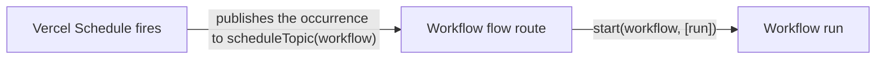

[Vercel Schedules](https://vercel.com/docs/schedules) runs work on a cron cadence or once at a set time. A schedule can start a workflow run directly: point it at the workflow's **schedule topic**, and the workflow's own flow route starts the workflow each time the schedule fires. You don't write a route or a queue consumer for it.



The workflow receives one argument, a [`ScheduledRun`](/docs/api-reference/workflow-api/schedule-target#scheduledrun): the occurrence the schedule fired for, with its scheduled time, execution ID, and the dynamic schedule's payload.

<Callout type="info">
Schedule topics are a Vercel World feature. Vercel Schedules publishes to Vercel Queues, which deliver to the flow route the Workflow SDK deploys. Other Worlds don't receive schedule messages.
</Callout>

## Write the workflow

Give the workflow a `ScheduledRun` parameter. Its type parameter is the payload a dynamic schedule carries; leave it out for a static schedule, which has no payload:

```typescript title="workflows/nightly-report.ts" lineNumbers
import type { ScheduledRun } from "workflow";
declare function listAccountIds(): Promise<string[]>; // @setup
declare function buildReport(accountId: string, night: Date): Promise<string>; // @setup
declare function emailReport(accountId: string, report: string): Promise<void>; // @setup

export async function nightlyReport(run: ScheduledRun) { // [!code highlight]
  "use workflow";

  const accountIds = await getAccountIds();
  for (const accountId of accountIds) {
    const report = await createReport(accountId, run.scheduledAt);
    await sendReport(accountId, report);
  }
}

async function getAccountIds() {
  "use step";
  return listAccountIds();
}

async function createReport(accountId: string, night: Date) {
  "use step";
  return buildReport(accountId, night);
}

async function sendReport(accountId: string, report: string) {
  "use step";
  await emailReport(accountId, report);
}
```

`run.scheduledAt` is the time the schedule's expression matched, not when the run started, so a late or catch-up occurrence still reports on the right night.

## Start it from a static schedule

A static schedule lives in `vercel.json`. Set its `topic` to the workflow's schedule topic. The topic is derived from the workflow's file and export name, so it is the same on every build:

```json title="vercel.json"
{
  "schedules": {
    "nightly-report": {
      "schedule": "0 2 * * *",
      "timezone": "America/New_York",
      "topic": "__wkf_workflow_schedule_workflows_snightly-report__nightlyReport"
    }
  }
}
```

There is no consumer to subscribe: the flow route already receives every `__wkf_workflow_*` topic.

To get a workflow's topic, call [`scheduleTopic()`](/docs/api-reference/workflow-api/schedule-topic) in your app, or build it from the workflow's name: drop `workflow//` and a leading `./`, write `//` as `__`, `/` as `_s`, `.` as `_d` and `_` as `_u`, and put `__wkf_workflow_schedule_` in front. For `workflow//./workflows/nightly-report//nightlyReport`, that is the topic above. Moving or renaming the workflow's file or export changes its topic, so update `vercel.json` with it.

## Start it from a dynamic schedule

A dynamic schedule is created at runtime with `@vercel/schedules`. Spread [`scheduleTarget()`](/docs/api-reference/workflow-api/schedule-target) into `Schedules.create()`. It sets the target topic and the payload, and type-checks the payload against the workflow's `ScheduledRun`:

```typescript title="workflows/send-digest.ts" lineNumbers
import type { ScheduledRun } from "workflow";
declare function sendDigestEmail(userId: string): Promise<void>; // @setup

export async function sendDigest(run: ScheduledRun<{ userId: string }>) {
  "use workflow";

  await deliver(run.payload.userId);
}

async function deliver(userId: string) {
  "use step";
  await sendDigestEmail(userId);
}
```

```typescript title="app/api/digests/route.ts" lineNumbers
import { scheduleTarget } from "workflow/api";
import { sendDigest } from "@/workflows/send-digest";
declare const Schedules: { create(params: Record<string, unknown>): Promise<unknown> }; // @setup

export async function POST(request: Request) {
  const { userId, timezone } = await request.json();

  await Schedules.create({
    name: `digest-${userId}`,
    namespace: userId,
    expression: { type: "cron", cron: "0 9 * * *" },
    timezone,
    ...scheduleTarget(sendDigest, { userId }), // [!code highlight]
  });

  return new Response(null, { status: 201 });
}
```

`scheduleTarget(sendDigest, { userId })` returns `{ target: { topic }, payload: { userId } }`. Leaving the payload out, or passing one of another shape, is a type error. For a workflow without a payload, call `scheduleTarget(nightlyReport)`.

The payload is stored by Vercel Schedules as JSON, up to 16 KB, so `ScheduledRun`'s payload type only accepts JSON values. Pass IDs and look the rest up in a step.

## One run per occurrence

Vercel can deliver a schedule's message more than once, and Vercel Queues redelivers it when starting the run fails. Each occurrence still starts at most one run. The flow route starts the workflow with [`start({ experimental_hook })`](/docs/api-reference/workflow-api/start#prevent-duplicate-starts), with a token built from the schedule's ID and the occurrence's `executionId`, kept for 7 days. A redelivery finds the run the first delivery started and is acknowledged.

The run's steps can still retry, so keep their side effects safe to repeat. See [Idempotency](/docs/foundations/idempotency).

## What happens when a start fails

| Situation | What the flow route does |
| --- | --- |
| The run started | Acknowledges the message |
| An earlier delivery of the occurrence started the run | Acknowledges the message |
| Starting the run failed, for example a backend error | Throws, so Vercel Queues redelivers the message with the same token |
| The occurrence was redelivered past the delivery cap | Logs an error and acknowledges the message, skipping the occurrence |
| The topic names no workflow (a typo in `vercel.json`) | Logs an error and acknowledges the message |
| The topic names a workflow the deployment doesn't have (a renamed file) | Starts a run that fails because the workflow isn't found, visible in the dashboard |

A run starts on the deployment the schedule delivered to: the current deployment of the schedule's environment. So every occurrence runs the latest code, and a long-running occurrence stays on the deployment it started on, like any other run.

## Compared with a queue consumer that calls `start()`

Without a schedule topic, a schedule publishes to a topic of your own, a queue consumer route receives the message, and the route calls `start()`. A schedule topic removes the route and its function, and the payload is typed end to end. The flow route still calls `start()`, which publishes the run's first message, so the run's work begins on a following delivery.

## Testing

Call the workflow the way the schedule would, with `start()` and a `ScheduledRun` you build:

```typescript lineNumbers
import { start } from "workflow/api";
import { nightlyReport } from "@/workflows/nightly-report";

await start(nightlyReport, [
  {
    scheduleId: "sch_test",
    executionId: "schx_test",
    name: "nightly-report",
    namespace: "default",
    scheduledAt: new Date(),
    source: "static",
    payload: undefined,
  },
]);
```

On Vercel, run a static or dynamic schedule now from the dashboard, `vercel schedules invoke`, or `Schedules.invoke()`. A manual run is an occurrence like any other.
