# Spec 9: single orchestrator

Spec 9 is an opt-in run format driven by a single orchestrator per run. New runs stay on spec 8 unless you set [`WORKFLOW_SPEC_VERSION=9`](https://workflow-sdk.dev/docs/configuration/runtime-tuning#workflow_spec_version), on a World that implements the in-band fence (the Vercel, Local and Postgres Worlds do). Nothing in this document applies to spec 8 runs.

This document is the reference for spec 9, kept next to the runtime that implements it (`packages/core/src/runtime/spec9/`). Update it in the same change when spec 9 behaviour, the World contract, or a decision recorded here changes. It is long, and its sections serve different readers:

- **Using spec 9:** [Overview](#overview), [Settings and behaviour on spec 9 runs](#settings-and-behaviour-on-spec-9-runs), and [Known limitations](#known-limitations).
- **Building or maintaining a World:** [World contract changes](#world-contract-changes), including [Implementing spec 9 in a World](#implementing-spec-9-in-a-world), [Queue topology, handoffs and rotation](#queue-topology-handoffs-and-rotation), and [Spec 8 and spec 9 side by side](#spec-8-and-spec-9-side-by-side).
- **Reviewing or maintaining the runtime:** [The spec 9 model](#the-spec-9-model), [Lifecycles and flows](#lifecycles-and-flows), [Edge cases and failure handling](#edge-cases-and-failure-handling), [Decisions and trade-offs](#decisions-and-trade-offs), [Follow-ups](#follow-ups) and [Benchmarks](#benchmarks).

## Overview

### What spec 9 is

Runs created at spec version 9 follow one rule: **only the run's orchestrator decides**. One orchestrator invocation at a time replays the run, runs the workflow code, writes every decision (`step_created`, `wait_created`, `wait_completed`, hook and attribute events, `run_completed` or `run_failed`), and runs inline steps. A step that runs from its own queue message only runs its body and reports its outcome. The World fences the orchestrator as the run's only in-band writer, and step and wait events are plain appends.

The spec 8 orchestrator stays, side by side. A run keeps the orchestrator of the version it was created with, so in-flight runs are unaffected when a deployment upgrades, and spec 9 runs keep theirs when a deployment unsets the variable.

### What changes for a spec 9 run

- **Background steps only run their body.** A step running from its own queue message writes `step_started` and its outcome, then sends the orchestrator one wake, without replaying the workflow. On Worlds that coalesce a run's orchestrator messages (Vercel, Postgres), a fan-out's wakes fold into the running orchestrator. The body runs once its `step_started` committed, so a step queued before `run.cancel()` is refused before its body runs.
- **Execution mode is fixed at creation.** An inline step is created by its first `step_started` (`inline: true`). A background step is created by `step_created`, which records the queue message that created it (`creatorMessageId`). An enqueued step never runs inline.
- **One message per step, re-sent if lost.** A background step keeps one queue message for its whole life and retries in place on it. The message is sent right after `step_created` commits; since an orchestrator can die between the two, every orchestrator delivery that is not its message's first re-sends the message of each unstarted background step, under the step's stable idempotency key and only while the step is less than 23 hours old (inside the queue's 24-hour deduplication window), so a re-send never creates a second live message.
- **Step events** carry `stepName`; `step_started` carries `attempt` and the step's creation time.
- **Wakes and timers.** Wakes carry no idempotency key, and a wake with nothing new exits without a replay. A sleep's timer is sent before the write that needs it commits, and each hop is keyed by the wait and the hop's deadline, so every delivery that sends a hop sends the same message.

### Why the World can stop keeping step state

On spec 8 runs the World refuses a second start or a second outcome by checking step and wait writes against the step's state. On a spec 9 run one decider writes those decisions, and the in-band fence refuses its writes once another invocation has superseded it, so the World no longer has to check step or wait writes against state. They are appends, the runtime folds step and wait state from the log, and the few duplicates that can still land are inert on replay (see [The event log](#the-event-log)).

### Opting in

Set [`WORKFLOW_SPEC_VERSION=9`](https://workflow-sdk.dev/docs/configuration/runtime-tuning#workflow_spec_version). The Vercel, Local and Postgres Worlds implement the in-band fence spec 9 runs need. A World that does not declare the fence (`capabilities.inBandFence`) keeps creating spec 8 runs, and logs a one-time warning if `WORKFLOW_SPEC_VERSION=9` asks it for spec 9.

- **Upgrade the whole fleet first.** Every deployment and process that calls `start()`, resumes hooks, receives webhooks, cancels runs or consumes the World's queue must run this release or later before any of them sets `WORKFLOW_SPEC_VERSION=9`.
- **Every caller of `start()` decides too.** A start that targets another deployment stamps the lower of the caller's and the target's versions, so a spec 9 run needs `WORKFLOW_SPEC_VERSION=9` on both.
- **To stop creating spec 9 runs**, unset the variable (or set `8`) on a deployment of this release or later (see [below](#runs-already-created-as-spec-9-when-the-variable-is-unset)).

### The rollback floor

Once spec 9 runs exist, do not roll back below this release. An older SDK fails writes to a spec 9 run (`RunNotSupportedError` on the Local and Postgres Worlds, HTTP 400 on Vercel). Reads still work, and nothing is corrupted.

- **On Vercel**, a run's deliveries go only to the deployment that created it, so only an older process's `cancel()` and other non-resume writes fail. Its `resumeHook()` and webhooks still work: world-vercel accepts their `hook_received` as an out-of-band write (see [An older SDK and a spec 9 run](#an-older-sdk-and-a-spec-9-run)).
- **On a shared Local or Postgres queue**, an older process can take the run's messages, and the run stalls while it does. After re-upgrading the run continues, unless the older release used up a message's delivery budget ([`WORKFLOW_MAX_QUEUE_DELIVERIES`](https://workflow-sdk.dev/docs/configuration/runtime-tuning#workflow_max_queue_deliveries), 48): it then acknowledges the message and leaves the run as it is. world-local's restart recovery re-sends steps and timers; on world-postgres they stay lost until something else wakes the run, which can need a manual wake.

Spec 8 runs are unaffected: upgrading, rolling back, and mixing old and new processes work as on earlier releases.

### How new runs get their version

`WORKFLOW_SPEC_VERSION` gates minting only: the version a World stamps on a new run. Everything that reads, routes or writes to an existing run follows the run's stamped version, which is what makes unsetting it safe for runs already created as spec 9.

| `WORKFLOW_SPEC_VERSION` | World passes `inBandFence: true` | Minted |
|---|---|---|
| unset | any | 8 |
| `9` | yes | 9 |
| `9` | no | 8, with a one-time warning |
| `6` to `8` | any | that value |
| any other value | any | 8 (the default), with a one-time warning naming it |

`mintedSpecVersion(env, { inBandFence })` in `@workflow/world` implements the table. A call with no options never returns 9, so a custom World written to the earlier guide (`specVersion: mintedSpecVersion()`) keeps creating spec 8 runs. `SPEC_VERSION_CURRENT` stays 8, the version assumed for a run that reports none; `SPEC_VERSION_DEFAULT_MINTED` (8) names the default, and `SPEC_VERSION_MAX_SUPPORTED` is 9.

### Runs already created as spec 9 when the variable is unset

On a deployment of this release or newer with `WORKFLOW_SPEC_VERSION` unset (or `8`), runs already created as spec 9 keep the spec 9 orchestrator: routing follows the run's stamp (and on Vercel, skew protection keeps the run on its creating deployment anyway). Hook resumes, webhooks and `cancel()` stamp their events with the run's own version, not the minted one; `wakeUp()` works, best-effort as for any spec 9 run; and the world-local and world-postgres run gates serialize by the message's stamp. Unsetting the variable reduces exposure, not correctness: the [Known limitations](#known-limitations) still apply to those runs, and rolling back below this release is still unsafe.

### Costs

- A background step's outcome reaches the workflow over the live event feed or the tail poll while the orchestrator runs, otherwise through one queue hop.
- An inline step costs two writes (its first `step_started` and its outcome); the starts go out in one creation batch when the World has `createBatch`.
- A hook, abort or cancellation that arrives during a long inline step is seen through the live feed or the tail poll; without either it waits for the next delivery, which queues behind the busy one.

### What spec 9 runs no longer use

Lazy inline step start, batched step claims, optimistic inline start outside turbo's first delivery, inline step ownership and its backstop wakes, and the precondition guard. They remain on spec 8 runs (see [Runtime tuning](https://workflow-sdk.dev/docs/configuration/runtime-tuning#replay-and-queue-delivery)).

### Status

- Spec 9 is opt-in; spec 8 is the default for new runs, and spec 8 runs use the same events API and batch transport as earlier releases.
- A required `e2e-vercel-spec9` lane deploys a preview with `WORKFLOW_SPEC_VERSION=9` (on the deployment and the test runner) and runs the full suite on both engines, asserting that its runs are spec 9 while the other lanes assert spec 8; the Event Log Race Repro has spec 9 cells, and `@workflow/world-testing` runs its embedded suite with `WORKFLOW_SPEC_VERSION=9` too.
- Open work is listed under [Follow-ups](#follow-ups).

## Settings and behaviour on spec 9 runs

The rest of the documentation describes spec 8 runs. This section collects what differs for a spec 9 run. [Runtime tuning](https://workflow-sdk.dev/docs/configuration/runtime-tuning#spec-9-experimental) lists the spec 9 settings briefly and links here.

### Runtime settings

Settings that apply to every run, read differently on spec 9 runs:

- **`WORKFLOW_MAX_QUEUE_DELIVERIES`** (48): only orchestrator messages count. A fence refusal's redelivery counts on every first-party World, so a run whose every write is refused fails instead of looping; a handoff does not count. Step messages retry in place and are bounded by `maxRetries` and retention instead, except that past the cap a step showing no activity for an hour (every delivery fails before it starts, say because its input cannot be read) fails with a catchable `FatalError` naming `MAX_DELIVERIES_EXCEEDED`.
- **`WORKFLOW_REPLAY_DIVERGENCE_MAX_RETRIES`**: recovery replays run in the same delivery, reloading the log and replaying from cold in a fresh VM. Once spent, the run fails with [`CORRUPTED_EVENT_LOG`](https://workflow-sdk.dev/docs/errors/corrupted-event-log); a redelivery starts the count again.
- **`WORKFLOW_OPEN_WAIT_CLOCK_SKEW_MS`**: an open wait due within the inline window plus this allowance makes [run-ahead](#workflow_run_ahead_depth) wait for its writes at that boundary.
- **`WORKFLOW_MAX_INLINE_STEPS`**: clamped to `0` to `16`. `0` enqueues every step (on spec 8 runs `0` is read as unset). An inline step whose retry is due moves to the background.
- **`WORKFLOW_OPTIMISTIC_INLINE_START`**: only `0` or `false` has an effect, making bodies wait for their start to commit on turbo's first delivery, under run-ahead, and under `WORKFLOW_OPTIMISTIC_BACKGROUND_START`.
- **Not read**: `WORKFLOW_INLINE_OWNERSHIP_LEASE_SECONDS` and the `WORKFLOW_PRECONDITION_*` settings. Spec 9 runs have no precondition guard; the fence replaces it.

Settings that exist only for spec 9 runs:

#### `WORKFLOW_SPEC_VERSION`

- Default: unset. New runs are spec 8. `9` makes them spec 9 on a World that declares the in-band fence (Vercel, Local, Postgres), and spec 8 with a one-time warning on one that does not.
- Values: an integer from `6` to `9`, whitespace trimmed; anything else is ignored with a one-time warning and new runs are spec 8. `6` to `8` select that version. See [How new runs get their version](#how-new-runs-get-their-version).
- A run keeps its version. world-vercel may raise a running run's version only across versions that change no log format, never from 8 to 9.
- On Vercel, a spec 9 run's events use a newer version of the events API; other runs stay on the one earlier releases use.
- Read [Opting in](#opting-in) and [The rollback floor](#the-rollback-floor) first.

#### One orchestrator per run, and the in-band fence

- Not a variable: how a spec 9 run stays correct when two invocations of its orchestrator overlap (in full under [The in-band fence](#the-in-band-fence)). The orchestrator's writes are **in-band**; a background step's own events, `hook_received` and `run_cancelled` are **out-of-band**.
- The queue delivers a run's orchestrator messages one at a time, but an invocation whose event loop stalls past its lease can be redelivered while alive. The fence makes that safe: the World refuses an in-band write whose count of in-band positions (`snapshot.seqInBand`) is stale with `InBandSupersededError`.
- A refused invocation stops writing and starts no further inline bodies, sends the queue messages its committed writes still owe, and asks for a redelivery of its message after 1 s (at least 5 s on Vercel, whose queue clamps a redelivery's delay to 5 to 900 s). Since the other writer may be an earlier delivery that died before sending what it owed, that redelivery re-sends unstarted background steps' messages.
- A write that resolves a promise in the workflow is consumed only after it commits, so the workflow sees events in log order.
- A terminal event is in-band only when the orchestrator writes it. `run_cancelled`, and a `run_failed` written by a background step's invocation, are out-of-band and do not supersede a live orchestrator: it keeps going until it sees the event or the World refuses its next creation or start on the terminal run. It can even commit its own terminal event above it; the run's status follows the first terminal event by position, and lifecycle hooks run only for the outcome the World reports. Anything after a terminal event is inert on replay.

#### `WORKFLOW_ORCHESTRATOR_POLL_INTERVAL_MS`

- Default: `2000`
- A busy orchestrator listens on the World's live event feed (`events.subscribe`) when it has one, and polls the run's log tail, so events other writers commit reach the running workflow without a queue hop. This is the poll interval while no live feed covers the run (none exists, the subscription was refused or ended, or it missed an event); otherwise [`WORKFLOW_ORCHESTRATOR_FEED_POLL_INTERVAL_MS`](#workflow_orchestrator_feed_poll_interval_ms) applies.
- The poll backs off: each empty poll doubles the interval, up to 10 seconds (never below this value). An event, a failed poll, feed trouble, or a write by the delivery itself resets it. A 10-minute inline body on a World without a push costs about 65 reads instead of 300, and an event from another writer can arrive up to 10 seconds late. No event is lost.
- `0` turns polling off.

#### `WORKFLOW_ORCHESTRATOR_FEED_POLL_INTERVAL_MS`

- Default: `10000`
- The tail poll's interval while the live feed is up, catching only an event the feed missed without a sign. While the feed keeps up the interval doubles, up to 2 times this value; feed trouble or an event only the poll found drops it to `WORKFLOW_ORCHESTRATOR_POLL_INTERVAL_MS`.
- Never below `WORKFLOW_ORCHESTRATOR_POLL_INTERVAL_MS`.

#### `WORKFLOW_ORCHESTRATOR_LINGER_MS`

- Default: `30000`
- When an orchestrator has nothing left to run but the run waits on a background step (or an inline step's retry), it stays live on the event feed this long before acknowledging. Each event in that time starts another pass, and the next idle pass restarts the time, so a burst of outcomes lands on one warm invocation.
- Only while a live feed is up (Vercel, Postgres, Local). Never past the invocation's inline-step deadline. On world-postgres at most half of a process's `queueConcurrency` slots hold a feed at once, and on world-local at most half of `WORKFLOW_LOCAL_QUEUE_CONCURRENCY`; past that a delivery polls and does not linger.
- `0` turns it off, for hooks too.

#### `WORKFLOW_ORCHESTRATOR_HOOK_LINGER_MS`

- Default: `5000`, and never more than [`WORKFLOW_ORCHESTRATOR_LINGER_MS`](#workflow_orchestrator_linger_ms).
- The linger when the run waits only on open hooks. Each payload restarts the window, so a burst of resumes stays on one invocation. Any undisposed hook counts, even beside a long sleep, so a long-lived approval hook next to a polling `sleep()` holds each timer wake for up to 5 seconds. Dispose unused hooks, or set `0` for that pattern.

#### `WORKFLOW_ORCHESTRATOR_READ_TIMEOUT_MS`

- Default: `5000`
- How long an orchestrator waits on one incremental read of its log before sending it again, doubling each attempt; after three the invocation fails retryably and the run is redelivered. Full loads are not bounded. `0` turns it off.

#### `WORKFLOW_INLINE_STEP_DEADLINE_MARGIN_MS`

- Default: `60000`
- The orchestrator stops starting inline steps this long before its inline window ([`WORKFLOW_V2_TIMEOUT_MS`](https://workflow-sdk.dev/docs/configuration/runtime-tuning#workflow_v2_timeout_ms)) ends, on both engines, and enqueues steps created inside the margin.

#### `WORKFLOW_OPTIMISTIC_BACKGROUND_START`

- Default: unset. A background step starts its body only once its `step_started` committed.
- `1` or `true` starts the body of a retryable background step while its start is in flight, on its message's first delivery, saving one round trip. In exchange, a step queued before `run.cancel()` runs its body, and a throttled or too-early start has already run it (the outcome is discarded, and a throttled start runs it again). Use it only for idempotent bodies.
- `maxRetries: 0` steps and redeliveries always wait; `WORKFLOW_OPTIMISTIC_INLINE_START=0` wins.

#### `WORKFLOW_RUN_AHEAD_DEPTH`

- Default: `10`
- Clamp: `0` to `16`
- Node.js VM engine only. When no other writer could change what the workflow does next (no awaited hook, no `AbortController`, no step running elsewhere, no wait due), an inline step's outcome reaches the workflow when its body returns, before its write commits, and at most this many outcomes are unconfirmed at once. Writes still land in order. See [Run-ahead](#run-ahead).
- A refused or failed write stops the delivery's decisions; it reloads the log and replays from cold with run-ahead off. A path-changing event landing below a speculative write is detected the same way but may already have been decided around: it is logged at error level with `possibleLogCorruption: true` and counted in `workflow.run_ahead.hazard_stops`. Report one with the workflow's code.
- `0` disables run-ahead.

### Retries

A failed step is retried after about a second by default, and:

- A background step keeps one queue message for its whole life. A retry writes `step_retrying` and asks for the same message again after the delay; the message is acknowledged only once the step completes or fails for good.
- A step that ran inline moves to the queue for its retry.
- The attempt number is the number of `step_started` events plus one (`getStepMetadata().attempt`); `stepStartedAt` stays the first attempt's time.
- A queue may deliver early (Vercel Queues waits at most 15 minutes per delivery). The step reads only its latest event and asks for the remaining time without running its body.
- A step whose next retry would land after its message expires (7 days) fails instead.

A `maxRetries: 0` step whose invocation dies after it started fails rather than running again, so it runs at most once per live owner; a duplicate delivery after a lease expiry can still run it twice. See [`maxRetries: 0` is at most once per live owner](#maxretries-0-is-at-most-once-per-live-owner).

### The event log

Steps and waits are folded from the run's events, not kept as state the World checks writes against. A World may keep step and wait records for its read APIs; the runtime never relies on them. Spec 9 runs always use the [sealed log](https://workflow-sdk.dev/docs/how-it-works/event-sourcing#sealed-positions-noop-events), since the fence counts sequencer positions.

- **Creation.** An inline step's first `step_started` carries its name, input and `inline: true`, with no `step_created`. A background step has `step_created` (with `creatorMessageId`), then its invocation's `step_started`.
- **Attempts.** A step's attempt count is the number of its `step_started` events. One after a `step_retrying` is a retry; one after another `step_started` is a redelivery.
- **Waits.** Only the orchestrator writes `wait_created` and `wait_completed`; a second `wait_completed` is inert.
- **Inert after terminal.** Once a step's outcome, `wait_completed`, `hook_disposed` or workflow `attr_set` is consumed, later events under that correlation ID are stepped over (see [Duplicate events](https://workflow-sdk.dev/docs/how-it-works/event-sourcing#duplicate-events)). That covers the duplicates that can still occur, such as a second `step_started` from a background step redelivered after its lease expired.

#### Events returned on a write

Every in-band write names the position it was decided from (`eventCount`), and the World returns the events between that position and the write's own (the *skipped-slot report*) in position order, so the orchestrator continues without a read. On a spec 9 run the report is authoritative; if the World cannot produce it completely in time, the write succeeds with `hasMore: true` and the orchestrator reloads before consuming what the write resolves.

| Event | Writer | Sends |
|-------|--------|-------|
| `run_created` | `start()` | Nothing |
| `run_started`, `step_created`, `wait_created`, `wait_completed`, `hook_created`, `hook_disposed`, workflow `attr_set`, `run_completed`, `run_failed`, and an inline step's events | Orchestrator | `eventCount`, in-band |
| A background step's `step_started`, `step_retrying`, `step_completed`, `step_failed` | The step's invocation | Nothing, out-of-band |
| `hook_received` | `resumeHook()` or a webhook | Nothing, out-of-band |
| `run_cancelled` | `cancel()` | Nothing, out-of-band |

Out-of-band writers get no report and wake the orchestrator instead. A hook create made alone also asks for events after the orchestrator's read cursor (`sinceCursor`), so a `hook_conflict` or an early payload resolves in the same invocation. A batch (`events.createBatch()`) names one position for its block and returns its report at the top level; on a spec 9 run a batch is not atomic, and a failed item's position is sealed.

### `run.wakeUp()` and `waitForSleep()`

On spec 9 runs, `wakeUp()` returns once the orchestrator has been asked to complete the sleeps; it writes their `wait_completed` events itself shortly after. `stoppedCount` counts sleeps asked for, not completed.

The request is best-effort. It is a queue message to the orchestrator, and on the Vercel and Postgres Worlds a message arriving while an invocation of the run is live, including one lingering for up to [`WORKFLOW_ORCHESTRATOR_LINGER_MS`](#workflow_orchestrator_linger_ms) or [`WORKFLOW_ORCHESTRATOR_HOOK_LINGER_MS`](#workflow_orchestrator_hook_linger_ms), is folded into it. That invocation only re-reads the log and never sees which sleeps to complete, so they run their full length. When no invocation is live the message completes the sleeps; the Local World holds it until the running invocation ends, and ends that invocation's linger so the wait is short.

A durable `wakeUp()` is not planned: it would need a new out-of-band "wake requested" event and world-vercel support, and a confirm-and-resend loop was rejected. To end a sleep reliably while the run is active, resume a hook the workflow races against it.

In `@workflow/vitest`, `waitForSleep()` skips a sleep that `wakeUp()` already named in this process. See [`run.wakeUp()`](#runwakeup) and [`run.wakeUp()` stays best-effort](#runwakeup-stays-best-effort).

### First-party Worlds

**world-local.** Its run gate is in-process. When a spec 9 orchestrator delivery acknowledges, it absorbs the run's orchestrator messages that queued behind it in its process and runs the handler again, up to 32 times, as world-postgres does; a handoff keeps the run's gate, and its redelivery covers them. An orchestrator message without a spec stamp is checked against the run's stored spec version, and a spec 9 run's is stamped and gated like the rest (see [world-local and world-postgres](#world-local-and-world-postgres)). Its live feed (`events.subscribe`) pushes the events this process writes at once and checks a subscribed run's log every 50 ms for writes from other processes, so orchestrators linger as on world-postgres. A message the running delivery cannot cover with a re-run (a `run.wakeUp()`, an invocation) ends that delivery's feed when it queues behind it, so a lingering delivery acknowledges and the message is delivered at once. Messages are sent and redelivered by the enqueuing process, so two processes sharing one data directory (an app plus a script calling `start()` or `resumeHook()`) can overlap deliveries of one run: the fence keeps the log linear, but each overlap costs a refused pass and a redelivery, which on a busy run means long refusal streaks. Keep those calls in the process serving the workflow routes. Restart recovery marks its messages (`recovery: true`), and their delivery re-sends every background step without an outcome and arms every open sleep; pass `{ queueLost: true }` to `reenqueueActiveRuns()` from `@workflow/world` for the same effect.

**world-postgres.** A spec 9 run's orchestrator deliveries run one at a time across processes as Graphile jobs in the run's named queue (`workflow_flows:<runId>:executor`); step jobs have no named queue and run concurrently. The fence refuses a stale orchestrator that outlived its job's lock.

- **Live event feed.** `events.subscribe` uses `LISTEN`/`NOTIFY`: after a spec 9 event write commits, the writer sends `pg_notify('workflow_run_events', runId)`, and one `LISTEN` connection per process serves every subscription, each reading the log after its last delivered position. A dropped connection or failed read ends subscriptions through `onError`, and orchestrators fall back to the tail poll.
- **Coalescing.** When a spec 9 orchestrator delivery acknowledges, its worker absorbs the run's orchestrator messages waiting behind it (not start messages) and re-runs the handler with the same `attempt`, up to 32 times; a handoff goes ahead of waiting messages.
- **Delivery cap.** A fence refusal's delayed redelivery carries the attempt count over, so a run refused on every pass reaches `MAX_DELIVERIES_EXCEEDED`.
- **Keyed sends.** A step's message and a near-due timer use Graphile's `unsafe_dedupe` job key mode, so a re-send is a no-op while any job holds the key and never resets its attempts or `run_at`.
- **Unstamped messages** are checked against the run's stored `spec_version`, and a spec 9 run's is stamped and moved to its named queue (see [An unstamped message](#an-unstamped-message)).
- **Hard-killed workers.** A worker killed mid-job leaves the named queue locked, and Graphile clears that only after 4 hours. By default every delivery renews its locks, renewing workers register (migration 0030), and any process releases a registered holder's named-queue job unrenewed for 300 seconds, so the run continues within about 8 minutes. Jobs of earlier-version processes keep the 4-hour reset. `jobLockStaleSeconds` changes this (see [Postgres World](https://workflow-sdk.dev/worlds/postgres#workflow_postgres_job_lock_stale_seconds)).

**world-vercel.** Spec 9 runs get one orchestrator invocation at a time: their orchestrator messages carry the run's id as a [Vercel Queues](https://vercel.com/docs/queues) concurrency key, and world-vercel fences the orchestrator's writes.

## The spec 9 model

### One decider

Only the orchestrator writes decisions: `step_created`, `wait_created`, `wait_completed`, hook and attribute events, `run_completed` and `run_failed`. It also runs inline steps. A background step's own invocation writes only that step's `step_started` and outcome, then sends the orchestrator one plain wake, without reading the log. Its body starts once its `step_started` committed; `WORKFLOW_OPTIMISTIC_BACKGROUND_START=1` starts it while the start is in flight instead (see [Background step bodies start once their start commits](#background-step-bodies-start-once-their-start-commits)).

```typescript
export async function checkout(orderId: string) {
  "use workflow";
  const order = await loadOrder(orderId);   // inline: run by the orchestrator
  const charge = await chargeCard(order);   // inline
  await sendReceipt(charge);                // inline
  return charge.id;
}

async function chargeCard(order: Order) {
  "use step";
  return await payments.charge(order.total);
}
```

A run of `checkout` typically completes in one orchestrator invocation. If a step fails with a retryable error, its retry moves to its own queue message, which owns its remaining attempts: the queue holds the backoff instead of a live invocation, the step invocation only reports outcomes, and the orchestrator decides what happens next. Retrying a short backoff inline is possible and not implemented.

### Step and wait events are plain appends

The runtime decides a step's or wait's state from the log alone. A World may keep step and wait entities and refuse writes that do not fit them, but the runtime never relies on such a refusal, so a World that accepts every step and wait append is fully correct (refusing new step or wait work on a terminal run is still expected; `step_completed`, `step_failed` and `wait_completed` must stay accepted after the run ended). Replay treats any event for an entity after its terminal event as inert, which is what makes a late duplicate append harmless.

### The in-band fence

Every orchestrator write is **in-band** (`CreateEventParams.inBand: true`). It carries `expectedSeqInBand`, the orchestrator's count of in-band positions, taken from the `snapshot` of its log load. The World refuses a stale count with `InBandSupersededError` (HTTP 412, code `in-band-superseded`) and writes and allocates nothing for it. Two live orchestrators of one run can therefore never both write. Everything else that writes to the run is **out-of-band**: a background step's own events, `hook_received` from `resumeHook()` and webhooks, `run_cancelled` from `cancel()`, and `attr_set` from `setAttributes()` outside the workflow body. Classification is by writer, not by event type: an inline step's events, an `attr_set` from the workflow body and a `hook_received` the orchestrator writes for a resume carried on its own message are all in-band.

The queue keeps a spec 9 run to one orchestrator delivery at a time (a concurrency key on world-vercel, a per-run gate on world-local and world-postgres), but that is a frequency mechanism: an invocation whose event loop stalls past its lease can be redelivered while it is still alive. The fence is what makes an overlap the queue lets through safe. A World that creates spec 9 runs implements it and declares `capabilities.inBandFence`; the runtime refuses to create or drive a spec 9 run on a World that does not, and such a World keeps creating spec 8 runs ([Single-writer guarantee and the in-band fence](#single-writer-guarantee-and-the-in-band-fence)).

**Example.** An orchestrator's event loop blocks past its queue lease (a CPU-heavy inline step). The queue redelivers the message and a second orchestrator starts, writes first and moves the count. The first wakes, tries its next write, gets a 412 and stops. Nothing is written twice.

#### The contract

| Counter | Moves on | Read by |
|---|---|---|
| `seq` | every allocation, in-band or not | the snapshot, as the highest position handed out |
| `seqInBand` | in-band allocations only; a new run's `run_created` counts as 1 (`IN_BAND_SEQ_AT_RUN_CREATION`) | the snapshot, and the check on every in-band write |

What declaring `capabilities.inBandFence` commits a World to:

- **A list snapshot.** `events.list` returns `snapshot: { seq, seqInBand }` on every page of a spec 9 run's log, read before the listing, so a full load from the first page covers every position up to that `seq`. The orchestrator adopts the first page's snapshot and never counts events itself, since that cannot say which positions were in-band. It refuses to write in-band from a full load whose first page has no snapshot.
- **Fenced in-band creates.** A create or batch with `inBand: true` carries `expectedSeqInBand`. The World checks it against `seqInBand` and advances both counters by the positions it allocates, in one atomic step. On a mismatch it throws `InBandSupersededError` and allocates nothing, so a refusal never leaves a hole. An in-band write without an expected count is a 400. `run_created` is never fenced itself.
- **Unfenced out-of-band creates.** Writes with `inBand` false or absent move `seq` only and are never refused by the fence.
- **`allocated` on the response.** An accepted write reports how many positions it took (1 for a new event, 0 for an idempotent replay, the admitted items for a batch). The writer adds it to its count; a World that omits it leaves the runtime to infer it.

`@workflow/world`'s in-band fence conformance suite (`test-support/in-band-fence-conformance.ts`) checks each of these against a World's `events` storage. world-local keeps the count in a file per run under a lock shared across processes; world-postgres checks and advances it in the same statement that inserts the event, after locking the run's slot row, so a stale writer is refused before it touches any entity row.

#### When a 412 does not mean another orchestrator

On world-local and world-postgres a 412 means another in-band write moved the count (on world-local, possibly one whose writer died mid-write, which it counts as landed). world-vercel also answers 412 `in-band-superseded` in two cases that involve no other orchestrator:

- **The writer's own position was sealed.** world-vercel can seal a position whose write did not finish in time as a `noop` event. A single write that loses its position this way gets 412 (a batch item gets 409 `position-lost`, still counted in `allocated`); the count already moved.
- **A refusal after allocation.** Some 409s (a conflicting hook or attribute write, a terminal event that lost to another) come after positions were allocated. The writer keeps its count after a non-fence 4xx, so its next in-band write gets a 412.

In both cases nothing else is queued for the run, which shapes what a refused delivery does.

#### What a refused delivery does

The first 412 stops the writer for good: that write and every later one throw `OrchestratorSupersededError` without reaching the World, and no further inline body starts. Bodies already running settle, their outcome writes are refused too, and supersession wins over any other failure. The delivery then:

1. forgets the consumed position it recorded for the run, and discards any retained VM session;
2. sends what its own committed writes owe the queue: the message of each background step whose `step_created` it committed, the message of each inline step whose retry it moved to the background, and the timers of the wait chains it owns; when its own delivery count is above 1 it also applies the [re-send rule](#the-re-send-rule);
3. returns `{ timeoutSeconds: 1 }`: a counted redelivery of its own message, 1 s later (5 s on Vercel, the queue's minimum). It sends no wake and does not acknowledge.

Because the redelivery is not its message's first delivery, it loads the log and re-sends, under its stable key, every background step that has a `step_created`, no `step_started`, and was created less than 23 hours ago (inside the 24-hour window in which every World deduplicates a step's key). Why not acknowledge instead:

- A refusal does not prove another orchestrator is running (see above). Acknowledging a self-superseded write strands the run, since nothing else is queued for it.
- The other writer may be a second delivery of the same message that committed a `step_created` and died before sending the step's message. A plain wake would not repair that: it is the first delivery of a different message, and the re-send rule skips first deliveries.

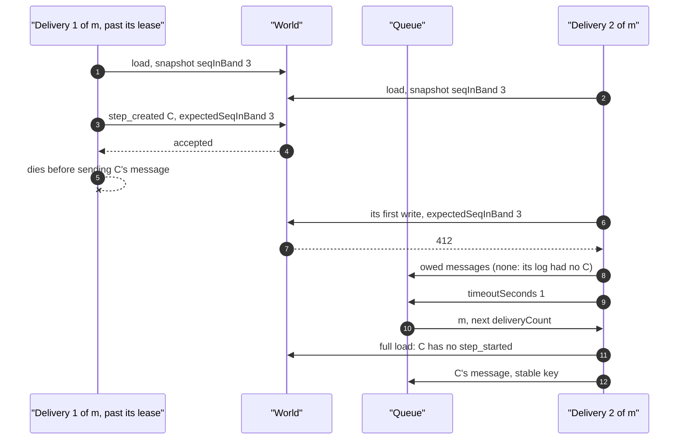

A crash between the refusal and the owed sends is covered the same way: the lease expires and the redelivery re-sends.

The cost is one more invocation, 1 s later (5 s on Vercel). On world-vercel the message keeps the run's concurrency key during the delay, so a wake sent meanwhile is coalesced into it, and a live winner holding the key absorbs it as a coalesced message. On world-local and world-postgres it is delivered after the running delivery. Every first-party World counts the redelivery as an attempt, so a run refused on every pass fails with `MAX_DELIVERIES_EXCEEDED` instead of looping; the streak is logged at warn.

#### Two overlapping orchestrators

In the [example above](#the-in-band-fence), if the stalled delivery A was inside an inline body when the redelivery B started, B finds that step started with no outcome and runs it again, so the body runs in both deliveries. The fence keeps the log to one writer; it does not stop a body from running twice. The exception is a `maxRetries: 0` step: B's attempt is past `maxRetries + 1`, so B fails the step without running the body. If A writes first instead, B's first write is refused, and a body B would start behind an awaited start never starts.

#### Fence edge cases

- **Refused turbo `run_started`.** Stops every later write and asks for a redelivery; the redelivery is not turbo.
- **Timer delivery refused on its `wait_completed`.** It re-sends its own timer and its message is redelivered; a duplicate timer finds its wait completed and arms nothing.
- **A non-fence 4xx.** The count stays and the caller may handle it; a required write (turbo `run_started`, a run-ahead write) stops the writer either way.
- **5xx or transport error.** Not a refusal: the writer stops, and the delivery is retried as that error is.
- **A `{ timeoutSeconds }` answer from a delivery whose lease already lapsed.** What Vercel Queues does with it is not verified. The message has a live delivery either way, and any later non-first delivery of the run re-sends what is missing.

### Event posting

Every in-band write of one delivery goes through one in-band writer. It marks each write `inBand: true`, carries `expectedSeqInBand`, and sends one write at a time. Out-of-band writers never carry a count.

#### Slot numbering

Every event of a spec 9 run has a dense, 1-based slot, encoded in its id as `evnt_` plus a zero-padded decimal (`slotToEventId()` in `@workflow/world`). An out-of-band write moves `seq` only, which is why a hook resume or a background step's outcome can land between two orchestrator writes without invalidating the orchestrator's count. A log of `run_created`, `run_started`, an inline `step_started`, a `hook_received`, the inline `step_completed`, a background `step_completed` and a `wait_created` ends at `seq` 7, `seqInBand` 5.

#### What one write carries

| Request field | Meaning |
|---|---|
| `inBand: true` | The orchestrator made this write. |
| `expectedSeqInBand` | The writer's count: the load snapshot's `seqInBand`, advanced by every accepted write's `allocated`. |
| `eventCount` | The slot the decision was made against: the highest slot below which the writer holds every event. Required with `inBand: true` on a batch. |
| `occurredAt` | Sent by run-ahead writes: the time the workflow already used. On spec 9 the World must store it as the event's `createdAt`. Writes that are not speculative omit it, so the World's own time is stored. |

| Response field | Meaning |
|---|---|
| `event` / `results` | The committed event, or per-item results of a batch. |
| `allocated` | Positions the write took. |
| `events` | The skipped-slot report: every event in slots `eventCount + 1` up to the write's first slot, in order, each committed or sealed. Authoritative for an in-band write; out-of-band writes get no report. |
| `hasMore` | The World could not produce the whole report within its request budget; the orchestrator reloads before it consumes anything the write resolves. |

The report is what tells the orchestrator, without a read, which foreign events landed below its own write. Understating `eventCount` is safe (the report widens, and the client drops what it already holds); overstating it would hide a hole.

The node engine keeps an incremental index beside its loaded log (event ids, highest slot, a dense-prefix watermark), so what each in-band write reads and merges, and the per-pass hole check, cost about the same at any log length. What still grows with the log is per pass (step analysis and the open- and due-wait scans read the replayed log once or twice a pass), not per write.

#### Serialization and batches

- **One at a time.** Two concurrent in-band writes would carry the same count and the second would be refused, so the writer chains every write. A suspension's creations go out as `createBatch` calls of at most 64 events and 512 KiB (each event's payload plus a 1 KiB allowance), one after another; the inline steps' creation-bearing `step_started` events go first and share the first batch with background creations. A single creation over the byte budget goes out alone.
- **Per-entity order.** A batch on a spec 9 run is not atomic, but once the World refuses an item it must refuse every later item of the batch with the same `correlationId` (world-vercel answers those with 409 `batch-earlier-item-failed`). That is what lets one batch carry a step's creation and its outcome without the outcome ever committing behind a refused creation. A World without `createBatch` meets this trivially.
- **Run-ahead groups.** Run-ahead writes queued behind a write in flight go out together as one batch of at most 16 events when their turn comes; any other write closes the group, so writes are never reordered.

### Consume after commit

An event the orchestrator writes is **committed** when the World accepts it at a position and answers with its slot and the skipped-slot report; until then the orchestrator does not know what lies below it. It is **consumed** when the orchestrator takes it into the log it replays from and the VM acts on it: a promise resolves, the clock moves to the event's time, the next decisions follow.

Every later replay of the run consumes the committed log in slot order, so the live orchestrator must consume the same events in the same order, which it can only know once the write committed. A write that resolves a promise in the workflow (`wait_completed`, an inline step's `step_completed` or `step_failed`) is consumed only after it committed and after the events its report names:

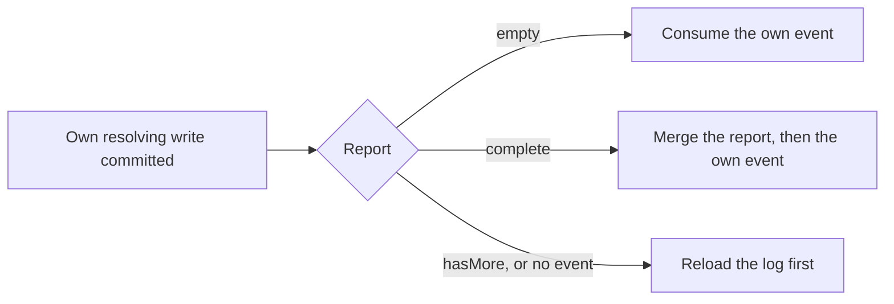

An out-of-band event below the write (a background step's outcome, a `hook_received`, a `run_cancelled`) is consumed first by every later replay, and resolution order is observable through correlation ids and the workflow clock.

#### Example: a hook payload lands while an inline step runs

```typescript
const hook = createHook({ token: 'race' });
return await Promise.race([hook.then(() => 'hook'), gated()]);
```

The first pass writes `hook_created` and the inline step's `step_started` (slots 3 and 4) and starts the body. While it runs, `resumeHook()` commits `hook_received` out-of-band at slot 5. Then the body returns and its `step_completed` is written in-band.

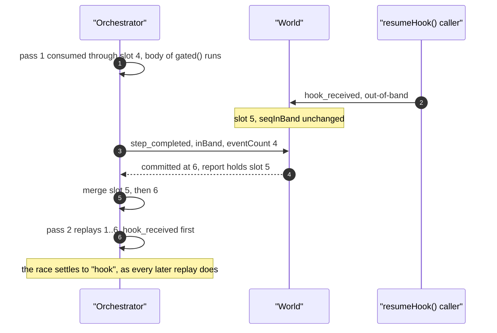

The report names slot 5 whatever the live feed did (the feed passes on only a gap-free run of slots), so the order is right even with no push at all. Had slot 5 been pushed while the body ran, the delivery would have run a pass on it there and then, with the same result: consuming a committed event is always safe; only its position must be known.

Had the orchestrator handed `step_completed` to the VM when the body returned, the race would settle to the step's value and the workflow act on it, while the next cold replay settles to `"hook"` and diverges from what the run already wrote. The same holds for a `run_cancelled` below a `wait_completed`: consumed in commit order, the run stops before the sleep's continuation runs.

#### Other orderings the rule covers

| Situation | What the runtime does | What would go wrong otherwise |
|---|---|---|
| The report is incomplete (`hasMore`), the World answers without the event, or the own slot is above a hole the report does not fill | Drops the retained session and does a full load before the next pass. | The VM would consume its own event above a hole that may hold an out-of-band resolution. |
| The fence refuses the write | Nothing committed, so nothing is consumed; the delivery stops as in [What a refused delivery does](#what-a-refused-delivery-does), and the redelivery replays from a fresh load. | The VM would hold a state the log never had: another orchestrator's decisions, not this one's, are the run's. |
| The live feed pushes the orchestrator's own write before the response | Starts no pass for it, keeps one copy per event id, and counts only slots unknown when the write was sent as allocated. | A pass per echo, and a fence count that undercounts the write, so the next in-band write is refused. |
| An inline step finishes while a fan-out's later creation batches are still committing | Queues its outcome only after every creation batch, and takes no pass while a creation is in flight. | A pass that does not yet see the creations re-derives them as uncreated and creates the steps again. |
| Another writer's event lands above what the pass consumed, after the VM decided | Replays again before suspending, and records its consumed position only after its writes committed and its messages and timers went out. | That event's own wake would find the tail at the recorded position and be acknowledged as a no-op, so the event would never be consumed. |

The one exception is [run-ahead](#run-ahead), which consumes an inline step's outcome before its write commits, and only where the order cannot matter.

### Out-of-band writers

| Writer | Events | Wake it sends |
|---|---|---|
| Background step invocation | `step_started`, `step_retrying`, `step_completed`, `step_failed` | One plain orchestrator message per outcome: no idempotency key, no delay, no log read. A redelivery that finds the step terminal sends it again. |
| `resumeHook()` and webhooks | `hook_received` | Orchestrator message, no idempotency key on spec 9 (a key could be absorbed by a delivery that is already exiting and lose the wake). |
| `cancel()` | `run_cancelled` | Orchestrator message. |
| `setAttributes()` in a step body | `attr_set` | None. |
| `start()` | `run_created` | The run's first message. |

Each lands at the next slot when it commits. The orchestrator sees it in the skipped-slot report of its next in-band write, in the live feed, or in its next load.

### Run-ahead

Run-ahead hands an inline step's outcome to the workflow before its `step_completed` commits, and can start the next inline steps' bodies before their creation commits. [Turbo](#turbo) does something similar on a run's first delivery. Every write still goes through the one in-band writer, in decision order.

`WORKFLOW_RUN_AHEAD_DEPTH` is 10 by default, clamped to 0..16; 0 turns it off. It caps how many step outcomes are unconfirmed at once. Both engines run ahead; see [QuickJS run-ahead](#quickjs-run-ahead) for where QuickJS differs. Per-step cost stays flat however many inline steps a delivery runs, because each hazard check reads only the boundaries whose speculative writes are still in flight. The `workflow.execute` span records the most such boundaries held at once as `workflow.run_ahead.contexts_max`.

#### When a boundary may run ahead

At each suspension that schedules inline steps, the delivery classifies who else could append an event that changes what the workflow does next:

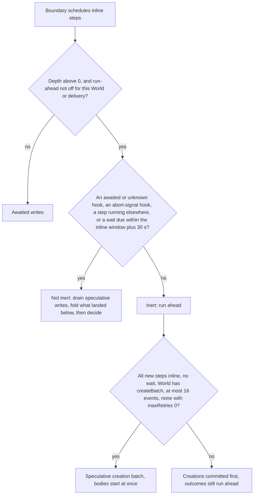

A hook the workflow created but does not await is inert on node:vm: its payload is buffered and moves neither step results nor the clock (on QuickJS it moves the clock; see the clock gate below). A wait is classified by time, since whether anything still awaits a sleep cannot be told; only the orchestrator writes `wait_completed` on spec 9, so a far-future wait is inert. At an inert boundary the outcome is placed at the slot the writer predicts and handed to the VM while the write is in flight, with `occurredAt` set to the time the workflow used.

#### Checking speculative writes

Each speculative write is checked when it commits:

- every event in its skipped-slot report is tested for a hazard (below);
- its stored `createdAt` must equal the `occurredAt` the workflow used, or the delivery stops and run-ahead is off for that World for the rest of the process;
- a slot other than the predicted one is a repair, not a stop: another writer appended first, and the delivery rebuilds its log from the write responses, without a read, and replays.

A displaced write commits above its predicted slot, and that slot's event id then belongs to another event. Replay's payload cache, which lives for the whole delivery, is therefore keyed on event id and correlation id together, so a payload prepared at the predicted id is never served to another step's event there.

| Event below a speculative write | Hazard when |
|---|---|
| `hook_received`, `hook_disposed`, `hook_conflict` | the hook was sensitive at a boundary still in flight: awaited, unknown, or an abort-signal hook |
| `step_started`, `step_completed`, `step_failed`, `step_retrying` | the step is not one this delivery runs inline |
| `wait_completed` | always: on spec 9 only the orchestrator completes waits (world-vercel refuses an out-of-band one with 409 `wait-completion-in-band-only`) |
| anything else (`run_cancelled`, `attr_set`, `noop`) | never |

The classification rules these out, so a hazard means a writer the classification missed. A hazard stops the writer's decisions (only outcomes of steps whose start committed still go out); the delivery sends what its writes owe, takes a fresh writer, reloads and replays from cold in the same delivery with run-ahead off for the rest of it. `MAX_RUN_AHEAD_RESTARTS` (1) bounds the restarts, and a stop past it hands the message off. A hazard stop detects a classification gap rather than recovering from one: a coalesced run-ahead group may already have committed decisions made without the event, so it is logged at error level with `possibleLogCorruption: true`. A stop can also run a body twice, when the body started ahead of a speculative creation the stop refused; a `maxRetries: 0` step never starts ahead, so it is never one of them (see [Known limitations](#known-limitations)).

#### A clean run-ahead

A workflow that awaits `stepA`, then `stepB`, both inline:

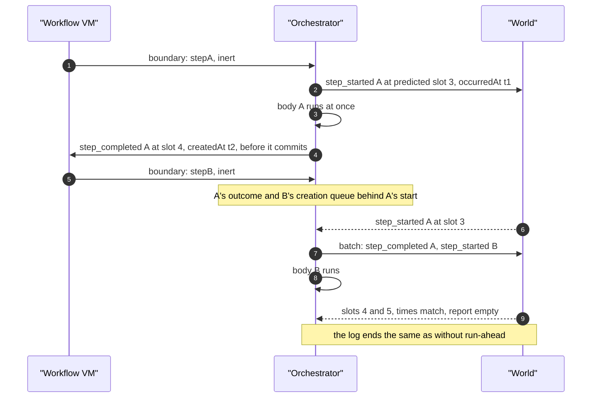

#### QuickJS run-ahead

QuickJS runs ahead with the same writer, classification, depth and hazard rules, with these differences:

- **The clock gate.** The QuickJS clock advances to the `createdAt` of every event the VM reads, not only events that reach workflow code, so an event another writer lands below a speculative one (a payload for an unawaited hook, an `attr_set` from a step body) gives a replay a later `Date.now()` than the live run read. Once workflow code reads the clock while the VM holds an unconfirmed speculative event, the next boundary is treated as not inert, and a displaced write restarts the delivery before anything decided from that reading is written (counted as `workflow.run_ahead.clock_drained_boundaries`). A workflow that reads the clock on every step waits for each outcome, as without run-ahead.
- **Speculative events are fed in position order.** A speculative event is queued at its predicted slot and fed only once every slot below it is fed.
- **A displaced write restarts the delivery.** The live VM cannot take back an event it consumed, so a displaced speculative write is not repaired in place: once the writes in flight settle, the delivery restarts from a fresh load with run-ahead off for the rest of it. A path-changing displacement also stops its decisions first, as on node, and a displaced write with a truncated report counts as path-changing.
- **Speculative creation.** A turn's new inline steps go out as one speculative batch when the boundary is inert, no step left by an earlier delivery runs in the same turn, the batch fits 16 events and 512 KiB, none declares `maxRetries: 0`, and `WORKFLOW_OPTIMISTIC_INLINE_START` is not `0`; under turbo it also waits for `run_started` to commit. Other steps are created on the awaited path, and their outcomes still run ahead.
- **Only while the latest boundary is inert.** A body that settles after a later boundary was found not inert writes its outcome on the awaited path.
- **Snapshots.** A VM snapshot is taken only once no speculative event is unconfirmed.

#### Replay divergence

On the node engine, a replay that diverges from the log discards the VM, reloads the log and replays from cold in a fresh VM in the same delivery, up to [`WORKFLOW_REPLAY_DIVERGENCE_MAX_RETRIES`](https://workflow-sdk.dev/docs/configuration/runtime-tuning#workflow_replay_divergence_max_retries) times (3 by default), then fails the run with `CORRUPTED_EVENT_LOG`. The first natural write after a recovered divergence carries `replayDivergenceCount`. Across crashes and redeliveries the count starts again, and the delivery cap bounds it. The QuickJS engine has no in-delivery divergence recovery.

### Turbo

[Turbo mode](../spec8/turbo-mode.md) fast-paths a run's first delivery. On that delivery the log holds only `run_created`, whose position counts as the run's first in-band write, and no other orchestrator exists yet. So it writes `run_started` without waiting, starts the in-band writer from `IN_BAND_SEQ_AT_RUN_CREATION` instead of loading the log, and starts the first inline step bodies before their start commits. Every in-band write queues behind `run_started` in the delivery's writer, and a refused `run_started` stops the delivery like any fence refusal.

Turbo is on by default (`WORKFLOW_TURBO`) and applies when all of these hold:

- the message carries `runInput`, so it is the message `start()` enqueued, and it is not a `start({ experimental_hook })` candidate;
- `attempt` is 1 and `deliveryCount` is 1, so it is neither a redelivery (including the one after a fence refusal), a handoff's next delivery nor a coalesced re-run;
- it is not a step message, a hook resume or a timer.

A restart in place is never turbo.

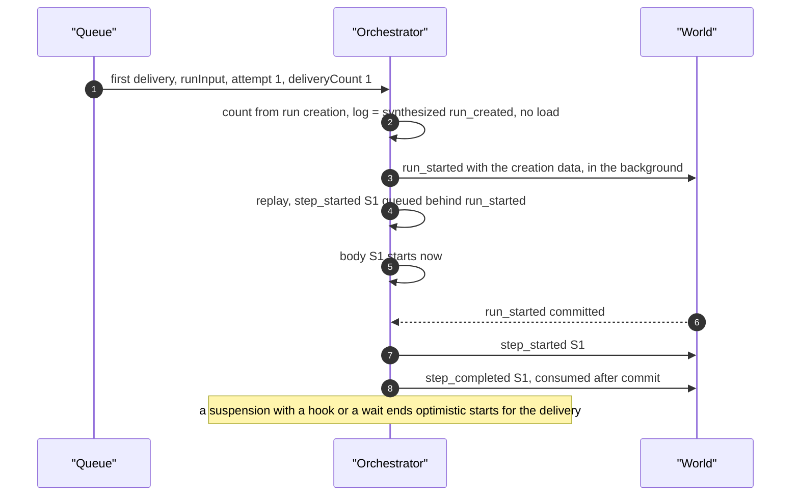

The optimistic start applies while the boundary has no wait and each of its inline steps allows retries. In a fan-out, inline bodies start while the creation batches commit, but each background step's message goes out only once its creation committed, so nothing runs elsewhere before it is durable (on QuickJS a fan-out commits its creations first).

#### Why turbo is safe on spec 9 runs

- **One orchestrator, one writer.** Starting a body before its start commits is unsafe in general: if the fence then refuses the start, the body ran without a durable record and runs again. On the first delivery of the first message no other orchestrator exists yet, so the body runs once.
- **It stops on the first hook or wait.** A hook or a wait gives the run other writers (a hook resume, a timer, `wakeUp()`). Turbo stops starting bodies ahead of their start for the rest of the delivery as soon as a suspension has a hook or a wait; attribute writes resolve in this process and do not end it.
- **Every write still lands after `run_started`.** In-band writes queue behind it, so the log still reads `run_created → run_started → step_created → step_started → step_completed`. Writes an optimistic step body makes outside the in-band writer (stream writes through `getWritable()`, a writable stream passed as an argument or returned, `setAttributes()`) wait on a run-ready barrier. An awaited start (`WORKFLOW_OPTIMISTIC_INLINE_START=0`) also waits for `run_started`.

#### When `run_started` or a later write is refused

If the backgrounded `run_started` fails for any reason, the writer stops: nothing else reaches the World and no further inline body starts. Bodies already started settle, their outcomes are discarded, and the delivery ends as an awaited `run_started` failing the same way would:

- refused by the fence: redelivered 1 s later (5 s on Vercel); the redelivery loads the log and takes the normal path;
- the run already finished (cancelled before its first delivery, say): acknowledged with nothing written;
- anything else: retried by the queue, or recorded as a setup failure.

Writes waiting on the barrier fail instead of writing, so a refused start leaves no chunks or attributes on a run whose log does not record the step that made them; a body that ran before the refusal runs again on the redelivery. If a step's own start batch is refused, its outcome is not written and the start's error decides. A World that rotates the start message must send a continuation without `runInput`, so the new message loads the log rather than replaying a progressed run against a `run_created`-only log.

#### Turbo trade-offs

- **A run cancelled before its first delivery still runs the first step body.** The normal path loads the run and returns before any code runs if it was cancelled or expired. Turbo synthesizes `status: 'running'`, so the cancellation is only seen when `run_started` is refused, after the body's side effects. `WORKFLOW_TURBO=0` restores the up-front check.
- **`workflowStartedAt` reflects the first delivery's clock.** Replay matching (correlation ids, the VM seed, the in-VM `Date.now()`) derives from a timestamp in the run id, identical on every delivery. Only `getWorkflowMetadata().workflowStartedAt` tracks `startedAt`, which turbo's first delivery takes from the local clock, so it can differ from later deliveries' by the start-to-first-delivery latency. Do not branch on it.
- **Seed attributes survive the skipped load.** `start({ attributes })` does not disable turbo: seed attributes ride in `run_created` and the run input. That is safe because attributes are write-only inside a workflow; an in-workflow read API, if ever added, must read the run snapshot rather than replay `run_created` / `attr_set`.

#### Turbo configuration

Set `WORKFLOW_TURBO=0` (or `false`) to disable turbo: every delivery then loads the log, awaits `run_started`, and waits for each inline step's start to commit before its body runs. Use it where first-step bodies are not idempotent, or while debugging.

`WORKFLOW_OPTIMISTIC_INLINE_START=0` (or `false`) keeps turbo's backgrounded `run_started` and skipped load, and makes the first delivery's inline bodies wait for their start to commit. No other value does anything: outside turbo's first delivery there is no optimistic inline start, because only that delivery is known to have no other orchestrator.

Turbo is client-side and needs no World changes. A World with `createBatch` saves the separate `step_started` write; one without it gets the start as its own write, chained behind `step_created`.

### `maxRetries: 0` is at most once per live owner

A background step keeps one queue message for its whole life and retries in place on it. Any delivery other than a plain first delivery reads the log before running the body.

```typescript
async function sendWireTransfer(amount: number) {
  "use step";
  await bank.transfer(amount); // must never run twice
}
sendWireTransfer.maxRetries = 0;
```

If the step's invocation crashes after the transfer but before `step_completed`, the redelivery reads the log, sees a started attempt with no outcome, and fails the step instead of running the body again. The same holds for an inline `maxRetries: 0` step after an orchestrator crash, and such a step never starts before its start commits, under turbo, run-ahead or `WORKFLOW_OPTIMISTIC_BACKGROUND_START`.

The guarantee holds per live owner. A duplicate delivery after a lease expiry is a second owner: if it reads the log before the first delivery's `step_started` lands, both run the body. A guarantee would need the World to make the first start conditional, which spec 9 does not require.

## Spec 8 and spec 9 side by side

The runtime keeps two orchestrators: the spec 8 one and the spec 9 single orchestrator. A run keeps the spec version it was created with, and every delivery is routed by that version: 9 or later to the spec 9 orchestrator, anything earlier to spec 8. A World may raise a running run across capability-only versions (for example 5 to 8, `CAPABILITY_ONLY_SPEC_VERSIONS`), never across 9, so a run never changes orchestrator. One entrypoint resolves the run's spec and hands the delivery to one orchestrator; the two share helpers but keep separate delivery bodies and step executors, which are mostly different code.

### Comparison

| | Spec 8 run | Spec 9 run |
|---|---|---|
| Writers | Several orchestrator invocations; the World refuses duplicate step and wait writes | One fenced in-band writer, plus out-of-band writers (hook payloads, background steps, cancellation, attributes) |
| world-vercel topic | `__wkf_workflow_<name>`, unkeyed | Same topic; orchestrator messages keyed by run id |
| `{ timeoutSeconds: n }` on world-vercel | A new message, up to 23 hours out | The same message redelivered; `0` is a handoff |
| world-local, world-postgres | Not serialized per run | Serialized per run (in-process gate, Graphile named queue) |
| Who writes `wait_created` / `wait_completed` | Any delivery; `run.wakeUp()` too | The orchestrator, in-band; an out-of-band `wait_completed` is refused |
| The timer | One delayed continuation for the run's earliest open wait, sent on every suspension; each delivery is a full replay | One delayed message per wait chain, sent only by a delivery that owns the chain; an ordinary orchestrator delivery |
| Long sleeps | 23-hour hops from the sender's clock, each a full replay | Hops anchored on the deadline; an intermediate hop reads only the run's status |
| Idempotency keys | On step messages, timers and some hook wakes | On step messages and timers only ([Timer keys](#timer-keys)), never on wakes |
| `run.wakeUp()` | Writes `wait_completed` out-of-band, then wakes; `stoppedCount` counts completions | Sends `completeWaits` to the orchestrator; best-effort, `stoppedCount` counts the waits it asked for |
| world-vercel events API | v4 routes, batches over HTTP | v5 routes, batches over the run's socket when the WebSocket transport is on |

Both model a sleep as a `wait_created` with a `resumeAt` under a fresh correlation id, resolved at its `wait_completed`; on spec 9 the timer goes out before `wait_created` commits ([Who arms a timer](#who-arms-a-timer)).

world-local and world-postgres serialize only spec 9 runs. A spec 8 delivery can hold an inline step until another wake of the same run aborts it, and a per-run gate would hold that wake back.

### Resolving a delivery's spec

The runtime takes the first of:

1. `runInput.specVersion`, on a run's first delivery from `start()`;
2. `runContext.specVersion`, on a step message;
3. `runSpecVersion`, the hint on every other message of a run (a world-vercel rotation's continuation drops the start message's `runInput` and stamps the version it carried);
4. `runs.get(runId, { resolveData: 'none' })`: the run's stored version, `SPEC_VERSION_LEGACY` for a run that stores none, or the World's own spec version for a run that is not found (the orchestrator then handles the missing run). The orchestrator reuses that read.

Nothing is remembered between messages: a stamped message never reads the run, and an unstamped one reads it once. A wrong hint routes the message to the other orchestrator, which finds the run's own version when it loads the run and sends the message again with that version before it replays anything.

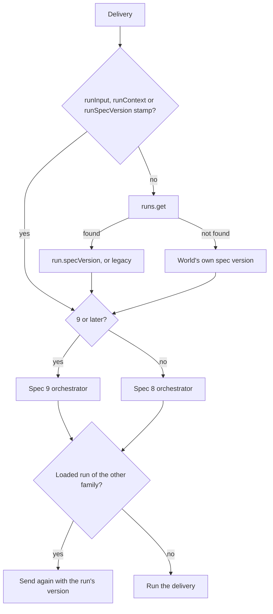

The World decides the queue side (topic, key, gate, continuation) from the payload alone, with `messageRunSpecVersion` (steps 1 to 3 only), and never reads the run there; an unstamped message counts as spec 8. See [Queue topology](#queue-topology-handoffs-and-rotation).

**Every send names the run's version**, for spec 8 runs as well as spec 9 ones: `start()` sets `runInput`, step messages carry `runContext`, and every other message (wakes, timers, requeues, `resumeHook()`, `cancel()`, `run.wakeUp()`, `reenqueueRun()`, and the restart recovery `reenqueueActiveRuns()`) sets `runSpecVersion`, never overwriting a stamp already there. Unstamped messages come only from outside this runtime: an older SDK's `resumeHook()` or `cancel()`, or another client of the World (see [Known limitations](#known-limitations)).

**Writes outside a delivery** (cancel, resume, wake-up, external attributes) stamp the run's own version, not the SDK's minted one, so a spec 8 run never receives a spec 9 event.

### An unstamped message

A message to a spec 9 run without a stamp still reaches the spec 9 orchestrator, through `runs.get`. What it costs depends on the World:

- **world-vercel** treats it as spec 8: it is sent unkeyed, so it can run beside the keyed holder, and a `{ timeoutSeconds }` result continues on a new message.
- **world-local** resolves it from its run record: the sending queue, and the handler of the process that receives it (for a message from another process, such as an older SDK's), read the run's stored spec version and stamp a spec 9 run's message with it, so it waits behind the run's live delivery, which may cover it with a coalesced re-run. A spec 8 run, a missing run or a failed read leaves the message as it was. Only unstamped messages pay the read.
- **world-postgres** resolves it from the run row: for an unstamped orchestrator message of a spec 9 run, the worker re-adds the message stamped with the run's version on the run's named queue, with the same attempt and delivery counts, and completes the original job undelivered. It then waits behind the live delivery, which may cover it with a coalesced re-run. A spec 8 run, a missing run or a failed read leaves the message delivered as before. Only unstamped messages pay the read.

Where the message does run beside the holder, the in-band fence keeps the log linear: the loser's write gets a 412 and it asks for a redelivery of its own message (see [The in-band fence](#the-in-band-fence)). The overlap can still cost more than one invocation: a spec 9 inline step's start carries no owner, so the unserialized delivery can start and run the body of an inline step the holder is still running, and the fence refuses only the later outcome write. A hint below 9 reaches the spec 8 orchestrator first, which hands the message on once it loads the run.

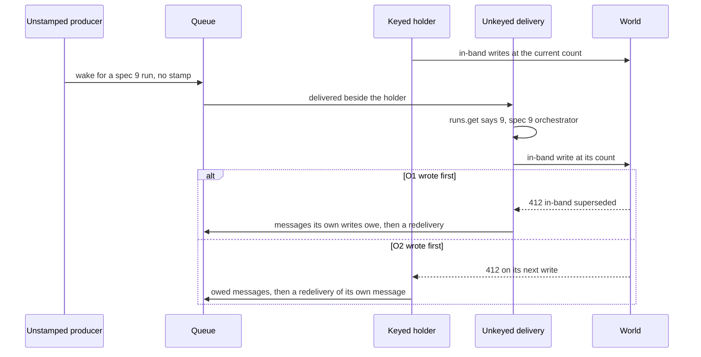

An unstamped spec 9 step message, possible only from a producer outside this runtime, would lose its same-message retry on world-vercel and arrive as a plain first delivery, skipping the log read that `maxRetries: 0` relies on.

### A spec 8 run after an upgrade

A run created as spec 8 keeps spec 8 after the app upgrades and opts in to spec 9 (sets `WORKFLOW_SPEC_VERSION=9` on a World that passes `{ inBandFence: true }`); upgrading alone keeps new runs on spec 8. Its next delivery, say the timer of a `sleep("7d")` that spans the upgrade, resolves to 8 from its stamp or `runs.get`, the spec 8 orchestrator replays its log, and every event it writes carries the run's version. New runs of the same deployment are spec 9. `@workflow/world-testing` checks this with world-local: a run created at spec 8 and parked on a hook finishes after its World restarts at spec 9.

On world-vercel, spec 9 adds no queue topic and no trigger: its messages go to the same `__wkf_workflow_*` topic and trigger spec 8 uses, distinguished only by the stamp and the concurrency key. That rule keeps the build and the World decoupled during a rollout: a deployment built with an older `@workflow/builders` still consumes every message world-vercel sends.

### An older SDK and a spec 9 run

world-vercel accepts writes to a spec 9 run over its API version 5, with one exception: a `hook_received` over an older API version. A deployment rolled back to an older SDK keeps receiving the webhooks and `resumeHook()` calls of spec 9 runs, so world-vercel writes that event out-of-band, stamped with the run's spec version; it moves no in-band position and needs no fence. Every other write over an older API version, such as `run_cancelled` or a hook disposal, gets 400 `spec-version-requires-api-v5`, before the older SDK sends any wake, so a refused write leaves no stale wake queued. Reads work on every version.

After an admitted `hook_received`, the older SDK sends its usual wake, with no stamp and no concurrency key. It is handled as [an unstamped message](#an-unstamped-message). A retried resume that carries the `(resumeId, resumePayloadDigest)` claim, which `resumeHook()` sends by default, converges on the first `hook_received`.

On the Local and Postgres Worlds an older SDK's writes, hook resumes included, fail with `RunNotSupportedError`. See [The rollback floor](#the-rollback-floor) for what happens to the run.

### Events API routing on world-vercel

The world-vercel client picks the route of every run-scoped events call from the run's spec version: v4 for spec 8 and below, as in earlier releases, v5 for spec 9. Writes route by the version stamped on the event (and, on `run_started`, by the attested executor version). Reads take a hint, `ListEventsParams.specVersion` and `GetEventParams.specVersion`, which the spec 9 orchestrator passes on every read on both engines; a read without it uses v4. The route never reads `WORKFLOW_SPEC_VERSION`, so opting out leaves spec 9 runs on v5. A spec 8 run's batches always go over HTTP; only a spec 9 run's batches may use the run's socket.

## World contract changes

A World written to the earlier "Building a World" guide (`specVersion: mintedSpecVersion()`, no fence) passes `createTestSuite()` and keeps creating spec 8 runs, on either engine, whatever `WORKFLOW_SPEC_VERSION` says. Everything below is required only of a World that creates spec 9 runs, and a World that declares the fence creates them only when `WORKFLOW_SPEC_VERSION=9` is set. The step-by-step guide is [Implementing spec 9 in a World](#implementing-spec-9-in-a-world); conformance testing is at [Conformance](#conformance).

### What changes, surface by surface

| Surface | Change |
|---|---|
| `capabilities.inBandFence` | **Required** to create spec 9 runs, and the only new capability. The runtime refuses a spec 9 run without it, in `start()` and at the start of every spec 9 delivery. Passing it to `mintedSpecVersion` lets the World's users opt in with `WORKFLOW_SPEC_VERSION=9`. |
| `CreateEventParams.inBand`, `expectedSeqInBand`; list `snapshot`; `EventResult.allocated`, `hasMore` | The [in-band fence](#storage-the-in-band-fence) and its bookkeeping. |
| Step and wait events | Plain appends on spec 9 runs; see [event rules](#spec-9-event-rules). |
| `{ timeoutSeconds }` | Read by the message's run spec (`messageRunSpecVersion`). Spec 9: `n > 0` redelivers the same message, `0` is a **handoff**, required and not counted toward `attempt`. Spec 8 and unstamped: unchanged. See [queue rules](#spec-9-queue-rules). |
| One orchestrator delivery per run | Hold or coalesce a spec 9 run's other orchestrator messages while one is in flight (`singleOrchestratorRunIdOf`). |
| `meta.deliveryCount` above 1 | Load-bearing: such an orchestrator delivery re-sends unstarted background steps. See [The dedupe contract](#the-dedupe-contract). |
| `meta.attempt` | `deliveryCount` less handed-off deliveries and coalesced re-runs; the delivery cap counts it. |
| Coalesced re-run | `meta.deliveryCount` plus the re-run number, `meta.attempt` unchanged; no separate field. |
| `meta.invocationStartedAt` | New, optional. When the invocation began (epoch ms), the same on every re-run; the inline deadline is measured from it. |
| `recovery: true` | New, optional, set by `reenqueueActiveRuns(..., { queueLost: true })`. A spec 9 delivery of it re-sends every open step message and arms every open wait chain. Older handlers ignore it. |

world-local and world-postgres declare the fence, mint spec 9 when `WORKFLOW_SPEC_VERSION=9` is set, and serialize only spec 9 runs' orchestrator deliveries. Both coalesce the messages queued behind a running delivery into re-runs of it (at most 32; see [world-local and world-postgres](#world-local-and-world-postgres)).

### The dedupe contract

A spec 9 step has one queue message for its whole life, and the runtime sometimes sends that message again (the [re-send rule](#the-re-send-rule)). A second live message for a step would be a second owner of its body, and the World does not refuse a second `step_started` (that would need a read on every insert). The queue's deduplication keeps a re-send from becoming a second message, so a World that creates spec 9 runs must:

- deduplicate a send that carries the same idempotency key for at least `QUEUE_MIN_STEP_KEY_DEDUPE_WINDOW_MS` (24 hours, exported by `@workflow/world`) after the first send, while the message that send made lives, whatever state it is in: waiting out a delay, being delivered, or backing off after a failed delivery. A send next to a message being delivered must not create a second one, and one next to a message in backoff must not reset its attempts or its schedule;
- keep redelivering a failing step message for at least `QUEUE_MIN_STEP_REDELIVERY_SPAN_MS` (one hour), the runtime's step stall window;
- follow a delivery that dies with one counted above 1: a redelivery of the same message, or a re-run of the delivery it was coalesced into.

The runtime stops re-sending an hour inside the dedupe window, so a re-send never outlives the dedupe. A re-send is decided from the log its delivery loaded, so it can reach the queue after the step's message ran the step to its outcome and was acknowledged, when a World that dedupes only while a message lives takes it as new. So the runtime marks a re-sent message (`stepResent`; carry it through), and its handler reads the log before running the body even on a first delivery. The first-party Worlds make that read redundant: world-vercel keeps the key for its whole window, acknowledged or not, and world-local and world-postgres refuse a `step_started` for a step that already has an outcome.

Timer hops carry idempotency keys too ([Timer keys](#timer-keys)) and need the same deduplication; the near-due key embeds the second, so every new second is a new key. How the shipped Worlds meet the contract:

| World | A second send under the key |
|---|---|
| world-vercel | Dropped for `min(retention, 24h)` after the first send, acknowledged or not; step messages are retained for at least a day |
| world-local | Dropped while the first message lives (held, delayed or being delivered) |
| world-postgres | Dropped while a Graphile job holds the key (`unsafe_dedupe`: waiting, locked or in backoff); each worker also skips a key it completed recently |

#### How world-postgres deduplicates a spec 9 run's keyed sends

Graphile's `preserve_run_at` job-key mode does not meet the contract: next to a **locked** job it inserts a second runnable job, which another worker delivers as a first delivery, running the body twice; next to an **unlocked** job it resets its attempts and schedule, so a failing step never reaches the delivery cap. So world-postgres sends every keyed step message (of any spec; spec 8's republish after a failed send hit the same double run) and a spec 9 run's timer hops with `unsafe_dedupe`, a no-op while any job holds the key. Spec 8's other keyed sends, and jobs the queue adds next to the still-locked job they continue (reschedules, moves), keep `preserve_run_at`, which `unsafe_dedupe` would drop. It deduplicates while the job exists rather than for 24 hours, which suffices: a step message lives until its step has an outcome.

### Implementing spec 9 in a World

This is the guide for a World author; [Building a World](https://workflow-sdk.dev/worlds/building-a-world) describes the spec 8 contract.

Spec 9 (`SPEC_VERSION_SINGLE_ORCHESTRATOR`, the single-orchestrator model) is opt-in, for users and for Worlds. A World that does nothing in this section keeps working and creates spec 8 runs. To let users opt in with `WORKFLOW_SPEC_VERSION=9`:

1. Implement the [single-writer guarantee](#single-writer-guarantee-and-the-in-band-fence) below: one orchestrator delivery per run at a time, and the in-band fence.
2. Implement the spec 9 storage and queue rules: the [event rules](#spec-9-event-rules), [the spec 9 queue rules](#spec-9-queue-rules) and [the dedupe contract](#the-dedupe-contract).
3. Declare `capabilities.inBandFence: true`, and pass it to `mintedSpecVersion`. That lets your World's users opt in: new runs stay on spec 8 unless they set `WORKFLOW_SPEC_VERSION=9`.

```typescript
import { mintedSpecVersion } from '@workflow/world';

export function createWorld(): World {
  const capabilities = { inBandFence: true, maxConcurrency: true };
  return {
    specVersion: mintedSpecVersion(process.env, {
      inBandFence: capabilities.inBandFence,
    }),
    capabilities,
    // ...
  };
}
```

4. Keep serving the spec 8 runs the World already created: they keep running on the spec 8 orchestrator. Decide from each run's stored `specVersion`, as world-local, world-postgres and world-vercel do. A World that drops what spec 8 needs fails those runs.

With `{ inBandFence: true }`, `mintedSpecVersion` returns 8 when `WORKFLOW_SPEC_VERSION` is unset (`SPEC_VERSION_DEFAULT_MINTED`, the default), the requested version for 6 to 9, and 8 with a one-time warning for an unrecognized non-empty value. Without it, it never returns 9: `9` also mints 8, with a one-time warning. The runtime refuses to create or drive a spec 9 run on a World that does not declare the fence: one that hard-codes `specVersion: 9` without it fails `start()` with an error naming `capabilities.inBandFence`.

#### Spec 9 event rules

**Step and wait events are appends.** On a spec 9 run, `step_created`, `step_started`, `step_retrying`, `step_completed`, `step_failed`, `wait_created` and `wait_completed` are plain appends. The runtime keeps their lifecycles correct itself, and replay treats any event after an entity's terminal event as inert. A World may keep step and wait records for `steps.get()` / `steps.list()`, but the runtime never relies on it refusing a write. Two run checks apply: refuse `step_created`, `step_started`, `step_retrying` and `wait_created` on a terminal run (`RunExpiredError`), and keep accepting `step_completed`, `step_failed` and `wait_completed` after it. Return no step or wait entity on the result.

**Inline steps are created by their first `step_started`.** A step the orchestrator runs inline has no `step_created`: its first `step_started` (`attempt: 1`) carries `stepName`, `workflowName`, `input` and `inline: true` (no `creatorMessageId`), and is the step's creation. Store it as one event, keep its `input`, and write no `step_created` beside it. A background step keeps `step_created` followed by its invocation's own `step_started`. The runtime still reads logs with a `step_created` for an inline step, so a World does not rewrite older runs.

**A resilient start may store its `run_started` as the run's creation.** When `run_created` never landed and a `run_started` carrying the creation data creates the run, a World may store that `run_started` alone at the first slot, with the data a `run_created` carries; the runtime reads either shape. Keep the in-band count a log with a `run_created` would have: the write reports `allocated: 1`, the creation holding the first in-band position and the start the next.

**Persist the bookkeeping fields** the runtime adds to `eventData` and return them from `events.list()`: `inline` and `creatorMessageId` on `step_created`, `inline` on an inline step's first `step_started`, `creatorMessageId` on `wait_created` and on an orchestrator's `step_retrying`, `attempt` on `step_started`, `step_retrying` and `step_failed`, and `stepName` on every step event. A `hook_received` written by `resumeHook()` or `resumeWebhook()` on a spec 9 run also carries the run's `workflowName`; older runtimes omit it, so treat it as optional.

**Batch writes.** The runtime writes a suspension's step and wait creations as one batch when `createBatch` exists, and one at a time otherwise. Events land in request order at consecutive positions; a batch is not atomic, and each item reports its own outcome. Batch params carry `inBand`, `expectedSeqInBand` and `eventCount` for the whole block; allocate the block in one fenced allocation and return its skipped-slot report and `allocated` at the top level of the result. Reject the whole batch, with a request-level error, for anything other than step and wait events, and for a batch over your own size caps.

#### Single-writer guarantee and the in-band fence

On a spec 9 run one orchestrator invocation at a time makes every decision for the run. Its writes are **in-band**: `run_started`, `run_completed`, `run_failed`, `step_created`, `wait_created`, `wait_completed`, `hook_created`, `hook_disposed`, an `attr_set` from the workflow body, a `hook_received` for a resume carried on its own queue message, and every event of a step it runs inline. Everything else is **out-of-band**: a background step's own events, `hook_received` from `resumeHook()` and webhooks, `run_cancelled` from `cancel()`, and `attr_set` from `setAttributes()` outside the workflow. Classification is by writer, not by event type, and the runtime states it on every write as `params.inBand`.

A World implements two mechanisms: **queue serialization** makes two orchestrators of one run rare (a frequency mechanism; the runtime takes no fast path from it), and **the in-band fence** makes the overlap the queue cannot rule out safe, such as a delivery that outlives its lease while a redelivery of the same run runs. Correctness rests on the fence.

##### Queue: one orchestrator delivery per run

`singleOrchestratorRunIdOf(payload)` from `@workflow/world` returns the run a message is an orchestrator delivery for when the run is spec 9 by the payload's stamp, and `undefined` for a step message, a health check, an intermediate hop of a long wait's timer, or an earlier run's message. While one delivery for such a run is in flight, hold the run's other orchestrator deliveries until it responds. Never hold step messages back, and never hold an earlier run's deliveries: a spec 8 orchestrator can hold an inline step until another wake of the same run aborts it. A delivery waiting out a `{ timeoutSeconds }` delay is not in flight. This applies to the Workflow SDK's own queue prefix only.

Declare `capabilities.maxConcurrency` when your queue does this. world-postgres uses a Graphile named queue per run and world-local an in-process per-run gate; world-vercel uses a concurrency key per run on the shared flow topic.

A queue may **coalesce** instead of holding: while one delivery of a run is in flight, it drops the run's other orchestrator messages and records them on that delivery, as world-vercel does with the concurrency key and world-postgres with its named queue. That is safe because what an orchestrator message is sent for is committed to the log first, with two exceptions and one obligation:

- **Re-run the delivery.** When messages were coalesced into a delivery, call the handler again within it before acknowledging, with `meta.deliveryCount` advanced by one per re-run, `meta.attempt` unchanged, and the same `meta.invocationStartedAt`, so a late re-run hands off instead of taking a fresh inline budget. When you bound the re-runs, either hand the message off once they are used up or, as world-postgres does, acknowledge and deliver the remaining messages as usual; never fail it.
- **`run.wakeUp()` is best-effort.** Its message names the waits to complete (`completeWaits`), which the log does not hold. Coalesced, the names are lost and the waits run their full length, which is accepted.
- **A timer names its wait** (`waitContinuation`). Coalescing a final timer loses nothing: the re-run sees the wait due and completes it, and arms the chain's next timer. But never serialize or coalesce an intermediate hop of a wait longer than 23 hours (`isIntermediateWaitHop(payload)`): a coalesced hop would leave the rest of the sleep without a timer. `singleOrchestratorRunIdOf` already returns `undefined` for one.

This is why an orchestrator that has to end early hands its message off (`{ timeoutSeconds: 0 }`) rather than sending itself a new message: on a coalescing queue the new message would be coalesced into its own delivery and run again in the same invocation.

##### Storage: the in-band fence

Declare `capabilities.inBandFence: true`. The runtime checks it in `start()` and at the start of every spec 9 orchestrator delivery and throws a `WorkflowRuntimeError` naming the capability, before anything is written.

Keep two counters per run, next to whatever allocates event positions: `seq`, the highest position allocated to any write, and `seqInBand`, the number of positions allocated to in-band writes. `run_created` counts as in-band, so a new run holds `seq = 1, seqInBand = 1`. Then:

- **List snapshot.** On every `events.list()` page of a spec 9 run, return `snapshot: { seq, seqInBand }`, read strongly consistently before the listing. A full load, followed to `hasMore: false`, must cover every position up to the first page's `seq`, each one committed or sealed. The runtime never counts events instead. A load of a non-empty log without a snapshot fails the run as a World contract error.
- **Fenced in-band creates.** An in-band write (`inBand: true`) carries `expectedSeqInBand`. Accept it only when that equals `seqInBand`, and advance both counters by the positions it allocates (1 for a create, the block size for a batch) atomically with the allocation. On a mismatch, throw `InBandSupersededError` (HTTP 412, `in-band-superseded`) and write and allocate nothing, so a refusal never leaves a hole. Never use the conflict (409) path for it.
- **Fence first.** Decide the fence before anything else the write does. A stale writer must touch no entity state and must hear 412, never a 409 for an entity the current writer created. If the write updates entity state as well as appending, make the check, the update and the append one atomic operation (Postgres: one transaction that locks the run's counter row first).
- **Missing count.** Answer an in-band write without `expectedSeqInBand` with a 400 (`WorkflowWorldError` with `status: 400`).
- **Out-of-band creates** (`inBand` false or absent) allocate unconditionally, move `seq`, and never move `seqInBand`. The fence never refuses them, and they carry no `eventCount`.
- **Allocation and report.** Return `allocated` on the result: how many positions the write took (0 for a write that converged on an event the log already held). For an in-band write, return the events on the positions between `eventCount` and the write's own (the skipped-slot report) in `events`, complete, or with `hasMore: true` when you could not produce all of it. The runtime acts on no other precondition rejection on a spec 9 run: a stale snapshot is answered with this report.
- **Event time.** Store an in-band write's `occurredAt` as the event's `createdAt`, on creates and batch items alike. The runtime hands an inline step's outcome to the workflow before the write commits ([run-ahead](#run-ahead)), and replay reads the stored time; on a mismatch the runtime stops the delivery and turns run-ahead off for your World for the rest of the process.
- **Batch order.** If you implement `createBatch`, order it per entity: once you refuse an item, refuse every later item of the batch with the same `correlationId`, so a step's outcome never commits behind its refused creation.

When a write is refused, the runtime stops that invocation: it writes nothing more, starts no further inline step bodies, sends the messages its own committed writes still owe (background steps and wait timers it created), and returns `{ timeoutSeconds: 1 }`. A refusal does not prove another orchestrator is running, so the redelivery, counted above 1, re-sends whatever is missing and continues the run. Count it toward `meta.attempt`, so that a run whose every write is refused reaches the delivery cap. The runtime never adopts the counts the error carries.

#### Spec 9 queue rules

The handler's result is queue control, and what a `{ timeoutSeconds }` result asks for depends on the spec version of the message's run, which `messageRunSpecVersion(payload)` and `isSingleOrchestratorMessage(payload)` read off the message:

- **Spec 9 run, `n > 0`**: do not acknowledge; deliver the **same** message again (same `messageId`, next `deliveryCount`) after about `n` seconds. The runtime uses it to retry a step in place, defer a run, and stand down after a fence refusal. You may clamp `n`; on an early redelivery the runtime asks again. Sleeps never use it: a timer is a new delayed message.
- **Spec 9 run, `0`: a handoff.** Deliver the same message again at once, and leave this delivery out of `meta.attempt`. The orchestrator returns it when its invocation has to end before its work does (deadline, stream flush, replay budget). world-vercel uses the Vercel Queues lease handoff; world-postgres puts the handed-off message ahead of the run's waiting orchestrator messages. Do not treat a non-finite `n` as a handoff, or a handler that kept returning one would be redelivered forever; world-vercel redelivers after its longest delay (900 seconds) instead.
- **Earlier runs, `n`**: continue the run after about `n` seconds, by redelivering the same message or publishing a new one with the same payload and acknowledging this one, counted toward `meta.attempt` as usual. world-vercel publishes a new message, up to 23 hours out. A message whose spec version cannot be read is an earlier run's.
- **Anything else**: acknowledge. **A rejection**: retry the same message with your own backoff.

For spec 9 runs, `meta.messageId` must be stable across redeliveries of one message, and `meta.deliveryCount` must be 1 only on a message's first delivery (leave it `undefined` if your queue cannot say; the runtime then reads the log before every step body). A step with `maxRetries: 0` runs at most once per live owner only if a redelivery never reports 1. What a delivery counted above 1 re-sends, and the deduplication that requires, is [the dedupe contract](#the-dedupe-contract).

On a spec 9 run, `QueueOptions.idempotencyKey` is set on step messages (stable for the step) and on wait timers (`wait:<correlationId>:<resumeAt>:<hopAt>` and its variants, [Timer keys](#timer-keys)). No orchestrator wake carries a key: each background step's outcome sends one undelayed wake, which your queue coalesces into the running delivery or delivers after it. Step messages also carry `retentionSeconds`, which you cap at what your queue supports.

Optional surfaces:

- **`events.subscribe(runId, afterSlot, onEvent, options)`** pushes a run's newly committed events, in slot order, to a running orchestrator. It is best effort: the runtime also polls the log tail and drops any pushed event that is not the next slot it expects. Return an unsubscribe function, and report a dropped connection through `options.onError`.
- **Abandoned reads.** `events.list()` may receive a `signal`; the runtime aborts it when it gives up on a read and never uses that read's result. Cancel the request on abort so a held read does not keep a connection open. A World that ignores it is still correct.
- **Lost queues.** If your World re-enqueues active runs on start and its queue does not survive a restart (an in-memory queue, as world-local's), pass `{ queueLost: true }` as the fifth argument of `reenqueueActiveRuns()`, so each message carries `recovery: true` and re-arms what died with the queue.

Spec 8 runs keep the [hooks-only suspension](https://workflow-sdk.dev/worlds/building-a-world#event-id-allocation) shortcut that omits `eventCount` and `sinceCursor`.

#### Conformance

Two suites check a World, and both skip their fence checks for a World that does not declare `capabilities.inBandFence`.

`inBandFenceConformance` from `@workflow/world` runs against your events storage directly. It checks the capability, a new run's snapshot, acceptance at the current count, a stale write refused without allocating, out-of-band writes that move only `seq`, a race of in-band writers on one count (exactly one wins), the 400 for a missing count, the stored `occurredAt`, the bookkeeping fields, and an inline step created by its first `step_started`. Pass `secondEvents` when two storage instances can share one store, to check that they share one fence. It imports `vitest`.

```typescript
import { inBandFenceConformance } from '@workflow/world/test-support/in-band-fence-conformance.js';
import { createWorld } from './index.js';

inBandFenceConformance({
  name: 'my-world',
  events: () => createWorld().events, // fresh storage per test
  capabilities: () => createWorld().capabilities,
  newRunId: () => null, // or a `wrun_` id when your World needs the client to mint it
  atRunCreation: 1, // in-band positions a new run holds
});
```

`createTestSuite()` from `@workflow/world-testing` runs workflows end to end against your World at the version it mints, and checks a finished run's snapshot and a stale in-band write when the World declares the fence. A fenced World mints spec 8 by default and spec 9 once its users opt in, and keeps serving spec 8 runs either way, so run the suite at both, as the first-party Worlds do: world-testing runs it on world-local at the default (spec 8) and in a second file with `WORKFLOW_SPEC_VERSION=9` (`test/embedded-spec9.test.ts`), and world-postgres runs it pinned to spec 8 (`test/spec.test.ts`) and at spec 9 (`test/spec9.test.ts`). world-testing also checks that a spec 8 run finishes after its World restarts at spec 9.

## Queue topology, handoffs and rotation

On Vercel, a spec 9 run is kept to one orchestrator invocation by a Vercel Queues concurrency key, the run id, on the same `__wkf_workflow_<name>` topic spec 8 runs use. Spec 8 runs keep the earlier topology: no key, and a `{ timeoutSeconds }` result continues on a new message. The in-band fence that makes an overlap safe when the key does not hold is described in [The in-band fence](#the-in-band-fence).

### What decides the topic and the key

world-vercel decides from the payload alone, at send and at delivery alike, with three helpers from `@workflow/world`:

- `messageRunSpecVersion` reads `runInput.specVersion`, then `runContext.specVersion`, then the `runSpecVersion` hint. `isSingleOrchestratorMessage` is true when that is 9 or more. A message without a stamp counts as spec 8.
- `orchestratorRunIdOf` returns the run id for an orchestrator message, and `undefined` for a step message, a health check, and an intermediate hop of a long wait's timer (`isIntermediateWaitHop`: `waitContinuation.resumeAtMs` is set).
- world-vercel keys a message only when it is on a flow topic, the message is spec 9, and `orchestratorRunIdOf` returns a run id.

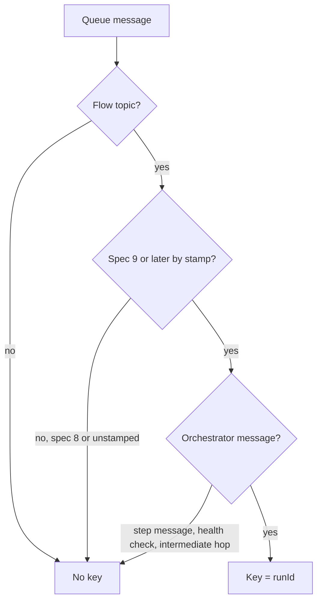

Every runtime that creates spec 9 runs stamps every message it sends. A producer outside it (an older SDK's `resumeHook()` or `cancel()`, another client of the World) may send an unstamped message for a spec 9 run. That message is sent unkeyed and continues on new messages, so it can run beside the keyed holder, and only the fence keeps the log correct; the cost is wasted orchestrator work, which can include running an open inline step's body a second time (see [Spec detection rests on the payload stamp](#spec-detection-rests-on-the-payload-stamp)).

### Spec 8 and spec 9 on Vercel

**Spec 8.** Every flow message of a workflow, orchestrator and step, goes to one topic. The flow trigger has no `maxConcurrency`, so two orchestrator invocations of one spec 8 run can run at once, and the World's step and wait records refuse the loser's duplicate writes. A `{ timeoutSeconds }` result sends a new message (delay up to 23 hours) before acknowledging, so a crash in between duplicates the wake instead of losing it.

**Spec 9.** Same topic, same trigger. Orchestrator messages carry the run id as the key. Vercel Queues keeps at most one push delivery per key active, and a keyed message claimed while another delivery holds the key is coalesced into that delivery. Step messages, health checks and intermediate wait hops carry no key and keep full parallelism. A fan-out's step messages go out in parallel batch sends of up to 16 messages each on the node engine; world-vercel caps one batch request at 100.

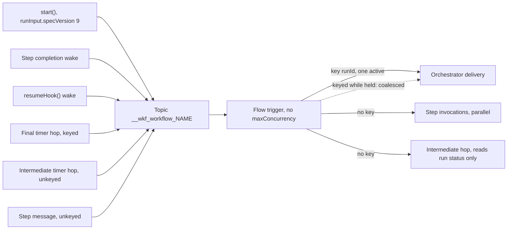

### What the design needs from the Vercel Queues client

world-vercel uses `@vercel/queue` 0.10.0. The design depends on these behaviours of a keyed message (`experimental_concurrencyKey`):

- **Send.** The key travels with single sends and batch sends alike. A coalesced message is never delivered, so its sender must commit what the message is for before sending it. If the key is dropped on the way, nothing is serialized: a run's orchestrator messages are delivered in parallel, and only the fence keeps the log correct, at the cost of refusals and re-run inline steps.
- **Conditional acknowledgment.** While coalesced messages the holder has not covered are pending, its acknowledgment is refused with 409 `concurrency_coalesced_pending` and a coalesced count. The next acknowledgment carries the count it covers (`experimental_ifCoalesced`).
- **Re-runs with the lease held.** Between refusals the client renews the lease at once and runs the handler again, with `experimental_coalesced: { rerun, coalescedCount }` in the metadata, up to `experimental_maxCoalescedReruns` times (world-vercel passes 32). The immediate renewal matters: a re-run started on the regular renewal schedule could outlive a short lease that was never renewed. Past the cap the refusal (`ConcurrencyCoalescedPendingError`) goes to the retry hook.
- **Handoff.** A retry directive `{ afterSeconds: 0, experimental_handoff: true }` makes the same message visible again at once, marked as a handoff. The queue answers `accepted`, or `not_immediate` / `limit_reached` when it applied an ordinary reschedule instead; it bounds handoffs per message (10,000), and past the bound a handoff counts as an attempt. The next delivery reports `experimental_handoffCount`. world-vercel logs each answer (`limit_reached` at warn) by wrapping an internal client object; if a client release moves it, the lines stop and a warning is logged once.
- **Lifetimes.** An orchestrator message is sent with the queue's default retention, 24 hours, counted from its first send. A redelivery's delay is clamped to 5 to 900 seconds. A new message's delay is capped at 23 hours (an hour short of the default retention).

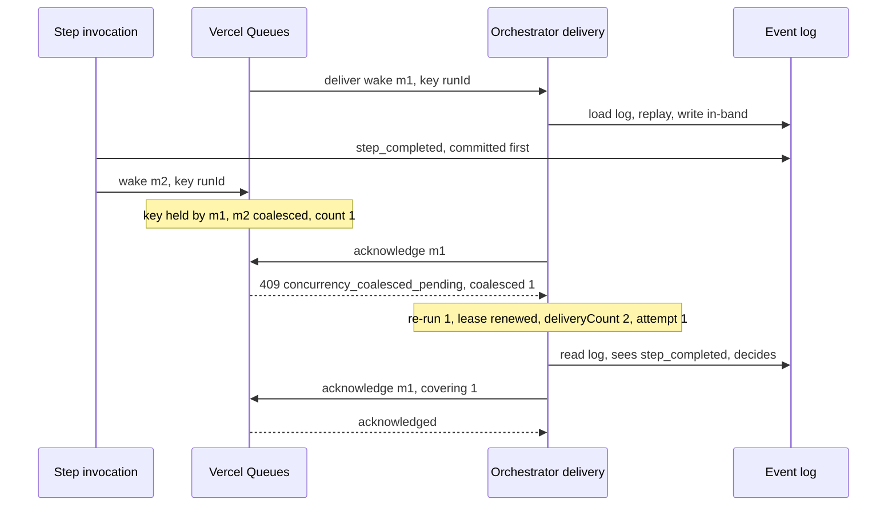

### Coalescing and re-runs

A keyed message claimed while another delivery holds the key is **coalesced**: it is never delivered, and it is counted on the holder. The holder's acknowledgment is refused until it covers that count, so the client runs the handler again in the same invocation with the lease held. world-vercel reports each re-run with the next `deliveryCount` and the same `attempt`, so the runtime treats it as a redelivery: turbo is off and the log is read.

Every re-run measures its inline deadline from the invocation's start, which world-vercel passes to each re-run as `invocationStartedAt`. Without it, a busy run (a chat agent receiving a message every second while a turn runs inline) could keep one invocation re-running past the function's maximum duration, to be killed mid-work and recovered only after its lease lapsed.

**Example: a fan-out whose completions coalesce.**

```typescript
export async function resizeAll(urls: string[]) {
  "use workflow";
  const sizes = await Promise.all(urls.map((url) => resize(url))); // 50 background steps
  return sizes;
}
```

The 50 step invocations finish over a few seconds, and each sends the orchestrator one plain wake without reading the log. While the orchestrator runs, every wake is coalesced into it. When it tries to acknowledge, it is told how many arrived, reads the log once, and sees every outcome that landed. The run is woken a few times instead of 50, and there is never a second orchestrator to refuse. world-local and world-postgres cover the wakes that queued behind a running delivery with re-runs in the same way (see [world-local and world-postgres](#world-local-and-world-postgres)).

Coalescing is safe because every producer commits what the wake is for (a step outcome, a `hook_received`) before it sends the wake, so the holder's next read sees it. The exceptions are `run.wakeUp()`, which is best-effort (see [`run.wakeUp()` lost under coalescing](#runwakeup-lost-under-coalescing)), and timers, which name their wait (see [Timers and waits](#timers-and-waits)).

### `{ timeoutSeconds }` by run spec

world-vercel's queue handler reads the run's spec off the payload:

| Handler result | Spec 9 run | Spec 8 run or unstamped |
|---|---|---|
| `{ timeoutSeconds: n }`, `n > 0` | Same message redelivered after `n` seconds (clamped to 5 to 900), counted as an attempt | New message with `delaySeconds: min(n, 82800)`, sent before the acknowledgment |
| `{ timeoutSeconds: 0 }` | Handoff: same message, at once, not an attempt | New message with no delay |
| Non-finite `timeoutSeconds` | Redelivery after 900 seconds, counted, never a handoff, so a handler that kept returning it is still bounded by the delivery cap | `Infinity` becomes a new message 82800 seconds out |
| Anything else | Acknowledge | Acknowledge |

The spec 8 column is what keeps long spec 8 sleeps and retry chains working: a new message starts with a fresh retention and delivery count. Redelivering the same message instead would cap every hop at 900 seconds, and with 48 deliveries a spec 8 chain longer than about 12 hours would fail with `MAX_DELIVERIES_EXCEEDED`.

### Handoffs

A spec 9 delivery that has to end before the run's work is done hands its message off (`{ timeoutSeconds: 0 }`) instead of sending itself a new one, on every World. On a keyed topic, a message the orchestrator sent itself would be coalesced into its own delivery and run again in the same invocation, which defeats the point of ending it. On world-vercel the client marks the lease change as a handoff, Vercel Queues redelivers the same message at once, and the handed-off delivery counts toward neither its backoff nor `maxAttempts`. Handoffs are used for:

- the invocation's inline deadline, on both engines;
- inline step stream writes still flushing in the background (for example a webhook step's `request.respondWith()`: the delivery ends so the flush can finish in `waitUntil`, and the run continues in the handoff);
- a hook conflict the workflow has to consume in a fresh pass;
- a run-ahead stop past its one restart;
- QuickJS exits on the replay budget, an elapsed wait, or an unread write of its own;
- a delivery whose 32 coalesced re-runs are used up (world-vercel's retry hook answers `ConcurrencyCoalescedPendingError` with a handoff).

**Example: a long workflow crossing the inline deadline.**

```typescript
export async function nightlyReport() {
  "use workflow";
  for (let day = 0; day < 365; day++) {
    await aggregateDay(day); // inline steps, about 2 seconds each
  }
}
```

The run needs about 12 minutes of inline work, longer than one invocation's inline budget. Near the deadline the orchestrator ends its delivery and the next one continues from the log: with a handoff when an inline step runs into the deadline, or through one background step when the inline-start margin comes first (see [Deadline handoff and the inline-start margin](#deadline-handoff-and-the-inline-start-margin)). A handoff is not an attempt, so handoffs never fail the run through the delivery cap (`WORKFLOW_MAX_QUEUE_DELIVERIES`, 48). They do not extend the message's life either: a handoff keeps the message, whose retention counts from its first send, and the queue bounds how often one message can be handed off. That is what rotation is for.

### Rotation near expiry

When the runtime asks for a handoff of an orchestrator message that expires within 4 hours, or is within 100 handoffs of the queue's bound, world-vercel instead sends a new message, delayed by one second so it is due after the old one's acknowledgment, and acknowledges the old one. Nothing is lost with the old message: the delivery has already sent every message its writes owe, and the timers of the waits it created, before it asks for the handoff. Only an orchestrator message rotates; a step message hands off on its own message, since its idempotency key would drop a copy and a continuation would turn it into an orchestrator wake.

When a delivery runs out of coalesced re-runs, `@vercel/queue` hands the message off itself from a synchronous retry hook that cannot send. So world-vercel makes the rotation decision on the delivery's last re-run instead, when the handler acknowledges: a message due for rotation is continued there, before the acknowledgment the queue may refuse. If that acknowledgment succeeds after all, the continuation is one extra wake, which replays from the log. If it is refused, the old message is still handed off; it owes nothing, and its next delivery decides again.

#### The continuation payload

The new message is never a copy. It is `singleOrchestratorContinuationPayload(payload)` from `@workflow/world`, built from `SINGLE_ORCHESTRATOR_CONTINUATION_FIELDS`, a record of every field of `WorkflowInvokePayload`, typed so that a new field fails the typecheck until it is classified:

| Rule | Fields | Why |
|---|---|---|
| Carried | `runId`, `runContext`, `traceCarrier` | The run, its identity, and the trace link. |
| Carried | `waitContinuation`, `completeWaits`, `hookInput` | What the message is a wake for: a timer's wait, the waits a `run.wakeUp()` names, a legacy hook resume (written deduplicated by its `resumeId`). |
| Stamped | `runSpecVersion` | Set to `messageRunSpecVersion(payload)`, so the continuation is still routed and serialized as spec 9 after `runInput` is dropped. |
| Dropped | `runInput` | Marks the run's first orchestrator message; see below. |
| Dropped | `requestedAt`, `hookResumeTiming`, `recovery`, `invoke`, `requestId`, `input`, the spec 8 retry counters, the step fields | They describe the request that sent the replaced message, a request/response invocation, or a step message, not a continuation. |

Dropping `runInput` is the point. The run's start message carries it through every handoff, and a new message is delivered with `attempt = 1` and `deliveryCount = 1`: together that is turbo's first-delivery predicate. A copied start message would take the fresh-start path over a progressed log, synthesize a log holding only `run_created`, and start inline step bodies optimistically while its stale `run_started` was in flight; the fence refuses that write, but a body already started keeps its side effects. A rotation happens only after hours of handoffs, so `run_started` has long committed. No separate "continuation" marker exists: without `runInput` the turbo predicate cannot hold, and the field list is the guarantee.

### Attempt accounting

world-vercel computes `attempt` as `max(1, deliveryCount - handoffCount)` and reports `deliveryCount + rerun` as the delivery count. A re-run is not a queue delivery, so it never raises `attempt`. The spec 9 re-send rule reads the reported delivery count: every delivery counted above 1 re-sends unstarted background steps created less than 23 hours ago, once per invocation (see [Step ownership and data](#step-ownership-and-data)).

One message, in order:

| Delivery | Queue `deliveryCount` | `handoffCount` | `rerun` | Reported `deliveryCount` | `attempt` | Re-send pass |
|---|---:|---:|---:|---:|---:|---|
| First delivery | 1 | 0 | 0 | 1 | 1 | no |
| Coalesced re-run 1 | 1 | 0 | 1 | 2 | 1 | yes |
| Coalesced re-run 2 | 1 | 0 | 2 | 3 | 1 | no, same invocation |
| After a handoff | 2 | 1 | 0 | 2 | 1 | yes |
| After a lease lapse (crash) | 3 | 1 | 0 | 3 | 2 | yes |
| After a fence refusal (`{ timeoutSeconds: 1 }`) | 4 | 1 | 0 | 4 | 3 | yes |

The reported count drops from 3 to 2 across the handoff, because the queue never counted the re-runs. Turbo needs `attempt === 1` and `deliveryCount === 1`, and the delivery after a handoff reports 2, so the drop never turns turbo on. Because a handoff counts above 1, a busy fan-out that keeps handing off re-sends (deduplicated) step messages on each continuation; the count is on the span as `workflow.reenqueue.count`.

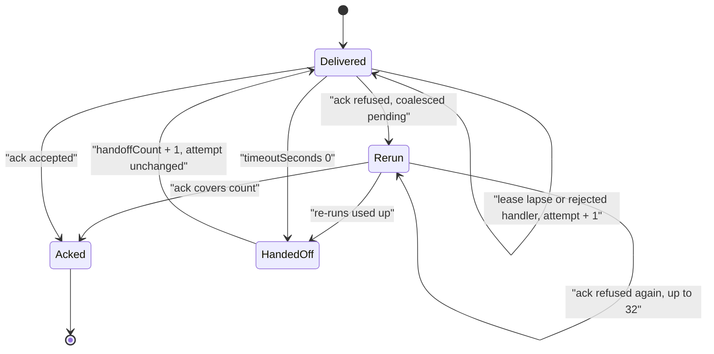

### No orchestrator message carries state the log needs

A coalesced message is never delivered, and its holder only re-reads the log, so a message may be coalesced only if losing its payload loses nothing the log does not hold. Every spec 9 orchestrator message is keyed except an intermediate hop of a long wait's timer:

| Message | Message-only state | How spec 9 handles it |
|---|---|---|
| Continuation after a fence refusal | None | The refused delivery sends what its own writes owe and asks for a counted redelivery of its own message (`{ timeoutSeconds: 1 }`). |
| Continuation after a run-ahead stop | None | Restarts in place in the same delivery. |
| Replay-divergence recovery | None | Replays again in place, counting divergences in memory. Spec 8 still sends a `replayDivergence` message. |
| `run.wakeUp()` | `completeWaits` | Keyed, best-effort. |
| Final timer | `waitContinuation` | Keyed. Coalesced, the holder's re-run sees the wait due, and whichever delivery completes a wait arms its chain's next timer. |
| Intermediate timer hop | `waitContinuation` | Unkeyed, never coalesced or serialized: its delivery depends on its own message, reads only the run's status, writes nothing, and sends the next hop (see [Timers and waits](#timers-and-waits)). |

The rule is why there is no unkeyed "replacement" message. Replacements that carried the replaced message's identity ran unkeyed next to the keyed holder, lost or won the fence, and the loser sent another replacement. Storm workflows measured on Vercel cascaded this way, about one run in ten taking 48 to 164 orchestrator invocations. With only keyed continuations, a refused delivery starts no chain: its redelivery is keyed and cannot run beside a keyed holder. The storm workflows have not been re-measured on Vercel since.

**Fence refusal.** A delivery whose in-band write is refused keeps, from its writer's accepted events, what those writes owe the queue: the message of each background step whose `step_created` it committed (trailing fan-out batches included), the message of each inline step whose retry it moved to the background with a committed `step_retrying`, and the timers of the wait chains it owns. It sends exactly the ones it has not sent, with their usual idempotency keys, plus what the re-send rule sends. Then it returns `{ timeoutSeconds: 1 }`: a counted redelivery of its own message, never an acknowledgment and never a separate wake. A refusal does not prove another orchestrator is running (see [Self-superseded 412](#self-superseded-412)), and the other writer may be a second delivery of the same message that died owing a send (see [Two deliveries of one message, one dies owing a send](#two-deliveries-of-one-message-one-dies-owing-a-send)); the redelivery is counted above 1, so the re-send rule covers both.

The redelivery costs one more invocation, after at least 5 seconds on Vercel (the queue's minimum delay). It keeps the run's key, so a wake sent meanwhile is coalesced into it, and a live winner still holding the key absorbs it. On world-local and world-postgres it is delivered after the running delivery, or covered by that delivery's re-run on world-postgres. Repeated refusals count toward the delivery cap on every first-party World, so a run refused on every pass fails with `MAX_DELIVERIES_EXCEEDED` instead of looping; the streak is logged at warn.

**Run-ahead stop.** The delivery lets the outcomes the stop still allows commit, sends what its writes owe, takes a fresh writer, reloads the log and replays from cold in the same delivery with run-ahead off for the rest of it. `MAX_RUN_AHEAD_RESTARTS` (1) bounds the restarts, and a stop past it hands off. A hazard stop detects a classification gap rather than recovering from one (the check runs on a write that already committed), so it is logged at error level with `possibleLogCorruption: true`.

**Replay divergence.** The delivery discards the VM, reloads the log and replays from cold in a fresh VM, up to `WORKFLOW_REPLAY_DIVERGENCE_MAX_RETRIES` (3) times, then fails the run with `CORRUPTED_EVENT_LOG`. The first natural write after a recovered divergence carries `replayDivergenceCount`. Across crashes and redeliveries the count starts again, and the delivery cap bounds it. The QuickJS engine has no divergence recovery.

### world-local and world-postgres

Both declare the fence, mint spec 9 runs when `WORKFLOW_SPEC_VERSION=9` is set, and serialize a spec 9 run's orchestrator deliveries by `singleOrchestratorRunIdOf` (spec 9 by stamp, then `orchestratorRunIdOf`). Spec 8 runs, step messages, health checks and intermediate hops are not gated. Both coalesce the orchestrator messages that queue behind a running delivery, and both resolve an unstamped orchestrator message's spec version from the run (see [An unstamped message](#an-unstamped-message)).

| | world-local | world-postgres |
|---|---|---|
| Per-run gate | In-process run gate | A Graphile named queue per run |
| Handoff | Same message, not an attempt, up to 10,000 handoffs per message (past that it counts, as on Vercel). The delivery keeps the run's gate and is delivered again at once as a new invocation (a fresh `invocationStartedAt` and re-run budget). That redelivery covers the coalescible orchestrator messages waiting behind it, and carries the resume timing of the earliest hook wake among them | A new Graphile job with the same `messageId`, no delay, on the run's named queue, with priority `-1` so it runs before the jobs already waiting there |
| `attempt` across reschedules | Unchanged by a handoff | Carried over by a handoff and by a spec 9 orchestrator message's delayed reschedule (a fence refusal's redelivery counts toward the cap); a step message's retry in place starts `attempt` over. `deliveryCount` carries over on all of them |
| Coalescing | When a delivery acknowledges, the run's orchestrator messages its process's queue holds behind it (not a start message carrying `runInput`, a legacy `hookInput` resume, a `run.wakeUp()` message carrying `completeWaits`, a restart's `recovery` message or an invoke request) are taken and covered by a re-run. A message another process sends reaches only the handler's gate, where it waits and is not coalesced | When a delivery acknowledges, the run's orchestrator jobs waiting behind it (due, unlocked, not a start message carrying `runInput`, not a hook resume or invoke request) are deleted and covered by a re-run. Not on invoke mode's executor lane |
| Re-runs | Handler called again with `deliveryCount + rerun`, the same `attempt` and the same `invocationStartedAt` (`x-workflow-local-invocation-started-at`), while messages wait, up to 32 times per hold of the gate; past the cap the waiting messages are delivered as usual. A re-run carries the resume timing of the earliest hook wake it absorbed | Handler called again in the same worker with `deliveryCount + rerun`, the same `attempt` and the same `invocationStartedAt`, while it finds jobs to take, up to 32 times. Past the cap the remaining jobs are delivered as usual, so no handoff is needed. A failed re-run is retried as the original job, counted above 1 |
| Dedupe of a keyed send | While the first message lives | While a Graphile job holds the key (`unsafe_dedupe`) for a spec 9 run's keyed sends and every run's step messages; `preserve_run_at` for a reschedule and for spec 8's other keyed sends |
| Live event feed | `events.subscribe` in process, with a 50 ms log check for other writers, at most half of `WORKFLOW_LOCAL_QUEUE_CONCURRENCY` live at once. A message the running delivery cannot coalesce ends its feed, and with it any linger | `events.subscribe` over `LISTEN`/`NOTIFY`, at most half of a process's `queueConcurrency` slots live at once |

world-postgres coalesces only jobs that are due: a delayed reschedule or a timer still waiting out its delay stays queued. A start message is never coalesced, since it carries the run's input for a start whose `run_created` may not have committed yet.

world-local coalesces only messages that are due: a delayed message waits out its delay before it reaches the run's gate. Intermediate wait hops stay ungated in both Worlds.

## Lifecycles and flows

Each flow below follows one part of a spec 9 run, then lists the edge cases that part has to handle. The mechanisms they rest on (the [in-band fence](#the-in-band-fence), [event posting](#event-posting), [consume after commit](#consume-after-commit), [run-ahead](#run-ahead) and [turbo](#turbo)) are described under The spec 9 model and are not repeated here.

### Run lifecycle

This section follows one run of the workflow below from `start()` to `run_completed`. With the default `WORKFLOW_MAX_INLINE_STEPS` of 3, the four-way `Promise.all` gets three inline steps and one background step.

```typescript
export async function order(id: string) {
  "use workflow";
  const order = await loadOrder(id);   // inline, first delivery (turbo)
  await Promise.all([1, 2, 3, 4].map((n) => reserve(order, n))); // 3 inline, 1 background
  await sleep("1h");                   // suspends; a timer message wakes the run
  return await confirm(order);         // inline, timer delivery
}
```

Terms used below:

- **Delivery**: one call of the orchestrator handler for one queue message.
- **In-band**: a write the orchestrator makes, fenced with `expectedSeqInBand`. **Out-of-band**: any other writer (a background step's invocation, `resumeHook()`, `cancel()`).
- **Handoff**: the delivery returns `{ timeoutSeconds: 0 }` and the World delivers the same message again at once without counting an attempt.

#### On world-vercel

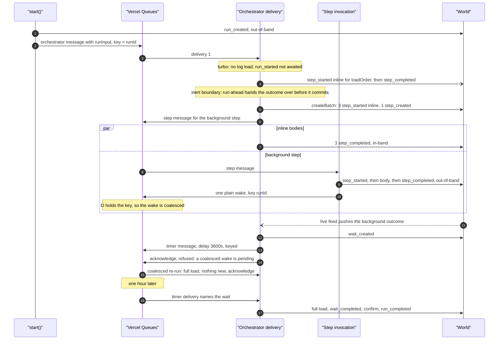

#### On world-local

world-local has no `createBatch`. It serializes a spec 9 run's orchestrator deliveries with an in-process per-run gate; step messages are not gated. The same run writes its four creations one at a time and takes the background outcome from its live feed, lingering for it if the inline bodies finish first; the step's wake, which queued behind the running delivery, is coalesced into it, and its re-run finds the outcome already consumed and acknowledges.

#### One delivery's main loop

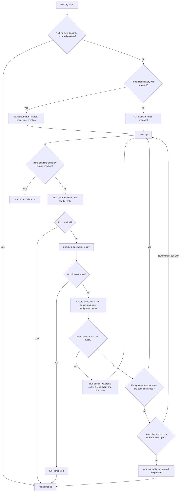

Three exceptions take other exits: a fence refusal sends the messages the delivery owes and asks for a redelivery of the same message after 1 s, 5 s on Vercel ([The in-band fence](#the-in-band-fence)); a run-ahead stop restarts in place once, then hands off ([Run-ahead](#run-ahead)); a replay divergence reloads and replays cold, or fails the run.

#### Run lifecycle edge cases

- **Resilient start.** When `run_created` never landed, the first delivery creates the run from `run_started` carrying `runInput`, and the writer starts at the count a run has at creation.
- **Run already finished at setup.** A `run_started` refused as a conflict, or an expired run, acknowledges without writing. A `run_completed` that loses by position to an earlier out-of-band `run_cancelled` or `run_failed` dispatches no completion hooks.
- **Wake with nothing new.** A delivery that carries no `runInput`, hook or timer, and finds the log tail at the position this process recorded, acknowledges without a replay, provided it is its message's first delivery or its invocation already ran the [re-send pass](#the-re-send-rule). A coalesced re-run reports the next `deliveryCount` with the same `attempt`, so turbo is off and the log is read.
- **Inline deadline.** At the top of each pass the delivery hands off once the inline window has passed since the invocation started: 2 minutes, 5 when the function may run 10 minutes or more, 10 at 25 minutes or more (`WORKFLOW_V2_TIMEOUT_MS` overrides). Within `WORKFLOW_INLINE_STEP_DEADLINE_MARGIN_MS` (60 s) of the window's end, new steps are created as background steps.
- **Stream writes still flushing**, or **a hook conflict** the workflow has to consume in a fresh pass: the delivery hands off.
- **An event that landed after the VM decided.** Before suspending, a foreign event above the pass's consumed slot starts another pass instead of acknowledging, because its own wake would find the position already recorded and exit.
- **Throttled inline start.** Defers the run by the longest backoff once every sibling settled.
- **Wakes behind a running delivery.** world-vercel, world-postgres and world-local cover the wakes queued behind a running orchestrator delivery with re-runs of it; on world-local, a wake that another process's queue sent is its own delivery, after the running one. A wake that finds nothing new acknowledges after one tail read; the others load the log and replay ([Known limitations](#known-limitations)).
- **QuickJS engine.** Same delivery, writer and run-ahead depth after setup, but no divergence recovery ([QuickJS run-ahead](#quickjs-run-ahead)).

### Event posting with consume-after-commit

The in-band writer and the consume-after-commit rule are under [Event posting](#event-posting) and [Consume after commit](#consume-after-commit); the live feed is under [The live event feed and polling](#the-live-event-feed-and-polling). The writer's edge cases:

- **Idempotent replay.** A write answered at a slot the writer already knew allocated nothing. Without an `allocated` from the World, the writer assumes 1 per create and the whole block per batch, less items answered at known slots.
- **Per-item batch failure.** A failed item leaves a hole the World seals as a `noop`; the next replay re-derives the event and writes it again. A 429 or 410 on an inline step's creation-bearing start is that step's start refusal; any other 429, or a 5xx, fails the delivery.
- **Unknown outcome.** A transport error or 5xx may have allocated, so the writer stops for good and the delivery is retried from a fresh load. After a non-fence 4xx the writer keeps its count; if world-vercel allocated a slot anyway, the next in-band write is refused with 412 and the delivery stands down with a redelivery.
- **No snapshot.** A write before any snapshot fails without reaching the World; a non-empty log without a snapshot fails the run with a World contract error instead of writing unfenced.
- **Thin or truncated reports.** A response without the payload gets `eventData` filled from what was sent. `hasMore`, or an own write more than one slot above everything held, marks the log behind, and the next pass reloads instead of merging across a hole.
- **A World that rewrites `occurredAt`.** A speculative write stored at another time stops the delivery and turns run-ahead off for that World for the rest of the process.

### Fan-out

```typescript
export async function resizeAll(urls: string[]) {
  "use workflow";
  return await Promise.all(urls.map((url) => resize(url))); // 100 urls
}
```

#### The constants

| Constant | Value |
|---|---|
| `WORKFLOW_MAX_INLINE_STEPS` | 3 by default, clamped to 0..16 |
| Events per in-band creation `createBatch` | 64, and 512 KiB (payload bytes plus 1 KiB per event) |
| Run-ahead write groups and speculative creation batch | 16 events (not the fan-out's creation batches) |
| Step messages per queue batch request (node engine) | 16, requests sent in parallel; world-vercel's own ceiling is 100 |
| Inline window, and `WORKFLOW_INLINE_STEP_DEADLINE_MARGIN_MS` | 2, 5 or 10 min; no inline step starts within 60 s of its end |
| `WORKFLOW_ORCHESTRATOR_LINGER_MS` | 30 s while a background step is open, only on a World with a live feed |
| `WORKFLOW_ORCHESTRATOR_HOOK_LINGER_MS` | 5 s while only hooks are open, at most the linger above |
| Coalesced re-runs per delivery | 32 (world-vercel and world-postgres) |

#### How the creations go out

The suspension's events are the inline steps' creation-bearing `step_started` events first, then the background steps' `step_created`, in batches of up to 64 events and 512 KiB. With the defaults, batch 1 holds 3 starts and 61 `step_created`, batch 2 the other 36 (with 16 inline slots: 16 + 48, then 36; with 0: 64, then 36). The inline bodies start once batch 1 commits, except on a turbo first delivery, where they start while it commits. (These are the node engine's numbers; the QuickJS engine writes creations through its own path.)

All batches are in-band writes, so they go out one at a time. Later batches commit in the background of the delivery, and each batch's step messages go out once it committed (61, then 36, in parallel queue requests). An inline step's outcome is queued on the writer only after the last creation batch, so it never holds one up, and no pass decides while a creation batch is in flight. A fan-out boundary with background steps is never run ahead: a step outside the delivery's inline slots runs elsewhere, so the boundary is not inert.

A background step's body starts once its out-of-band `step_started` committed. Under the opt-in `WORKFLOW_OPTIMISTIC_BACKGROUND_START=1`, the first delivery of a step that allows retries starts its body while that start is in flight, and writes the outcome only once the start committed.

#### Timeline on world-vercel

On a delivery after the run's first: 1 replay; 2 `createBatch` calls and 7 queue batch requests; 3 in-band `step_completed`; 97 step invocations, each writing `step_started` and its outcome and sending a wake that is coalesced into the running delivery. The orchestrator takes the outcomes from the live feed, lingering up to 30 s per idle stretch (never past 60 s into the invocation with a 2-minute window), writes `run_completed`, and coalesced re-runs (at most 32) find the run terminal. If every step finishes while it lingers, that is 1 orchestrator invocation plus 97 step invocations. If they take longer, the delivery acknowledges, and the next wake starts a delivery that loads the log, takes in the outcomes, and lingers again. Measurements are under [Benchmarks](#benchmarks).

#### Fan-out on world-local and world-postgres

Neither has `createBatch` or `queueBatch`, so the 100 creations are single in-band writes, all committed before the inline bodies start, and the 97 messages are parallel single sends. Both then see the outcomes on their live feeds and cover the completion wakes that queue behind their delivery with re-runs ([world-local and world-postgres](#world-local-and-world-postgres)).

#### Fan-out edge cases

- **Inline slots already taken.** Open inline steps and running bodies count against `WORKFLOW_MAX_INLINE_STEPS`, so a second fan-out while the first runs gets fewer inline slots; one created inside the 60 s margin gets none. A pass that starts after the window's end hands off once running bodies settle.
- **A later batch fails.** The delivery fails with that error once the bodies settled, and its redelivery writes the missing creations. A refused batch item leaves a sealed hole that the next replay creates again.
- **Fence refusal mid fan-out.** The writer's accepted events record every background step created so far, including later batches; the refused delivery sends exactly those messages, then asks for a redelivery of its own message.
- **Busy fan-out runs out of re-runs.** Past 32 coalesced re-runs world-vercel hands the message off instead of counting an attempt.
- **Re-sends on continuations.** A fan-out whose steps are throttled at their start, and whose orchestrator keeps handing off, can re-send a few thousand deduplicated step messages over a run ([The re-send rule](#the-re-send-rule)). Accepted; the count is on the delivery span as `workflow.reenqueue.count`.

### Step ownership and data

A spec 9 step has one owner at a time, and its execution mode is fixed when it is created. The first `inlineSlots` new steps of a suspension are inline, the rest are background. `inlineSlots` is `WORKFLOW_MAX_INLINE_STEPS` less the inline steps already open or running, and 0 inside the inline-start margin or while a new hook waits on its conflict.

- **Inline step.** Owned by the orchestrator delivery that created it, which runs the body in its own process and writes all of its events in-band. A retryable failure writes `step_retrying` in-band and moves the retry to the step's own queue message, which owns the step from then on; the orchestrator never runs it inline again. If the orchestrator dies mid-body, its redelivery runs the open step again.
- **Background step.** Owned by its queue message, one message for the step's whole life. The step's invocation writes only `step_started` and the outcome, out-of-band, then sends the orchestrator one plain wake without reading the log. A retry redelivers the same message after `retryAfter`; an invocation that dies is redelivered and reads the log. The message carries when the step was created, and the `step_started` reports it.

#### What each event carries

| Event | Writer | `inline` | `input` | `creatorMessageId` | `attempt` | Notes |
|---|---|---|---|---|---|---|
| `step_started`, first of an inline step | orchestrator, in-band | `true` | yes | no | 1 | Also the step's creation; no other start carries `inline: true`. |
| `step_created` | orchestrator, in-band | `false` | yes | yes | no | A background step's creation. |
| `step_created`, unserializable input | orchestrator, in-band | `true` | placeholder | yes | no | Followed at once by `step_failed`, so the workflow observes the error. |
| `step_started`, later | step invocation, out-of-band; or the orchestrator for an inline re-run | no | no | no | starts + 1 | `attempt` is required, and an input is refused on any start but the first. |
| `step_retrying` | the step's current owner | no | no | only when the orchestrator moves an inline retry to the background | yes | Carries `retryAfter`. The `creatorMessageId` marks a retry the re-send rule covers. |
| `step_completed` / `step_failed` | the step's current owner | no | no | no | `step_failed` only | Terminal: every later event with the step's id is inert. |
| `wait_created` | orchestrator, in-band | n/a | n/a | yes | n/a | The wait chain's creator, read by the timer rules. |

A background step's `creatorMessageId` is kept for diagnostics; the re-send rule does not read it.

#### One delivery of a step message

The step's invocation never replays the workflow. It decides from the message alone only on a plain first delivery; any other delivery reads the log first.

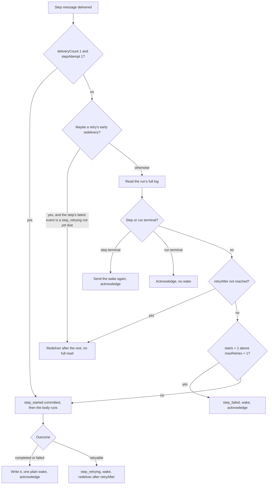

**Retry hops read one event.** A delivery that may be a retry's early redelivery (counted above 1, or the first delivery of an inline step's retry moved to the background) first reads only the step's latest event (`events.listByCorrelationId`, newest first, limit 1, no payloads). While that is a `step_retrying` whose `retryAfter` is still ahead, it asks for a redelivery without reading the whole log; anything else, a failed read included, takes the full read. Deferring is the only decision the short read makes, so a stale read is safe: nothing newer can exist for the step, because only a delivery of this message writes its next start, after a full read past `retryAfter`, and a missed terminal state only delays the acknowledgement. A long `retryAfter` on world-vercel costs one small read per 900-second redelivery. The span records `step.delivery.log_read` (`none`, `step_tail` or `full_log`).

#### The re-send rule

A background step's message is sent once, right after its `step_created` commits. A delivery that dies or fails between the two leaves the step with no message. Any orchestrator delivery whose `deliveryCount` is above 1 (a redelivery, a handoff continuation, a coalesced re-run, or a World that reports no count) therefore re-sends every background step that has a `step_created` and no `step_started`, whichever message created it:

- once per invocation (coalesced re-runs share the invocation), in batches, on both engines;
- under the step's stable idempotency key, so a re-send whose first message lives is deduplicated;
- only while the `step_created` is younger than 23 hours, one hour inside the 24-hour window (`QUEUE_MIN_STEP_KEY_DEDUPE_WINDOW_MS`) in which every World that creates spec 9 runs must deduplicate a step key while its first message lives. No World has to refuse a second `step_started` of a running step, so this bound is what keeps two live messages from both starting it;
- marked as a re-send (`stepResent`). It was decided from a log that may be older than the step's progress, so the step may have finished and its message been acknowledged (a World need not keep the key past that). A marked message reads the log even on its first delivery, so such a copy acknowledges without running the body.

The queue guarantees the pass happens: a delivery that dies is redelivered, or coalesced into a running delivery whose re-run reports the next count. Letting only the creating message's redelivery re-send would strand a step when that redelivery is coalesced away, or when a fence-refused second delivery of the message acknowledges.

An inline step whose last event is the `step_retrying` that moved it to the background (stamped with the orchestrator delivery's `creatorMessageId`) is re-sent the same way, within the same bound counted from the `step_retrying`: it is the step's only way back to an owner if the delivery that moved it died before the send. A `step_retrying` the step's own message wrote carries no creator and is never re-sent, because that message lives until the step ends. A recovery delivery (world-local after a restart, `recovery: true`) also re-sends started steps with no outcome, with their next attempt so the handler reads the log first, and applies no age bound: the queue and its dedupe state died with the process.

A plain first delivery re-sends nothing. The span records `workflow.reenqueue.count`, `workflow.reenqueue.skipped_too_old` and `workflow.reenqueue.recovery`.

#### `maxRetries: 0`

- **No early start.** A step declared with `maxRetries: 0` never starts its body before its `step_started` commits: not under turbo, run-ahead or `WORKFLOW_OPTIMISTIC_BACKGROUND_START=1`. A boundary that creates one commits its creations first.
- **Redelivery.** A redelivered background message finds one start with no outcome, computes attempt 2, and writes `step_failed` without running the body. A redelivered orchestrator re-runs an open inline step with attempt `starts + 1`, and an attempt past `maxRetries + 1` fails without running the body, so an inline `maxRetries: 0` step whose start committed is failed rather than run again. Both engines.
- **Message retention.** A step that never retries keeps its message for one day, one that may retry for seven.

#### Steps on world-vercel

On spec 9 runs world-vercel derives step state from the event log by the same terminal-inert rules replay applies, and checks no step state on write. `steps.list` and `steps.get` can lag the log (a step written moments ago can be missing or behind), and with payloads requested a step it cannot settle from the log is left out of a list, or a 404 for a get.

#### Step edge cases

- **Terminal-inert rule.** Once a step's outcome is consumed, every later event with its id is inert, so a stalled invocation's late `step_started` or `step_retrying` cannot change what the workflow observed.
- **Owed retry message.** An inline step's committed `step_retrying` is tracked as an owed message, so a refused or restarted delivery sends it.
- **Retries and retention.** A retry that would land after the step's message expires fails the step instead. A `retryAfter` beyond the queue's redelivery cap is waited out across several redeliveries of the same message.
- **Outcome already in the log.** A redelivered step message whose step is terminal sends the plain wake again, then acknowledges without a body: the wake is the only thing that moves the run on, and the delivery that wrote the outcome may have failed to send it. A duplicate costs a tail read.
- **Refused start.** By default a start that is throttled, refused as too early, or refused because the run ended runs no body. Under `WORKFLOW_OPTIMISTIC_BACKGROUND_START=1` the body may already have run, and its outcome is discarded. `WORKFLOW_OPTIMISTIC_INLINE_START=0` wins over the opt-in.
- **Large inputs.** An input over 128 KiB is not carried on the message; the step's invocation reads it from the step's creation event.
- **world-postgres restarts `attempt` on a step's retry in place**, so a step retried many times on one message is not failed by the delivery cap. A handoff keeps it, and so does a spec 9 orchestrator message's delayed reschedule (a fence refusal's redelivery); the re-send rule reads `deliveryCount`, so nothing strands.

### Hooks

A hook has two writers. The orchestrator writes `hook_created` and `hook_disposed` in-band, from the suspension. `resumeHook()` writes `hook_received` out-of-band (`inBand: false`), then wakes the orchestrator.

#### `resumeHook()`

The dispatch is strictly serial: the `hook_received` write is acknowledged first, then the wake is published. The wake carries no payload, so a lost or coalesced wake loses nothing the log does not hold.

- The wake stamps the run's spec version explicitly and carries the producer's timing (`hookResumeTiming`), from which the runtime measures hook-resume latency.
- On a spec 9 run it has no idempotency key: a key could be absorbed by a delivery that is already exiting and lose the wakeup, while a duplicate wake costs one cheap delivery that exits when nothing is new. Spec 8 runs keep `hook-<resumeId>`.
- Transport-shaped failures are retried after 25 and 100 ms. A wake that still fails throws `WorkflowRuntimeError` (never `HookNotFoundError`, since the payload is durable), and the `hook_received` waits for the next wake of the run.

When no delivery holds the run, the wake is delivered, the orchestrator loads the log, and the hook's `await` resolves on replay.

#### Resume while the orchestrator is running

A delivery with nothing left to run lingers while the run waits on a background step, or on open hooks alone, but only while the World's `events.subscribe` feed is live ([Linger interaction](#linger-interaction)). While it lingers, or while it waits on inline bodies, the feed pushes other writers' events and starts a new pass in the same delivery.

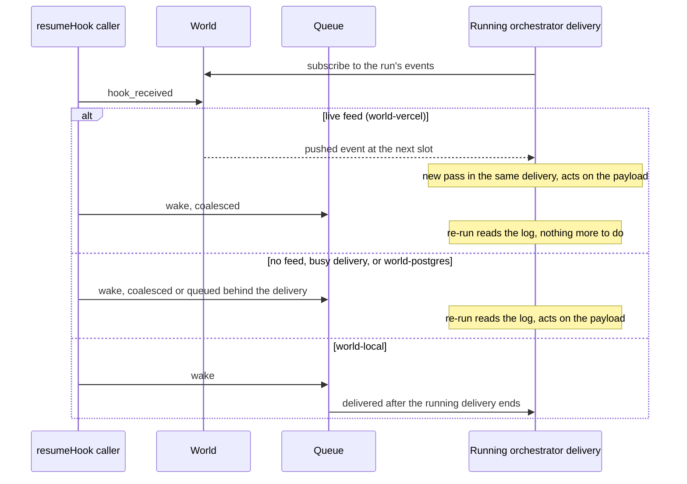

On world-postgres the feed ends at a resume instead of delivering it, so the resume reaches the delivery through its wake with its timing ([world-postgres over LISTEN/NOTIFY](#world-postgres-over-listennotify)).

#### Run-ahead and awaited hooks

The orchestrator runs ahead only at an inert boundary. A boundary is not inert while any open hook is awaited by workflow code, has unknown observation, or is a system (abort) hook. An unawaited hook is inert: on the node engine its payload is buffered and moves neither step results nor `Date.now()`, so its `hook_received` may land anywhere below speculative writes. The first `then()` on the hook marks it observed, and from that boundary on, the delivery drains its speculative writes before writing more. See [Run-ahead](#run-ahead).

#### Hook conflicts

A `hook_created` for a token another run holds is answered with a `hook_conflict` event in the creator's log. The workflow observes it on its next pass: an awaited payload rejects, and `hook.getConflict()` resolves with the conflicting run. While a suspension has a hook creation with a conflict awaiter, no inline step starts. Each conflicting hook id gets one in-place continuation per delivery; after that the delivery hands off, and a fresh delivery of the same message consumes it.

#### Force-claim

`createHook({ token, experimental_force: true })` takes a token from another run. The World writes `hook_disposed{forceClaimedBy}` into the victim's log and records the victim on the new hook (`claimedFrom`). The World has no queue, so the claimer's runtime wakes the victim, whose `await hook` throws `HookForceClaimedError`. A claimer that dies before that wake repays it on every replay within 24 hours of the creation. A `resumeHook()` aimed at the old hook gets `HookForceClaimedError`, looks the token up again and follows it to the new owner, up to 3 times. A legacy victim with no recorded `workflowName` gets no wake and reads the disposal on its next invocation.

#### Terminal hook disposal

The end-of-run drain skips `hook_disposed` for non-retained hooks, since the terminal event releases them. It still writes one for a disposed hook with `tokenRetentionUntil` (releasing the retained token early) and for a disposed hook created before a later creation in the same drain (so that same-token registration does not conflict with this run's own hook). A system hook never created and with no abort request is not created at all.

#### Hook edge cases

- A 409 on the `hook_received` write is passed through as retryable rather than mapped to `HookNotFoundError`, since it committed nothing. A resume to an ended run is refused and surfaces as `HookNotFoundError`.
- Linger is skipped when no time is left before the inline deadline minus the margin, so a late delivery does not hold the invocation.
- An older SDK's `resumeHook()` on a spec 9 run is accepted out-of-band by world-vercel and sends an unstamped wake; on the Local and Postgres Worlds it fails with `RunNotSupportedError` ([Older SDK after a rollback](#older-sdk-after-a-rollback)).

### Timers and waits

On spec 9 the orchestrator writes both events of a sleep in-band: `wait_created` when the workflow reaches `sleep()`, and `wait_completed` at the top of a pass once the wait is due. Between the two, a timer message wakes the run. A timer is a delayed orchestrator message carrying `waitContinuation`, the wait it is for, and every timer carries an idempotency key ([Timer keys](#timer-keys)).

#### Who arms a timer

Each `wait_created` records `creatorMessageId`, the queue message of the delivery that wrote it. All waits written by one message form a chain. A delivery owns, and arms the earliest open wait of: its own message's chain, including waits it is about to write; the chain of every wait whose `wait_completed` it commits; on a redelivery of a timer message, that timer's chain; and the wait of a timer delivered before its wait is due, which re-arms what is left.

**Why chain ownership, when every hop is keyed.** "Every delivery arms every open wait" would be correct, but every wake of a run would then send one timer per open wait, each a queue operation even when the key drops it. Ownership keeps the sends per wait close to one; the keys cover the cases where it hands a timer to more than one sender.

Ownership lives in a delivery's memory, so a delivery that commits a write and then fails leaves the timer owed only to its message's redelivery, which the queue may coalesce into a delivery of another message that owns no chain. Three rules close those gaps:

- **At creation.** A delivery about to commit a pass's `wait_created` events first sends the timer of its chain's earliest open wait, when that is a new wait (`resumeAt` is known before the write). If the commit fails, the stray timer finds no wait, or the wait the redelivery created, and re-arms it under that wait's key. A wait already due gets no timer: the next delivery completes it.
- **At completion (C1).** A delivery about to commit a wait's `wait_completed` first sends the timer of the chain's next open wait, including a timer delivery completing its own wait, since its redelivery might be coalesced away. A failure after the commit leaves the chain armed; duplicates are deduplicated by the key or find their wait completed.
- **Near due (C2).** A suspending delivery that may hold a coalesced timer (any delivery but its message's first) arms every open wait due within `max(5 s, WORKFLOW_NEAR_ELAPSED_WAIT_THRESHOLD_SECONDS)` (2 s by default, so 5 s), whatever its chain ([Near-due re-arms](#near-due-re-arms)).

A recovery delivery (world-local after a restart) owns every chain: the timers died with the queue. Every other delivery leaves a chain alone, so timers do not pile up across suspensions, and a late or duplicate timer finds its wait completed and arms nothing.

#### Two sleeps in one `Promise.all`

```typescript
export async function reminders() {
  "use workflow";
  await Promise.all([sleep("1h"), sleep("2h")]);
}
```

Both waits are created by message `m1`, so they form one chain, and only the earliest gets a timer.

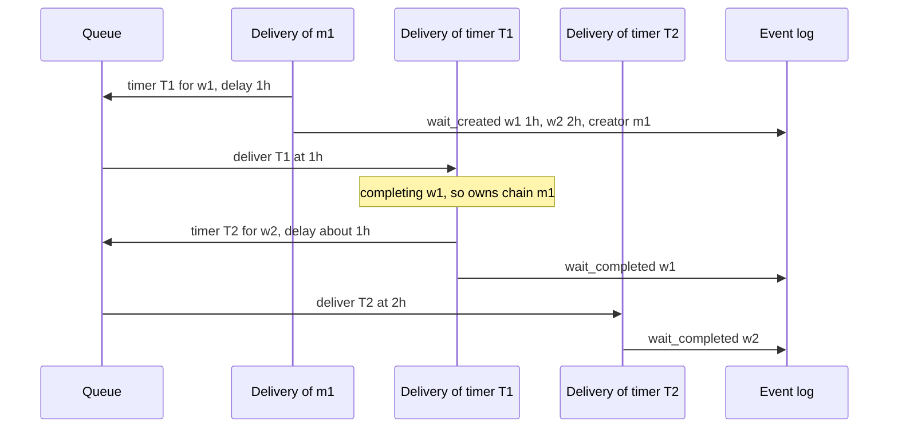

If only the wait's own timer delivery could arm the next one, a first timer coalesced into another delivery would lose the second sleep's timer ([Two concurrent sleeps](#two-concurrent-sleeps)).

#### Races and sleeps

- A `Promise.race` between a hook and a `sleep()` does not cancel the sleep's timer. If the hook wins, the timer, when it comes, completes the wait in a delivery that replays the finished race and changes nothing, or finds a terminal run and acknowledges.
- If a hook payload and a timer arrive close together on world-vercel, the second wake is coalesced into the first's delivery. The re-run reads the log, sees both, and the replay picks the winner by log order, the same on every later replay.
- A wait due within the invocation's inline window plus `WORKFLOW_OPEN_WAIT_CLOCK_SKEW_MS` (30 s) makes the next boundary path-changing, so the orchestrator does not run ahead past it.

#### Long sleeps are reached in hops

A wait more than 82800 seconds (23 hours; `WORKFLOW_WAIT_CONTINUATION_MAX_DELAY_SECONDS` overrides it) away is reached in hops anchored on the wait's deadline: the last is due at `resumeAt`, each one before it 82800 seconds earlier, so a sender sends the earliest hop still ahead of it. Every hop but the last carries the wait's deadline (`waitContinuation.resumeAtMs`) and its own (`hopAtMs`).

An intermediate hop has no concurrency key on world-vercel and no per-run gate on world-local and world-postgres, and is never coalesced: a coalesced hop is never delivered, and the holder's re-run would find the wait not yet due and send no next hop. Its delivery reads only the run's status, writes nothing, sends the next hop (computed from its own `hopAtMs`, so a hop delivered early does not send itself again), and acknowledges; for a run that ended it stops the chain. The last hop is an ordinary timer with the run's concurrency key. A 3-day sleep, with `R` its deadline:

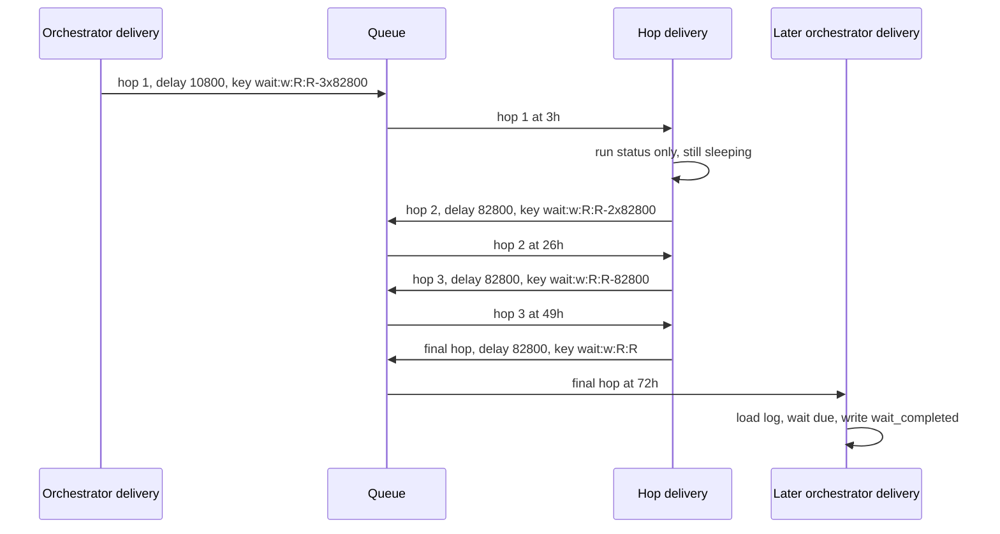

Any other sender of the same hop (the creating delivery's redelivery, a hop's redelivery after it sent the next one) computes the same deadline and key, so the queue keeps one message per hop instead of starting a second chain. That is what anchoring on the deadline buys over spec 8's scheme, where the hop index depended on the sender's clock and every hop delivery was a full replay.

A final timer that comes due while another delivery holds the run's concurrency key is coalesced and its payload lost, harmlessly: the holder's re-run reads the log, finds the wait due, sends the chain's next timer, completes it, and so owns the chain. (A keyed timer that comes due after the key was released is delivered normally: Vercel Queues compares its due time, not its send time, with the release.)

#### Timer keys

Every spec 9 timer carries an idempotency key of the form `wait:<correlationId>:<resumeAtMs>:<slot>`:

| Timer | Slot |
|---|---|
| A hop, intermediate or last | the hop's deadline, epoch ms (`<hopAtMs>`) |
| A timer delivery's re-arm of its own wait, which came before the wait was due | `<hopAtMs>:a<attempt>`, the next attempt |
| A near-due re-arm (C2), and a last hop sent by a delivery that may hold a coalesced timer | the sender's second (`s<second>`) |

- **The hop's deadline.** Without a key, every sender that owes a timer sends one, and a duplicate intermediate hop starts a second chain of hops. A deadline anchored on the wait's depends only on that deadline and the sender's hop window, so every sender computes the same key for the same timer and a different one for each timer the wait still needs.
- **`resumeAt`.** Two deadlines must never share a key: a stray timer from a creation that did not commit, whose wait a replay then creates with another deadline, is a different message, and its delivery re-arms the wait under a fresh attempt. (`run.wakeUp()` completes a wait instead of moving it, and every `sleep()` mints a fresh correlation id.)
- **The attempt.** A last hop that arrives before its wait is due (clock skew, or a World that clamps the delay) has spent the key of the hop due at `resumeAt`, so its delivery re-arms with `attempt + 1`; a redelivery of that early timer computes the same key.
- **The sender's second.** A near-due re-arm stands in for a last hop that the queue coalesced and whose key it still holds, so it cannot reuse the hop's key; a last hop sent by a delivery that may hold a coalesced timer takes the same kind of key for the same reason. Intermediate hops are never coalesced and keep the hop's key from every sender. The one duplicate left, on a failure path, is a last hop sent under the hop's key and again under a second; it costs one delivery.

##### Near-due re-arms

A wait's last timer is due with the wait on the sender's clock, rounded up to a whole second, so a host whose clock runs behind the queue's can receive it early. Delivered on its own, it re-arms under the next attempt. Coalesced into a delivery that does not own the wait's chain, it is never delivered on its own, and that delivery finds nothing due: without C2 the wait would never complete.

- **Who re-arms.** Only a delivery that may hold a coalesced timer: any but its message's first, since a coalesced message never reaches the first run of the delivery that absorbs it (the re-run reports the next `deliveryCount`). A process also sends each key once (remembering the 10,000 newest), so a busy run's re-runs do not each pay a queue round trip per near-due wait.
- **Why a key.** Without one, a fan-out of `step(i); sleep('3s')` whose outcomes each wake the run in their own delivery (no coalescing, no live feed) sends `n(n + 1) / 2` timers instead of `n`. With the gate and the key, a 40-wide fan-out of that shape sends 40 on either engine.
- **Why the second.** A re-arm that is itself delivered early and coalesced into another non-owner is re-armed in a later second under a fresh key; a key of the wait alone would be spent by the first re-arm. Clocks that differ by more than the re-arm's delay can still share a second, the same limit spec 8's near-elapsed keys have. The gate alone, the key alone, or deduplication within one delivery would each leave redundant or quadratic sends.

#### Timers inside a live delivery, and linger

A delivery still running inline steps completes a due wait itself: it waits at most until the earliest open wait's deadline, and the next pass writes `wait_completed`. The timer also goes out before the delivery waits, in case the delivery ends first.

A sleep alone never makes a delivery linger. While one lingers on a background step or a hook, a wait that falls due ends the linger and is completed in process, a timer or `run.wakeUp()` message is coalesced into it (on world-postgres, removed from behind it and covered by a re-run), and the chains it owns are armed when the linger ends without new work.

**Long-lived hooks.** A run with a long-lived approval or cancel hook beside a polling `sleep()` lingers on every wake for up to `WORKFLOW_ORCHESTRATOR_HOOK_LINGER_MS` (5 s) of function time. That is why hooks alone get the shorter window, while a burst of resumes still stays on one warm invocation, since each payload starts the window again. For such a deployment, dispose the hook once it is no longer needed, or set the hook linger to `0`.

#### `run.wakeUp()`

On a spec 9 run, `wakeUpRun` does not write `wait_completed`. It sends one orchestrator message with `completeWaits`, the waits to complete now, and returns `stoppedCount` as the number of waits it asked to complete, not the number completed. The orchestrator completes the named waits on its first pass, whatever their `resumeAt`. On a spec 8 run, `wakeUpRun` writes each `wait_completed` out-of-band and then sends a wake, and `stoppedCount` counts those writes.

The message is an ordinary keyed orchestrator message, so on spec 9 it is best-effort ([`run.wakeUp()` stays best-effort](#runwakeup-stays-best-effort)):

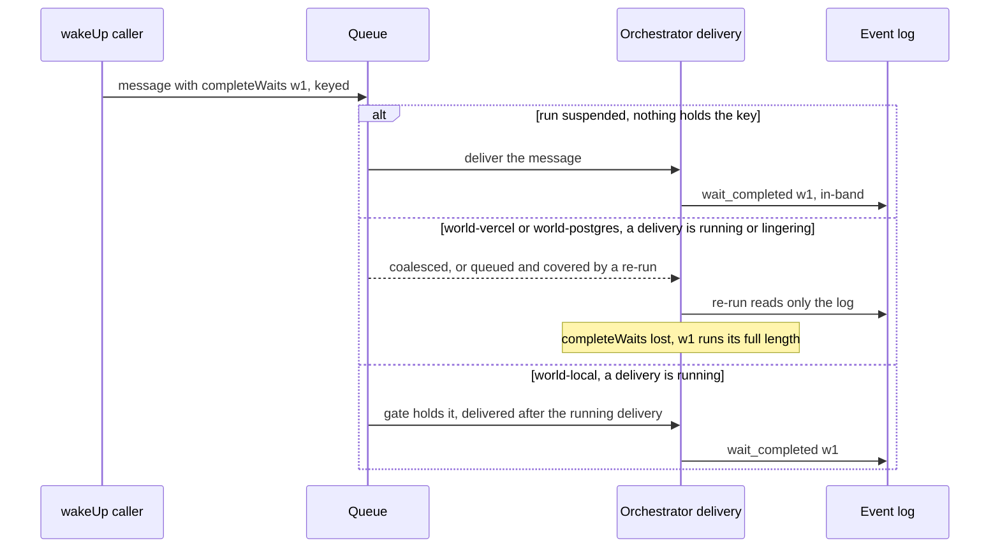

The 5 s hook-only linger bounds how long a run that waits only on hooks drops `wakeUp()` after each wake. world-local never coalesces a wake-up: one that queues behind a delivery ends that delivery's live feed, so a lingering delivery acknowledges and the wake-up is delivered at once, and `@workflow/vitest`'s `waitForSleep()` and `wakeUp()` keep working ([`run.wakeUp()` and `waitForSleep()`](#runwakeup-and-waitforsleep)).

#### Why `wait_completed` is in-band only

An out-of-band `wait_completed` could commit below events the orchestrator already acted on while running ahead, and a later replay would see them in a different order. world-vercel refuses an out-of-band `wait_completed` on a spec 9 run with 409 `wait-completion-in-band-only`, and the run-ahead hazard check treats any `wait_completed` from another writer as a hazard.

```typescript
export async function digest(userId: string) {
  "use workflow";
  const first = await fetchUpdates(userId); // run-ahead: outcome reaches the workflow before it commits
  const timeout = sleep("1h");
  return await Promise.race([timeout, nextUpdate(userId, first)]);
}
```

If a `wait_completed` committed below `fetchUpdates`'s outcome, the live run saw the step first and a replay would see the wait first.

#### Timer failure and recovery

- **A crash after `wait_created` or `wait_completed`.** The timer went out before the commit, so the wait is armed whichever delivery comes next ([A new wait's creator coalesced away](#a-new-waits-creator-coalesced-away), [A timer delivery's redelivery coalesced away](#a-timer-deliverys-redelivery-coalesced-away)). A coalesced redelivery's holder completes what is due, and C2 re-arms what is near due.
- **world-local restart.** The in-memory queue and every queued timer die with the process; the recovery delivery arms the earliest open wait of every chain ([world-local restart](#world-local-restart)).
- **Message rotation near expiry.** A world-vercel orchestrator message close to its retention is continued on a new message carrying `waitContinuation` and `completeWaits`. Before that handoff the delivery arms the timers of waits it created and sent none for, since the new message's deliveries do not own the old chain.
- **The delivery cap.** Timer deliveries count toward `WORKFLOW_MAX_QUEUE_DELIVERIES`, but each hop is a new message, so a long sleep does not accumulate deliveries on one.
- **Cancel.** No timer is withdrawn from the queue: a hop finds the run terminal and stops the chain, a final timer's delivery acknowledges without writing.
- **A clamped final hop.** `VERCEL_QUEUE_MAX_DELAY_SECONDS` below 82800 makes a final hop arrive early. Delivered on its own or coalesced into a delivery that owns its chain, it is re-armed; coalesced into one that does not, only C2 re-arms it, and only within its window, so a clamp far below the hop length can still lose it.

#### Timers on each World

| | world-vercel | world-local | world-postgres |
|---|---|---|---|
| Longest delay of one message | 23 hours by default (`VERCEL_QUEUE_MAX_DELAY_SECONDS`, an hour below the 24-hour message retention) | `setTimeout`, capped at about 24.8 days | A job's `run_at`, no cap |
| Hop length | 82800 s on every World, so a hop never exceeds world-vercel's limit | the same | the same |
| Timer key dedupe | `min(retention, 24h)` after the first send | while the first message lives | while a job holds the key |
| A final timer while a delivery runs | Coalesced into it | Held behind the run's gate, then delivered | Held behind the run's named queue; covered by the re-run if due when the delivery acknowledges, else delivered |
| A due wait during linger | Completed in process | No linger | Completed in process |
| Timers after a restart | Survive | Lost; re-armed by the recovery delivery | Survive; a hard-killed worker's job waits for its lock to clear |

On world-vercel a fractional `delaySeconds` is rounded up, so a timer can land up to a second after its deadline.

#### What changes for sleeps on spec 9

- **Precision.** A sleep completes when its final timer is delivered, or earlier when a live delivery reaches its deadline in process; expect up to a second of rounding on world-vercel plus queue latency, as on spec 8. Concurrent sleeps cost one timer per chain rather than one per suspension.
- **The Vercel dashboard's wake-up action** writes `wait_completed` out-of-band, which world-vercel refuses on spec 9 runs, so it does not work on them until it moves to a release with spec 9.
- **Unsetting `WORKFLOW_SPEC_VERSION`** (or setting `8`) does not change runs already created as spec 9: their timers keep spec 9's rules, because routing follows the run's stamped version.

The two engines implement these timer rules separately, on top of shared creator rules and key builders; sharing the timer sender itself is still open.

### The live event feed and polling

A spec 9 run has one orchestrator delivery at a time, but more than one writer: background steps, `resumeHook()` and `run.cancel()` all write out-of-band ([Out-of-band writers](#out-of-band-writers)). Each also sends a wake, but a wake for a run whose delivery is still running is folded into that delivery or queued behind it ([Queue topology](#queue-topology-handoffs-and-rotation)).

The live feed lets a running delivery react to those events at once, without waiting for its own exit and the next queue hop. It runs while inline bodies run and while the delivery lingers, and every event it hands over joins the log between passes, never under a replay. It has two sources: the World's optional `events.subscribe` push (world-vercel, world-postgres and world-local), and a tail poll of `events.list` from the delivery's cursor, on every World. Both go through the same dedupe, so correctness never depends on the push: the push buys latency, the poll bounds how long a silent push failure can hide an event.

#### The `events.subscribe` contract

`events.subscribe` is optional; a World that omits it is fully supported and polled. One that offers it calls `onEvent` for each event above `afterSlot`, in slot order, each slot at most once, with no gaps while healthy, in the shape `events.list` returns with `resolveData: 'all'`. It is best-effort: it may stop at any time and need not replay what it missed, but it must report a stop, a closed or ended subscription, or a transport failure through `onError` rather than by throwing, because the runtime polls more slowly while a subscription is live. The unsubscribe function it returns is idempotent, and no `onEvent` follows it. A refused subscription (`onError` at once) makes the delivery poll only and not linger.

#### On world-vercel

The client sends `{ reqId, type: 'subscribe', afterSlot }` on the run's events WebSocket, which the run's event writes share, so invocations of one run in one process share it. A second `subscribe` on the socket replaces the first.

- **The reply.** `subscribe_ack` (200) once world-vercel has checked the run, or an error: 400 for a run that is not spec 9, 429 `run-feed-limit` when too many feeds are open. Any non-2xx reply fails the feed.
- **Pushes.** `{ reqId, type: 'run_event', slot }` frames, each one complete event as a list returns it, only the dense prefix (an event above an uncommitted slot waits until that slot commits or is sealed as a `noop`). Every push goes to every subscriber on the socket, and each drops slots it already passed on.
- **End.** The feed ends, and `onError` is called once, on an `end: true` notice (for example `run-feed-unavailable` when world-vercel cannot keep reading the log), a malformed push, or the socket closing. It is not re-subscribed for the rest of the delivery.

##### Heartbeats

The client lists `run-heartbeat` in its upgrade flags. A backend that sends heartbeats says so on the `subscribe_ack` (`heartbeatMs`, 10 s), and sends `{ reqId, type: 'run_heartbeat', slot }`, naming the highest slot it has pushed, whenever it has sent nothing for `heartbeatMs` and its last read of the log succeeded. A heartbeat is a new frame type because an older client fails its connection on an unknown frame, so a client without the flag gets none. On an ack with `heartbeatMs`, the client watches the feed, within the `subscribe` contract:

- **Silence.** No push and no heartbeat for 3 × `heartbeatMs` (30 s) ends the feed (`run-feed-silent`): a half-open socket, a feed that stopped without its `end` notice, or reads failing that long.
- **Gap.** A heartbeat slot above the last one delivered means pushes went missing (for example, a replacement subscription on the connection started above this subscriber). The client reads the log after its last delivered slot and delivers what continues the sequence; a failed read ends the feed (`run-feed-gap`). A push landing during that read can still leave a gap, which the runtime's poll fills.
- **Replaced.** A heartbeat under another `reqId` after the ack ends the feed (`run-feed-replaced`).

Against a backend that predates heartbeats the ack has no `heartbeatMs` and nothing is armed. The runtime's live poll stays at 10 to 20 s either way: the `subscribe` contract cannot say that a feed is watched.

#### world-postgres over LISTEN/NOTIFY

- After an event write whose `specVersion` is 9 or above commits, the writer sends `pg_notify('workflow_run_events', runId)`, outside the write's transaction (a `NOTIFY` inside it could fail the write) and without awaiting it.
- One `LISTEN` connection per process, opened on the first subscription, serves every subscription. A subscription reads once the connection listens, then on each announcement of its run: `events.list` after the last slot it delivered, in pages of 200. It delivers what continues the slot sequence, each slot once, and stops at a hole until a later announcement fills it. The notification is only a signal, so a duplicated or merged `NOTIFY` changes nothing, and a lost one is found by the run's next announcement or by the client poll.
- A dropped `LISTEN` connection ends every live subscription through `onError`, and a failed read ends its subscription. The connection reconnects for later subscriptions; a first `LISTEN` that fails refuses new subscriptions for 5 seconds.
- A subscription ends at a hook resume another writer made (a `hook_received` with a `resumeId`) instead of delivering it, because the resume's wake carries the producer's timing that `workflow.resume.total_ms` is measured from. With the feed ended, a waiting delivery stops lingering, and the wake (or the re-run covering it) consumes and measures the resume. The workflow's own `hook_received` (an `AbortController` abort) has no `resumeId` and is delivered.
- At most `floor(queueConcurrency / 2)` subscriptions are live per process, and none at `queueConcurrency: 1`; past that a subscription is refused, and its delivery polls instead of lingering. A lingering delivery holds a Graphile worker slot, and the cap keeps lingering deliveries from taking every slot while their own background steps wait for one.

#### The client poll

The runtime polls the log tail from its cursor, each page under the orchestrator's read deadline (`WORKFLOW_ORCHESTRATOR_READ_TIMEOUT_MS`, 5 s) with a single attempt, so one held read cannot stop later polls.

| Feed state | Interval |
|---|---|
| Push live, after clean polls | `WORKFLOW_ORCHESTRATOR_FEED_POLL_INTERVAL_MS` (10 s), doubling per clean poll up to 20 s |
| No push (no `events.subscribe`, or a refused, failed or ended subscription) | `WORKFLOW_ORCHESTRATOR_POLL_INTERVAL_MS` (2 s), doubling per empty poll up to 10 s |

`WORKFLOW_ORCHESTRATOR_POLL_INTERVAL_MS=0` turns the poll off. The live interval is never below the no-push one, nor the 10 s cap below the configured interval.

- **One dedupe.** A push and a poll page are offered the same way: events below the next expected slot are dropped, the rest held by slot, and the gap-free run from the next expected slot handed over. A push that leaves events held behind a missing slot is feed trouble; if the push never comes, the next poll hands the event over and counts as unclean.
- **With a push.** A poll is clean when the subscription was live throughout, the poll did not fail, it handed over nothing the push had not, and nothing is held afterwards. A clean poll doubles the interval; any other poll, and any feed trouble, sets it back to 2 s and moves a later poll up to 2 s from now.
- **Without a push** (a World without `events.subscribe`, or one whose feed is down or refused), an empty poll doubles the interval up to 10 s. A poll that delivers an event, a failed poll, or a write the delivery commits itself sets it back to 2 s: what the delivery just wrote is what makes another writer's event likely. A 10-minute inline body costs about 65 polls rather than 300, at the price of an outcome arriving up to 10 s after it committed during a quiet stretch; no event is lost.
- **Idle polls inside the replay.** The VM's own idle poll, which decides when a replay has suspended, runs at most once per suspension generation and ends when the generation moves on; one poll per signal would grow with generations times pending steps (about 10^8 timers for a 1024-branch join on a lingering orchestrator).

**Why the poll stays when the push is live.** Signalled failures (a refused `subscribe`, an `end` notice, a closed socket, a watchdog verdict) switch to the 2 s poll at once. The poll backs up the silent ones: a feed that stops on world-vercel's side without an `end` notice, a half-open socket during a linger (a lingering delivery makes no requests, so nothing times out), and a same-process replacement subscription that starts above the old subscriber with nothing pushed after it. The heartbeat watchdog ends the first two within 30 s and fills the third; until then, or without heartbeats, the poll delivers within 10 to 20 s instead of at the end of the delivery. How often a poll finds an event before its push (and drops to 2 s) is not yet measured.

#### Linger interaction

A delivery with nothing left to run lingers while the run waits on a background step (or an inline step's retry), for up to `WORKFLOW_ORCHESTRATOR_LINGER_MS` (30 s), or on open hooks alone, for up to `WORKFLOW_ORCHESTRATOR_HOOK_LINGER_MS` (5 s, never more than the linger), capped by the inline deadline minus the inline-start margin. Each foreign event runs a pass and starts the window again.

- **Only while the push is live.** The linger checks that the subscription is live after starting the feed (world-vercel defines `subscribe` even when its push transport is unavailable, and reports that through `onError`) and after every wake; `onError` wakes it so it ends at once. Lingering on the poll alone would hold a function open for a poll's latency, so a World without `events.subscribe` never lingers.
- **What liveness cannot see.** A subscription that never acknowledges and never errors still counts as live, as does every silent case above; the linger then runs to its end on the poll alone, and the 20 s cap bounds what it can miss.
- **Open hooks.** Any open hook is enough to linger ([Timers inside a live delivery, and linger](#timers-inside-a-live-delivery-and-linger)).

## Edge cases and failure handling

Each case gives the situation, what happens, and why the outcome is safe or what it costs. Anything not verified says so.

### Overlap and the fence

#### Lease stall overlap

An orchestrator's event loop blocks past its queue lease (a CPU-heavy inline step, say), the queue redelivers the message, and a second delivery starts and writes first. The stalled delivery's next in-band write is refused with 412 `InBandSupersededError`; it sends what its own writes owe and asks for a redelivery of its message in a second, which on Vercel the live delivery absorbs as a coalesced message. Nothing is written twice, and the stalled delivery never acknowledges, so what the queue does with an acknowledgment of a lapsed lease never matters. See [The in-band fence](#the-in-band-fence).

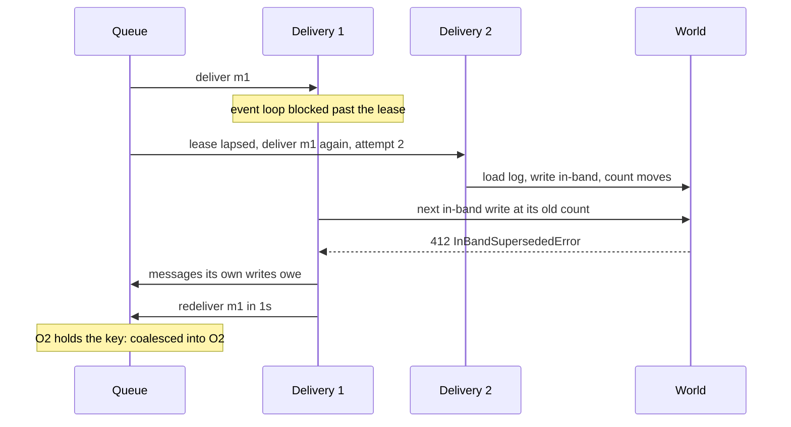

#### Self-superseded 412

world-vercel can refuse an in-band write with 412 when no other orchestrator exists, for example after one of the writer's own writes took too long, or on the write after a 409. Nothing else is queued for the run then. Acknowledging (on the premise that a refusal means a live winner) would leave the run stopped until an outside event woke it, so the refused delivery asks for a counted redelivery of its own message instead. The redelivery loads the log fresh, takes a fresh writer, runs the re-send pass, and completes the run. A delivery refused on every pass reaches the delivery cap and fails the run with `MAX_DELIVERIES_EXCEEDED`.

#### Two deliveries of one message, one dies owing a send

A delivery D1 of m1 outlives its lease and m1 is delivered again as D2. Both load the same log. D1 commits a background step's `step_created` and dies before the step's message goes out; D2's next write is refused. Had D2 acknowledged and sent a plain wake, that wake would be the first delivery of a different message and would re-send nothing, and the step would never run. Because D2 asks for a redelivery of m1 instead, the redelivery is counted above 1 and the re-send rule sends the step's message under its stable key. See [Step ownership and data](#step-ownership-and-data).

#### Background body before a refused start

By default a background step's body runs only once its `step_started` committed, so a start the World refuses (a cancelled run, throttling) never runs the body, as on spec 8. Under the opt-in `WORKFLOW_OPTIMISTIC_BACKGROUND_START=1`, a plain first delivery of a step that allows retries starts its body while the start is in flight: on a cancelled run or under throttling the body runs before the refusal arrives, and a throttled start runs the body again on the redelivery. A `maxRetries: 0` step and every delivery that reads the log keep the awaited start even with the opt-in, and `WORKFLOW_OPTIMISTIC_INLINE_START=0` wins over it.

#### `run.wakeUp()` lost under coalescing

`run.wakeUp()` sends a keyed message naming the waits to complete (`completeWaits`). While an orchestrator delivery holds the key on world-vercel, or runs on world-postgres, that message is coalesced and the holder's re-run reads only the log, so the wait runs its full length. `wakeUp()` still counts those waits in `stoppedCount`. It is reliable when the run is suspended, and on world-local, which never coalesces a wake-up. This is accepted; a sleep that has to end reliably while the run is active can race a hook instead (see [`run.wakeUp()` and `waitForSleep()`](#runwakeup-and-waitforsleep)). The unkeyed wake it would otherwise need had two worse failures while an orchestrator was running: a fence-losing wake dropped `completeWaits`, and a fence-winning one refused the running orchestrator's `step_completed`, so an open inline step's body ran twice.

#### Older SDK after a rollback

A deployment on an SDK without spec 9 writes to a spec 9 run, for example a rolled-back production deployment whose API route calls `cancel()`. world-vercel refuses the write with 400 `spec-version-requires-api-v5` and the older SDK sends no wake, so the run is unchanged; reads still work. On Vercel its hook resumes still reach the run and the run's deliveries stay on the deployment that created it, so the run keeps going; on a shared Local or Postgres queue the older process can take the run's messages, and the run stalls until it is upgraded again (see [The rollback floor](#the-rollback-floor) and [An older SDK and a spec 9 run](#an-older-sdk-and-a-spec-9-run)).

### Crashes before an owed send

These cases share one shape: a delivery commits a write and fails before it sends what the write owes. Unhandled, each leaves the run stuck in `running` with no error.

#### Crash between commit and dispatch

A delivery commits a background step's `step_created` and dies before it sends the step's message. The redelivery finds the step with no `step_started`, created less than 23 hours ago, and re-sends its message under the same stable idempotency key. So does any orchestrator delivery counted above 1, once per invocation: a handoff continuation, a coalesced re-run, a fence refusal's redelivery. A step whose first message still lives dedupes the re-send. See [Step ownership and data](#step-ownership-and-data).

#### Creator's redelivery coalesced away

The delivery that created a step fails before the step's message goes out, a hook wake takes the run's key first, and the creator's redelivery is coalesced into the hook wake's delivery, so it is never delivered. The re-send rule does not ask which message created the step: the hook wake's re-run is counted above 1 and re-sends the step's message. The same applies to an inline step whose first attempt failed: the delivery committed its `step_retrying`, failed before the retry message went out, and the orchestrator never runs a retried inline step inline again, so any delivery counted above 1 re-sends a creator-stamped `step_retrying` that is the step's last event, within 23 hours of that write. A holder in retry backoff was never exposed: the queue keeps its key, so a wake folds into it.

```mermaid
sequenceDiagram
    participant Q as Vercel Queues
    participant M as Delivery of m1
    participant H as Delivery of hook wake h
    participant W as World
    M->>W: step_created s1
    Note over M: dies before sending s1's message
    Q->>H: deliver h, deliveryCount 1
    Note over Q: m1's redelivery comes due, coalesced into H
    H->>Q: acknowledge, refused, 1 coalesced
    Q->>H: re-run, deliveryCount 2
    H->>Q: s1's message, stable key
```

#### A new wait's creator coalesced away

A delivery creates a sleep, commits `wait_created`, and fails before the timer goes out; its redelivery is coalesced into a hook wake that owns no chain and finds the wait an hour away. To close this, a pass sends the timer of its chain's earliest new wait before the `wait_created` commits, on both engines (`resumeAt` is known before the write). If the commit then fails, the stray timer finds no wait, or finds the wait the redelivery created and re-arms it. A wait that is already due gets no timer: the next delivery completes it and sends the chain's next timer first. Steady-state cost is unchanged: one timer per created chain, sent earlier. See [Who arms a timer](#who-arms-a-timer).

#### A timer delivery's redelivery coalesced away

Three sleeps of one chain. The first one's timer delivery completes its sleep and fails right after the commit; its redelivery is coalesced into a wake that owns no chain, and the second and third sleeps have no timer. So a timer delivery completing its own wait sends the chain's next timer before the completion commits, like any other completing delivery. Its redelivery still owns the chain, and the second send it may make is deduplicated by the hop's key.

#### Lost completion wake

A background step commits its outcome and sending the orchestrator wake fails. That wake is the only thing that moves the run on, since the node orchestrator arms no backstop for background steps. The step message is redelivered, finds the step terminal, and sends the plain wake again before acknowledging. A live orchestrator absorbs it, and one with nothing new acknowledges after a tail read. A redelivery that finds the run terminal sends nothing.

#### Inline `maxRetries: 0` step after an orchestrator crash

An orchestrator commits an inline `maxRetries: 0` step's `step_started` and dies inside the body. The redelivery re-runs open inline steps with the next attempt, but the step executor fails any attempt past `maxRetries + 1` without running the body, for inline and background steps alike, so the redelivery writes `step_failed`. The same check covers a winner re-running a refused overlap's open inline step. See [`maxRetries: 0` is at most once per live owner](#maxretries-0-is-at-most-once-per-live-owner).

#### Inline retry re-sent past the 24-hour dedupe

An inline step's retry moves to the background with a `retryAfter` beyond 24 hours. A re-send after the queue's 24-hour idempotency window had passed would give one step two messages, and both would own its body. So a `step_retrying` is re-sent only while it is younger than 23 hours, inside the minimum key dedupe window of every World that creates spec 9 runs. A re-sent message is also marked (`stepResent`), so a copy the queue takes after the step's outcome reads the log first and does not run the body.

#### world-local restart

world-local's queue is in memory, so a restart loses every step message and timer a run had queued, and its recovery wake is a new message on its first delivery, which owns nothing. world-local therefore marks the restart (`queueLost`), and the recovery message (`recovery: true`) arms the earliest timer of every open chain and re-sends every open step message, a started one with its next attempt. Without it, a spec 9 run that was sleeping, or waiting on a background step mid-body, stayed `running`. world-postgres's queue persists, so it sets no marker.

#### world-postgres worker killed mid-delivery

A worker killed hard mid-job leaves its job locked. On the default policy (`jobLockStaleSeconds` unset) every delivery renews its job lock and its named queue's, and its worker registers as a renewing holder before the delivery runs; any process releases the jobs of this World's per-run named queues whose registered holder stopped renewing for 300 seconds, so a spec 9 run is redelivered within that window. The sweep covers only the per-run named queues, not the task spec 8 shares. A process on an earlier version never registers and keeps Graphile Worker's 4-hour reset, so its deliveries are never released under it. 300 seconds is well above an inline step's longest synchronous stretch, so a stalled event loop does not become a second owner of a running inline step. An explicit `jobLockStaleSeconds` (or `WORKFLOW_POSTGRES_JOB_LOCK_STALE_SECONDS`) above `0` releases every job of the World after that window, and `0` turns renewal off. Without migration 0030 deliveries still run and renew, nothing is released, and a warning names the migration.

### Timers

#### Coalesced timer losing its re-arm

A keyed timer comes due while a hook or step wake holds the run, and is coalesced. The holder's re-run completes the wait, and because the delivery that completes a wait owns its chain, whatever message it is, it arms the chain's next timer. A final timer coalesced a little before its wait is due, into a delivery that does not own it, is covered by the near-due rule: the holder's re-run re-arms every wait due within a few seconds, under a key. An intermediate hop has no such cover, which is why intermediate hops carry no concurrency key.

#### Two concurrent sleeps

`await Promise.all([sleep("1h"), sleep("2h")])`: one timer covers the chain's earliest wait. The delivery that completes the first sleep owns the chain and arms the second. A delivery that owns waits of two chains arms the earliest of each chain, not the earliest of all. A delivery that commits `wait_completed` and dies before its next send leaves no gap, because the next timer goes out before the commit. e2e alone would not catch a regression here: its parallel sleeps have equal durations, which one timer covers.

#### Near-due re-arms on every delivery

A fan-out of `step(i); sleep('3s')` whose outcomes each wake the run in their own delivery: every sleep is near-due as soon as it is created. If every delivery re-armed every near-due wait, delivery `k` would send `k` timers, `n(n+1)/2` in all. So a message's first delivery re-arms nothing it does not own, and a re-run re-arms under a key of the wait id, its `resumeAt` and the second, which the queue deduplicates: 20 timers instead of 210 at width 20. See [Near-due re-arms](#near-due-re-arms).

### Deadlines, handoffs and busy runs

#### Deadline handoff and the inline-start margin

The inline deadline is 2, 5 or 10 minutes from the invocation's start, by the function's maximum duration, and no inline step starts within `WORKFLOW_INLINE_STEP_DEADLINE_MARGIN_MS` (60 seconds) of it. When a long inline step runs into the deadline, the next pass starts past it and hands off on the same message, not an attempt. When short inline steps reach the margin first, the next step is created as a background step and the run continues from its completion wake; that costs a step invocation and a queue hop where a handoff would cost a redelivery (see [Known limitations](#known-limitations)).

#### Stream-flush handoff

An inline step returns while its stream writes are still flushing in `waitUntil`, for example `request.respondWith()` in a webhook step. The delivery hands off so the flush can finish, and the next delivery loads the log and continues the run.

#### Coalesced re-runs exhausted

A busy run, such as a fan-out of hundreds of steps whose completions keep arriving, finds more coalesced messages on every acknowledgment, and its 32 re-runs run out. world-vercel's retry hook answers the refusal with a handoff, so the next delivery continues at once and nothing counts toward the delivery cap; backing off and counting an attempt instead would let a long busy fan-out reach the cap. Each re-run measures the inline deadline from `invocationStartedAt`, so re-runs never extend the invocation past its deadline. A message due for rotation is continued on a new message by the last re-run (see [Rotation near expiry](#rotation-near-expiry)). On world-postgres, past its 32 re-runs the remaining jobs are simply delivered as usual.

#### Rotated start message re-entering turbo

A run's start message hands off for hours and world-vercel continues it on a new message near its expiry. A copy of the start message would carry `runInput` on a first delivery and take turbo's fresh-start path over a progressed log, running a completed step's body again. The continuation drops `runInput` and the other first-delivery and per-request fields and stamps the spec version, and a step message is never rotated (see [The continuation payload](#the-continuation-payload)).

#### Run-ahead stop re-runs step bodies

A run-ahead stop (a refused speculative batch entry, a World that does not store `occurredAt` as `createdAt`, which also turns run-ahead off for that World, or the hazard check) lets the outcomes still allowed commit, reloads, and replays from cold in the same delivery with run-ahead off. A step whose body started ahead of its creation, and whose creation the stop refused, has no committed start, so the restarted pass runs its body again: up to `WORKFLOW_RUN_AHEAD_DEPTH` (10 by default) bodies per stop. A `maxRetries: 0` step never starts before its start commits, and a second stop after the one restart hands off. Which events trigger a stop in practice is not verified (see [Known limitations](#known-limitations) and [Run-ahead](#run-ahead)).

#### Replay divergence recovered in place

A replay diverges from the log. The delivery records the divergence, discards the VM, reloads the log and replays from cold in a fresh VM, up to `WORKFLOW_REPLAY_DIVERGENCE_MAX_RETRIES` (3) times in the same delivery, then writes `run_failed` with `CORRUPTED_EVENT_LOG`. The count is in memory, so it starts again across crashes and redeliveries, where the delivery cap bounds it. Nothing is sent on the queue for it on spec 9.

### World-specific cases

#### Wakes from another process on world-local

world-local coalesces the orchestrator messages its own queue holds behind a running delivery (see [world-local and world-postgres](#world-local-and-world-postgres)). A message another process's queue sends (a script calling `resumeHook()`, the CLI) reaches only the handler's gate in the process serving the routes, where it waits for the running delivery and is then delivered on its own, not coalesced.

#### world-postgres re-send next to a locked job

A re-send of a step message (or a spec 9 timer hop) arrives while the step's job is locked and its body running. world-postgres publishes these with Graphile's `unsafe_dedupe`, a no-op while any job holds the key, so no second job is inserted and a job in retry backoff keeps its attempts and `run_at`. With `preserve_run_at` the re-send next to a locked job inserted a second job, which another worker ran as a first delivery without reading the log, running the body twice; spec 8 step messages had the same exposure and use `unsafe_dedupe` too. A reschedule keeps `preserve_run_at`, because it is sent while the job it continues is locked and must insert one.

#### `attempt` across world-postgres reschedules

Every `{ timeoutSeconds }` result on world-postgres reschedules on a new Graphile job, whose own counter starts at 1. A spec 9 handoff carries the attempts so far, and so does a spec 9 orchestrator message's delayed reschedule, so a run refused by the fence on every pass reaches `MAX_DELIVERIES_EXCEEDED` as on the other Worlds. `deliveryCount` always carries over, so the re-send rule, which reads it, still runs after a crash and a handoff. A step message's retry in place starts `attempt` over (see [Known limitations](#known-limitations)).

#### Long step retries on Vercel

A spec 9 step retries in place, and Vercel Queues caps a redelivery at 900 seconds, so a day-long backoff costs about 96 invocations, where spec 8 sends a new message of up to 23 hours. See [Known limitations](#known-limitations).

#### Spec 8 retry chains over 12 hours

A spec 8 run's `{ timeoutSeconds }` always sends a new message before acknowledging. Redelivering the same message would cap each hop at 900 seconds and count each toward the 48-delivery cap, so a spec 8 sleep or step retry chain longer than about 12 hours would fail with `MAX_DELIVERIES_EXCEEDED`. Unit-tested; not run against Vercel.

### QuickJS differences

- **Run-ahead.** QuickJS runs ahead as node does, but a speculative write another writer displaced restarts the delivery in place instead of being repaired (see [QuickJS run-ahead](#quickjs-run-ahead)).
- **No divergence recovery.** A replay divergence fails the run.
- **Deadline.** QuickJS applies the node engine's deadline check and inline-start margin: a turn that begins at or past the inline deadline starts nothing more, lets the bodies still running settle, and hands off on the same message; inside the margin new steps are created as background steps, and linger is capped at the deadline minus the margin. One difference: an inline step an earlier delivery left open still runs once per delivery inside the margin on QuickJS, where the node engine leaves it unstarted.
- **Other continuations.** Exits on the replay budget, an elapsed wait, or an unread write of its own hand off the same way; no test triggers them.
- **Race losers.** A spec 9 run that finishes while an inline step body still runs (a race's loser) waits on QuickJS for that body, and for speculative writes, to settle before it writes `run_completed` or `run_failed`, so a run won by a sleep or hook against a long inline step completes only when the step does. The node engine writes the terminal event first and lets the body settle afterwards; the loser's outcome, if it lands, follows the terminal event and is inert.
- **Heap.** The terminal-inert rule (every event after an entity's terminal event is inert) reads closure from state the VM already has instead of keeping a per-entity record, so the heap stays flat over long runs. Only terminals VM state cannot show (an `AbortController` hook, a hook disposed in the log before this VM disposed it) go into a small record, which can grow by one entry per such hook never matched later; expected to be rare, not measured.

## Decisions and trade-offs

### Spec 9 was not split into "format" and "capability" halves

The alternative was an event-format-only spec 9 (the creation-bearing `step_started`, the inert-after-terminal rule, the new fields) with the single orchestrator gated on a World capability. It lost for three reasons. The format changes exist because the World stops keeping step state, and that is safe only with one fenced writer. The World has to know per run whether to keep step state, which a process-wide capability cannot express; a stored per-run flag would be a second spec version under another name. And a capability check would hand spec 8 runs created before an upgrade to the new orchestrator, although those runs have no in-band count from creation. A rollout can still be staged without the split: readers first (raise `SPEC_VERSION_MAX_SUPPORTED` while minting stays at 8), then the World, then minting.

### Spec 8 keeps its code, side by side

Spec 8 runs keep the previous orchestrator unchanged, at the cost of two orchestrators in one package until spec 8 is dropped. In return, runs in flight during an upgrade finish on the code that started them, and unsetting `WORKFLOW_SPEC_VERSION` is a working opt-out for new runs.

### Spec 8 messages are not keyed

Spec 8 messages carry no concurrency key. A key would serialize them, and a wake that the queue coalesced would become a re-run inside one invocation instead of a separate delivery, which changes spec 8 behaviour. Spec 8 runs keep the shared, unserialized topic and their new-message continuations.

### `{ timeoutSeconds: 0 }` means handoff, by run spec

The handoff could have been a result flag (`handoff: true`) behind a capability. It is the plain `{ timeoutSeconds: 0 }`, with its meaning taken from the message's run: a handoff for a spec 9 message, the earlier continuation for spec 8 and below. No capability can be forgotten and there is no second result shape. The cost is that a World must read the run's spec off the message, which `@workflow/world` provides (`isSingleOrchestratorMessage`). On every first-party World a spec 9 handoff continues the same message: the next delivery keeps the message's id (and so its creator identity) and the `attempt` of the delivery that handed off.

### Per-run and per-step topics are dropped for spec 9

With the key doing the serialization, a spec 9 run uses one topic per workflow name. That reduces the number of topics and lets a fan-out's step messages share batch requests (16 messages each, sent in parallel). The trade-off is that the key is the only queue-side serialization: a spec 9 message sent without it, such as one without its spec stamp, has none, and only the in-band fence keeps the run correct (see [Spec detection rests on the payload stamp](#spec-detection-rests-on-the-payload-stamp)).

### Coalesced re-runs instead of new deliveries

A re-run reads the log in the same invocation, so a burst of wakes costs one more pass instead of one cold invocation per wake. The cost is that the re-run is bounded by the invocation's deadline and by the re-run cap (32, `MAX_COALESCED_RERUNS`), past which the run hands off.

### Liveness: any non-first delivery re-sends, without a creator anchor

An anchored design (only a redelivery of the creating message re-sends a background step; only the chain's owner arms its next timer) broke in five ways: a fence-refused delivery acknowledged while a sibling delivery still owed a send; the creator's redelivery coalesced into another holder; world-local's recovery wake owned nothing; a delivery that committed a `wait_completed` and then failed lost the chain's next timer; and an early final timer coalesced into a non-owner lost its wait. The rules that replaced it:

**Background steps re-send on any delivery counted above 1**, whichever message created them (see [The re-send rule](#the-re-send-rule)). No self-wake is needed: a delivery that dies is always followed by one counted above 1, because the queue redelivers its message or coalesces it into a running delivery whose re-run reports the next count. There is no second owner: a re-send keeps the step's stable key and happens only while the step's creation is younger than 23 hours, inside the 24 hours every World that creates spec 9 runs must deduplicate a step key (`QUEUE_MIN_STEP_KEY_DEDUPE_WINDOW_MS`). The World deliberately does not refuse a second `step_started` (that would need a read on every insert), so this bound and each World's dedupe are what prevent a duplicate start. The cost is deduplicated sends on redeliveries, handoffs and re-runs, up to a few thousand per run for a busy fan-out handing off under throttling, visible on the delivery span (`workflow.reenqueue.count`, `workflow.reenqueue.skipped_too_old`).

**A fence refusal ends in a counted redelivery of the same message.** The refused delivery sends what its own writes owe, drops the plain wake, and returns `{ timeoutSeconds: 1 }`. The redelivery passes the re-send gate, so it sends what a dead sibling delivery of the same message owed, and repeated refusals count toward the delivery cap where the World counts the redelivery as an attempt.

**A world-local restart marks its recovery messages.** world-local's queue lives in memory, so its re-enqueue after a restart sets `recovery: true` on each message (world-postgres's queue persists). A delivery of a marked message also re-sends started steps without an outcome, with no age bound and with their next attempt, since the queue and its dedupe state died with the process, and arms the earliest timer of every open wait chain.

**Wait chains keep chain ownership.** "Any redelivery owns every open chain" was rejected for timers, because a duplicate intermediate hop of a long sleep would start a parallel chain costing one invocation per hop for the rest of the sleep. The timer holes are closed instead by ordering and keys: a new wait's timer goes out before `wait_created` commits, the chain's next timer before `wait_completed` commits, whoever completes it, and a delivery that may hold a coalesced timer re-arms every wait due within a few seconds (next sections). Every hop is keyed by its deadline, so a duplicate hop no longer starts a parallel chain; ownership stays as the bound on who sends at all (see [Crashes before an owed send](#crashes-before-an-owed-send)).

**A message near its expiry rotates.** A handoff of a message close to its retention, or to the queue's handoff bound, continues the run on a new keyed message instead, whose payload is a continuation and never a copy (see [The continuation payload](#the-continuation-payload)). The last coalesced re-run applies the same check before it acknowledges, because the queue's own overflow handoff cannot send.

**A step message has a delivery cap.** A step message delivered past the cap, with no creation, start or retry of its step in the last hour and no retry due, fails the step with `MAX_DELIVERIES_EXCEEDED`, which the workflow can catch. For that window to be reachable, a World must keep redelivering a failing step message for at least `QUEUE_MIN_STEP_REDELIVERY_SPAN_MS` (one hour); world-local backs its retries off to a minute so that its 256-delivery limit spans hours.

### Background step bodies start once their start commits

By default a background step's body runs only once its out-of-band `step_started` committed, as on spec 8. A step queued before `run.cancel()` is refused at its start (`RunExpiredError`) and never runs; a throttled (429) or too-early start runs no body, and the message is redelivered after the backoff.

The opposite default, starting the body of a first delivery while its `step_started` is in flight (as turbo does for inline steps), was tried and reverted: a step queued before `run.cancel()` ran its side effects after the cancel, and a throttled start ran the body, discarded its outcome and ran it again, several times per step under throttling at scale. A background step has already paid a queue hop, so the start's round trip is a small share of its latency.

It remains an opt-in, [`WORKFLOW_OPTIMISTIC_BACKGROUND_START=1`](https://workflow-sdk.dev/docs/configuration/runtime-tuning#workflow_optimistic_background_start). Under it the outcome is still written only once the start committed, and a `maxRetries: 0` step, every delivery that reads the log, and an explicit `WORKFLOW_OPTIMISTIC_INLINE_START=0` keep the awaited start. `WORKFLOW_OPTIMISTIC_INLINE_START` was not reused because on spec 9 it is an opt-out for inline steps.

### `run.wakeUp()` stays best-effort

On spec 9, `run.wakeUp()` names the waits to complete on an ordinary keyed orchestrator message (`completeWaits`), and the orchestrator writes `wait_completed` in-band. A wake-up that arrives while a delivery of the run is live is folded into it and lost: the re-run reads only the log, the sleeps run their full length, and `stoppedCount` still counts the waits the call asked to complete. A wake-up is mostly used while the run is suspended on its sleeps, when the message is delivered on its own, and world-local (which never coalesces a wake-up, and ends a lingering delivery's feed when one queues behind it) delivers it right after the running delivery, so `@workflow/vitest`'s `waitForSleep()` and `wakeUp()` keep working.

A keyed wake also never overlaps the running delivery; an unkeyed one could drop `completeWaits` when it lost the fence, or, when it won, make an open inline step's body run twice.

The alternative, `wakeUp()` writing `wait_completed` out-of-band the way `resumeHook()` writes `hook_received`, is refused by world-vercel on spec 9 runs, on purpose. An out-of-band completion could land below events the orchestrator already acted on while running ahead, and a later replay would order them differently:

```typescript
export async function digest(userId: string) {
  "use workflow";
  const first = await fetchUpdates(userId); // run-ahead: the outcome reaches
  const timeout = sleep("1h");              // the workflow before it commits
  const winner = await Promise.race([timeout, nextUpdate(userId, first)]);
  return winner;
}
```

If the `wait_completed` committed below `fetchUpdates`'s outcome, the live run saw the step first and the replay sees the wait first. A reliable wake-up under a running orchestrator would need a new out-of-band "wake requested" event, written like `hook_received` and turned into an in-band `wait_completed` by the orchestrator, plus World support for it. It is not planned. A confirm-and-resend loop was rejected too: `wakeUp()` would block for at least a linger window and still have no upper bound if every resend landed in one. The post-pass linger makes the drop window common rather than rare (see [Known limitations](#known-limitations)); a sleep that has to end reliably while the run is active can race a hook instead.

### The near-due re-arm is gated and keyed

A final timer can be delivered a little before its wait is due (clock skew between queue and host). Coalesced into a delivery that does not own the wait's chain, it is never delivered on its own, and the wait would never complete. The safety net: a delivery that may hold a coalesced message re-arms every open wait due within the near-due window, whatever its chain. Unbounded, that was quadratic (a fan-out of `step(i); sleep('3s')` with one outcome per delivery sent 820 timers at width 40, against 40 without it). Two rules bound it on both engines:

- **Gate.** A coalesced message never reaches the first run of the delivery that absorbs it; the holder's re-run reports the next `deliveryCount`. So only a delivery that is not its message's first (a coalesced re-run, a handoff, a redelivery, or a World that reports no count) re-arms.
- **Key.** Each re-arm carries `wait:<correlationId>:<resumeAtMs>:s<floor(nowMs / 1000)>`, so the re-arms of one wait within one second of the sender's clock are one message on every World, and a process sends each key once. That leaves one timer per wait plus at most the near-due window plus one re-arms.

The second is in the key because a re-arm can itself be delivered early and coalesced into another non-owner, which re-arms in a later second under a fresh key; keyed by the wait alone, the first re-arm would spend the key (for a day on world-vercel) and the second would be dropped. Clocks that differ by more than the re-arm's delay can still defeat it. `resumeAt` is in the key so that two deadlines never share one: a timer sent for a `wait_created` that did not commit can name a correlation id that a replay creates with another deadline.

Rejected: the gate alone (every coalesced re-run of a busy run still sends one timer per near-due wait), the key alone (every first delivery pays a round trip for a re-arm the queue drops), no re-arm (leaves the hole), and keying the ordinary last hop the same way (the shared key would drop the re-arm against the very timer it covers).

How each first-party World deduplicates a keyed send, which every keyed timer and step message relies on:

| World | Dedupe of a keyed send |
|---|---|
| world-vercel | The queue keeps the key for `min(retention, 24h)`, whether or not the first message was acknowledged. |
| world-local | While the first message lives: held, delayed, or being delivered. |
| world-postgres | While a Graphile job holds the key (`unsafe_dedupe`: waiting, locked or in retry backoff); each worker also skips a key it completed recently. |

### Keyed timer hops anchored on the deadline

Sending each timer before its creation commits, and from whoever completes the previous wait, multiplies a timer's senders, so every hop is keyed: `wait:<correlationId>:<resumeAtMs>:<hopAtMs>`. Hops are anchored on the wait's deadline: the last is due at `resumeAt`, each one before it `WAIT_CONTINUATION_MAX_DELAY_SECONDS` (23 hours) earlier, and a sender sends the earliest one still ahead of its clock, so every sender in one hop window computes the same deadline and key. Forward-chained hops (each `now + max`) depended on the sender's clock and could not be keyed. An intermediate hop carries its own deadline (`waitContinuation.hopAtMs`, an optional payload field in `@workflow/world`), and its delivery sends the next hop from it rather than from its clock; computed from the clock, an early hop would name itself again and the queue would drop its successor. A last hop sent by a delivery that may hold a coalesced timer uses the near-due key instead, and a timer delivery's re-arm of its own early wait appends `:a<attempt>`.

Keys make a duplicate harmless, not free: without ownership every delivery of a run with an open wait would pay a send, and world-local forgets a key once its message is acknowledged. So chain ownership decides who sends, and the keys make two senders of one hop one message.

### Other decisions

- **Spec 9 is opt-in.** Minting only reads `WORKFLOW_SPEC_VERSION`: new runs are spec 8 unless it is `9` on a World that declares `capabilities.inBandFence` (Vercel, Local, Postgres), and a World without the fence keeps minting 8. Events route by each run's own spec (see [How new runs get their version](#how-new-runs-get-their-version)), and one required e2e lane (`e2e-vercel-spec9`) runs spec 9, beside spec 9 cells in the event-log race repro and a spec 9 world-testing suite.
- **A shorter linger for hooks alone.** A run waiting only on open hooks lingers for `WORKFLOW_ORCHESTRATOR_HOOK_LINGER_MS` (5 s by default), one with an open background step for `WORKFLOW_ORCHESTRATOR_LINGER_MS` (30 s); each payload restarts the window, so a burst of resumes stays on one warm invocation. A burst-aware policy (linger on hooks only after a recent `hook_received`) was not needed (see [An open hook keeps every invocation lingering](#an-open-hook-keeps-every-invocation-lingering)).
- **Linger only while the feed is live.** A delivery lingers only while its live feed is up, and feed trouble ends the linger at once; a World without `events.subscribe` never lingers.
- **The engines treat a refused item in a creation batch differently, on purpose.** QuickJS sends a message for every step past the inline cap that no batch reported, since it cannot tell a refused creation from a single write's, so a refused step creation stops its pass. node sends messages only for creations it saw committed, so it leaves a non-transient refusal to the next replay. Transient refusals fail the delivery on both.
- **Step start latency.** A background step's message carries its creation time, and world-vercel's first `step_started` reports it, so creation-to-start latency can be read off the start alone.

## Known limitations

### `run.wakeUp()` is best-effort on Vercel and Postgres

A wake-up that arrives while an orchestrator delivery of the run is live is folded into it and lost (on world-postgres, the running delivery removes the waiting message when it acknowledges and covers it with a re-run), and the sleeps run their full length. A delivery stays live after its last pass for up to [`WORKFLOW_ORCHESTRATOR_LINGER_MS`](https://workflow-sdk.dev/docs/configuration/runtime-tuning#workflow_orchestrator_linger_ms) while the run waits on a background step, or [`WORKFLOW_ORCHESTRATOR_HOOK_LINGER_MS`](https://workflow-sdk.dev/docs/configuration/runtime-tuning#workflow_orchestrator_hook_linger_ms) while it waits on open hooks alone, so a wake-up sent shortly after such a run was active can be lost too. `stoppedCount` counts the sleeps the call asked to complete, not completions. This is by decision (see [`run.wakeUp()` stays best-effort](#runwakeup-stays-best-effort)).

### An open hook keeps every invocation lingering

Any undisposed hook keeps an invocation with nothing left to run live for up to the hook linger window (5 seconds by default) after each pass, including one that just armed a long sleep, so a long-lived approval or cancel hook beside a polling `sleep()` loop holds a function for up to 5 seconds per timer wake. Dispose the hook once it is no longer needed, or set `WORKFLOW_ORCHESTRATOR_HOOK_LINGER_MS` to `0`; background steps keep their linger.

### A step left without a message for 23 hours stays without one

A background step whose delivery died between its `step_created` and its message, and that sees no orchestrator delivery other than a first one for 23 hours, is not sent again: a later send could outlive the 24-hour key deduplication and give the step a second message. It is counted on the delivery span (`workflow.reenqueue.skipped_too_old`).

### Local World restarts

The Local World's queue is in memory, so a restart loses the step messages and timers it held; its marked recovery messages re-send every open step and re-arm every open sleep (see [Liveness](#liveness-any-non-first-delivery-re-sends-without-a-creator-anchor)).

### Step bodies a run-ahead stop can run twice

When a hazard stops run-ahead, a step whose body started ahead of its creation, and whose creation the stop then refused, has no committed start, so the restarted pass runs its body again. Because a World orders a batch per entity, one refused speculative batch can carry up to `WORKFLOW_RUN_AHEAD_DEPTH` such steps (10 by default), so up to that many bodies can run twice per stop. A stop needs the speculative writes to fail or be overtaken: a refused entry in a speculative batch, a World that did not store a write at its `occurredAt`, or another writer's path-changing event landing below them (an awaited hook makes its boundary path-changing, so the orchestrator waits instead). Which real-world writers can still cause a stop is not verified (see [Run-ahead](#run-ahead)). A `maxRetries: 0` step never starts before its start commits, so it is never one of them.

### Spec detection rests on the payload stamp

A message's topic, key, gate and continuation are chosen from the spec version it carries. A spec 9 message without one would be sent unkeyed and continue on new messages; a step message would lose its same-message retry and arrive as a plain first delivery, skipping the log read that `maxRetries: 0` steps rely on. Every send in this runtime names the run's spec version (`specVersion` on the queue options, stamped on the payload as `runSpecVersion`; a step message carries `runContext`), spec 8 sends included, and a run that records no version is stamped `SPEC_VERSION_LEGACY`. Routing keeps no per-process memory of run spec versions.

Producers outside this runtime can still send a spec 9 run a message that is unstamped or stamped below 9: `resumeHook()` and `cancel()` callers on an older SDK, or any other client of the World. world-vercel treats such a message as spec 8 and sends it unkeyed, so it can run next to the keyed orchestrator. world-local and world-postgres read an unstamped orchestrator message's spec from the run and gate a spec 9 run's message like the rest (see [An unstamped message](#an-unstamped-message)). Routing still delivers it to the spec 9 orchestrator, and the in-band fence keeps the log correct; the cost is wasted orchestrator work, possibly a second run of an inline step's body, not a corrupted log.

### Long step retries cost an invocation every 900 seconds on Vercel

A spec 9 step retries in place: its message is redelivered after `retryAfter` (`{ timeoutSeconds: n }`). Vercel Queues caps a redelivery's delay at 900 seconds, so a retry more than 15 minutes out is reached through 900-second redeliveries, each an invocation that asks again: about 96 a day for a day-long backoff, where spec 8 schedules a new message up to 23 hours out. Each such delivery reads only the step's latest event, not the run's log, while the retry is still ahead. The invocation count is not measured.

### world-postgres restarts `attempt` on a step's delayed reschedule

world-postgres computes `attempt` from the Graphile job's own attempt counter. A spec 9 handoff carries `attempt` over, as the contract asks, and so does a spec 9 orchestrator message's `{ timeoutSeconds: n }` reschedule with `n > 0`, so repeated fence refusals reach the delivery cap. A step message's delayed reschedule starts `attempt` over, on purpose, so that a step retried in place many times on one message is not failed by the cap. `deliveryCount` keeps counting across every reschedule, and it is what the re-send rule reads.

### Billing

Vercel Queues bills operations on keyed messages at a higher rate than on unkeyed ones. Spec 9 runs therefore cost more queue units per orchestrator message, offset by fewer messages (coalescing) and fewer invocations. Not measured.

### QuickJS

Spec 9 runs on both engines, and every spec 9 runtime test file runs on both. Differences and gaps:

- **Run-ahead restarts instead of repairing** (see [QuickJS run-ahead](#quickjs-run-ahead)).
- **No replay-divergence recovery.** QuickJS fails the run on a VM failure; recovery is tested on node only.
- **Deadline handoff and inline-start margin, as on node.** Past the inline deadline a turn starts nothing more and the run hands off on the same message once running bodies settle. Within `WORKFLOW_INLINE_STEP_DEADLINE_MARGIN_MS` of the deadline, new steps are background steps. An inline step an earlier delivery left open still runs once per delivery inside the margin on QuickJS, where node leaves it unstarted. The handoff verified on Vercel ran on node.
- **Other continuations untested.** Its other exit continuations (replay budget, an elapsed wait, an unread write of its own) hand off the same way; no test triggers them.
- **Fan-out order.** QuickJS starts its inline bodies after the background dispatch and writes their starts after the creation batches; node overlaps both.

### A long sequential run reaches the inline-start margin before the deadline

A run of short sequential inline steps reaches the inline-start margin (`WORKFLOW_INLINE_STEP_DEADLINE_MARGIN_MS`, 60 seconds before the inline deadline) before any step runs into the deadline, so its next step goes to the background on its own message, and its completion wakes the orchestrator on a fresh one.

```typescript
export async function nightlyReport() {
  "use workflow";
  for (let day = 0; day < 365; day++) {
    await aggregateDay(day); // about 1 second each
  }
}
```

Each invocation runs about 4 minutes of `aggregateDay` inline, then sends one step to the background and ends: a step invocation and a queue hop where a handoff would cost a redelivery. Handing off at the margin would remove that hop; it is not implemented.

### Handoff outcomes rely on a `@vercel/queue` internal

world-vercel logs what the queue did with each handoff (`accepted`, `not_immediate`, `limit_reached`) by wrapping the queue client's internal API object, because the public `retry` hook does not expose the outcome. If a `@vercel/queue` release moves that object, the outcome lines stop with a one-time warning; a world-vercel test against the installed `@vercel/queue` fails. Handoffs and message rotation do not depend on it.

## Follow-ups

Open work, not scheduled:

- **Stop coalescing speculative creations under run-ahead (measure first).** The hazard check runs on committed writes, and a coalesced run-ahead write can commit an outcome together with the next boundary's speculative creation, so a stop detects a classification gap (logged at error level with `possibleLogCorruption: true`) but cannot undo what committed with it. Keeping speculative creations out of coalesced writes would turn the stop back into a recovery, at the cost of run-ahead's per-turn batching, its latency win. Measure that cost first, and add a test that injects a path-changing event below a speculative write.
- **A required host contract for the QuickJS orchestrator.** `runWorkflowWithQuickJS` takes its writer, loaded log, message identity, re-send policy and continuation callback as optional parameters, whose unfenced fallbacks only standalone tests use. One required host argument would make a missing fence or handoff a type error, once those tests move to a fence-capable World.
- **Share timer sends between the engines.** The timer message and key (`waitTimerMessage`) and the ownership rules are shared, but each engine still runs its own sending: owned-chain filtering, sends before the completing commit, the near-due sweep and its bookkeeping. A shared sender, as background step messages have, with the before-commit ordering kept visible at each call site.
- **Bound a step message whose deliveries throw before the cap check.** A step delivery that throws while resolving the run, checking the deployment or reading the log is redelivered until the World gives up on the message. Bounding it needs those reads moved behind the cap check, or their failures caught into the stall path.
- **A smaller first creation batch.** The inline starts ride a fan-out's first creation batch (up to 64 events), whose commit time on world-vercel grows with its size. Committing them with about 16 creations first should take an estimated 200 to 320 ms off the first branch from 64 branches up (see [Fan-out latency](#fan-out-latency)).
- **Live-feed robustness and measurement in world-vercel.** world-vercel's feed can still go silent without an end notice in two cases (before its first read, and after an unexpected error in its loop); the heartbeat watchdog bounds both, and ending the feed with a notice would make them immediate. Count `run-feed-limit` refusals, and on the client count polls that delivered events while the push was live, the signal for whether the live poll (10 to 20 s) can be lengthened.
- **Further sharing of the spec 8 and spec 9 delivery bodies and step executors**, once spec 8 is on its way out.

## Benchmarks

### Benchmark suite

The benchmark suite measures time to first step (TTFS), fan-out latency and per-step overhead (STSO) on a deployed workbench app. On an earlier build of spec 9 (nextjs-turbopack preview, p75 in milliseconds, 30 samples per scenario and 10 for fan-out), against `main`'s spec 8 production baseline:

| Metric | Spec 9 | vs spec 8 |
|---|---:|---:|
| TTFS, one step | 292 | −81% |
| TTFS, stream | 280 | −81% |
| TTFS, hook and stream | 492 | −74% |
| Fan-out TTFS, 100 steps | 655 | −28% |
| Fan-out TTLS, 100 steps | 2213 | −54% |
| STSO, 1020 inline steps | 12 | −92% |

Spec 9 ran on a preview deployment and spec 8 on warmer production, so the comparison favours spec 8 and the percentages are directional. Not re-run since.

### Fan-out latency

durabench measures a fan-out's first branch start, time to last branch start (TTLS) and join. On world-vercel, 20 runs per width, 100 ms steps, 1 KB payloads, an earlier spec 9 build against spec 8 (p50 ms, p90 in parentheses):

| Branches | First branch, spec 9 | First branch, spec 8 | TTLS, spec 9 | TTLS, spec 8 |
|---:|---:|---:|---:|---:|
| 16 | 428 (580) | 434 (523) | 630 (2478) | 956 (2587) |
| 64 | 705 (803) | 459 (606) | 916 (1258) | 1030 (1161) |
| 256 | 882 (1288) | 676 (852) | 3232 (4822) | 19322 (73419) |
| 1024 | 3194 (3459) | 2603 (5426) | 11789 (159975) | 91390 (146354) |

What the numbers show:

- **TTLS** is below spec 8 at every width, about 6x at 256 branches and 8x at 1024. It rests on creation batches of up to 64 events, inline outcomes queued only after every creation batch, and step messages in parallel batches of 16.
- **First branch** is 200 to 600 ms behind spec 8 from 64 branches up. Part was the inline bodies waiting for the background dispatch (85 to 135 ms), which node avoids by running the dispatch beside them; the rest is the 64-event first creation batch, which takes 300 to 420 ms to commit on world-vercel (60 to 100 ms for 16 events), where spec 8 commits smaller chunks in parallel. A run's first delivery starts its inline bodies while that batch commits ([Turbo](#turbo)); later deliveries still wait (see [Follow-ups](#follow-ups)).
- **The join at 1024 branches** regressed in this measurement (p50 84.5 s against 2.8 s): each pending step's suspension signal started its own idle poll, and spec 9 resumes its retained session once per batch of outcomes, so polls stacked as generations times pending steps (locally, 92 M timers at 1024 branches). Signals of one generation share one poll that ends when the generation moves on, and the event walk offers an event only to the consumers keyed to it; locally at 1024 branches that leaves about 1.1 k timers and a 0.2 to 0.3 s join. Not re-measured on Vercel.
- **Dispatch itself** is not slow: 4 parallel queue requests for 61 messages take 44 to 141 ms each.

Not in these numbers, and not re-measured: per-batch dispatch of later creation batches, inline bodies running beside the dispatch, and background starts awaited by default (one more round trip per background body).

### Handoffs verified on Vercel

Verified on an earlier build that signalled the handoff with a `handoff: true` result flag, over the same queue call `{ timeoutSeconds: 0 }` makes on a spec 9 run. Not re-verified since.

- **Deadline handoff.** A run of 100-second inline steps reached the 5-minute inline deadline (`elapsedMs: 300421`) and handed off. The same message was redelivered 1.2 seconds later with `deliveryCount: 2` and `attempt: 1`: the handoff counts as a delivery but not as an attempt.
- **Stream-flush handoffs.** All 28 stream-flush handoffs on the e2e deployments were redelivered once, on the same message, about 2 seconds after the first invocation started.
- **Queue outcome.** The queue's answer to a handoff was not logged at the time; a redelivery within about a second implies `accepted`. world-vercel logs the outcome (see [Handoff outcomes rely on a `@vercel/queue` internal](#handoff-outcomes-rely-on-a-vercelqueue-internal)).

