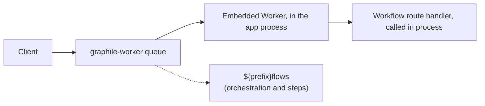

# How PostgreSQL World Works

This document explains the architecture and components of the PostgreSQL world implementation for workflow management.

This implementation is using [Drizzle Schema](./src/drizzle/schema.ts) that can be pushed or migrated into your PostgreSQL schema and backed by [node-postgres](https://node-postgres.com/) (`pg`). `createWorld` uses a single `pg.Pool` for Drizzle and graphile-worker (via `pgPool`), and a dedicated `pg.Client` for LISTEN/NOTIFY derived from the same connection options. You may pass your own pool to share query connections with application code.

If you want to use any other ORM, query builder or underlying database client, you should be able to fork this implementation and replace the Drizzle parts with your own.

## Job Queue System

Jobs include retry logic, idempotency keys, durable delayed rescheduling, and configurable worker concurrency (default: 50).

## Streaming

Real-time data streaming via **PostgreSQL LISTEN/NOTIFY**:

- Stream chunks stored in `workflow_stream_chunks` table
- `pg_notify` triggers sent on writes to `workflow_event_chunk` topic
- Subscribers receive notifications and fetch chunk data
- ULID-based ordering ensures correct sequence
- One long-lived dedicated `LISTEN` client, with an in-process EventEmitter for distributing events to multiple subscribers

## Setup

`world.start()` makes the World ready to enqueue, and starts a graphile-worker runner when the process is a worker: one that registered the Workflow SDK's flow route with `world.registerHandler(prefix, route)`. The framework integrations do that when the app starts (`registerWorkflowHandler()` from `workflow/runtime`, see the Postgres World docs), in either order with `start()`: a registration after `start()` starts the runner then. Every other process (the CLI, the web UI, a script) only enqueues and never claims a job.

When a job arrives, the worker calls the registered route's in-process entry (`IN_PROCESS_QUEUE_HANDLER` from `@workflow/world`) with the decoded message and its metadata, and awaits the runtime's handler before acknowledging the Graphile job. Nothing goes over HTTP, and the flow route refuses HTTP requests (`queueAuthMode: 'deny'`; see [Security](./README.md#security)). The HTTP shape of a delivery (`src/queue-handler.ts`) remains for a consumer's own route (`registerRoute`), and for the flow route while `WORKFLOW_QUEUE_AUTH=off` admits a worker on an earlier release; it reads the current delivery headers and the earlier release's `x-vqs-*` names.

When the runtime returns `{ timeoutSeconds }`, the worker schedules a new Graphile job with a future `runAt` time before finishing the current task.

## Crash recovery

graphile-worker 0.16 sets a job's `locked_at` once, when a worker claims it, and only resets locks older than a fixed 4 hours. On its own, a worker that dies mid-delivery would keep its job locked for 4 hours, and a healthy delivery that runs longer than that would be reset and delivered twice.

Unless `jobLockStaleSeconds` is `0`, the queue renews the lock of every delivery it is running (`src/job-lease.ts`): one batched `UPDATE` of `graphile_worker._private_jobs.locked_at`, and of the job's named queue in `_private_job_queues` (invoke mode's per-run executor queue), fenced on the worker that claimed it, every quarter of `jobLockStaleSeconds` and at least every 10 seconds. Every process with a running Graphile runner also runs Graphile Worker's own stale-lock reset with that window, scoped to this World's task identifiers so that other applications sharing the `graphile_worker` schema keep their locks. Both statements use the database clock.

What the reset covers depends on the policy (`resolveJobLeasePolicy`):

- `jobLockStaleSeconds` unset (the default): a 300 second window, and only jobs in this World's per-run named queues (`<prefix>flows:<runId>:executor`, a spec 9 run's orchestrator deliveries and invoke mode's executor lane) whose `locked_by` is in `workflow.workflow_job_lock_holders`. A worker registers there before its first delivery, again every hour, and on a renewal tick if that failed. A process on an earlier version (5.1.0 renews only with the window set) never registers, so its long deliveries are not released under it and its unfenced acknowledgement cannot delete a redelivery's row. Rows of workers that hold no job and have not registered for a day are deleted by the sweep, at most once an hour. A missing table (migration 0030 not applied) is logged once; deliveries and renewal do not depend on it.
- `jobLockStaleSeconds` above `0`: that window, and every job of this World's tasks, whoever holds it.
- `0`: no renewal and no reset.

A renewal that no longer finds its job means the job was released for redelivery. The delivery then fails instead of completing when it finishes: Graphile Worker completes a job with a delete that is not fenced on the lock holder, so completing could delete a successor's row, whereas failing is fenced and changes nothing. If no renewal has shown the lock to be held within half the window, the delivery renews once more before it completes. After a failed renewal or release (a database outage), a process's next release only checks that the database is back, so that holders can renew before their jobs are released.

Releasing every job is opt-in because of rolling upgrades: a process on an earlier version neither renews its locks nor fences its acknowledgement, so releasing its jobs while it shares the database could delete the redelivered job of one of its long deliveries. The default's holder registration exists for that reason. The README's [Crash recovery](./README.md#crash-recovery) section covers setting it.

## Shutdown

`world.close()` first stops Graphile Worker from claiming new jobs, then waits for active jobs before closing the streamer and any internally owned pool.

Graphile Worker gives active tasks a grace period, then aborts their task signal. The Postgres world stops waiting on the in-process delivery when that signal aborts (the runtime's handler finishes on its own), so Graphile Worker unlocks the same Postgres job row through its normal failure handling. The already-claimed delivery consumes an attempt and is retried only if its Graphile attempt budget remains; the shutdown handler does not insert a successor row.

Applications that manage a broader shutdown sequence should set `WORKFLOW_POSTGRES_APPLICATION_MANAGED_SHUTDOWN=1` for the standard package target or `applicationManagedShutdown: true` for a programmatic World, await `world.close()`, and only then close the workflow HTTP routes and any caller-owned pool. This prevents Graphile Worker's default handler from terminating the process as soon as its queue stops. Because aborting a client request does not prove that its server handler stopped, workflow and step handlers still need to tolerate at-least-once execution.
