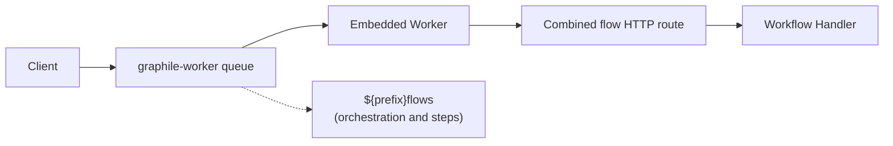

# How PostgreSQL World Works

This document explains the architecture and components of the PostgreSQL world implementation for workflow management.

This implementation is using [Drizzle Schema](./src/drizzle/schema.ts) that can be pushed or migrated into your PostgreSQL schema and backed by [node-postgres](https://node-postgres.com/) (`pg`). `createWorld` uses a single `pg.Pool` for Drizzle and graphile-worker (via `pgPool`), and a dedicated `pg.Client` for LISTEN/NOTIFY derived from the same connection options. You may pass your own pool to share query connections with application code.

If you want to use any other ORM, query builder or underlying database client, you should be able to fork this implementation and replace the Drizzle parts with your own.

## Job Queue System



Jobs include retry logic (3 attempts), idempotency keys, durable delayed rescheduling, and configurable worker concurrency (default: 10).

## Streaming

Real-time data streaming via **PostgreSQL LISTEN/NOTIFY**:

- Stream chunks stored in `workflow_stream_chunks` table
- `pg_notify` triggers sent on writes to `workflow_event_chunk` topic
- Subscribers receive notifications and fetch chunk data
- ULID-based ordering ensures correct sequence
- One long-lived dedicated `LISTEN` client, with an in-process EventEmitter for distributing events to multiple subscribers

## Spec 9 runs

### Live event feed

`events.subscribe` (`src/run-events.ts`) is the live feed a spec 9 orchestrator listens on while it runs inline steps or lingers:

- After a spec 9 event write commits, the writer sends `pg_notify('workflow_run_events', runId)` for every spec 9 run it committed an event to, outside the write's transaction and without awaiting it, like the run-terminal `NOTIFY`. A `NOTIFY` inside the transaction could fail the write itself. A forced `hook_created` also announces the run it took the token from, whose log got `hook_disposed{forceClaimedBy}` in the same transaction.
- A subscription listens on one shared `LISTEN` connection per process. For each announcement of its run it reads the log after the last slot it delivered (`events.list` with `resolveData: 'all'`) and delivers what continues the slot sequence, each slot once. It stops at a hole (a position not committed yet) until a later announcement fills it. The notification is a signal only, so a duplicated or merged `NOTIFY` changes nothing.
- A dropped `LISTEN` connection ends every live subscription through `onError`, and so does a failed read; the runtime falls back to its log-tail poll. The connection reconnects for later subscriptions.
- A subscription ends (`onError`) at a hook resume another writer made with `resumeHook()` (a `hook_received` with a `resumeId`) instead of delivering it. The resume's wake carries its producer's timing (`hookResumeTiming`), where the runtime starts its hook-resume latency measurement; a delivery that picked the resume up from the feed would consume it without that timing. With the feed ended, a delivery that is only waiting stops lingering and acknowledges, and the wake (delivered, or coalesced into that delivery's re-run) consumes the resume and measures it. The workflow's own `hook_received` (an `AbortController` abort) carries no `resumeId` and is delivered.
- A subscription past half of the process's `queueConcurrency` (rounded down, so none at `queueConcurrency: 1`) is refused through `onError`. While its feed is live, an orchestrator with nothing left to run lingers on it, holding its worker slot, so the cap keeps lingering deliveries from taking every slot while their own background steps wait for one.

### Serializing a run's deliveries: run leases

A spec 9 run's orchestrator deliveries, and invoke mode's executor deliveries, never overlap across workers and processes: each takes the run's delivery lease before it calls the handler (`src/run-lease.ts`). The in-band fence in storage is the other half of the single-writer guarantee. Step messages, health checks and the messages of earlier runs take no lease.

The lease is a row in `workflow.workflow_run_delivery_leases` (migration 0031) that exists only while a delivery drives the run. It names the Graphile job that owns it, and is live while that job exists and can still run: locked, or unlocked with attempts left. So a crashed holder's redelivery, the same job, takes its lease back, and the lease needs no expiry or renewal of its own. A job that completed without releasing, or used its last attempt, no longer owns it, and the next delivery takes it over.

A delivery that finds the lease live leaves its message on the row and completes without calling the handler:

- **Wake.** An orchestrator message a later delivery covers, because every producer commits what it is for (a step outcome, a `hook_received`, a cancellation) before it sends it, and a delivery reads the log. The row keeps one. A wake carrying a hook resume's timing (`hookResumeTiming`) replaces one without; later wakes are dropped.
- **Deferred.** A message no later delivery covers: a start message carrying `runInput` (its `run_created` may not be committed yet), a legacy resume carrying `hookInput`, and every executor delivery. The row keeps them all, in order.

When the owner's delivery acknowledges, it takes the wake left on the row, if any, and calls the handler again with the next `deliveryCount`, the same `attempt` and the same `invocationStartedAt`. It repeats while it finds one, up to `MAX_COALESCED_RERUNS` (32). A re-run's body is the delivery's own message with the `hookResumeTiming` (and trace context) of the wake it took, and never its own timing again, so a coalesced resume's latency is measured once, by the re-run that consumes it (`rerunBody`). Coalescing is not used on invoke mode's executor lane, whose deliveries also drive the run's invocation mailbox.

Releasing deletes the row and re-adds as jobs whatever is still left on it (the deferred messages, and a wake past the re-run cap), in one transaction, so nothing left for the owner is lost between the two. A delivery that reschedules (`{ timeoutSeconds: n > 0 }`) or fails releases too. A handoff (`{ timeoutSeconds: 0 }`) instead passes the lease, with what is left on it, to its continuation's job, so the run's other deliveries keep waiting for the continuation rather than starting between the two. The continuation's job also gets priority `-1` (Graphile takes the lowest priority first, then the earliest `run_at`).

Each lease operation is one primary-key row statement, and a release with nothing left on it is a single `DELETE`. Graphile named queues, which earlier versions used for this, cost more as runs accumulated: Graphile never deletes a named queue's row, and its `get_job` locks every available queue row on each poll.

A wake is coalesced only once a worker has picked its job up and found the lease held. A wake still waiting for a worker when the owner releases is delivered on its own, which is equally correct.

If the table is missing (migration 0031 not applied), the lease is skipped with one warning, and a run's deliveries are not serialized; the in-band fence still refuses an overlapping delivery's writes. Invoke mode's executor admission requires the table.

### Unstamped orchestrator messages

An orchestrator message without a spec stamp (`runInput.specVersion`, `runContext.specVersion` or `runSpecVersion`) does not say it needs the run's lease. When a worker takes one, it reads the run's `spec_version`; for a spec 9 run it re-adds the message stamped with that version, carrying its attempt and delivery counts, and completes the original job without delivering it. The stamped job takes the run's lease when it runs.

## Setup

Call `world.start()` to initialize graphile-worker workers. When `.start()` is called, workers begin listening to graphile-worker queues. When a job arrives, the worker executes the queue message over the workflow HTTP routes and awaits completion before acknowledging the Graphile job.

When the runtime returns `{ timeoutSeconds }`, the worker schedules a new Graphile job with a future `runAt` time before finishing the current task.

The worker sends workflow orchestration and queued step messages to the combined `.well-known/workflow/v1/flow` endpoint.

That endpoint is not authenticated: the queue HTTP handler is inherited from `@workflow/world-local` and checks the `x-vqs-*` header shape and the queue-name prefix, but never the caller, so restricting the route is left to the deployment. The payload is validated later, by the runtime that consumes the message. See [Security](./README.md#security).

In **Next.js**, the `world.start()` call needs to be added to `instrumentation.ts|js` to ensure workers start before request handling. Use `workflow/runtime` for `getWorld` (same as the testing server and other framework plugins):

```ts
// instrumentation.ts

if (process.env.NEXT_RUNTIME !== "edge") {
  import("workflow/runtime").then(async ({ getWorld }) => {
    // start listening to the jobs.
    const world = await getWorld();
    await world.start?.();
  });
}
```

## Crash recovery

graphile-worker 0.16 sets a job's `locked_at` once, when a worker claims it, and only resets locks older than a fixed 4 hours. On its own, a worker that dies mid-delivery would keep its job locked for 4 hours, and a healthy delivery that runs longer than that would be reset and delivered twice.

Unless `jobLockStaleSeconds` is `0`, the queue renews the lock of every delivery it is running (`src/job-lease.ts`): one batched `UPDATE` of `graphile_worker._private_jobs.locked_at`, and of the job's named queue in `_private_job_queues` (for a job an earlier version put in a per-run named queue), fenced on the worker that claimed it, every quarter of `jobLockStaleSeconds` and at least every 10 seconds. Every process with a running Graphile runner also runs Graphile Worker's own stale-lock reset with that window, scoped to this World's task identifiers so that other applications sharing the `graphile_worker` schema keep their locks. Both statements use the database clock.

What the reset covers depends on the policy (`resolveJobLeasePolicy`):

- `jobLockStaleSeconds` unset (the default): a 300 second window, and only jobs of this World's tasks that own a run's delivery lease (a spec 9 run's orchestrator deliveries and invoke mode's executor lane; see [Serializing a run's deliveries](#serializing-a-runs-deliveries-run-leases)) whose `locked_by` is in `workflow.workflow_job_lock_holders`. A worker registers there before its first delivery, again every hour, and on a renewal tick if that failed. A process on an earlier version (5.1.0 renews only with the window set) never registers, so its long deliveries are not released under it and its unfenced acknowledgement cannot delete a redelivery's row. Rows of workers that hold no job and have not registered for a day are deleted by the sweep, at most once an hour. A missing table (migration 0030 or 0031 not applied) is logged once; deliveries and renewal do not depend on it.
- `jobLockStaleSeconds` above `0`: that window, and every job of this World's tasks, whoever holds it.
- `0`: no renewal and no reset.

A renewal that no longer finds its job means the job was released for redelivery. The delivery then fails instead of completing when it finishes: Graphile Worker completes a job with a delete that is not fenced on the lock holder, so completing could delete a successor's row, whereas failing is fenced and changes nothing. If no renewal has shown the lock to be held within half the window, the delivery renews once more before it completes. After a failed renewal or release (a database outage), a process's next release only checks that the database is back, so that holders can renew before their jobs are released.

Releasing every job is opt-in because of rolling upgrades: a process on an earlier version neither renews its locks nor fences its acknowledgement, so releasing its jobs while it shares the database could delete the redelivered job of one of its long deliveries. The default's holder registration exists for that reason. The README's [Crash recovery](./README.md#crash-recovery) section covers setting it.

## Shutdown

`world.close()` first stops Graphile Worker from claiming new jobs, then waits for active jobs before closing the streamer and any internally owned pool.

Graphile Worker gives active tasks a grace period, then aborts their task signal. The Postgres world forwards that signal to both the workflow HTTP request and its response body. If the request aborts, Graphile Worker unlocks the same Postgres job row through its normal failure handling. The already-claimed delivery consumes an attempt and is retried only if its Graphile attempt budget remains; the shutdown handler does not insert a successor row.

Applications that manage a broader shutdown sequence should set `WORKFLOW_POSTGRES_APPLICATION_MANAGED_SHUTDOWN=1` for the standard package target or `applicationManagedShutdown: true` for a programmatic World, await `world.close()`, and only then close the workflow HTTP routes and any caller-owned pool. This prevents Graphile Worker's default handler from terminating the process as soon as its queue stops. Because aborting a client request does not prove that its server handler stopped, workflow and step handlers still need to tolerate at-least-once execution.
